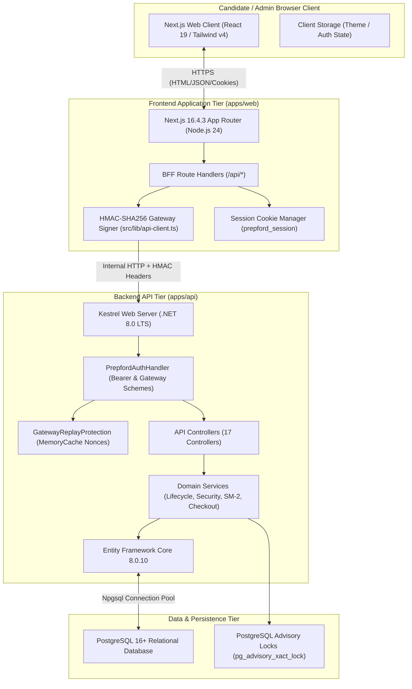
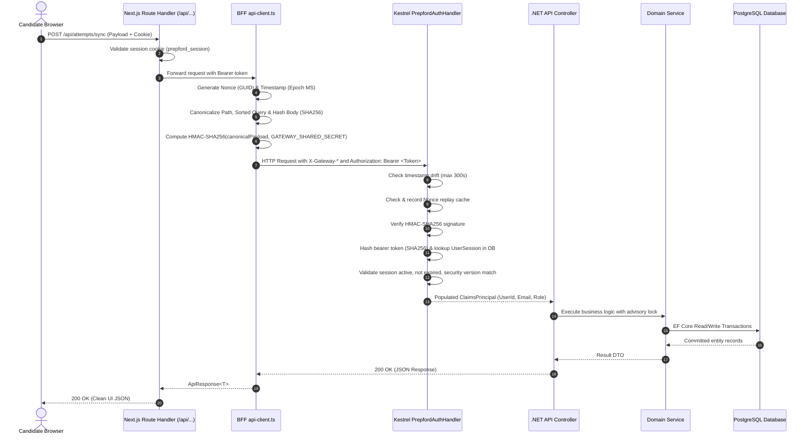
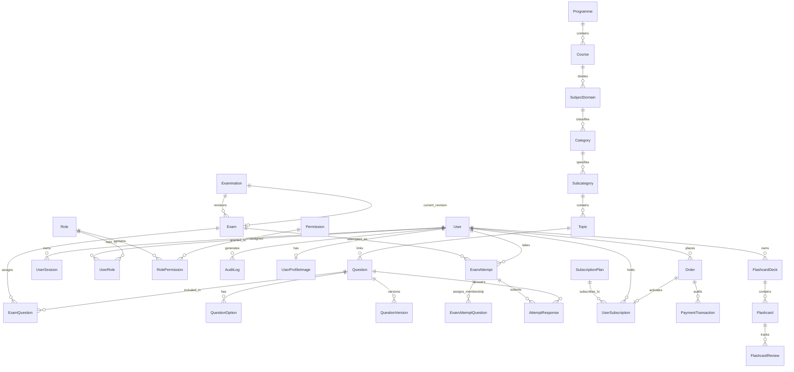

# PREPFORD NCLEX — FEATURE EXPANSION PROGRAMME
## EXISTING ARCHITECTURE MAP & SHARED MODULE DEPENDENCY BLUEPRINT

**Deliverable 2 of 7: Architecture & Dependency Map**  
**Document File:** `PREPFORD_EXISTING_ARCHITECTURE_MAP.md`  
**Repository Working Directory:** `C:\Users\gitau\Documents\PREform`  
**Branch:** `feature/dotnet-backend-migration`  
**Commit Hash (HEAD):** `7c7647e412bcfecf9d42e10f37eefdf90c39bc90`  
**Target Framework:** ASP.NET Core 8.0 (`net8.0`) | Next.js 16.4.3 App Router  
**Authority:** Product Owner  
**Date:** November 5, 2026  

---

## 1. System Topology & Tier Architecture

PrepFord utilizes a decoupled **BFF (Backend-for-Frontend) + Headless API** architecture deployed over modern Linux container infrastructure and relational PostgreSQL:

---

## 2. Request Lifecycle & HMAC Gateway Authentication

Every server-to-server request between the Next.js BFF and the .NET Web API is cryptographically signed and authenticated to prevent direct API bypass or unauthorized internal calling.

---

## 3. High-Level Domain Entity Architecture

The PrepFord domain model is structured into six cohesive relational sub-graphs within `apps/api/Data/AppDbContext.cs`:

---

## 4. Shared Architecture & Anti-Duplication Principles

To preserve the stability of the existing platform during the expansion programme, all newly introduced modules MUST reuse existing shared architectural components rather than inventing parallel mechanisms.

### 4.1 Anti-Duplication Directives

| Domain | Canonical Existing Implementation | Anti-Duplication Strict Rule |
|---|---|---|
| **Question Bank** | Table `Questions`, `QuestionOptions`, `QuestionTypeDefinitions` | **DO NOT** create a separate table for AI questions or practice questions. All items must share `Questions` table with proper `QuestionTypeKey` and `Status`. |
| **Curriculum Taxonomy** | Tables `Courses`, `SubjectDomains`, `Categories`, `Subcategories`, `Topics` | **DO NOT** hardcode category trees in frontend files. Connect existing `study-guide-data.ts` to backend taxonomy. |
| **Client Needs** | Currently in `NCLEX_CLIENT_NEEDS` array in `assessment-store.ts` | Normalize Client Needs into `SubjectDomains` or dedicated lookup table; do NOT create competing domain strings. |
| **Examinations** | Tables `Examinations` (Stable family) and `Exams` (Revisions) | **DO NOT** create parallel tables for RAT or Tutored CAT. Standardize RATs as `Exam` records with `ExamType.DiagnosticReadiness`. |
| **Learner Attempts** | Table `ExamAttempts`, `ExamAttemptQuestions`, `AttemptResponses` | All learner tests (RAT, CAT, practice) must write to `ExamAttempts`. Do NOT introduce separate RAT attempt tables. |
| **Subscription Catalog** | Table `SubscriptionPlans` (12 canonical plans seeded via `CatalogSeeder`) | **DO NOT** introduce a second commerce engine. All new plans or tier modifications must modify `SubscriptionPlans`. |
| **Entitlements** | Table `UserSubscriptions` queried via `ICheckoutService.GetUserEntitlementsAsync` | Entitlement checks across dashboard, examinations, and studio must query `/api/v1/entitlements`. |
| **Flashcards & Reviews** | Tables `FlashcardDecks`, `Flashcards`, `FlashcardReviews` | All decks (manual, guide-derived, AI-generated) must live in `FlashcardDecks`. Spaced repetition must use existing SM-2 `SpacedRepetitionService`. |
| **AI Materials** | Study Studio models in `apps/api/Models/Study.cs` | Generated learning summaries or study notes must integrate into `Topic` notes or personal study entities tied to `UserId`. |
| **Audit Logs** | Table `AuditLogs` | All new security, admin, billing, and exam events must write to `AuditLogs` via `AppDbContext.AuditLogs.Add()`. |

---

## 5. Architectural Dependency Mapping for Expansion Modules

The proposed expansion introduces new capabilities across Examination Management, Study Studio, Monetization, and RBAC. The dependency map below illustrates how these new components bind cleanly to existing services:

```mermaid
graph TD
    subgraph ExistingFoundations ["Existing Core Foundations"]
        AppDbContext["AppDbContext (PostgreSQL / EF Core)"]
        AuditLogging["AuditLog System"]
        AuthHandler["PrepfordAuthHandler & SessionSecurityService"]
        ExamLifecycle["ExamLifecycleService & Concurrency Engine"]
        SM2Service["SpacedRepetitionService (SM-2)"]
        CheckoutEngine["CheckoutService & Canonical Plans"]
    end

    subgraph ExpandedModules ["New & Expanded Capabilities"]
        QuestionBankAdmin["Question Bank Authoring & Review Admin"]
        TaxonomyManager["Course / Subject / Client Needs Taxonomy Admin"]
        DecoupledRAT["Decoupled Server-Backed RAT & CAT Generator"]
        ExamRunner["Full-Width Dedicated Assessment Taking Client"]
        AIStudioEngine["AI Study Studio Engine (PDF / Summaries / Tutor)"]
        SubscriptionAdmin["Manual Subscription & Promotional Admin"]
        UserRoleAdmin["User & RBAC Role Management Admin"]
        PasswordRecovery["Self-Service Password Reset (Forgot Password)"]
        SecurityGateway["Trusted Proxy & RFC 7807 Exception Pipeline"]
    end

    QuestionBankAdmin -->|"Reuses Questions, Options, Types"| AppDbContext
    QuestionBankAdmin -->|"Audits Changes"| AuditLogging
    QuestionBankAdmin -->|"Requires RequireContentManager"| AuthHandler

    TaxonomyManager -->|"Reuses Courses, SubjectDomains, Topics"| AppDbContext
    TaxonomyManager -->|"Audits Changes"| AuditLogging

    DecoupledRAT -->|"Builds on"| ExamLifecycle
    DecoupledRAT -->|"Generates"| AppDbContext
    DecoupledRAT -->|"Entitlement Gated"| CheckoutEngine

    ExamRunner -->|"Submits to ExamAttempts & Responses"| AppDbContext
    ExamRunner -->|"Maintains In-Exam Reauth"| AuthHandler

    AIStudioEngine -->|"Creates Decks & Cards"| AppDbContext
    AIStudioEngine -->|"Schedules via"| SM2Service
    AIStudioEngine -->|"Audits Generation"| AuditLogging

    SubscriptionAdmin -->|"Extends UserSubscriptions & Plans"| CheckoutEngine
    SubscriptionAdmin -->|"Audits Grants"| AuditLogging
    SubscriptionAdmin -->|"Requires RequireAdmin"| AuthHandler

    UserRoleAdmin -->|"Assigns UserRoles"| AppDbContext
    UserRoleAdmin -->|"Invalidates Sessions on Role Change"| AuthHandler
    UserRoleAdmin -->|"Requires RequireSuperAdmin"| AuthHandler

    PasswordRecovery -->|"Resets PasswordHash & SecurityVersion"| AppDbContext
    PasswordRecovery -->|"Revokes Stale Sessions"| AuthHandler

    SecurityGateway -->|"Protects"| AuthHandler
```

---

## 6. Frontend Shell & Navigation Integration

The frontend user experience is divided into three distinct operational shells:
1. **Public Site Shell (`apps/web/src/components/layout/public-header.tsx`, `public-footer.tsx`):**
   - Renders across all public marketing routes (`/`, `/nclex-rn`, `/nclex-pn`, `/courses`, `/subscriptions`, `/about`, `/faq`, `/contact`, `/testimonials`).
   - Automatically hides itself when candidate navigates to `/dashboard` or when admin navigates to `/admin`.
2. **Learner Dashboard Shell (`apps/web/src/components/learner/learner-dashboard-shell.tsx`):**
   - Provides fixed left sidebar with pathway badge, target exam date countdown, primary navigation (Dashboard, Assessments, Study Studio, Security Settings), and collapsed mode.
   - Contains child layouts: `/dashboard/study/layout.tsx` which wraps `study-studio-shell.tsx`.
3. **Admin Studio Shell (`apps/web/src/components/admin/admin-shell.tsx`):**
   - Provides administrative header with quick command menu (`admin-command-menu.tsx`), route breadcrumbs, live session indicators, and dedicated admin navigation.
   - Preserves instant navigation segment retention (`AdminShell` hidden children pattern) to prevent segment unmounting during tab switching.

---

## 7. Operational & Deployment Architecture

- **Web Server Pipeline:**
  - Next.js Web App runs in production mode on Node.js 24 LTS, exposing port 3000.
  - ASP.NET Core 8 Web API runs on Kestrel behind internal network boundary on port 4000.
  - PostgreSQL 16+ runs on port 5432 with isolated database user `prepford`.
- **Health & Readiness Probes:**
  - `GET /api/v1/health/live`: Fast in-memory liveness probe (returns 200 OK).
  - `GET /api/v1/health/ready`: Relational database readiness probe (`PostgresHealthCheck.cs` verifying database connectivity via `SELECT 1`).
- **Environment Isolation:**
  - Development: Local PostgreSQL 18 with trust authentication.
  - CI: PostgreSQL 16 Alpine container with healthcheck probes in `.github/workflows/ci.yml`.
  - Production / Staging: Strictly enforced non-zero secrets, fail-closed HMAC gateway tokens, and SSL connection strings.
