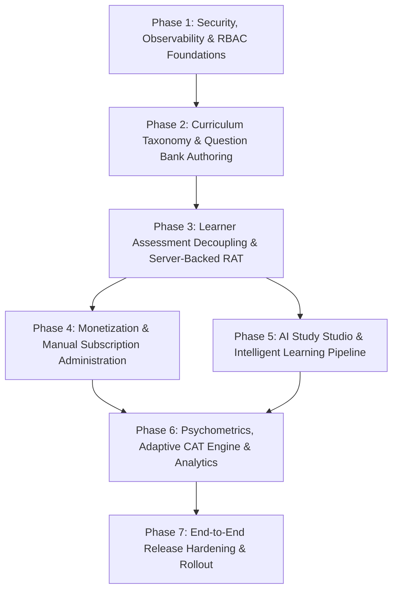

# PREPFORD NCLEX — FEATURE EXPANSION PROGRAMME
## PHASED IMPLEMENTATION ROADMAP & ENGINEERING BLUEPRINT

**Deliverable 7 of 7: Implementation Roadmap**  
**Document File:** `PREPFORD_IMPLEMENTATION_ROADMAP.md`  
**Repository Working Directory:** `C:\Users\gitau\Documents\PREform`  
**Branch:** `feature/dotnet-backend-migration`  
**Commit Hash (HEAD):** `7c7647e412bcfecf9d42e10f37eefdf90c39bc90`  
**Authority:** Product Owner  
**Date:** November 5, 2026  

---

## 1. Executive Implementation Strategy

The PrepFord Feature Expansion Programme must expand system capabilities while strictly preserving proven, functioning production modules. The roadmap is designed around **7 sequential, gated engineering phases**:



### Strategic Non-Negotiables:
1. **Zero Database Drops:** All database modifications must use additive EF Core migrations.
2. **Backward-Compatible Contracts:** Existing endpoints (e.g. `/api/v1/attempts/sync`) must remain intact to support in-flight attempts and historical data.
3. **Additive Gateway Signing:** All new BFF routes must implement HMAC-SHA256 request signing using `src/lib/api-client.ts`.
4. **Isolated Verification Gates:** No phase may begin execution until the preceding phase has satisfied all acceptance tests and received Product Owner sign-off.

---

## 2. Phase-by-Phase Implementation Blueprint

---

### Phase 1: Security, Observability & RBAC Core Foundations

**Primary Focus:** Eliminate perimeter vulnerabilities, establish structured error handling, introduce administrative user management, and provide self-service password reset.

#### 1.1 Scope & Technical Deliverables
- **Trusted Proxy Hardening:**
  - Configure `app.UseForwardedHeaders()` with `KnownNetworks` and `KnownProxies` matching the BFF container/ingress to prevent spoofed `X-Forwarded-For` headers.
- **Global RFC 7807 Exception Pipeline:**
  - Add `app.UseExceptionHandler()` in `Program.cs` returning standard `ProblemDetails` with unique correlation identifiers and sanitized production error messages.
- **Correlation ID Middleware:**
  - Attach `X-Correlation-ID` header across Next.js BFF and ASP.NET Core API; propagate correlation ID into Serilog / `ILogger.BeginScope`.
- **Self-Service Password Reset (Forgot Password):**
  - Add additive migration `AddPasswordResetTokens` (`Id`, `UserId`, `TokenHash`, `ExpiresAt`, `UsedAt`).
  - Create `POST /api/v1/auth/forgot-password` (rate-limited, issues hashed single-use token, triggers transactional email).
  - Create `POST /api/v1/auth/reset-password` (verifies token, updates password hash, increments `User.SecurityVersion`, revokes active sessions).
  - Update `apps/web/src/app/sign-in/page-client.tsx` to replace placeholder modal with live recovery flow.
- **Administrative User & Role Management:**
  - Expose `AdminUsersController.cs` (`RequireSuperAdmin`):
    - `GET /api/v1/admin/users`: Search and paginate platform users.
    - `POST /api/v1/admin/users/{userId}/roles`: Assign canonical roles (`admin`, `exam_manager`, `content_manager`, `reviewer`, `instructor`).
    - `DELETE /api/v1/admin/users/{userId}/roles/{roleId}`: Revoke role.
    - Automatic session invalidation: Increment `User.SecurityVersion` upon role changes to force session reauthentication with new privileges.
  - Implement `/admin/users` frontend page in `AdminShell`.
- **IP & User Access Rules (Blocklist / Allowlist):**
  - Add additive migration `AddIpAccessRules` (`Id`, `IpAddressOrCidr`, `RuleType` [Allow/Block], `Reason`, `ExpiresAt`).
  - Add `IpFilteringMiddleware.cs` in backend request pipeline.
- **Admin Audit Trail Viewer:**
  - Expose `GET /api/v1/admin/audit-logs` in `AdminSecurityController.cs`.
  - Implement `/admin/audit-logs` frontend page in `AdminShell` to resolve the dead navigation link.

#### 1.2 Verification & Acceptance Criteria
- [ ] Attempting to spoof `X-Forwarded-For` from an untrusted client does not alter the logged client IP.
- [ ] Unhandled backend exceptions return valid RFC 7807 `application/problem+json` with an active `traceId`.
- [ ] Full password reset workflow passes: request $\rightarrow$ token generation $\rightarrow$ password update $\rightarrow$ old session revocation $\rightarrow$ successful login with new password.
- [ ] Superadmin can promote a candidate to `exam_manager`, and the user's active session is invalidated and refreshed with elevated privileges.
- [ ] Blocklisted IP addresses receive immediate `403 Forbidden` at Kestrel perimeter.
- [ ] Automated tests: Minimum 25 new unit & integration tests covering password reset, role assignment, and proxy headers.

---

### Phase 2: Curriculum Taxonomy & Question Bank Authoring

**Primary Focus:** Activate dormant curriculum tables, expose question bank authoring API, and build an administrative question creation and review studio.

#### 2.1 Scope & Technical Deliverables
- **Curriculum Taxonomy API & Admin:**
  - Activate `Courses`, `SubjectDomains`, `Categories`, `Subcategories`, and `Topics` tables.
  - Create `CurriculumController.cs` (`RequireContentManager`):
    - Endpoints for hierarchical domain navigation and editing.
  - Seed canonical 8 NCSBN Client Needs domains into `SubjectDomains`.
  - Implement `/admin/curriculum` taxonomy explorer in `AdminShell`.
  - Connect static `study-guide-data.ts` to backend `Topics` table via backward-compatible API adapter.
- **Question Bank CRUD Controller (`QuestionsController.cs`):**
  - Implement `POST /api/v1/questions`: Author draft question with stem, instructions, difficulty, and pathway.
  - Implement `GET /api/v1/questions`: Paginated search by pathway, topic, question type, and status.
  - Implement `GET /api/v1/questions/{id}`: Detailed view including options and rationales.
  - Implement `PUT /api/v1/questions/{id}`: Update draft question, automatically capturing version snapshot in `QuestionVersions`.
  - Implement `POST /api/v1/questions/{id}/submit-review`: Transition `Draft` $\rightarrow$ `InReview`.
  - Implement `POST /api/v1/questions/{id}/approve`: Transition `InReview` $\rightarrow$ `Approved` (Enforces `RequireContentManager`).
  - Implement `POST /api/v1/questions/{id}/archive`: Soft-delete question.
- **Admin Question Authoring Studio (`/admin/questions`):**
  - Build full-featured question editor in `AdminShell`:
    - Markdown / Rich-text stem editor with preview.
    - Clinical scenario vignette & exhibits tab (labs, vitals, provider notes).
    - Dynamic option list with correct answer toggles, option-specific rationales, and distractor rationales.
    - Client Needs domain and topic selectors.
    - Question type picker supporting all 7 Traditional types + contract preview for NGN types.

#### 2.2 Verification & Acceptance Criteria
- [ ] Questions can be authored, reviewed, and approved via API and UI.
- [ ] Updating an approved question increments `Version` and creates an immutable snapshot in `QuestionVersions`.
- [ ] Question options require at least one correct key for single-choice and multiple-choice before submission.
- [ ] Questions marked `Approved` or `Published` immediately appear in the examination picker dialog (`question-picker-dialog.tsx`).
- [ ] Automated tests: Minimum 30 new tests covering question validation, versioning, and state transitions.

---

### Phase 3: Learner Assessment Decoupling & Server-Backed RAT

**Primary Focus:** Decouple test creation and execution from `dashboard/page-client.tsx` into dedicated, distraction-free assessment routes connected to real server-side examinations.

#### 3.1 Scope & Technical Deliverables
- **Dynamic Assessment Generator Service (`AssessmentGenerationService.cs`):**
  - Generates custom standalone practice tests and RATs based on learner-selected parameters:
    - Pathway (`rn` / `pn`).
    - Test Type (`tutored_cat` with immediate rationales or `rat` with delayed post-exam scoring).
    - Question Count (10, 25, 50, 75, or 100 questions).
    - Target Domains (all domains or selected NCSBN Client Needs categories).
    - Question Inclusion Mode: Unused questions only, incorrect questions only, or mixed.
  - Creates a dedicated `Exam` record with `ExamType.DiagnosticReadiness` or `ExamType.Practice`, populating `ExamQuestions` randomly from approved question pool.
- **Dedicated Assessment Routes:**
  - Create `/dashboard/assessments/new`: Dedicated configuration wizard replacing the modal dialog.
  - Create `/dashboard/assessments/[id]`: Full-screen, distraction-free test delivery interface:
    - Maintains cognitive fatigue relievers (calm timer, scratchpad, collapsible rationales).
    - Integrates `InExamReauthModal` to protect against token expiry.
    - Submits question answers in real time to `POST /api/v1/attempts/{id}/responses`.
  - Create `/dashboard/assessments/[id]/report`: Diagnostic performance report displaying:
    - Overall score percentage and standard PrepFord 4-tier readiness badge (`Very High`, `High`, `Borderline`, `Low`).
    - NCSBN Client Needs domain-by-domain accuracy radar/bar chart.
    - Peer cohort benchmark comparisons.
  - Create `/dashboard/assessments/[id]/review`: Question-by-question review with comprehensive rationales.
- **Backward Compatibility Guarantee:**
  - Preserve `POST /api/v1/attempts/sync` in `ExamAttemptsController.cs` so any client-cached legacy attempts sync without error.

#### 3.2 Verification & Acceptance Criteria
- [ ] Generating a 50-question RAT creates a valid server `Exam` and `ExamAttempt` with assigned `ExamAttemptQuestions`.
- [ ] In-progress attempt securely withholds correct answers and rationales from API payload until final submission.
- [ ] Submitting completed exam calculates accurate 4-tier readiness classification and updates learner dashboard metrics.
- [ ] In-exam reauthentication works seamlessly without resetting exam timer or losing entered responses.
- [ ] Automated tests: Minimum 25 new tests covering dynamic test generation, real-time response submission, and report rendering.

---

### Phase 4: Monetization & Manual Entitlement Administration

**Primary Focus:** Equip administrators with full lifecycle control over learner subscriptions, complimentary access, and promotional passes.

#### 4.1 Scope & Technical Deliverables
- **Manual Subscription Administration API (`AdminUserSubscriptionsController.cs`):**
  - Implement `GET /api/v1/admin/users/{userId}/subscriptions`: View candidate subscription history and active passes.
  - Implement `POST /api/v1/admin/users/{userId}/subscriptions/grant` (`RequireAdmin`):
    - Grants complimentary or promotional access for a specified duration (e.g. 7 days, 30 days, 90 days, 365 days).
    - Selects plan or creates custom entitlement override.
    - Records an audit log entry in `AuditLogs` with administrative reason.
  - Implement `POST /api/v1/admin/users/{userId}/subscriptions/{subId}/extend`: Extend expiration date.
  - Implement `POST /api/v1/admin/users/{userId}/subscriptions/{subId}/revoke`: Administratively terminate access.
- **Administrative Subscription & Order Viewer:**
  - Build subscription administration tab in `/admin/subscriptions`:
    - Candidate lookup by email.
    - Active entitlement status badge and quick extension controls.
    - Transaction history log displaying `Orders` and `PaymentTransactions`.
- **Complimentary Code Engine:**
  - Extend `CheckoutService` to support $100\%$ discount administrative voucher codes with zero-dollar checkout auditing.

#### 4.2 Verification & Acceptance Criteria
- [ ] Admin can grant a 30-day NCLEX-RN complimentary pass to a user; user's `/api/v1/entitlements` immediately reflects active access.
- [ ] Extending a subscription by 15 days correctly recalculates `ExpiresAt` in PostgreSQL without changing `StartsAt`.
- [ ] Revoking a subscription immediately denies access to premium assessment generation.
- [ ] Automated tests: Minimum 15 new tests covering manual grants, extensions, and revocation audit logs.

---

### Phase 5: AI Study Studio & Intelligent Learning Pipeline

**Primary Focus:** Build document ingestion, text extraction, LLM provider integration, and AI-driven study tools (summaries, flashcard generation, quiz generation, and AI Tutor).

#### 5.1 Scope & Technical Deliverables
- **Document Ingestion & Text Processing Pipeline:**
  - Create `DocumentIngestionService.cs`:
    - Supports PDF and plain text document uploads (max 15MB).
    - Sanitizes, extracts text, strips PII, and chunks content into semantic tokens.
    - Enforces antivirus and MIME type validation.
- **LLM Provider Abstraction (`IAiCompletionService.cs`):**
  - Pluggable provider architecture supporting OpenAI, Anthropic, and Google Gemini with streaming response support.
  - System prompts strictly grounded in NCSBN clinical guidelines to prevent medical hallucinations.
- **AI-Driven Study Studio Features:**
  - **AI Summaries:** Endpoint `POST /api/v1/study/ai/summarize` generating structured high-yield NCLEX clinical summaries from uploaded documents.
  - **AI Flashcard Generation:** Endpoint `POST /api/v1/study/ai/generate-flashcards`:
    - Generates 10-30 flashcard candidates from uploaded notes.
    - Presents an interactive review screen where the learner approves, edits, or rejects cards before saving to their personal `FlashcardDeck`.
  - **AI Quiz Generation:** Endpoint `POST /api/v1/study/ai/generate-quiz`:
    - Generates 5-10 NCLEX-style questions with plausible distractors and rationales.
  - **Context-Aware AI Tutor:**
    - WebSocket or Server-Sent Events (SSE) streaming chat endpoint `POST /api/v1/study/ai/tutor/chat`.
    - Contextualized to the learner's current topic, weak Client Needs domains, or specific review question.
- **Personal Learning Notes Sync:**
  - Add additive migration `AddLearnerNotes` (`Id`, `UserId`, `TopicId`, `ContentMarkdown`, `CreatedAt`, `UpdatedAt`).
  - Create learner notes editor in study guide pages.

#### 5.2 Verification & Acceptance Criteria
- [ ] Uploading a nursing pharmacology PDF extracts clean text and generates valid flashcards with verified front/back pairs.
- [ ] Learner can edit and accept AI flashcards into a personal deck; accepted cards integrate seamlessly into SM-2 review scheduler.
- [ ] AI Tutor responds via streaming SSE with clinically safe, medically grounded guidance and citations.
- [ ] Automated tests: Minimum 20 tests covering document parsing, prompt safety filters, and deck ingestion.

---

### Phase 6: Psychometric Scoring, Adaptive CAT Engine & Analytics

**Primary Focus:** Upgrade Tutored CAT into a standardized Computer Adaptive Testing engine with calibrated item difficulty, stopping rules, and advanced cohort analytics.

#### 6.1 Scope & Technical Deliverables
- **Item Response Theory (IRT) Question Calibration:**
  - Add additive migration `AddQuestionPsychometrics` to `Questions` table:
    - `DifficultyParameter` ($b$-parameter: $-3.0$ to $+3.0$).
    - `DiscriminationParameter` ($a$-parameter: $0.5$ to $2.5$).
    - `GuessingParameter` ($c$-parameter: typically $0.0$ to $0.25$).
  - Admin UI to inspect and adjust item psychometrics based on empirical response history.
- **Adaptive CAT Selection Engine (`CatEngineService.cs`):**
  - Employs 1-Parameter or 2-Parameter Logistic (2PL) IRT model:
    - Calculates learner ability estimate ($\hat{\theta}$) after each response.
    - Dynamically selects next question matching candidate's current ability level.
    - Evaluates stopping rules: 95% confidence interval pass/fail rule, minimum 85 items, maximum 150 items.
- **Advanced Longitudinal Learning Analytics:**
  - Endpoint `GET /api/v1/analytics/cohort-benchmarks`: Compares learner's domain accuracy against anonymous PrepFord candidate cohort percentiles.
  - Predictive NCLEX passing probability indicator.

#### 6.2 Verification & Acceptance Criteria
- [ ] CAT engine adapts question difficulty upwards following correct responses and downwards following incorrect responses.
- [ ] Stopping rules correctly terminate simulation when candidate ability is conclusively above or below passing standard.
- [ ] Cohort analytics display valid statistical percentiles without leaking candidate PII.
- [ ] Automated tests: Minimum 20 tests verifying IRT formulas, ability updates, and stopping rules.

---

### Phase 7: End-to-End Release Hardening & Rollout Plan

**Primary Focus:** Comprehensive E2E test verification, staging smoke testing, disaster recovery rehearsal, and production rollout.

#### 7.1 Scope & Technical Deliverables
- **Full Test Suite Execution & Regression Gates:**
  - Execute complete backend xUnit suite: Target 100% pass rate (>400 tests).
  - Execute complete frontend Vitest suite: Target 100% pass rate (>500 tests).
  - Run Playwright E2E automation covering all user journeys (Registration $\rightarrow$ Checkout $\rightarrow$ Test Taking $\rightarrow$ Study Studio $\rightarrow$ Admin Management).
  - Run TypeScript compilation (`tsc --noEmit`) and production Next.js build.
- **Staging Deployment & Smoke Testing:**
  - Execute automated migrations against staging PostgreSQL.
  - Verify health probes (`/api/v1/health/live`, `/api/v1/health/ready`).
  - Run staging smoke test runbook validating all 10 standard scenarios.
- **Disaster Recovery & Rollback Drill:**
  - Rehearse multi-tier application rollback and PostgreSQL point-in-time recovery (`pg_restore`).
- **Production Cutover Execution:**
  - Provision production secrets and live payment credentials.
  - Final Product Owner sign-off and release deployment.

---

## 3. Implementation Sequence & Cross-Phase Dependencies

```
Phase 1 (Security & RBAC)
  │
  ├──► Phase 2 (Taxonomy & Question Bank)
  │      │
  │      └──► Phase 3 (Learner Assessment Decoupling)
  │             │
  │             ├──► Phase 4 (Monetization & Admin Grants)
  │             │      │
  │             │      └──► Phase 6 (Psychometrics & Analytics)
  │             │             │
  │             └──► Phase 5 (AI Study Studio) ──┘
  │                                                │
  └────────────────────────────────────────────────┴──► Phase 7 (Release Hardening)
```

---

## 4. Technical Risk Register & Mitigation Strategy

| Risk ID | Identified Technical Risk | Severity | Probability | Concrete Mitigation Strategy |
|:---:|---|:---:|:---:|---|
| **R-01** | Database schema corruption during curriculum expansion. | High | Low | Enforce expand-and-contract migrations. Zero column drops. Dry-run migrations on staging PostgreSQL clone. |
| **R-02** | Test attempt data loss during assessment taking decoupling. | Critical | Low | Maintain existing `POST /api/v1/attempts/sync` endpoint and `ExamAttempts` schema. Decoupled routes use same underlying tables. |
| **R-03** | Medical misinformation or hallucination in AI Study Studio. | Critical | Medium | Ground AI prompts strictly in PrepFord's curated study notes. Mandate human review before AI flashcards are saved. |
| **R-04** | Race conditions during concurrent candidate login or test submission. | High | Low | Preserve PostgreSQL advisory transaction locks (`pg_advisory_xact_lock`) and optimistic concurrency tokens (`ConcurrencyToken`). |
| **R-05** | Unauthorized access to administrative question bank or user management. | Critical | Low | Enforce strict authorization policies (`RequireSuperAdmin`, `RequireAdmin`, `RequireContentManager`) with mutual HMAC-SHA256 gateway signing. |
| **R-06** | Accidental triggering of real payment charges during testing. | High | Low | Enforce `APP_ENV=production` fail-closed check in `CheckoutService`. Keep sandbox checkout active for development and testing. |

---

## 5. Acceptance Checklist for Programme Kickoff

Before starting implementation of Phase 1, ensure:
- [x] Complete repository audit completed and approved by Product Owner.
- [x] Clean Git working tree on `feature/dotnet-backend-migration`.
- [x] Zero uncommitted changes or untested code modifications.
- [x] All 7 deliverable documents authored and verified.
- [ ] Product Owner explicit authorization to begin Phase 1 execution.
