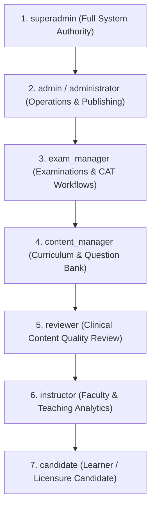

# PREPFORD NCLEX — FEATURE EXPANSION PROGRAMME
## RBAC AND SECURITY GAP ANALYSIS

**Deliverable 5 of 7: Security & RBAC Gap Analysis**  
**Document File:** `PREPFORD_RBAC_AND_SECURITY_GAP_ANALYSIS.md`  
**Repository Working Directory:** `C:\Users\gitau\Documents\PREform`  
**Branch:** `feature/dotnet-backend-migration`  
**Commit Hash (HEAD):** `7c7647e412bcfecf9d42e10f37eefdf90c39bc90`  
**Authority:** Product Owner  
**Date:** November 5, 2026  

---

## 1. Executive Security Baseline

PrepFord handles sensitive educational licensure preparation data, proprietary examination questions, and candidate payment records. Security in PrepFord is designed around zero-trust boundaries:
1. **Perimeter Defense:** The Next.js BFF acts as a reverse proxy, insulating backend Kestrel endpoints from direct browser exposure.
2. **Cryptographic Gateway Mutual Authentication:** The BFF signs every request with HMAC-SHA256 tokens (`X-Gateway-Timestamp`, `X-Gateway-Nonce`, `X-Gateway-Signature`), validated against replay attacks by `GatewayReplayProtection.cs`.
3. **Database-Backed Stateful Sessions:** Authentication is governed by hashed bearer tokens stored in PostgreSQL (`UserSessions.TokenHash`), not stateless JWTs, enabling immediate revocation across all nodes.
4. **PostgreSQL Advisory Locking:** Concurrency-critical session allocations are serialized using PostgreSQL transaction-level advisory locks (`pg_advisory_xact_lock`), eliminating race conditions in concurrent login scenarios.

---

## 2. Authentication Scheme & Session Security Architecture

### 2.1 The `PrepfordAuth` Scheme
The backend registers a custom authentication handler `PrepfordAuthHandler` (`apps/api/Services/PrepfordAuthHandler.cs`):
- **Token Resolution:** Extracts the Bearer token from the `Authorization: Bearer <token>` header.
- **Cryptographic Hashing:** Computes the SHA256 hash of the incoming plain token string to compare against `UserSessions.TokenHash`. Plain session tokens are NEVER stored in plaintext in the database.
- **Session State Validation:**
  - `Revoked == false`: Rejects revoked sessions immediately with `401 Unauthorized`.
  - `ExpiresAt > UtcNow` & `AbsoluteExpiresAt > UtcNow`: Enforces hard expiration boundaries.
  - `IdleExpiresAt > UtcNow`: Enforces idle inactivity timeouts.
  - `SecurityVersion == User.SecurityVersion`: Enforces immediate session invalidation when a user changes their password or an administrator elevates/demotes privileges.
- **Identity Principal Construction:** If valid, populates a `ClaimsPrincipal` with `ClaimTypes.NameIdentifier` (`UserId`), `ClaimTypes.Email`, `ClaimTypes.Name` (`DisplayName`), and effective role claims resolved through `RoleHierarchy.GetEffectiveRole()`.

### 2.2 Session Concurrency & Policy Engine (`SessionSecurityService.cs`)
Managed dynamically via `SessionSecurityPolicy` in PostgreSQL:
- **Default Policy Parameters:**
  - `MaxConcurrentSessions`: 2 (Limits a candidate to 2 simultaneous active devices, e.g., laptop and mobile).
  - `MaxSessionsPerClient`: 1 (Only 1 active session per unique browser `ClientId`).
  - `IdleTimeoutMinutes`: 300 minutes (5 hours).
  - `AbsoluteTimeoutMinutes`: 10,080 minutes (7 days).
  - `RotateOnLogin`: `true` (Issuing a new token on each login).
  - `RotateOnPrivilegeChange`: `true`.
  - `RotateOnPasswordChange`: `true`.
- **Concurrency Enforcement Mechanism:**
  When a candidate attempts to log in from a 3rd device while having 2 active sessions, the service:
  1. Acquires a PostgreSQL advisory transaction lock on `hashtext('user_session_' || userId)`.
  2. Queries active, non-revoked sessions.
  3. Sweeps expired sessions.
  4. If the active session count still exceeds `MaxConcurrentSessions`, the login is **rejected** with `CONCURRENT_LIMIT_EXCEEDED` unless the user utilizes credential-verified recovery.
- **Credential-Verified Login Recovery (`POST /api/v1/auth/recover-sessions`):**
  If a candidate is locked out due to orphan sessions on lost devices, they can submit their email and password to `/api/v1/auth/recover-sessions`. Upon password verification, all existing active sessions are decommissioned with revocation reason `LoginAccessRecoveryRevoked`, granting immediate single-device access.

---

## 3. Role Hierarchy & Authorization Policies

### 3.1 Authoritative Role Hierarchy (`RoleHierarchy.cs`)
PrepFord defines 8 canonical roles organized into a strict descending priority order:

$$\text{superadmin} > \text{admin} \equiv \text{administrator} > \text{exam\_manager} > \text{content\_manager} > \text{reviewer} > \text{instructor} > \text{candidate}$$

### 3.2 Backend Authorization Policies (`Program.cs`)
Backend endpoints enforce four declarative authorization policies:

| Policy Name | Permitted Roles in Policy | Purpose / Scope |
|---|---|---|
| `RequireSuperAdmin` | `superadmin` | Security policy tuning, system-wide session revocation, emergency retirement, superadmin bootstrap recovery. |
| `RequireAdmin` | `admin`, `superadmin`, `administrator` | Subscription plan CRUD, exam publication/approval/archival, testimonial moderation. |
| `RequireContentManager` | `content_manager`, `admin`, `superadmin`, `administrator` | Programme authoring, exam review recommendations, question bank curation. |
| `RequireExamManager` | `exam_manager`, `superadmin`, `admin` | Examination creation, revision editing, question assignment, exam duplication. |
| `[Authorize]` | Any authenticated role (incl. `candidate`) | Learner dashboard, personal flashcards, exam taking, profile management. |

---

## 4. Role-Based Access Control (RBAC) Matrix

The table below maps platform operations across all 7 user roles:

| Operational Domain | Action / Capability | `candidate` | `instructor` | `reviewer` | `content_manager` | `exam_manager` | `admin` | `superadmin` |
|---|---|:---:|:---:|:---:|:---:|:---:|:---:|:---:|
| **Learner Portal** | View Dashboard & Overview | ✅ | ✅ | ✅ | ✅ | ✅ | ✅ | ✅ |
| | Create & Take Assessments | ✅ | ✅ | ✅ | ✅ | ✅ | ✅ | ✅ |
| | Personal Flashcards & SM-2 | ✅ | ✅ | ✅ | ✅ | ✅ | ✅ | ✅ |
| | Update Profile & Avatar | ✅ | ✅ | ✅ | ✅ | ✅ | ✅ | ✅ |
| | Manage Own Device Sessions | ✅ | ✅ | ✅ | ✅ | ✅ | ✅ | ✅ |
| **Question Bank** | Browse Cataloged Types | ✅ | ✅ | ✅ | ✅ | ✅ | ✅ | ✅ |
| | Author Draft Questions | ❌ | ❌ | ❌ | ✅ | ✅ | ✅ | ✅ |
| | Review & Validate Questions | ❌ | ❌ | ✅ | ✅ | ✅ | ✅ | ✅ |
| | Approve Questions for Bank | ❌ | ❌ | ❌ | ✅ | ❌ | ✅ | ✅ |
| **Examinations** | Browse Published Exams | ✅ | ✅ | ✅ | ✅ | ✅ | ✅ | ✅ |
| | Create Exam Family (`RN-EX-*`) | ❌ | ❌ | ❌ | ❌ | ✅ | ✅ | ✅ |
| | Edit Draft Revisions & Order | ❌ | ❌ | ❌ | ❌ | ✅ | ✅ | ✅ |
| | Submit Revision for Review | ❌ | ❌ | ❌ | ❌ | ✅ | ✅ | ✅ |
| | Recommend / Return Revision | ❌ | ❌ | ❌ | ✅ | ❌ | ✅ | ✅ |
| | Approve & Publish Revision | ❌ | ❌ | ❌ | ❌ | ❌ | ✅ | ✅ |
| | Archive / Restore Revision | ❌ | ❌ | ❌ | ❌ | ❌ | ✅ | ✅ |
| | Emergency Retire Revision | ❌ | ❌ | ❌ | ❌ | ❌ | ❌ | ✅ |
| **Monetization** | View Catalog & Checkout | ✅ | ✅ | ✅ | ✅ | ✅ | ✅ | ✅ |
| | Create / Edit Plans | ❌ | ❌ | ❌ | ❌ | ❌ | ✅ | ✅ |
| | Grant Complimentary Access | ❌ | ❌ | ❌ | ❌ | ❌ | ❌* | ❌* |
| **Administration** | Access Admin Studio Shell | ❌ | ❌ | ❌ | ✅ | ✅ | ✅ | ✅ |
| | View Global Security Metrics | ❌ | ❌ | ❌ | ❌ | ❌ | ❌ | ✅ |
| | Update Session Security Policy | ❌ | ❌ | ❌ | ❌ | ❌ | ❌ | ✅ |
| | Revoke Any User Session | ❌ | ❌ | ❌ | ❌ | ❌ | ❌ | ✅ |
| | Assign User Roles | ❌ | ❌ | ❌ | ❌ | ❌ | ❌* | ❌* |
| | Superadmin Bootstrap Recovery | ❌ | ❌ | ❌ | ❌ | ❌ | ❌ | ✅ |

*\*Marked operations represent identified feature gaps where capabilities are currently missing.*

---

## 5. Security Gap Analysis & Threat Vulnerabilities

### Gap 1: Missing User Role Administration (Elevation / Demotion)
- **Finding:** The database possesses `Roles`, `Permissions`, `RolePermissions`, and `UserRoles` tables. However, there are NO API controllers or UI panels to assign or revoke roles for users.
- **Current State:** Users registered via `/api/v1/auth/register` are hardcoded to `"candidate"`. Superadmin is created solely via CLI bootstrap. Assigning `content_manager`, `exam_manager`, `reviewer`, or `admin` requires manual database SQL execution.
- **Risk:** High operational friction; high risk of database corruption if administrators edit `UserRoles` via raw SQL without incrementing `User.SecurityVersion` to rotate stale sessions.
- **Required Extension:** Implement `AdminUsersController` exposing `GET /api/v1/admin/users`, `POST /api/v1/admin/users/{id}/roles`, and `DELETE /api/v1/admin/users/{id}/roles/{roleId}` with `RequireSuperAdmin` authorization and automatic `SecurityVersion` incrementation.

### Gap 2: Dormant Dynamic Permissions
- **Finding:** Policies in `Program.cs` check role membership (`policy.RequireRole(...)`). The `Permissions` and `RolePermissions` tables are completely unpopulated.
- **Risk:** Inflexible RBAC. Cannot grant a specific instructor permission to review questions without promoting them to full `content_manager`.
- **Required Extension:** Seed canonical permissions (`exams:create`, `exams:publish`, `questions:edit`, `users:manage`) and integrate an `IAuthorizationHandler` that evaluates role permissions dynamically.

### Gap 3: Missing Self-Service Password Reset
- **Finding:** `/sign-in` provides a modal dialog stating that self-service password recovery is deferred to Phase 4. Currently, a user who forgets their password has no mechanism to reset it without direct database administrator intervention.
- **Risk:** Account lockout, candidate churn, administrative burden.
- **Required Extension:** Introduce a secure `PasswordResetToken` model with SHA256 hashed single-use tokens, 15-minute expiration, rate-limited email triggering, and automatic session revocation upon completion.

### Gap 4: Absence of IP & User Blacklist / Whitelist Engine
- **Finding:** There is no mechanism to block offending IP addresses or temporarily blacklist suspected malicious users (e.g. credential-stuffing bots or abusive scraping).
- **Risk:** Vulnerability to brute-force attacks and volumetric DDoS targeting login and checkout.
- **Required Extension:** Create an `IpAccessRules` model and ASP.NET Core middleware to enforce IP allowlists and blocklists at the Kestrel perimeter before authentication execution.

### Gap 5: In-Process Rate Limiter Scalability
- **Finding:** `AuthController._loginRecoveryRateLimits` and `ExamAttemptsController._reauthRateLimits` use static in-memory `ConcurrentDictionary` collections.
- **Risk:** In a multi-replica load-balanced deployment, rate limiting state is not synchronized across instances; an attacker can rotate requests across pods to circumvent the 5-attempt threshold.
- **Required Extension:** Transition rate limiting state to distributed cache (Redis or PostgreSQL backed) or leverage ASP.NET Core 8's built-in `AddRateLimiter` middleware.

### Gap 6: Reverse Proxy & Trusted Forwarded Headers
- **Finding:** Controllers inspect `Request.Headers["X-Forwarded-For"]` directly without `app.UseForwardedHeaders()`.
- **Risk:** A client can inject arbitrary `X-Forwarded-For` headers to spoof their IP address in `AuditLogs` and bypass IP-based logging.
- **Required Extension:** Configure `ForwardedHeadersOptions` with explicit `KnownNetworks` and `KnownProxies` matching the BFF or Cloudflare ingress IPs.
