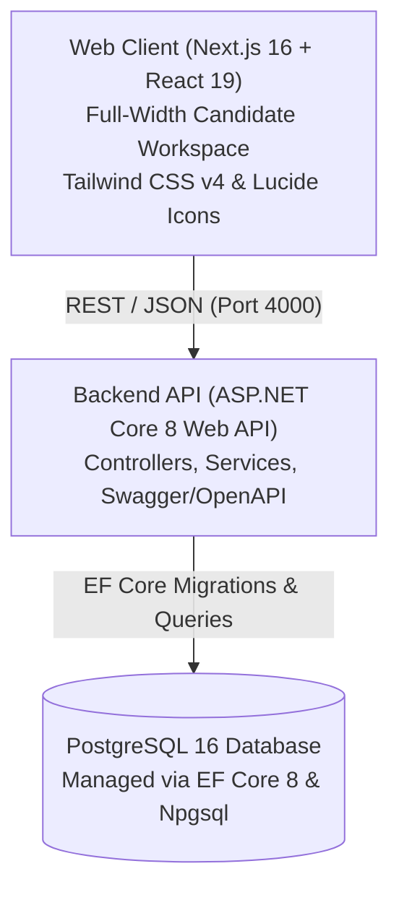

# PrepFord — Next Generation NCLEX® Preparation Platform

**PrepFord** is an advanced, production-grade assessment and learning platform for nursing candidates preparing for the **NCLEX-RN** and **NCLEX-PN** Next Generation NCLEX (NGN) licensing examinations.

The platform combines a modern, full-width Next.js 16 frontend with an enterprise-grade ASP.NET Core 8 Web API and PostgreSQL database.

---

## Architecture Overview



### Monorepo Layout

```text
PREform/
├── apps/
│   ├── web/                    # Next.js 16 App Router frontend (React 19, Tailwind CSS v4)
│   │   ├── src/app/            # App Router pages (Dashboard, Study Guide, Practice, Cart, Auth)
│   │   ├── src/components/     # Design system components & workspace modules
│   │   └── tests/              # Vitest test suites (82 unit & integration tests)
│   └── api/                    # ASP.NET Core 8 Web API backend (C# 12, EF Core 8, Npgsql)
│       ├── Controllers/        # Health and Programme controllers
│       ├── Models/             # Domain entities (Identity, Questions, Assessments, Subscriptions)
│       ├── Data/               # AppDbContext and EF Core configurations
│       ├── Services/           # Business logic services
│       └── Tests/              # xUnit test project
├── docs/                       # Technical architecture decisions and audit reports
├── package.json                # Monorepo root package & orchestration scripts
└── compose.yaml                # Docker Compose for PostgreSQL 16
```

---

## Technology Stack

| Layer | Technologies |
| :--- | :--- |
| **Frontend** | [Next.js 16.4](https://nextjs.org/) (App Router), [React 19](https://react.dev/), [TypeScript 5](https://www.typescriptlang.org/), [Tailwind CSS v4](https://tailwindcss.com/), [Lucide React](https://lucide.dev/), [Zod](https://zod.dev/), [zxcvbn-ts](https://github.com/zxcvbn-ts/zxcvbn) |
| **Backend API** | [ASP.NET Core 8.0 Web API](https://learn.microsoft.com/en-us/aspnet/core/), [C# 12](https://learn.microsoft.com/en-us/dotnet/csharp/), [Entity Framework Core 8](https://learn.microsoft.com/en-us/ef/core/), [Npgsql](https://www.npgsql.org/efcore/), [Swashbuckle Swagger](https://github.com/domaindrivendev/Swashbuckle.AspNetCore) |
| **Database** | [PostgreSQL 16](https://www.postgresql.org/) with EF Core schema migrations |
| **Testing & Quality** | [Vitest 2.1](https://vitest.dev/), [Testing Library](https://testing-library.com/), [xUnit](https://xunit.net/), [ESLint 9](https://eslint.org/), [TypeScript](https://www.typescriptlang.org/) |

---

## Key Features

1. **Seamless Candidate Learning Workspace:**
   - Full-width, unboxed dashboard canvas providing continuous visual flow.
   - High-contrast candidate readiness metrics with domain-by-domain mastery meters.
   - Direct pathway switching between **NCLEX-RN** and **NCLEX-PN**.
   - Diagnostic practice exam launcher and targeted review modes.

2. **Clinical Study Guide & Nursing Notes:**
   - In-depth, evidence-based study notes covering 7 core clinical domains (Pharmacology, Med-Surg, Pediatrics, Maternal-Newborn, Mental Health, Critical Care, Leadership).
   - High-yield clinical takeaways, NGN cue recognition boxes, and live topic search.

3. **Next Generation NCLEX (NGN) Item Simulation:**
   - Case-study workflows with split clinical tab views (Nurses Notes, Vital Signs, Lab Results).
   - Support for Extended Multiple Response, Drag-and-Drop, Matrix/Grid, and Prioritization questions.

4. **Security & Authentication:**
   - Full-screen split layout authentication with Google sign-in integration.
   - Comprehensive client-side and server-side Zod form validation.
   - Real-time zxcvbn password strength evaluation with visual entropy indicators.

5. **E-Commerce & Subscription Management:**
   - Dynamic cart state with localized discount calculation and bundle offers.
   - Self-service subscription management and checkout workflows.

---

## Prerequisites

- **Node.js:** 20.x or newer (Node 24 recommended)
- **npm:** 10.x or newer
- **.NET SDK:** 8.0 LTS (or .NET 9/10 SDK with .NET 8 targeting)
- **PostgreSQL:** 16+ (or Docker Compose for local PostgreSQL container)

---

## Getting Started

### 1. Clone & Install Dependencies

```powershell
# Clone the repository
git clone https://github.com/prepford/prepford.git
cd PREform

# Install npm workspace dependencies
npm install
```

### 2. Configure Environment

Copy the example environment configuration:

```powershell
cp .env.example .env
```

Ensure your `.env` contains:

```env
# Frontend
NEXT_PUBLIC_APP_URL=http://localhost:3000
NEXT_PUBLIC_API_URL=http://localhost:4000

# Backend & Database
DATABASE_URL=Host=localhost;Port=5432;Database=prepford;Username=postgres;Password=postgres
WEB_ORIGIN=http://localhost:3000
ASPNETCORE_ENVIRONMENT=Development
```

### 3. Start PostgreSQL Database

Using Docker Compose:

```powershell
docker compose up -d postgres
```

Or ensure a local PostgreSQL 16 service is running on port `5432` with database `prepford`.

### 4. Apply Database Migrations

Apply EF Core migrations using the .NET CLI or npm script:

```powershell
npm run ef:database:update --workspace @preform/api
# or natively:
dotnet ef database update --project apps/api/Preform.Api.csproj
```

### 5. Launch Development Servers

Start both frontend and backend concurrently:

```powershell
# In terminal 1 (Next.js Frontend, Port 3000):
npm run dev:web

# In terminal 2 (ASP.NET Core API, Port 4000):
npm run dev:api
```

- **Frontend Application:** [http://localhost:3000](http://localhost:3000)
- **Backend API & Swagger:** [http://localhost:4000/swagger](http://localhost:4000/swagger)
- **API Health Liveness:** [http://localhost:4000/api/v1/health/live](http://localhost:4000/api/v1/health/live)
- **API Health Readiness:** [http://localhost:4000/api/v1/health/ready](http://localhost:4000/api/v1/health/ready)

---

## Verification & Quality Checks

Run all verification suites across the monorepo:

```powershell
# TypeScript typecheck
npm run typecheck

# Code formatting and lint
npm run lint

# Frontend Vitest test suite (82 passing tests)
npm run test:web

# Backend .NET build
npm run build:api

# Backend test suite
npm run test:api

# Production frontend build
npm run build:web
```

---

## Architectural Decisions

See the documentation in `docs/` for historical context and architectural records:

- [docs/decisions.md](./docs/decisions.md) — Architecture decisions, including the retirement of legacy NestJS/Prisma in favor of ASP.NET Core 8 Web API.
- [docs/implementation-status.md](./docs/implementation-status.md) — Implementation milestones and roadmap status.
- [apps/api/README.md](./apps/api/README.md) — Backend-specific architecture, DTOs, entity models, and migration guides.

---

## License

Proprietary — All rights reserved.
