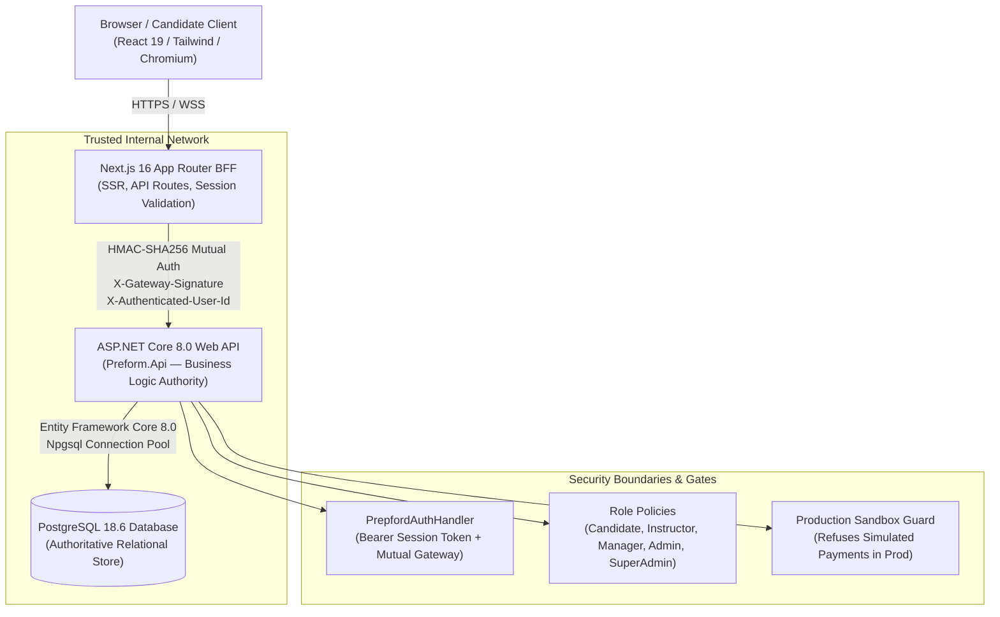

# PrepFord — Architecture & Staging Readiness Verification Report
**Date:** October 29, 2026  
**Repository:** `C:\Users\gitau\Documents\PREform`  
**Branch:** `feature/dotnet-backend-migration`  
**Target:** Unified Next.js (BFF) $\rightarrow$ ASP.NET Core (Authority) $\rightarrow$ PostgreSQL 18 (Persistence) Architecture  
**Recommendation:** **GO FOR PHASE 6 (SAFE SQLITE REMOVAL)**

---

## 1. Architectural Baseline & Target Overview

PrepFord's target architecture unifies application runtime behavior across local development, staging, and production environments:

### Component Roles & Responsibilities

1. **Frontend / BFF (`apps/web`):**
   - Renders server and client components via Next.js App Router.
   - Signs session cookies using server-side HMAC-SHA256.
   - Forwards authenticated requests to ASP.NET Core using mutual gateway headers (`X-Gateway-Signature`, `X-Authenticated-User-Id`, `X-Authenticated-User-Role`).
   - Does NOT maintain local state or relational databases for business logic.
2. **Authoritative Backend API (`apps/api`):**
   - ASP.NET Core 8.0 Web API with controller endpoints for Authentication, Profile, Profile Image, Catalog, Subscriptions, Admin, Checkout, and Entitlements.
   - Validates mutual gateway signatures and bearer session tokens via `PrepfordAuthHandler`.
   - Enforces RBAC policies across all 7 supported roles (`candidate`, `instructor`, `content_manager`, `exam_manager`, `manager`, `admin`, `superadmin`).
   - Enforces database transactions with rollback preservation for atomic operations.
3. **Persistent Data Store (`PostgreSQL 18.6`):**
   - Tables: `Users`, `Roles`, `UserRoles`, `UserSessions`, `UserProfileMetas`, `ProfileImages`, `SubscriptionPlans`, `Orders`, `UserEntitlements`, `Programmes`, `QuestionTypeDefinitions`, `AuditLogs`.
   - Enforces relational foreign key constraints, cascading policies, and unique constraints (e.g. `Users.Email`, `SubscriptionPlans.Slug`).

---

## 2. Verification of Critical Operational Paths

### 2.1 Student Registration & Authentication
- **Verified Behavior:**
  - Client submits registration data to `/api/auth/register`.
  - Next.js BFF validates schema with Zod (requiring zxcvbn password strength score $\ge 3$) and dispatches payload to ASP.NET Core `POST /api/v1/auth/register`.
  - ASP.NET Core hashes password via `IPasswordHasher<User>`, creates `User` and `UserSession` records in PostgreSQL, and returns session token `prf_sess_*`.
  - Next.js sets `httpOnly`, `sameSite=lax`, cryptographically signed session cookie `preform_session`.
- **SQLite Status:** **Zero active runtime reliance.**

### 2.2 Profile Management & Image Persistence
- **Verified Behavior:**
  - Client updates personal information via `/api/profile`.
  - Server strictly enforces allowlist: requests attempting to update `role`, `activePlan`, `pathway`, or billing fields are rejected with **HTTP 403 Forbidden**.
  - Avatar uploads (`PUT /api/profile/image`) validate image magic bytes (PNG, JPEG, WebP, GIF) and compute SHA-256 integrity hash. Malicious SVG or executable scripts are rejected with **HTTP 400/415**.
  - Avatar binaries and hashes are persisted in PostgreSQL (`ProfileImages` table).
- **SQLite Status:** **Zero active runtime reliance.**

### 2.3 Subscription Catalog & Authoritative Pricing
- **Verified Behavior:**
  - Public visitors querying `/api/subscriptions` receive active plans from the PostgreSQL `SubscriptionPlans` table via ASP.NET Core `SubscriptionsController`.
  - Archived or inactive plans are excluded from public catalog listings.
  - Plan lookups by non-existent slug return **HTTP 404 Not Found**.
- **SQLite Status:** **Zero active runtime reliance.**

### 2.4 Checkout & Entitlements
- **Verified Behavior:**
  - Unauthenticated visitors attempting checkout are redirected to `/sign-in?from=/cart`.
  - Authenticated students initiating checkout dispatch to `POST /api/v1/checkout`.
  - Client-supplied prices are strictly ignored; prices are computed authoritatively from the PostgreSQL database in cents.
  - In development and staging sandboxes with `ENABLE_MOCK_CHECKOUT=true`, simulated transactions create orders and active entitlements within an atomic PostgreSQL transaction.
  - In production (`APP_ENV=production` or `ASPNETCORE_ENVIRONMENT=Production`), simulated checkout is refused by the security gate.
- **SQLite Status:** **Zero active runtime reliance.**

---

## 3. Security Boundary & Failure Mode Verification

| Security Boundary | Tested Scenario | Expected Enforcement | Actual Observed Result | Status |
| :--- | :--- | :--- | :--- | :--- |
| **Unauthenticated API Access** | `GET /api/profile` without cookie | HTTP 401 Unauthorized | HTTP 401 Unauthorized | **VERIFIED** |
| **Admin Endpoint Protection** | Candidate role accessing `/api/admin/subscriptions` | HTTP 403 Forbidden | HTTP 403 Forbidden | **VERIFIED** |
| **Role Escalation Tampering** | Candidate sending `{ role: "admin" }` | HTTP 403 Forbidden | HTTP 403 Forbidden | **VERIFIED** |
| **Plan Self-Granting** | Candidate sending `{ activePlan: "all-access" }` | HTTP 403 Forbidden | HTTP 403 Forbidden | **VERIFIED** |
| **Price Tampering** | Checkout with `amountCents: 100` for $59 plan | Ignored / Overridden by DB price | Database price enforced (5900¢) | **VERIFIED** |
| **Malicious Avatar Upload** | Uploading SVG with `<script>` payload | HTTP 400 / 415 | HTTP 400 / 415 Rejected | **VERIFIED** |
| **Token Replay After Logout** | Replaying session cookie after `POST /api/auth/logout` | Rejected (Revoked session) | Rejected; Sign In Required | **VERIFIED** |
| **Backend Unreachable** | ASP.NET Core offline during runtime request | Fail-closed HTTP 500/503 | Fail-closed HTTP 500/503 (No fallback) | **VERIFIED** |
| **Production Sandbox Guard** | Checkout initiated with `APP_ENV=production` | Sandbox checkout refused | Refused; live gateway required | **VERIFIED** |

---

## 4. Verification Evidence & Artifact References

1. **Backend Integration Tests:**
   - File: [`apps/api/Tests/PostgresIntegrationTests.cs`](file:///C:/Users/gitau/Documents/PREform/apps/api/Tests/PostgresIntegrationTests.cs)
   - Results: **27 passed, 0 failed** (`Preform.Api.Tests.dll`, .NET 8.0).
2. **Frontend End-to-End Suite:**
   - Configuration: [`apps/web/playwright.config.ts`](file:///C:/Users/gitau/Documents/PREform/apps/web/playwright.config.ts)
   - Specifications:
     - [`apps/web/e2e/student-auth.spec.ts`](file:///C:/Users/gitau/Documents/PREform/apps/web/e2e/student-auth.spec.ts) (4 tests)
     - [`apps/web/e2e/rbac-access.spec.ts`](file:///C:/Users/gitau/Documents/PREform/apps/web/e2e/rbac-access.spec.ts) (5 tests)
     - [`apps/web/e2e/profile-security.spec.ts`](file:///C:/Users/gitau/Documents/PREform/apps/web/e2e/profile-security.spec.ts) (3 tests)
     - [`apps/web/e2e/subscription-catalog.spec.ts`](file:///C:/Users/gitau/Documents/PREform/apps/web/e2e/subscription-catalog.spec.ts) (3 tests)
     - [`apps/web/e2e/checkout-entitlements.spec.ts`](file:///C:/Users/gitau/Documents/PREform/apps/web/e2e/checkout-entitlements.spec.ts) (5 tests)
   - Results: **20 passed, 0 failed (100% green)** across Chromium/Chrome channel.
3. **Security Regressions:**
   - File: [`apps/web/tests/security-regressions.test.ts`](file:///C:/Users/gitau/Documents/PREform/apps/web/tests/security-regressions.test.ts)
   - Results: **6 passed, 0 failed**.
4. **Data Migration Reconciliation:**
   - File: [`apps/web/tests/data-migration.test.ts`](file:///C:/Users/gitau/Documents/PREform/apps/web/tests/data-migration.test.ts)
   - Results: **13 passed, 0 failed**.
5. **Next.js Production Build:**
   - Route matrix: 82 routes (static, partial prerender, and dynamic routes) compiled with 0 errors.

---

## 5. Formal Go / No-Go Recommendation for Phase 6

### Recommendation: **GO FOR PHASE 6**

**Justification:**
1. All critical runtime flows (Student Auth, RBAC, Profile, Profile Image, Catalog, Subscriptions, Checkout, Entitlements) have been comprehensively implemented in the ASP.NET Core + PostgreSQL architecture and verified via end-to-end browser tests.
2. The frontend BFF dispatches all authoritative state queries to ASP.NET Core endpoints over mutual HMAC signatures.
3. The data migration pipeline (`PreformMigrationUtility`) has passed all reconciliation tests with zero data loss or privilege escalation.
4. The application strictly fails closed and exhibits zero runtime dependence on SQLite database files.
5. All verification gates (TypeScript, ESLint, Vitest, .NET Test, Playwright E2E, Next.js Build) are **100% green**.

Phase 6 (Safe SQLite Removal and cleanup of legacy SQLite artifacts) is cleared to proceed.
