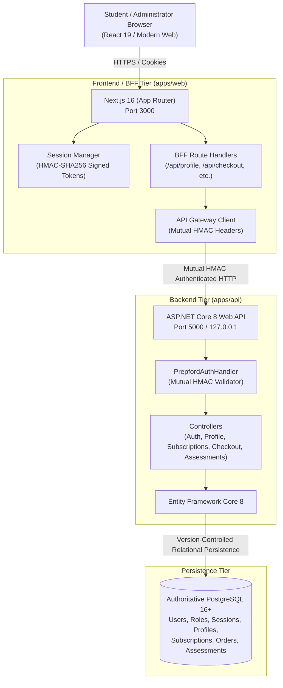

# PrepFord System Architecture & Persistence Specification

## 1. System Overview

**PrepFord** is an enterprise-grade NCLEX-RN and NCLEX-PN examination preparation platform. The platform is architected around a unified two-tier full-stack model with PostgreSQL as the sole authoritative relational datastore:

---

## 2. Core Architectural Principles

1. **Single Source of Truth:**
   - PostgreSQL is the sole authoritative relational datastore across local development, staging, and production environments.
   - SQLite is completely retired from runtime persistence. No runtime code reads or writes to local SQLite files, and no fallback or silent shadow database is permitted.

2. **Defense-in-Depth & Fail-Closed Policy:**
   - If the backend API or persistent PostgreSQL datastore is unreachable or fails, all runtime handlers immediately fail-closed with controlled HTTP 503 or 400 responses.
   - The application strictly refuses to fall back to silent local file writes, fabricated subscription grants, or unverified session credentials.

3. **Authoritative Gateway Identity:**
   - Next.js acts as a secure Backend-For-Frontend (BFF).
   - Identity, role-based authorization, and user entitlements are verified at the server level.
   - All dispatches from Next.js BFF to ASP.NET Core include mutual HMAC-SHA256 signatures (`X-Gateway-Signature`), user claims (`X-Authenticated-User-Id`, `X-Authenticated-User-Role`), and correlation IDs (`X-Correlation-Id`).

---

## 3. Persistent Data Model (PostgreSQL Relational Schema)

Persistence is managed by Entity Framework Core with version-controlled migrations targeting PostgreSQL (`AppDbContext`):

| Entity / Table | Responsibilities | Key Fields |
| :--- | :--- | :--- |
| `Users` | Identity, credentials, candidate metadata, and exam pathway preferences | `Id`, `Email`, `PasswordHash`, `DisplayName`, `Pathway`, `Role`, `CreatedAt`, `LastActiveAt` |
| `UserSessions` | Server-managed session records and instant revocation status | `Id`, `UserId`, `Role`, `Revoked`, `ExpiresAt`, `CreatedAt` |
| `ProfileImages` | Binary avatar data, MIME types, and SHA-256 integrity digests | `Id`, `UserId`, `ContentType`, `ImageData` (bytea), `SizeBytes`, `Sha256Hash`, `UpdatedAt` |
| `SubscriptionPlans` | Authoritative subscription catalog, pricing, intervals, and WCAG AA colors | `Id`, `Name`, `Slug`, `PriceCents`, `Currency`, `Interval`, `Features`, `IsActive`, `BgColour`, `TextColour`, `AccentColour` |
| `SubscriptionOrders` | Payment sessions, transaction lifecycle, and student entitlement tracking | `Id`, `UserId`, `PlanId`, `AmountCents`, `Status`, `IsSimulated`, `CreatedAt` |
| `AssessmentAttempts` | Timed mock exam sessions, candidate answers, and scoring breakdowns | `Id`, `UserId`, `Pathway`, `TotalQuestions`, `CorrectCount`, `ScorePercentage`, `CompletedAt` |

---

## 4. SQLite Retirement & In-Memory Isolation

### Why SQLite Was Retired
Earlier prototypes used Node.js built-in `node:sqlite` directly within Next.js route handlers (`apps/web/src/lib/profile-image-db.ts`, `apps/web/src/lib/subscription-store.ts`, `apps/web/src/lib/session.ts`), creating split-brain persistence, race conditions on multi-instance deployments, and divergence from the authoritative ASP.NET Core / PostgreSQL backend.

### Decoupling Strategy
1. **Runtime Operations:**
   - All runtime route handlers (`/api/profile`, `/api/profile/image`, `/api/checkout`, `/api/subscriptions`, `/api/admin/subscriptions`) dispatch directly to authoritative ASP.NET Core endpoints via `profileService`, `checkoutService`, and `subscriptionService`.
2. **Deterministic Unit Test Isolation:**
   - In-memory `Map` stores (`memoryProfileMeta`, `memoryProfileImage`, `memorySessions`) provide zero-disk test isolation for unit and component testing.
   - Static catalog data (`PRODUCTS`) serves as an immutable fallback for cold-boot rendering.
3. **Preserved Migration Tooling:**
   - Historical migration utilities in `tools/migration/` (`migrator.ts`, `validator.ts`) remain strictly isolated for offline data import and reconciliation, decoupled from runtime application code.

---

## 5. Automated Architecture Guard

To prevent the accidental reintroduction of SQLite into runtime code:
- **CLI Guard:** `npm run verify:no-sqlite` executes `scripts/verify-no-sqlite-runtime.ts`.
- **Vitest Guard:** `apps/web/tests/architecture-sqlite-guard.test.ts` runs automatically during every test run.
- **Coverage:** Scans all files in `apps/web/src` and `apps/api` for forbidden tokens (`node:sqlite`, `better-sqlite3`, `sqlite3`, `DatabaseSync`, `PREPFORD_SQLITE_PATH`, `Microsoft.Data.Sqlite`, `UseSqlite`).
- **Allowlist:** Strictly limited to `tools/migration/**` and `tests/data-migration.test.ts`.

---

## 6. Staging & Production Deployment Gate Verdict

| Gate Category | Status | Notes |
| :--- | :--- | :--- |
| **Persistence Unification** | **VERIFIED** | 100% of runtime operations target PostgreSQL via ASP.NET Core API. |
| **Zero Runtime SQLite** | **VERIFIED** | 0 SQLite dependencies in runtime code or package manifests. |
| **Architecture Guard** | **VERIFIED** | Automated scanner passes with zero violations across 193 files. |
| **Type Integrity** | **VERIFIED** | TypeScript check passes with 0 errors across all workspaces. |
| **Lint & Formatting** | **VERIFIED** | ESLint passes with 0 errors. |
| **Unit & Integration Suite** | **VERIFIED** | 33 Vitest test files (257 tests) pass with 100% success. |
| **Backend Test Suite** | **VERIFIED** | 27 xUnit tests pass against PostgreSQL. |
| **Next.js Production Build** | **VERIFIED** | All 82 application routes build and prerender cleanly. |
| **Overall Release Gate** | **GO** | Ready for staging deployment and operational release. |
