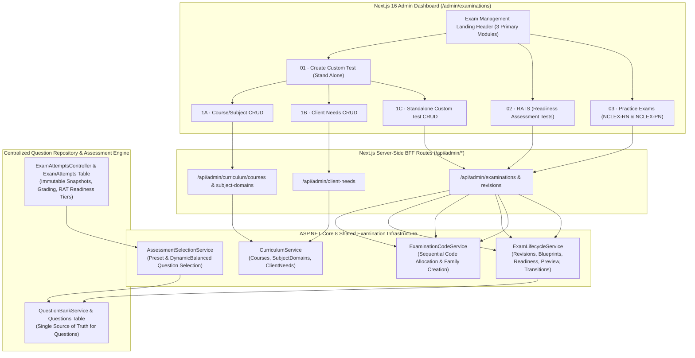

# PrepFord NCLEX — Admin Dashboard Exam Management: System Architecture

**Date:** 2026-11-06  
**Branch:** `feature/dotnet-backend-migration`  
**Status:** Architecture Specification

---

## 1. High-Level Architectural Separation

The Exam Management architecture enforces a strict separation between **Administrative Presentation Modules**, **Shared Examination Infrastructure**, and the **Centralized Question Repository**:

---

## 2. Module Discriminator & Shared Infrastructure Strategy

Rather than creating three disconnected examination tables or three parallel assessment engines, all three examination modules share the `Examination` (family) and `Exam` (revision) tables, discriminated cleanly via `ExamType`:

| Module | `ExamType` Enum Value | Numeric Value | Key Characteristics |
|---|---|---|---|
| **01 · Standalone Custom Tests** | `ExamType.Standalone` | `5` | Custom tests assembled by administrators using Course/Subject and Client Needs classifications and Question Repository selections. |
| **02 · RATS (Readiness Assessment Tests)** | `ExamType.DiagnosticReadiness` | `4` | Readiness assessments with configurable readiness classification thresholds (`Low`, `Borderline`, `High`, `Very High`), assessment objectives, and balanced Client Needs blueprints. |
| **03 · Practice Exams** | `ExamType.Practice` | `1` | Structured NCLEX-RN and NCLEX-PN practice examinations supporting Traditional & NGN question formats, duplication, preview, and timed/untimed delivery. |
| *(Existing CAT)* | `ExamType.CAT` | `2` | Computerized Adaptive Testing examinations. |
| *(Existing Mock Simulation)* | `ExamType.MockSimulation` | `3` | Full-length licensure simulations. |

---

## 3. Centralized Question Repository Reuse

1. **Zero Question Duplication:**
   - Questions are authored, versioned, reviewed, and published exclusively in the **Question Repository** (`Questions`, `QuestionOptions`, `QuestionVersions`).
   - When an administrator selects questions for a Standalone Custom Test, a RAT, or a Practice Exam, the system creates `ExamQuestion` membership rows (`ExamId`, `QuestionId`, `DisplayOrder`) or stores blueprint rules in `CompositionRulesJson`.
   - The underlying `Question` record is never duplicated across modules.
2. **Historical Attempt Immutability:**
   - When a learner starts or completes an attempt (`ExamAttempt`), `ExamAttemptsController` captures immutable snapshots (`MetadataSnapshot`, `QuestionSnapshotJson`, `OptionsSnapshotJson`, `RationaleSnapshotJson`, `ConfigurationSnapshotJson`).
   - Subsequent edits to a new draft revision or taxonomy metadata never corrupt historical learner attempts or scores.

---

## 4. Lifecycle Governance & Dependency-Aware Deletion

### 4.1 Revision Lifecycle State Machine
All examinations (Standalone Custom Tests, RATS, and Practice Exams) honour the 6-state governance lifecycle on `Exam` revisions:
- `Draft (1)` → `InReview (2)` → `Approved (3)` → `Published (4)` → `Archived (5)` / `Retired (6)`.
- Direct publication from `Draft` or `Approved` is also supported for users holding `exams.publish` (`admin`, `superadmin`, `exam_manager`) when readiness checks pass.

### 4.2 Dependency-Aware Deletion vs. Deactivation/Archival
- **Course / SubjectDomain:**
  - Cannot be hard-deleted (`409 Conflict`) if child Subject Domains, Categories, Questions, or Examination blueprints reference the record.
  - Supports non-destructive deactivation (`IsActive = false`).
- **ClientNeed:**
  - Cannot be hard-deleted (`409 Conflict`) if any `Question` (`ClientNeedId`) or `Exam` blueprint (`CompositionRulesJson`) references the category.
  - Supports non-destructive deactivation (`IsActive = false`).
- **Examination Family (`DELETE /api/v1/examinations/{id}`):**
  - Can be hard-deleted **only** when all revisions are in `Draft` state, have never been published, and have zero `ExamAttempts`.
  - If any revision has been published or has learner `ExamAttempts`, hard deletion is rejected with `409 Conflict` and the administrator is guided to **Archive** or **Retire** the examination.
