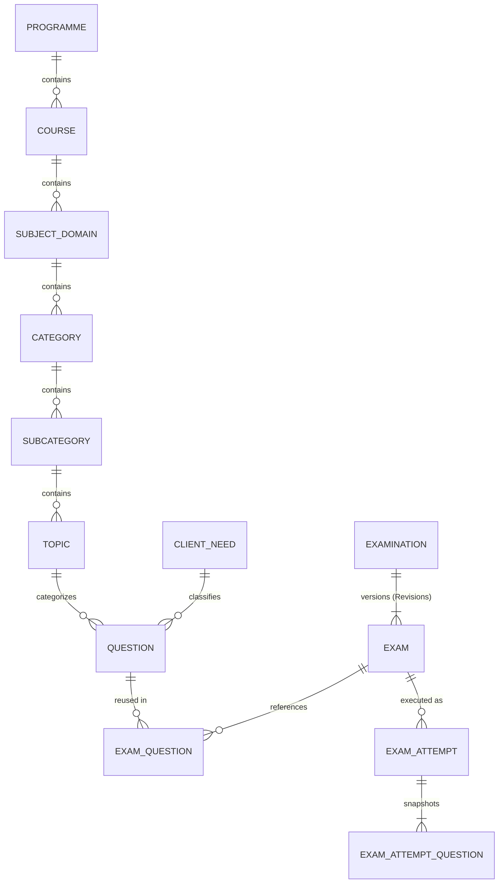

# PrepFord NCLEX — Admin Dashboard Exam Management: Database Design

**Date:** 2026-11-06  
**Branch:** `feature/dotnet-backend-migration`  
**Database Engine:** PostgreSQL (via Entity Framework Core 8 / Npgsql)

---

## 1. Entity-Relationship Overview



---

## 2. Core Tables & Columns

### 2.1 Taxonomy Tables (`LearningStructure.cs`)

#### `Programmes`
| Column | Type | Constraints | Purpose |
|---|---|---|---|
| `Id` | `text` | PK | Unique identifier (`prog_rn`, `prog_pn`) |
| `Code` | `integer` | Unique (`RN=1`, `PN=2`) | NCLEX programme discriminator |
| `DisplayName` | `text` | Not Null | Human-readable programme name |
| `IsActive` | `boolean` | Default `true` | Active status |

#### `Courses` (Course Management)
| Column | Type | Constraints | Purpose |
|---|---|---|---|
| `Id` | `text` | PK | Unique identifier |
| `ProgrammeId` | `text` | FK → `Programmes.Id` (Restrict) | Associated NCLEX programme |
| `Title` | `text` | Not Null | Course name |
| `Description` | `text` | Not Null | Course description & metadata |
| `DisplayOrder` | `integer` | Not Null | Ordering index |
| `IsPublished` | `boolean` | Default `false` | Publication flag |
| `IsActive` | `boolean` | Default `true` | Active/deactivated flag |
| `CreatedAt` / `UpdatedAt` | `timestamptz` | Not Null | Audit timestamps |

#### `SubjectDomains` (Subject Management)
| Column | Type | Constraints | Purpose |
|---|---|---|---|
| `Id` | `text` | PK | Unique identifier |
| `CourseId` | `text` | FK → `Courses.Id` (Cascade) | Parent Course |
| `Title` | `text` | Not Null | Subject domain name |
| `Description` | `text` | Not Null | Subject domain description |
| `DisplayOrder` | `integer` | Not Null | Ordering index |
| `IsActive` | `boolean` | Default `true` | Active/deactivated flag |
| `CreatedAt` / `UpdatedAt` | `timestamptz` | Not Null | Audit timestamps |

#### `ClientNeeds` (Client Needs Management)
| Column | Type | Constraints | Purpose |
|---|---|---|---|
| `Id` | `text` | PK | Unique identifier (`cn_moc`, etc.) |
| `Code` | `text` | Unique Index | Canonical code (`MOC`, `SIC`, `HPM`, `PSI`, `BCC`, `PHA`, `RRP`, `PPT`, etc.) |
| `Name` | `text` | Not Null | Category name |
| `Description` | `text` | Not Null | Category description |
| `Pathway` | `text` | Default `"both"` | `"rn"`, `"pn"`, or `"both"` |
| `DisplayOrder` | `integer` | Not Null | Ordering index |
| `IsActive` | `boolean` | Default `true` | Active/deactivated flag |
| `CreatedAt` / `UpdatedAt` | `timestamptz` | Not Null | Audit timestamps |

---

### 2.2 Shared Examination Infrastructure (`Assessments.cs`)

#### `Examinations` (Permanent Examination Families)
| Column | Type | Constraints | Purpose |
|---|---|---|---|
| `Id` | `text` | PK | Family identifier |
| `Pathway` | `text` | Not Null (`"rn"` \| `"pn"`) | Programme track |
| `Code` | `text` | Unique Index | Permanent code (`RN-EX-000001`, `PN-EX-000001`) |
| `Title` | `text` | Not Null | Canonical family title |
| `CurrentRevisionId` | `text` | Nullable | Active published revision pointer |
| `SuccessorExaminationId` | `text` | Nullable | Lineage replacement pointer |
| `CreatedAt` / `CreatedBy` | `timestamptz` / `text` | Not Null | Creation provenance |

#### `Exams` (Versioned Examination Revisions)
| Column | Type | Constraints | Purpose |
|---|---|---|---|
| `Id` | `text` | PK | Revision identifier |
| `ExaminationId` | `text` | FK → `Examinations.Id` | Parent family |
| `RevisionNumber` | `integer` | Unique `(ExaminationId, RevisionNumber)` | Sequential revision number (`1, 2, ...`) |
| `LifecycleState` | `integer` | Indexed | `Draft=1, InReview=2, Approved=3, Published=4, Archived=5, Retired=6` |
| `ConcurrencyToken` | `integer` | Optimistic lock | Incremented on every mutation |
| `ExamType` | `integer` | Not Null | `Practice=1, CAT=2, MockSimulation=3, DiagnosticReadiness=4, Standalone=5` |
| `Title` / `Description` | `text` | Not Null | Revision title & instructions |
| `Pathway` | `text` | Not Null | `"rn"` or `"pn"` |
| `TimeLimitMinutes` | `integer` | `0..720` | Duration in minutes (`0` = untimed) |
| `PassingScorePercent` | `numeric` | `0..100` | Passing or readiness benchmark percentage |
| `TargetQuestionCount` | `integer` | `>= 1` | Configured question count |
| `SelectionStrategy` | `text` | Not Null | `"Preset"` or `"DynamicBalanced"` |
| `CompositionRulesJson` | `jsonb` | Nullable | Blueprint JSON: `ClientNeedQuotas`, `AllowedQuestionTypes`, `CourseIds`, `SubjectDomainIds`, `DifficultyDistribution`, `ReadinessThresholds`, `AssessmentObjectives`, `RandomizeQuestions` |
| `IsAvailable` / `AvailableFrom` / `AvailableTo` | `bool` / `timestamptz` | Availability window | Learner scheduling controls |
| `MaxAttemptsAllowed` / `RetakeCooldownHours` | `integer` | Attempt governance | Retake limits & cooldown |
| `AllowInterruptedResume` | `boolean` | Default `true` | Pause/resume permission |
| `ReviewPolicy` / `ShowRationales` / `ShowScoreImmediately` | `text` / `bool` | Post-exam review | Rationale and score visibility controls |
| `ConfigurationSnapshotJson` | `jsonb` | Nullable | Immutable configuration snapshot frozen upon publication |

#### `ExamQuestions` (Question Repository References)
| Column | Type | Constraints | Purpose |
|---|---|---|---|
| `Id` | `text` | PK | Membership row ID |
| `ExamId` | `text` | FK → `Exams.Id` (Cascade) | Revision reference |
| `QuestionId` | `text` | FK → `Questions.Id` (Cascade) | Question Repository reference |
| `DisplayOrder` | `integer` | Indexed `(ExamId, DisplayOrder)` | Sequence order within revision |

---

## 3. JSONB Blueprint Schema (`CompositionRulesJson`)

By storing extended module-specific blueprint configurations inside the existing PostgreSQL `jsonb` column `CompositionRulesJson` on `Exams`, we achieve zero destructive schema migrations while supporting full structured persistence for all three modules:

```json
{
  "clientNeedQuotas": [
    { "clientNeedCode": "MOC", "targetPercentage": 18.0, "targetCount": 14 }
  ],
  "allowedQuestionTypes": ["single-choice", "multiple-response", "sata"],
  "courseIds": ["course_rn_medsurg"],
  "subjectDomainIds": ["dom_cardio", "dom_resp"],
  "difficultyDistribution": {
    "easyPercent": 20,
    "moderatePercent": 50,
    "hardPercent": 30
  },
  "randomizeQuestions": true,
  "questionFormatFilter": "all",
  "assessmentObjectives": "Evaluate comprehensive clinical readiness prior to licensure scheduling.",
  "readinessThresholds": {
    "lowMin": 0,
    "lowMax": 54,
    "borderlineMin": 55,
    "borderlineMax": 64,
    "highMin": 65,
    "highMax": 79,
    "veryHighMin": 80,
    "veryHighMax": 100
  }
}
```
