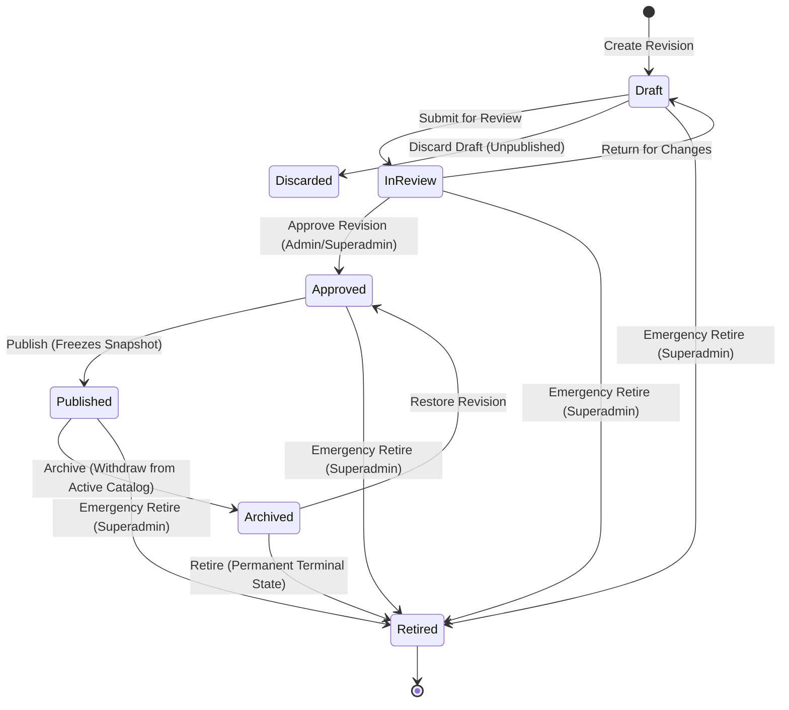

# PREPFORD NCLEX — PHASE 4 EXAMINATION LIFECYCLE & GOVERNANCE ARCHITECTURE
## State Machine, Concurrency Isolation & Immutability Specification

**Document File:** `docs/architecture/PHASE_4_EXAMINATION_LIFECYCLE.md`  
**Authority:** PrepFord Product Owner  
**Date:** November 5, 2026  
**Status:** AUTHORITATIVE & APPROVED  

---

## 1. Lifecycle State Machine Overview

The PrepFord examination governance model enforces a strict, transactional state machine for examination families and versioned revisions (`Exam`).



---

## 2. State Definitions & Permitted Operations

### 2.1 State: `Draft` (1)
- **Description:** Working revision under active authoring and configuration.
- **Permitted Operations:**
  - Update title, description, time limit, passing score.
  - Update composition rules & Client Needs blueprint.
  - Add, remove, and reorder questions.
  - Configure scheduled availability, attempt limits, and review policies.
  - Execute pre-flight readiness checks.
  - Launch zero-side-effect candidate preview.
  - Submit for review (`submit`).
  - Discard draft (permanently deletes unreviewed draft).
- **Invariants:**
  - Exactly **one active draft** is allowed per examination family (`IX_Exams_ExaminationId_ActiveDraft`).
  - Draft revisions are completely hidden from learners (`AssessmentsController`).

### 2.2 State: `InReview` (2)
- **Description:** Authoring is locked; revision is submitted for clinical and psychometric review.
- **Permitted Operations:**
  - Reviewers evaluate questions, blueprint quotas, and clinical rationales.
  - Recommend approval (`recommend`).
  - Return for changes (`return`): transitions back to `Draft` with mandatory audit notes.
  - Approval (`approve`): only authorized Administrators / Superadmins can approve.
- **Invariants:**
  - Editing questions or configuration is prohibited while in review.

### 2.3 State: `Approved` (3)
- **Description:** Clinically and psychometrically certified revision awaiting publication or scheduled release.
- **Permitted Operations:**
  - Publish revision (`publish`).
  - Emergency retirement.
- **Invariants:**
  - Configuration cannot be mutated in this state. If edits are necessary, the revision must be returned to draft or duplicated.

### 2.4 State: `Published` (4)
- **Description:** Active revision surfaced to candidate assessments and delivery engines.
- **Permitted Operations:**
  - Archive revision (`archive`): safely withdraws the examination from active discovery without affecting in-progress attempts.
  - Emergency retirement (`emergency-retire`).
- **Invariants:**
  - Exactly **one published revision** is allowed per examination family (`IX_Exams_ExaminationId_SinglePublished`).
  - Publishing automatically unpublishes any prior published revision for that family.
  - **Snapshot Immutability:** Upon publication, `ConfigurationSnapshotJson` is frozen with the exact blueprint, Client Needs quotas, attempt limits, and review policies.
  - Published revisions cannot be directly modified. To update a published assessment, administrators must author a new draft revision ($N+1$).

### 2.5 State: `Archived` (5)
- **Description:** Withdrawn revision retained for historical compliance, reporting, and learner attempt review.
- **Permitted Operations:**
  - Restore revision (`restore`) back to `Approved`.
  - Permanently retire revision (`retire`).
- **Invariants:**
  - Archived revisions do not accept new learner attempts.
  - Completed attempts referencing this revision remain fully accessible to candidates and reporting systems.

### 2.6 State: `Retired` (6)
- **Description:** Permanent terminal state.
- **Invariants:**
  - Irreversible. No further transitions permitted.
  - Historical attempt records remain preserved for audit compliance.

---

## 3. Concurrency Protection & PostgreSQL Transaction Isolation

### 3.1 Optimistic Concurrency Tokens
- Every `Exam` entity contains a 64-bit `ConcurrencyToken`.
- Mutation requests must supply the client's current `concurrencyToken`.
- If the token in the database differs from the supplied token, the transaction aborts with `409 Conflict`.
- Upon successful update, the token is atomically incremented ($token = token + 1$).

### 3.2 Row-Level Locking (`SELECT ... FOR UPDATE`)
- During lifecycle state machine transitions (`submit`, `approve`, `publish`, `archive`, `retire`), `ExamLifecycleService` acquires a row-level lock on the `Examinations` family record and `Exams` revision record.
- This prevents race conditions where two administrators might attempt to publish or approve simultaneously.

### 3.3 Partial Unique Indexes
- `IX_Exams_ExaminationId_SinglePublished`:
  ```sql
  CREATE UNIQUE INDEX "IX_Exams_ExaminationId_SinglePublished" 
  ON "Exams" ("ExaminationId") 
  WHERE "LifecycleState" = 4;
  ```
- `IX_Exams_ExaminationId_ActiveDraft`:
  ```sql
  CREATE UNIQUE INDEX "IX_Exams_ExaminationId_ActiveDraft" 
  ON "Exams" ("ExaminationId") 
  WHERE "LifecycleState" = 1;
  ```

---

## 4. Preservation of Learner Assessment Integrity

### 4.1 Zero Side Effects on Active or Completed Attempts
- When an examination revision is edited, unpublished, archived, or retired:
  - Active learner attempts (`ExamAttempts` where `Status == InProgress`) continue executing against their immutable attempt snapshots (`ExamAttemptQuestions` and `MetadataSnapshot`).
  - Completed learner attempts retain their historical question sequence, candidate responses, and calculated scores.
  - An administrative update **never** alters or invalidates existing learner attempts.

### 4.2 Candidate Review Policy Enforcement
- Attempt review respects `Exam.ReviewPolicy`:
  - `"Never"`: Rationale and correct answers are permanently concealed.
  - `"AfterDeadline"`: Rationale unlocked only after $StartedAt + TimeLimitMinutes$ has elapsed.
  - `"AfterExamSubmission"`: Rationale unlocked immediately upon attempt completion.
