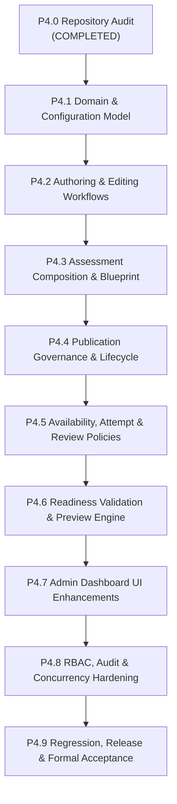

# PREPFORD NCLEX — PHASE 4 IMPLEMENTATION PLAN & ENGINEERING BLUEPRINT
## Examination Management, Administrative Assessment Configuration & Lifecycle Governance

**Document File:** `docs/architecture/PHASE_4_IMPLEMENTATION_PLAN.md`  
**Repository Working Directory:** `C:\Users\gitau\Documents\PREform`  
**Branch:** `feature/dotnet-backend-migration`  
**Baseline Git Commit:** `dbf0969`  
**Authority:** Product Owner  
**Date:** November 5, 2026  
**Status:** APPROVED & ACTIVE  

---

## 1. Architecture Strategy & Design Principles

The Phase 4 implementation strategy builds upon the existing `Examination` and `Exam` domain established in earlier foundations. We strictly observe the **Additive Architecture Principle**:
1. **Extend Existing Domain Entities:** Rather than creating redundant parallel entities, we additively enrich `Exam` (and related configuration models) with assessment composition, availability, attempt limits, and review policies.
2. **PostgreSQL JSONB Configuration Snapshot:** Use structured columns for top-level queryable policies (`MaxAttemptsAllowed`, `RetakeCooldownHours`, `AvailableFrom`, `AvailableTo`, `ReviewPolicy`, `ShowRationales`, `SelectionStrategy`), paired with a PostgreSQL `jsonb` column `CompositionRulesJson` for flexible, extensible blueprint distribution rules (percentages, counts, filters).
3. **Multi-Stage Readiness Validation Engine:** Build an evaluation engine that verifies metadata, blueprint quotas, question pool sufficiency, supported question types, and security policies, yielding structured status reports (`PASS`, `WARN`, `BLOCK`).
4. **Zero-Side-Effect Administrative Preview:** Enable administrators to preview candidate-facing assessment flow, question sequence, and layout without polluting learner attempt tables or performance metrics.
5. **Phase 1–3 Zero-Regression Invariant:** Zero duplicate question stores, zero duplicate attempt stores, strict backend RBAC, and candidate answer key concealment during active exams.

---

## 2. Milestone Breakdown & Gap Mapping



---

### Milestone P4.1: Examination Domain & Configuration Model

- **Identified Gap:** `Exam` entity currently stores basic parameters (`TimeLimitMinutes`, `PassingScorePercent`) but lacks assessment composition, availability windows, attempt policies, and review policies.
- **Proposed Change:**
  - Add configuration properties to `Exam`:
    - `TargetQuestionCount` (`int`, default 10)
    - `SelectionStrategy` (`string`: `"Preset"`, `"DynamicBalanced"`, `"Hybrid"`)
    - `CompositionRulesJson` (`string?`, PostgreSQL `jsonb`): Encodes Client Needs category distributions (`MOC`, `SIC`, `HPM`, `PSI`, `BCC`, `PPT`, `RRP`, `PHA`), question type restrictions, and taxonomy filters.
    - `AvailableFrom` (`DateTime?`, UTC)
    - `AvailableTo` (`DateTime?`, UTC)
    - `IsAvailable` (`bool`, manual toggle, default `true`)
    - `MaxAttemptsAllowed` (`int?`, null for unlimited, or $\ge 1$)
    - `RetakeCooldownHours` (`int`, default 0)
    - `AllowInterruptedResume` (`bool`, default `true`)
    - `ReviewPolicy` (`string`: `"Immediate"`, `"AfterExamSubmission"`, `"AfterDeadline"`, `"Never"`, `"ManualRelease"`)
    - `ShowRationales` (`bool`, default `true`)
    - `ShowScoreImmediately` (`bool`, default `true`)
    - `ConfigurationSnapshotJson` (`string?`, PostgreSQL `jsonb`): Frozen at publication time.
  - Define enums/constants for selection strategies, review policies, and Client Needs categories.
- **Relevant Existing Components:** `apps/api/Models/Assessments.cs`, `apps/api/Data/AppDbContext.cs`.
- **Database Impact:** Additive EF Core migration (`0009_AddExaminationConfigurationAndPolicies`) adding nullable/default columns to `public."Exams"`. Non-destructive, 100% backward-compatible with existing data.
- **API Impact:** Update `ExaminationDtos.cs` with configuration fields for requests and responses.
- **Frontend Impact:** Types in `apps/web/src/lib/api-services.ts` extended to include configuration fields.
- **Security Impact:** All new fields validated server-side.
- **Acceptance Criteria:** Additive migration compiles and applies cleanly; existing 398 backend tests continue passing.

---

### Milestone P4.2 & P4.3: Assessment Composition & Blueprint Selection Configuration

- **Identified Gap:** Question assignment is solely manual via `ExamQuestion`. Administrators cannot configure Client Needs distribution quotas, question type whitelisting, or curriculum filters, nor preview question pool sufficiency.
- **Proposed Change:**
  - Add DTOs: `ExamCompositionDto`, `ClientNeedDistributionItem`, `UpdateExamCompositionRequest`, `QuestionPoolPreviewRequest`, `QuestionPoolPreviewResponse`.
  - Implement deterministic Client Needs allocation algorithm with exact rounding to `TargetQuestionCount`.
  - Implement question pool evaluation logic in `ExamLifecycleService` verifying available published questions across the 8 Client Needs categories and candidate pathway (`rn` / `pn`).
  - Strict enforcement: Catalogued NGN types are excluded; only supported grading types (`single-choice`, `multiple-choice`, `sata`, `checkbox`, `image-based`, `multiple-image`, `true-false`) are allowed.
  - Expose API endpoints:
    - `GET /api/v1/examinations/revisions/{revisionId}/composition`
    - `PUT /api/v1/examinations/revisions/{revisionId}/composition`
    - `GET /api/v1/examinations/revisions/{revisionId}/pool-preview`
- **Relevant Existing Components:** `IAssessmentSelectionService`, `AssessmentSelectionService`, `ExamLifecycleService`, `ExaminationsController`.
- **Database Impact:** Persisted in `CompositionRulesJson` on `Exam`.
- **Frontend Impact:** New "Composition & Blueprint" panel in Revision Studio allowing administrators to tune Client Needs sliders/percentages, question types, and preview question availability.
- **Security Impact:** Only authorized roles (`superadmin`, `admin`, `exam_manager`) can update blueprint composition.
- **Acceptance Criteria:** Blueprint allocation deterministically totals 100% and matches target question count; unsupported question types rejected with `422 Unprocessable Entity`; pool exhaustion properly detected.

---

### Milestone P4.4 & P4.5: Publication Governance, Availability & Review Policies

- **Identified Gap:** Publication currently only validates basic properties. Scheduled availability windows, max attempt limits, and review visibility are not enforced when learners attempt assessments.
- **Proposed Change:**
  - Implement pre-publication validation in `ExamLifecycleService.PublishAsync`:
    - Checks complete metadata.
    - Validates blueprint and question pool sufficiency.
    - Validates that all assigned questions are `Approved` or `Published` in Question Bank.
    - Freezes `ConfigurationSnapshotJson` capturing the exact publication rules.
  - Update `AssessmentsController.GetAvailableAssessments`:
    - Filters out exams outside `AvailableFrom` and `AvailableTo` windows.
    - Evaluates user attempt count against `MaxAttemptsAllowed`.
    - Evaluates cooldown period against latest completed attempt (`RetakeCooldownHours`).
    - Sets `IsEligible` and explanatory `IneligibilityReason` if limits reached.
  - Update `ExamAttemptsController.StartAttempt`:
    - Enforces availability dates and attempt limits server-side (`422 Unprocessable Entity` or `403 Forbidden`).
  - Update `ExamAttemptsController.GetAttemptResult` / `sync`:
    - Respects `ReviewPolicy`: If `ReviewPolicy == "Never"` or `AfterDeadline` before deadline, rationales and answer keys are concealed in attempt review.
- **Relevant Existing Components:** `ExamLifecycleService`, `AssessmentsController`, `ExamAttemptsController`.
- **Database Impact:** None beyond P4.1 schema.
- **API Impact:** Update `AssessmentsController` and `ExamAttemptsController` responses.
- **Security Impact:** Backend-authoritative enforcement prevents client bypass of attempt limits or availability dates.
- **Acceptance Criteria:** Learners cannot start assessments outside availability dates or exceeding attempt limits; candidate answer keys remain protected.

---

### Milestone P4.6: Examination Readiness, Validation & Admin Preview Engine

- **Identified Gap:** Validation only returns basic string messages; administrators have no mechanism to preview candidate assessment flow without creating learner attempts.
- **Proposed Change:**
  - Implement comprehensive readiness evaluation service returning structured categories:
    - `MetadataCheck`: Title, pathway, duration, passing score.
    - `CompositionCheck`: Target question count, Client Needs distribution, question types.
    - `QuestionPoolCheck`: Availability of published questions matching criteria.
    - `PolicyCheck`: Availability dates, attempt limits, review policy.
    - Overall status: `PASS` (eligible for publication), `WARN` (advisory notices), `BLOCK` (publication prohibited).
  - Add endpoint: `GET /api/v1/examinations/revisions/{revisionId}/readiness`.
  - Add Admin Preview endpoint: `GET /api/v1/examinations/revisions/{revisionId}/preview`
    - Returns simulated question set (stem, options, randomized order, time limit) matching candidate view, with administrator-only rationale toggle.
    - Creates **zero** records in `ExamAttempts` or `AttemptResponses`.
- **Relevant Existing Components:** `IExamLifecycleService`, `ExamLifecycleService`, `ExaminationsController`.
- **API Impact:** New `/readiness` and `/preview` endpoints under `/api/v1/examinations/revisions/{revisionId}`.
- **Frontend Impact:** Readiness summary banner in Revision Studio with status badges and one-click "Preview Assessment" modal/view.
- **Security Impact:** Preview endpoint strictly restricted to `superadmin`, `admin`, `exam_manager`, `reviewer`, `instructor`.
- **Acceptance Criteria:** Readiness accurately blocks invalid configurations; preview functions with zero side effects on learner database tables.

---

### Milestone P4.7: Administrative Dashboard UI Enhancements

- **Identified Gap:** Revision Studio UI needs tabs/panels for Composition & Blueprint, Availability/Attempt/Review Policies, Readiness status drawer, and Admin Preview dialog.
- **Proposed Change:**
  - Update `apps/web/src/app/admin/examinations/[id]/revisions/[revisionId]/page-client.tsx`:
    - Add "Composition & Blueprint" tab: Client Needs distribution sliders/inputs, question type toggles, selection strategy selector, question pool sufficiency meter.
    - Add "Policies & Delivery" tab: Availability dates (start/end), active toggle, max attempts, cooldown hours, review & rationale visibility dropdown.
    - Add "Readiness & Review" tab: Multi-category check results (`PASS` / `WARN` / `BLOCK`), publication eligibility indicator, and "Preview Candidate View" button.
  - Implement `AdminExamPreviewDialog`: Modal simulating the candidate test experience with timer, navigation, question cards, and admin inspection panel.
  - Update BFF routes in `apps/web/src/app/api/admin/examinations/...` to proxy new composition, readiness, and preview endpoints.
- **Relevant Existing Components:** Next.js App Router components under `apps/web/src/app/admin/examinations/...`.
- **Frontend Impact:** Responsive, accessible UI adhering to the PrepFord design system (Tailwind CSS, Lucide icons, accessible ARIA attributes).
- **Acceptance Criteria:** All settings can be viewed, modified, saved, validated, and previewed from the administrative UI.

---

### Milestone P4.8: RBAC, Audit, Concurrency & Security Hardening

- **Identified Gap:** Ensure all new configuration updates, blueprint edits, and readiness transitions are protected by RBAC, optimistic concurrency tokens, and audit logging.
- **Proposed Change:**
  - Audit logging for all new administrative actions (`ExamCompositionUpdated`, `ExamPoliciesUpdated`, `ExamReadinessChecked`, `ExamPreviewed`).
  - Concurrency token enforcement on composition and policy updates (`ConcurrencyToken` incremented on every save, `409 Conflict` on stale token).
  - Backend RBAC verification: Only privileged roles can mutate configuration.
- **Relevant Existing Components:** `RoleHierarchy`, `AppDbContext`, `ExamLifecycleService`.
- **Acceptance Criteria:** Unauthorized attempts rejected with `403 Forbidden`; stale concurrency tokens return `409 Conflict`; audit logs record all changes.

---

### Milestone P4.9: Comprehensive Regression, Release & Acceptance

- **Identified Gap:** Full verification of all backend and frontend test suites, static analysis, typechecking, and production build.
- **Execution:**
  - Run backend tests: `dotnet test apps/api/Tests/Preform.Api.Tests.csproj --filter "FullyQualifiedName!~Postgres"`.
  - Run frontend examination & assessment tests: `npx vitest run ...`.
  - Run TypeScript typecheck: `npm run typecheck` in `apps/web`.
  - Run Next.js production build: `npm run build` in `apps/web`.
  - Author `PHASE_4_IMPLEMENTATION_REPORT.md` and `PHASE_4_ACCEPTANCE_REPORT.md`.
- **Acceptance Criteria:** 100% test pass rate, clean build, zero regressions across Phases 1–3.

---

## 3. Detailed Entity Schema Specification (P4.1)

```csharp
// Additive properties on Preform.Api.Models.Exam
public class Exam
{
    // ... Existing Properties ...

    // ── Phase 4 Additive Composition & Blueprint Configuration ──
    public int TargetQuestionCount { get; set; } = 10;
    
    [MaxLength(32)]
    public string SelectionStrategy { get; set; } = "Preset"; // "Preset", "DynamicBalanced", "Hybrid"

    [Column(TypeName = "jsonb")]
    public string? CompositionRulesJson { get; set; } // Detailed Client Needs quotas, question types, curriculum filters

    // ── Phase 4 Additive Availability Policies ──
    public bool IsAvailable { get; set; } = true;
    public DateTime? AvailableFrom { get; set; }
    public DateTime? AvailableTo { get; set; }

    // ── Phase 4 Additive Attempt & Timing Policies ──
    public int? MaxAttemptsAllowed { get; set; } // null = unlimited
    public int RetakeCooldownHours { get; set; } = 0;
    public bool AllowInterruptedResume { get; set; } = true;

    // ── Phase 4 Additive Review & Result Visibility Policies ──
    [MaxLength(32)]
    public string ReviewPolicy { get; set; } = "AfterExamSubmission"; // "Immediate", "AfterExamSubmission", "AfterDeadline", "Never", "ManualRelease"
    public bool ShowRationales { get; set; } = true;
    public bool ShowScoreImmediately { get; set; } = true;

    // ── Phase 4 Additive Immutable Publication Snapshot ──
    [Column(TypeName = "jsonb")]
    public string? ConfigurationSnapshotJson { get; set; }
}
```

---

## 4. Acceptance Gate P4.0 Sign-Off

The P4.0 Repository Audit and Implementation Plan are complete, internally consistent, and backed by evidence from the working codebase. We now proceed immediately to Milestone P4.1.
