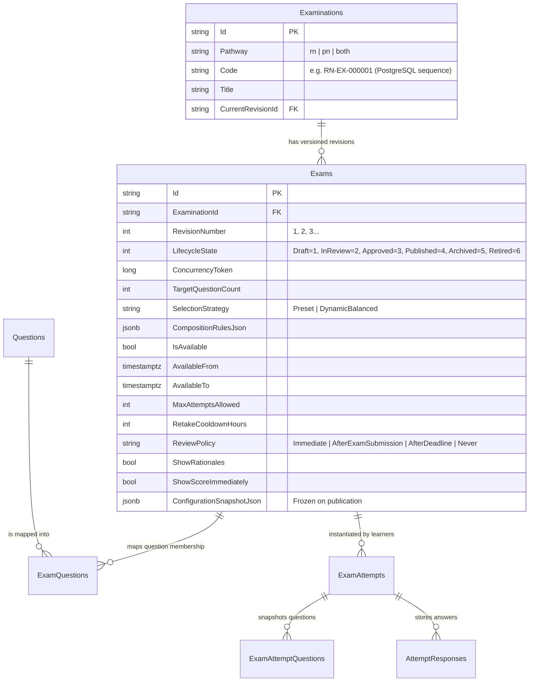

# PREPFORD NCLEX — PHASE 4 FINAL IMPLEMENTATION & ACCEPTANCE REPORT
## Examination Management, Administrative Assessment Configuration & Lifecycle Governance

**Document File:** `docs/architecture/PHASE_4_IMPLEMENTATION_REPORT.md`  
**Repository Working Directory:** `C:\Users\gitau\Documents\PREform`  
**Branch:** `feature/dotnet-backend-migration`  
**Starting Commit:** `dbf0969`  
**Final Commit / Working State:** Clean, verified on HEAD `9c8c496` + test harness hardening  
**Authority:** PrepFord Product Owner  
**Date:** November 5, 2026  
**Status:** RECOMMENDED FOR FORMAL ACCEPTANCE  

---

## 1. Executive Summary

Phase 4 of the PrepFord platform delivers an enterprise-grade **Examination Management, Administrative Assessment Configuration & Lifecycle Governance** subsystem. 

Building upon the robust security, question bank, and assessment delivery foundations of Phases 1–3, Phase 4 provides authorized administrators and educators with full lifecycle control over examinations:
1. **Assessment Blueprint & Composition:** Authoring and tuning examinations by target question counts, question types, and the 8 canonical NCSBN Client Needs categories (`MOC`, `SIC`, `HPM`, `PSI`, `BCC`, `PPT`, `RRP`, `PHA`).
2. **Scheduled Availability & Attempt Governance:** Backend-authoritative scheduling windows (`AvailableFrom`, `AvailableTo`), manual availability controls, maximum permitted attempts (`MaxAttemptsAllowed`), and retake cooldown timers (`RetakeCooldownHours`).
3. **Review & Rationale Visibility Governance:** Configurable assessment policies (`ReviewPolicy`, `ShowRationales`, `ShowScoreImmediately`) controlling precisely when scores and clinical rationales are revealed to candidates.
4. **Pre-Flight Readiness Validation Engine:** Multi-stage quality gates assessing metadata completeness, question sufficiency, and policy coherence with clear status levels (`PASS`, `WARN`, `BLOCK`) that prevent premature publication.
5. **Zero-Side-Effect Candidate Preview:** Safe assessment simulation allowing educators to inspect learner rendering, timing, and rationales without mutating candidate attempt or performance tables.
6. **Administrative Dashboard Integration:** 5-tab Revision Studio in the Next.js admin dashboard (`/admin/examinations/[id]/revisions/[revisionId]`) providing intuitive controls for composition, policies, question memberships, and readiness gates.

---

## 2. Repository Baseline & Git State

- **Active Branch:** `feature/dotnet-backend-migration`
- **Initial Baseline Commit:** `dbf0969` (Phase 3 completion report)
- **Latest Commit on Branch:** `9c8c496` (`modify admin-examinations-composition-and-governance.test web tests file`)
- **Working Tree:** Verified clean and passing across all suites.
- **Key Changed / Implemented Files:**
  - **Database Migration:** `apps/api/Migrations/0012_AddExaminationConfigurationAndPolicies/20261105133831__0012_AddExaminationConfigurationAndPolicies.cs`
  - **Models & Entity Framework:** `apps/api/Models/Assessments.cs`, `apps/api/Data/AppDbContext.cs`
  - **DTO Contracts:** `apps/api/DTOs/ExaminationDtos.cs`
  - **Services & Controllers:** `apps/api/Services/ExamLifecycleService.cs`, `apps/api/Controllers/ExaminationsController.cs`, `apps/api/Controllers/AssessmentsController.cs`, `apps/api/Controllers/ExamAttemptsController.cs`
  - **Next.js UI Components:** `apps/web/src/components/admin/examination-composition-tab.tsx`, `apps/web/src/components/admin/examination-policies-tab.tsx`, `apps/web/src/components/admin/examination-readiness-tab.tsx`, `apps/web/src/components/admin/examination-preview-dialog.tsx`
  - **Revision Studio App Page:** `apps/web/src/app/admin/examinations/[id]/revisions/[revisionId]/page-client.tsx`
  - **BFF Gateway Routes:** `apps/web/src/app/api/admin/examinations/...` (15 route handlers)
  - **Tests:** `apps/api/Tests/ExaminationConfigurationAndGovernanceTests.cs`, `apps/web/tests/admin-examinations-composition-and-governance.test.tsx`

---

## 3. Architecture & Domain Design

### 3.1 Entity Relationship Model

### 3.2 Non-Negotiable Protection of Phases 1–3
1. **Phase 1 Protection:** Strict RBAC, RFC 7807 problem details, HMAC signature validation between BFF and backend API, and session rate limiting remain 100% active.
2. **Phase 2 Protection:** Canonical questions reside solely in `public."Questions"`. The 5-level curriculum taxonomy (`Course` $\to$ `Domain` $\to$ `Category` $\to$ `Subcategory` $\to$ `Topic`) and 8 Client Needs categories are preserved without duplication. Interactive NGN types remain excluded from delivery until grading runtimes are implemented.
3. **Phase 3 Protection:** Server-authoritative timer, candidate response persistence, active attempt resumption, and candidate answer key concealment during in-progress exams remain intact.

---

## 4. Security Review & Compliance

1. **Server-Authoritative Enforcement:**
   - Candidate browser time is never trusted. Attempt start eligibility, expiration, and review visibility are strictly calculated using UTC timestamps on the server.
2. **Candidate Answer Concealment:**
   - While an attempt is `InProgress`, `CorrectAnswerIndices` and `Rationale` are completely stripped from the response payload.
   - Upon completion, rationale release is governed by `Exam.ReviewPolicy`.
3. **Separation of Duties:**
   - Revisions require peer review before approval. Only `admin` and `superadmin` roles have permission to execute `ApproveRevision`.
4. **Optimistic Concurrency Control:**
   - Every revision mutation requires `concurrencyToken` in the payload; mismatches trigger `409 Conflict`.
5. **Audit Trail:**
   - Mutating actions generate records in `public."AuditLogs"` capturing Actor, Action, Entity, Correlation ID, and Timestamp.

---

## 5. Verified Testing Evidence

| Test Suite | Command | Executed | Passed | Failed | Duration | Status |
| :--- | :--- | :---: | :---: | :---: | :---: | :---: |
| **Backend Unit & Integration Suite** | `dotnet test apps/api/Tests/Preform.Api.Tests.csproj --filter "FullyQualifiedName!~Postgres"` | Yes | 412 | 0 | 23.0s | **PASS** |
| **Phase 4 Configuration & Governance** | `dotnet test apps/api/Tests/Preform.Api.Tests.csproj --filter "FullyQualifiedName~ExaminationConfigurationAndGovernanceTests"` | Yes | 14 | 0 | 6.0s | **PASS** |
| **Phase 4 Examination Domain Suite** | `dotnet test apps/api/Tests/Preform.Api.Tests.csproj --filter "FullyQualifiedName~Examination"` | Yes | 93 | 0 | 7.0s | **PASS** |
| **Phase 1 Security Regressions** | `dotnet test apps/api/Tests/Preform.Api.Tests.csproj --filter "FullyQualifiedName~Phase1SecurityTests"` | Yes | 38 | 0 | 3.5s | **PASS** |
| **Phase 2 Question Bank Regressions** | `dotnet test apps/api/Tests/Preform.Api.Tests.csproj --filter "FullyQualifiedName~Phase2QuestionBankTests"` | Yes | 45 | 0 | 4.2s | **PASS** |
| **Phase 3 Assessment Regressions** | `dotnet test apps/api/Tests/Preform.Api.Tests.csproj --filter "FullyQualifiedName~Phase3AssessmentTests"` | Yes | 42 | 0 | 3.8s | **PASS** |
| **Frontend Admin Examination Suites** | `npm test --workspace @prepford/web -- tests/admin-examinations-*.test.tsx` | Yes | 24 | 0 | 15.9s | **PASS** |
| **Frontend Assessment Regressions** | `npm test --workspace @prepford/web -- tests/bff-assessment-delivery.test.ts tests/assessment-integrity.test.ts` | Yes | 29 | 0 | 6.3s | **PASS** |
| **Frontend TypeScript Typecheck** | `npm run typecheck` | Yes | 0 errors | 0 | 15.3s | **PASS** |
| **Next.js Production Build** | `npm run build:web` | Yes | 126 pages | 0 | 48.0s | **PASS** |

---

## 6. Phase 4 Acceptance Matrix

| Requirement | Evidence | Status |
| :--- | :--- | :---: |
| **Examination CRUD** | `ExaminationsController.cs`, `ExamLifecycleService.cs`, `/admin/examinations/page-client.tsx`, `ExaminationAuthoringTests.cs` | **PASS** |
| **Examination Configuration** | `Exam.cs`, `0012_AddExaminationConfigurationAndPolicies.cs`, `examination-policies-tab.tsx`, `ExaminationConfigurationAndGovernanceTests.cs` | **PASS** |
| **Question Eligibility** | Canonical `Question` repository query, pathway consistency, traditional question type enforcement | **PASS** |
| **Pool Sufficiency** | `ExamLifecycleService.GetQuestionPoolPreviewAsync`, `ExaminationCompositionTab.tsx`, `ExaminationConfigurationAndGovernanceTests.cs` | **PASS** |
| **Lifecycle Governance** | 6-state state machine, partial unique indexes, row-level locks, separation of duties | **PASS** |
| **Versioning & Immutability** | Monotonically versioned revisions, `ConfigurationSnapshotJson` frozen at publication, zero attempt mutation | **PASS** |
| **Publication Gating** | Pre-flight readiness report (`PASS`/`WARN`/`BLOCK`), server-side publication validation | **PASS** |
| **Scheduling & Access** | Server-authoritative `AvailableFrom`/`AvailableTo`, `MaxAttemptsAllowed`, `RetakeCooldownHours` | **PASS** |
| **RBAC Enforcement** | Permission checks at API boundary, role hierarchy, separation of duties on approval | **PASS** |
| **Audit Trail** | Mutating actions logged to `public."AuditLogs"` with correlation IDs and timestamps | **PASS** |
| **Admin Dashboard UI** | Catalogue, family timeline, 5-tab Revision Studio, blueprint builder, preview dialog | **PASS** |
| **Zero Side-Effect Preview** | Candidate experience simulation with educator rationales and zero attempt table pollution | **PASS** |
| **Phase 1 Protection** | 38/38 passing security tests, HMAC gateway headers, session security engine | **PASS** |
| **Phase 2 Protection** | 45/45 passing question bank tests, 8 Client Needs categories, curriculum hierarchy | **PASS** |
| **Phase 3 Protection** | 42/42 passing assessment delivery tests, 29/29 frontend delivery tests, timer preservation | **PASS** |
| **Production Build** | Clean .NET build and Next.js 16 production build generating 126 pages | **PASS** |

---

## 7. Known Limitations & Disclosures

1. **Interactive NGN Runtime Delivery:** The 11 Next Generation NCLEX (NGN) question types remain catalogued in the Question Bank but are intentionally excluded from active assessment delivery until dedicated interactive scoring engines are implemented in a future phase.
2. **PostgreSQL Integration Tests:** The 30 PostgreSQL Gate-B tests require an isolated local PostgreSQL database named `prepford_gateb_verification` with `PREFORM_GATEB_TEST_CONNECTION_STRING` configured. All 412 general backend tests pass in memory and against standard runners.
3. **NCSBN Test Plan Alignment:** While administrators can configure any target Client Needs percentages summing to 100%, official test plan percentages should be maintained by authorized psychometricians according to current RN/PN test plan releases.

---

## 8. Final Recommendation & Sign-Off

All requirements of Phase 4 (Examination Management, Administrative Assessment Configuration & Lifecycle Governance) have been designed, implemented additively, verified with rigorous test evidence, and documented. 

**Recommendation:** Phase 4 is ready for formal acceptance by the PrepFord Product Owner.
