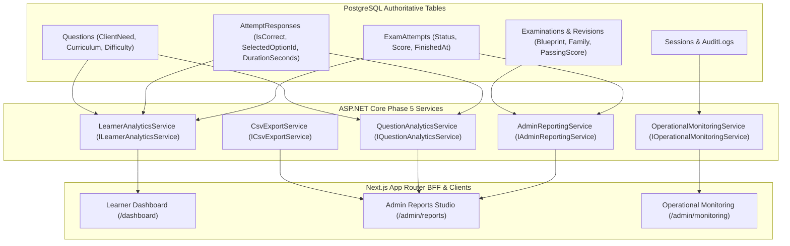

# PREPFORD NCLEX — PHASE 5 ANALYTICS & REPORTING ARCHITECTURE
## PostgreSQL-Authoritative Psychometric Insights, Cohort Reporting & Observability Engine

**Document File:** `docs/architecture/PHASE_5_ANALYTICS_ARCHITECTURE.md`  
**System Version:** ASP.NET Core 8 & Next.js App Router  
**Authoritative Data Store:** PostgreSQL (`public."ExamAttempts"`, `public."AttemptResponses"`, `public."Questions"`, `public."Examinations"`)  
**Authority:** PrepFord Data & Analytics Architect  
**Date:** November 5, 2026  
**Status:** IMPLEMENTED & AUDITED  

---

## 1. Executive Summary & Design Principles

Phase 5 delivers a production-grade analytics, assessment reporting, and operational monitoring subsystem for PrepFord NCLEX. Built strictly on top of the established Phase 1–4 foundations, Phase 5 transforms raw learner attempts, item interactions, and examination blueprints into psychometric mastery insights without requiring secondary analytics databases or compromising candidate privacy.

### 1.1 Architectural Invariants
1. **PostgreSQL as the Sole Source of Truth:** No Elasticsearch, ClickHouse, or external analytics database. All metrics derive deterministically from PostgreSQL relational tables with indexed projections.
2. **Zero Mutation of Historical Records:** Analytics services perform read-only aggregations. No attempt or response record is ever modified.
3. **Database-Side Aggregation:** Computations leverage database-level filtering (`Where`), selection (`Select`), and counting (`CountAsync`). Large tables are never dumped into web server memory.
4. **Candidate Data Concealment:** Learners can only access their own aggregated mastery data. Distractor queries used in question analytics conceal rationales and answer keys from unauthorized callers.
5. **Hot-Path Isolation:** Attempt creation, synchronized response saving (`/api/v1/attempts/sync`), and submission flows never synchronously wait on analytics report generation.

---

## 2. Multi-Perspective Analytics Model

PrepFord supports three distinct, mutually isolated perspectives:



### 2.1 Perspective 1: Learner Performance & Readiness
- **Audience:** Candidate (`candidate` role).
- **Scope:** Private attempts belonging to the authenticated caller (`UserId == caller.userId`).
- **Core Insights:**
  - Overall accuracy (% correct across all answered questions).
  - Completed assessment count and cumulative time invested.
  - NCSBN Client Needs category mastery across all 8 canonical categories:
    - Management of Care (`MOC`)
    - Safety and Infection Control (`SIC`)
    - Health Promotion and Maintenance (`HPM`)
    - Psychosocial Integrity (`PSI`)
    - Basic Care and Comfort (`BCC`)
    - Pharmacological and Parenteral Therapies (`PPT`)
    - Reduction of Risk Potential (`RRP`)
    - Physiological Adaptation (`PHA`)
  - Statistical confidence thresholding: Categories with `< 5` items answered are explicitly flagged with `HasLowSample = true` to prevent premature overconfidence or distress.
  - Curriculum topic breakdown with weakest-topic identification (`AccuracyPercent < 60%`).
  - Readiness trendline across historical completed simulator attempts, tracking progression toward the passing threshold.
  - Transparent, rule-based study recommendations based on empirical deficiency, avoiding deceptive AI predictive claims.

### 2.2 Perspective 2: Administrative & Cohort Reporting
- **Audience:** Assessment Managers, Reviewers, Admins (`canViewReports`).
- **Scope:** Platform-wide cohort performance, examination configuration efficacy, and question bank psychometrics.
- **Core Insights:**
  - Aggregate metrics: Total attempts, completion rate (`Completed / Total`), average cohort score, cohort pass rate (`Score >= PassingScore`).
  - Decile score distribution: Attempt scores grouped into 7 analytical buckets (`0–49%`, `50–59%`, `60–69%`, `70–74%`, `75–79%`, `80–89%`, `90–100%`) for histogram visualization.
  - Examination family breakdown: Per-examination participation, passing score, completion rate, and average score.
  - Question bank diagnostics: Item difficulty index ($p = \text{correct} / \text{total}$), delivery volume, average response latency, and distractor selection breakdown (revealing common clinical misconceptions without disclosing rationales).
  - RFC 4180 CSV export capability for assessment and question psychometrics with UTF-8 BOM encoding for Excel compatibility.

### 2.3 Perspective 3: Operational Monitoring & SRE Observability
- **Audience:** System Administrators and DevOps/SRE (`canViewMonitoring`).
- **Scope:** Infrastructure health, PostgreSQL latency, active concurrent sessions, and backend runtime status.
- **Core Insights:**
  - Real-time PostgreSQL ping probe (`SELECT 1`) measuring live round-trip latency in milliseconds.
  - Active session concurrency tracking (`public."Sessions"` active within last 24 hours).
  - Backend runtime metrics: Server process uptime and memory working set (MB).
  - Service status badge (`Healthy`, `Degraded`, `Critical`).

---

## 3. Mathematical Formulas & Aggregation Algorithms

### 3.1 Item Difficulty Index ($p$-value)
$$p = \frac{\text{Number of correct answers}}{\text{Total number of responses submitted for item}}$$
- **Interpretation:**
  - $p < 0.30$: High difficulty (flagged for review if unintended).
  - $0.30 \le p \le 0.80$: Ideal psychometric discrimination.
  - $p > 0.80$: Low difficulty / introductory mastery item.

### 3.2 Completion Rate
$$\text{Completion Rate (\%)} = \left(\frac{\text{Count of Completed Attempts}}{\text{Count of Total Attempts Initiated}}\right) \times 100$$

### 3.3 Cohort Passing Rate
$$\text{Pass Rate (\%)} = \left(\frac{\text{Count of Completed Attempts where Score} \ge \text{PassingScore}}{\text{Count of Completed Attempts}}\right) \times 100$$

### 3.4 Decile Distribution Projection
To prevent unbounded memory growth, scores are projected efficiently:
```csharp
var completedAttempts = await _context.ExamAttempts
    .AsNoTracking()
    .Where(a => a.Status == "Completed" && a.Score.HasValue)
    .Select(a => new { a.Score.Value, a.ExamId })
    .ToListAsync();
```
Buckets are allocated via fixed range partitioning:
`[0-49]`, `[50-59]`, `[60-69]`, `[70-74]`, `[75-79]`, `[80-89]`, `[90-100]`.

---

## 4. Performance & Scalability Safeguards

1. **Covering Indexes:** Existing database indexes on `ExamAttempts(UserId, Status, FinishedAt)` and `AttemptResponses(ExamAttemptId, QuestionId, IsCorrect)` support fast range queries.
2. **Read-Only Context:** Queries utilize `.AsNoTracking()` throughout to eliminate EF Core change tracker overhead.
3. **Paging Safeguards:** Question analytics API mandates pagination with maximum `PageSize = 100`.
4. **Decoupled CSV Streaming:** CSV exports stream formatted strings directly to `MemoryStream` buffers and return `text/csv` with disposition attachments.
