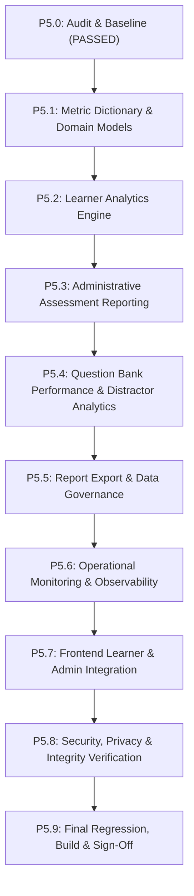

# PREPFORD NCLEX — PHASE 5 IMPLEMENTATION PLAN
## Architecture, Roadmap, Execution Stages & Acceptance Gates

**Document File:** `docs/architecture/PHASE_5_IMPLEMENTATION_PLAN.md`  
**Repository Working Directory:** `C:\Users\gitau\Documents\PREform`  
**Branch:** `feature/dotnet-backend-migration`  
**Phase 4 Baseline:** `9c8c496` | **Current HEAD:** `78b615b`  
**Date:** November 5, 2026  
**Status:** APPROVED FOR STAGE-BY-STAGE EXECUTION  

---

## 1. Architectural Strategy & Guiding Principles

1. **PostgreSQL as Sole Authoritative Truth:**
   - Zero duplicate analytics databases, external cache stores, or desynchronized materialized views.
   - All analytics queries perform database-side aggregation via EF Core LINQ projections (`GroupBy`, `Select`, `CountAsync`, `AverageAsync`, `SumAsync`) to ensure minimal memory footprint and real-time freshness.
2. **Preservation of Phases 1–4:**
   - Strict adherence to Phase 1 RBAC, session policies, RFC 7807 problem details, and HMAC authentication.
   - Zero modification of canonical question structures or Phase 3 attempt completion and sync contracts.
   - Zero mutation of historical attempts. Historical question snapshots and attempt memberships remain immutable.
3. **Additive Development:**
   - New domain services, DTOs, controllers, and Next.js BFF routes are introduced additively.
   - Existing endpoints and tests continue to operate without alteration.
4. **Data Governance & Privacy:**
   - Learner analytics are accessible only by the owning learner and authorized administrative roles (`admin`, `superadmin`).
   - Reporting queries exclude candidate PII and answer keys. Distractor analytics are restricted to administrative staff.

---

## 2. Execution Stages & Acceptance Gates

### Stage P5.1 — Analytics Domain & Metric Dictionary
- **Deliverable:** `docs/architecture/PHASE_5_ANALYTICS_METRIC_DICTIONARY.md`
- **Scope:** Define mathematical formulas, inclusion criteria, data sources, time windows, and threshold tiers for every metric across learner, administrative, and operational domains.
- **Gate:** Formulas verified against assessment models; status rules explicit; unit test definitions established.

### Stage P5.2 — Learner Performance Analytics Engine
- **Backend Components:**
  - `ILearnerAnalyticsService` & `LearnerAnalyticsService` in `apps/api/Services/Analytics/`
  - `LearnerAnalyticsController` in `apps/api/Controllers/`
  - DTOs: `LearnerAnalyticsSummaryDto`, `ClientNeedMasteryDto`, `TopicMasteryDto`, `ReadinessTrendDto`, `StudyRecommendationDto`
- **Endpoints:**
  - `GET /api/v1/learner/analytics/summary`
  - `GET /api/v1/learner/analytics/client-needs`
  - `GET /api/v1/learner/analytics/curriculum`
  - `GET /api/v1/learner/analytics/readiness-trend`
  - `GET /api/v1/learner/analytics/recommendations`
- **Gate:** Authorization verified (learners cannot view other learners' data); database-side aggregations verified; empty states handled; backend unit tests pass.

### Stage P5.3 — Administrative Assessment Reporting Subsystem
- **Backend Components:**
  - `IAdminReportingService` & `AdminReportingService` in `apps/api/Services/Analytics/`
  - `AdminReportsController` in `apps/api/Controllers/`
  - DTOs: `AdminOverviewMetricsDto`, `AssessmentReportDto`, `ExaminationRevisionReportDto`, `ScoreDistributionBucketDto`
- **Endpoints:**
  - `GET /api/v1/admin/reports/overview` (replaces hardcoded "TBD" cards on `/admin`)
  - `GET /api/v1/admin/reports/assessments` (filterable by pathway, exam, date range, status)
  - `GET /api/v1/admin/reports/examinations/{id}/revisions` (revision comparison)
- **Gate:** Strict admin authorization; pagination and date bounding enforced; unit/integration tests pass.

### Stage P5.4 — Question Bank Performance & Distractor Analytics
- **Backend Components:**
  - `IQuestionAnalyticsService` & `QuestionAnalyticsService` in `apps/api/Services/Analytics/`
  - Endpoints in `AdminReportsController` or `QuestionsController`:
    - `GET /api/v1/admin/reports/questions/performance`
    - `GET /api/v1/admin/reports/questions/{id}/distractors`
- **Metrics:** Delivery count, response count, correct response rate, distractor frequency breakdown, average response time.
- **Gate:** Answer keys protected; distractor rates accurately calculated from `AttemptResponses`; tests pass.

### Stage P5.5 — Report Export & Data Governance
- **Backend Components:**
  - `ICsvExportService` & `CsvExportService` in `apps/api/Services/Analytics/`
  - Streaming CSV generation for assessment reports and question performance.
  - Endpoints:
    - `GET /api/v1/admin/reports/assessments/export`
    - `GET /api/v1/admin/reports/questions/export`
- **Gate:** Memory-safe streaming response; RFC 4180 CSV compliance; sensitive fields excluded; tests pass.

### Stage P5.6 — Operational Monitoring & Observability
- **Backend Components:**
  - `IOperationalMonitoringService` & `OperationalMonitoringService` in `apps/api/Services/Monitoring/`
  - `AdminMonitoringController` in `apps/api/Controllers/`
  - Endpoint: `GET /api/v1/admin/monitoring/health`
  - Telemetry: DB response time probe, memory usage, process uptime, recent error rates, audit action rates.
- **Gate:** Non-disruptive to attempt delivery; restricted to administrators; tests pass.

### Stage P5.7 — Frontend Learner & Admin Integration
- **Next.js BFF Handlers:**
  - Routes in `apps/web/src/app/api/learner/analytics/...` and `apps/web/src/app/api/admin/reports/...` and `apps/web/src/app/api/admin/monitoring/...`
- **UI Enhancements:**
  - Learner Dashboard (`apps/web/src/app/dashboard/page-client.tsx`): Replace `SAMPLE_BENCHMARK_ATTEMPTS` with live backend analytics; render real Client Needs breakdown, readiness trend, and recommendations.
  - Admin Overview (`apps/web/src/app/admin/page-client.tsx`): Populate metric cards with real data from `/api/admin/reports/overview`.
  - Admin Navigation (`apps/web/src/lib/admin/navigation.tsx`): Add "Analytics & Reports" and "System Health" navigation items.
  - Admin Reports & Monitoring Studio (`apps/web/src/app/admin/reports/` and `apps/web/src/app/admin/monitoring/`): Filterable tables, score distribution, question analytics, and CSV download.
- **Gate:** Clean UI rendering; loading/empty/error states; responsive layout; zero console errors.

### Stage P5.8 — Security, Privacy & Integrity Verification
- **Automated Security Tests:** Cross-tenant authorization checks, candidate parameter tampering, rate limiting on analytics queries, and answer key exclusion.
- **Gate:** 100% pass across all security and data-integrity test suites.

### Stage P5.9 — Regression, Final Build & Documentation
- **Verification Commands:**
  - Backend test suites (all unit, integration, and security regressions).
  - Frontend test suites (Vitest).
  - Frontend typecheck (`npm run typecheck`).
  - Next.js production build (`npm run build:web`).
- **Final Documentation:**
  - `docs/architecture/PHASE_5_ANALYTICS_METRIC_DICTIONARY.md`
  - `docs/architecture/PHASE_5_ANALYTICS_ARCHITECTURE.md`
  - `docs/architecture/PHASE_5_API_CONTRACTS.md`
  - `docs/architecture/PHASE_5_SECURITY_REVIEW.md`
  - `docs/architecture/PHASE_5_OPERATIONAL_MONITORING.md`
  - `docs/architecture/PHASE_5_TEST_REPORT.md`
  - `docs/architecture/PHASE_5_IMPLEMENTATION_REPORT.md`
- **Gate:** Full green test suite; production build succeeds; audit sign-off.
