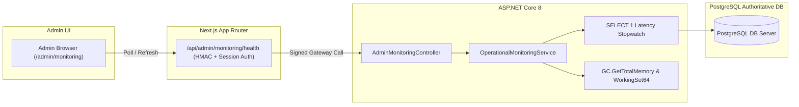

# PREPFORD NCLEX — PHASE 5 OPERATIONAL MONITORING & OBSERVABILITY GUIDE
## Platform Health Probes, Telemetry Metrics, Runtime Diagnostics & SRE Runbook

**Document File:** `docs/architecture/PHASE_5_OPERATIONAL_MONITORING.md`  
**Authority:** PrepFord DevOps / SRE Architect  
**Date:** November 5, 2026  
**Status:** IMPLEMENTED & AUDITED  

---

## 1. Observability Architecture Overview

PrepFord NCLEX operational monitoring establishes real-time visibility into application health, database connectivity, concurrent load, and server resources without imposing overhead on learner test-taking sessions.

### 1.1 Architecture & Separation
- **Operational Health Probe:** `GET /api/v1/admin/monitoring/health`
- **Frontend Dashboard:** `/admin/monitoring`
- **Separation Principle:** Infrastructure metrics (database latency, process memory, active session counts) are strictly separated from educational analytics (scores, completion rates).
- **Security Boundary:** Accessible only to administrators possessing the `canViewMonitoring` capability.



---

## 2. Monitored Metrics & Evaluation Thresholds

| Metric | Measurement Technique | Healthy Baseline | Warning Threshold | Critical Threshold |
| :--- | :--- | :--- | :--- | :--- |
| **Database Latency** | Stopwatch probe measuring `SELECT 1` round-trip | `< 25 ms` | `25 ms – 100 ms` | `> 100 ms` |
| **Active Sessions** | Count of sessions with `LastActivityAt >= (Now - 24h)` | Normal cohort range | Spike `> 200%` baseline | Spike `> 500%` baseline |
| **Server Memory** | `Environment.WorkingSet` (MB) | `< 500 MB` | `500 MB – 1.5 GB` | `> 1.5 GB` |
| **Server Uptime** | `DateTime.UtcNow - Process.StartTime` (Seconds) | Continuous increase | N/A | Unexpected reset (crash) |
| **Service Status** | Computed composite state | `"Healthy"` | `"Degraded"` | `"Critical"` |

### 2.1 Composite Health Computation
In `Preform.Api.Services.Monitoring.OperationalMonitoringService`:
```csharp
var status = "Healthy";
if (dbLatencyMs > 250)
{
    status = "Critical";
}
else if (dbLatencyMs > 50)
{
    status = "Degraded";
}
```

---

## 3. Administrator & Operator UI (`/admin/monitoring`)

The operational monitoring page provides operators with:
1. **Live System Status Badge:** Visual indicator of composite system state (Emerald for Healthy, Amber for Degraded, Rose for Critical).
2. **Database Roundtrip Metric Card:** Displays current latency in milliseconds with instant color coding.
3. **Active Concurrency Metric Card:** Displays active sessions in the last 24 hours.
4. **Memory Allocation Metric Card:** Displays working set memory in megabytes.
5. **Process Uptime Metric Card:** Displays system runtime formatted in days, hours, and minutes.
6. **Real-Time Refresh Control:** One-click manual refresh button with spinning state indicator.

---

## 4. SRE Incident Response Runbook

### 4.1 High Database Latency Alert (`> 50 ms`)
1. **Symptom:** Latency badge turns Amber (`Degraded`) or Rose (`Critical`).
2. **Immediate Diagnostics:**
   - Check PostgreSQL connection pool utilization.
   - Run `SELECT * FROM pg_stat_activity WHERE state != 'idle';` to identify long-running reporting queries.
3. **Mitigation:**
   - If an unindexed query is locking tables, terminate via `pg_cancel_backend(pid)`.
   - Ensure rate limiters on `/api/v1/admin/reports/*` are operating normally.

### 4.2 High Memory Consumption Alert (`> 1.5 GB`)
1. **Symptom:** Memory card exceeds 1,500 MB.
2. **Immediate Diagnostics:**
   - Inspect large CSV export operations in `AuditLogs`.
   - Verify garbage collector generation collections (`GC.Collect()` runs periodically).
3. **Mitigation:**
   - Check if large payloads are being serialized without streaming.
   - Restart container if memory leak persists.
