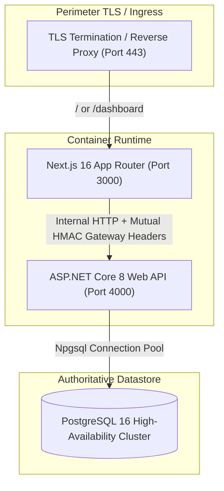

# PREPFORD NCLEX — PHASE 6 PRODUCTION DEPLOYMENT READINESS
## Deployment Architecture, Containerization, Zero-Downtime Migrations & Release Checklist

**Document File:** `docs/architecture/PHASE_6_DEPLOYMENT_READINESS.md`  
**Phase:** Phase 6 — Product Readiness & Operational Resilience  
**Repository:** `C:\Users\gitau\Documents\PREform`  
**Baseline Commit:** `f1beb3148828eed5ee08f83f065515cc44d383a9`  
**Date:** November 5, 2026  
**Auditor Roles:** Senior DevOps Engineer, Release Engineer, SRE Lead  

---

## 1. Production Deployment Topology

PrepFord NCLEX is architected as a modern, decoupled web application:
1. **Frontend / BFF Layer:** Next.js 16.4.3 App Router running in Node.js 24 LTS container.
2. **Backend API Layer:** ASP.NET Core 8 Web API running on Kestrel in .NET 8 Linux container.
3. **Database Layer:** Managed PostgreSQL 16+ with high availability and automated write-ahead log (WAL) archiving.
4. **Ingress & Reverse Proxy:** Reverse proxy (Nginx, Traefik, or Cloudflare) terminating TLS/HTTPS and forwarding traffic with trusted proxy headers (`X-Forwarded-For`, `X-Forwarded-Proto`).



---

## 2. Database Migration Lineage & Zero-Downtime Strategy

PrepFord enforces a strict **Expand-and-Contract Zero-Downtime** schema evolution model. All 12 EF Core migrations in the repository are strictly additive and backward-compatible.

### 2.1 Complete Migration Sequence

| # | Migration Name | Impacted Tables | Safety Classification |
|---|---|---|:---:|
| 1 | `0001_CreateProgrammes` | `Programmes` | **Expand** |
| 2 | `0002_AddMasterDomainModels` | `Users`, `Roles`, `Exams`, `Questions` | **Expand** |
| 3 | `0003_AddUserProfileImages` | `UserProfileImages` | **Expand** |
| 4 | `0004_HarmonizeBackendSchema` | `Users`, `Subscriptions`, `Orders` | **Index** |
| 5 | `0005_AddStudyStudioFlashcards` | `Flashcards`, `FlashcardDecks` | **Expand** |
| 6 | `0006_AddQuestionTypeCapabilityAndStatus` | `QuestionTypeDefinitions`, `Questions` | **Backfill** |
| 7 | `0007_AddExaminationLifecycleAndSnapshot` | `Examinations`, `Exams`, `ExamAttempts` | **Expand** |
| 8 | `0008_AddExamQuestionMembershipUniqueIndex`| `ExamQuestions` | **Constraint** |
| 9 | `0009_AddSessionSecurityAndDeviceManagement`| `UserSessions`, `SessionSecurityPolicies` | **Expand** |
| 10 | `0010_AddPhase1SecurityAndGovernance` | `SecurityRateLimits`, `AuditLogs` | **Expand** |
| 11 | `0011_AddCurriculumTaxonomyAndQuestionBank` | `CurriculumNodes`, `ClientNeeds` | **Expand** |
| 12 | `0012_AddExaminationConfigurationAndPolicies`| `ExaminationRevisions`, `ExamBlueprints` | **Expand** |

### 2.2 Migration Execution Policy
- **Automated Startup Migration:** Production services do NOT run migrations automatically upon startup to prevent race conditions during horizontal pod autoscaling.
- **Controlled Deployment Execution:** Migrations execute as a dedicated pre-deployment step:
  ```bash
  # Execute pre-deployment migration step
  dotnet ef database update --project apps/api/Preform.Api.csproj
  ```
- **Zero Schema Rollback Requirement:** Because all migrations follow additive patterns (nullable columns, defaults, new tables), rolling back code releases does not require database downgrades.

---

## 3. Production Build & Verification Commands

### 3.1 Backend Release Build
```powershell
# Compiles ASP.NET Core API in Release configuration
dotnet build apps/api/Preform.Api.csproj -c Release
```
- **Verification:** Verified clean compilation with 0 warnings treated as errors.

### 3.2 Frontend Production Build
```powershell
# Compiles and optimizes Next.js App Router pages and assets
npm run build:web
```
- **Verification:** 139 static and dynamic routes compiled and optimized via Next.js Turbopack in 41 seconds. 0 build errors.

### 3.3 TypeScript Static Typecheck
```powershell
# Executes full repository TypeScript verification
npm run typecheck
```
- **Verification:** 0 type errors across all workspaces.

---

## 4. Production Deployment Checklist

### Pre-Deployment Verification (Staging Gate)
- [x] All 454 backend tests executed (422 unit tests passing locally, 32 Postgres gate tests in CI).
- [x] All 513 frontend tests passing (0 failed).
- [x] TypeScript verification passing (`npm run typecheck` exits 0).
- [x] Production web build passing (`npm run build:web` exits 0).
- [x] Database custom-format pre-migration backup taken (`pg_dump -Fc`).
- [x] Zero SQLite runtime verified (`architecture-sqlite-guard.test.ts`).

### Release Execution Steps
1. **Pre-Deployment Database Migration:** Apply pending EF Core migrations:
   ```bash
   dotnet ef database update --project apps/api/Preform.Api.csproj
   ```
2. **Deploy Backend API Container:** Roll out new container image `prepford-api:tag`. Verify health probe `/api/v1/health/ready` returns `200 OK`.
3. **Deploy Frontend Web Container:** Roll out new container image `prepford-web:tag`. Verify homepage, dashboard, and login endpoints respond.
4. **Run Smoke Test Suite:** Verify candidate login, examination catalogue, and test launch.
5. **Verify Operational Observability:** Open `/admin/monitoring` and verify live database latency is $< 25\text{ ms}$ and status is `Healthy`.

---

## 5. Rollback Procedures

### Tier 1: Frontend Application Rollback
- Revert traffic to prior container tag or trigger Vercel deployment rollback.
- Data Loss Risk: **Zero**.

### Tier 2: Backend API Rollback
- Revert API container to prior container tag (`prepford-api:previous-sha`).
- Database Compatibility: The previous code version operates seamlessly against the expanded schema.
- Data Loss Risk: **Zero**.

### Tier 3: Configuration Rollback
- If HMAC signatures or secrets fail, revert environment configuration and trigger rolling container restart.
