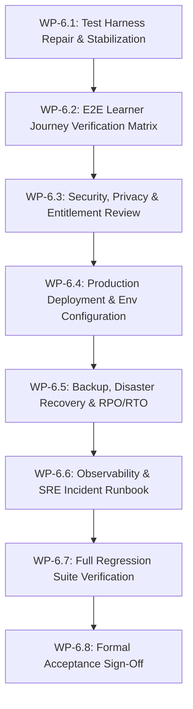

# PREPFORD NCLEX — PHASE 6 IMPLEMENTATION PLAN
## Controlled Execution Roadmap, Work Packages, Risk Mitigation & Stage Gates

**Document File:** `docs/architecture/PHASE_6_IMPLEMENTATION_PLAN.md`  
**Phase:** Phase 6 — Product Readiness & Operational Resilience  
**Repository:** `C:\Users\gitau\Documents\PREform`  
**Baseline Commit:** `f1beb3148828eed5ee08f83f065515cc44d383a9`  
**Date:** November 5, 2026  
**Auditor Roles:** Principal Software Architect, Senior Release Engineer, QA Automation Lead  

---

## 1. Plan Structure & Execution Rules

Phase 6 executes strictly in a controlled, additive manner following the empirical findings established in `PHASE_6_AUDIT_REPORT.md` and `PHASE_6_GAP_ANALYSIS.md`. 

### 1.1 Non-Negotiable Execution Rules
1. **Zero Destructive Operations:** No Git resets, rebases, or force operations. No schema drops or destructive DDL.
2. **Preserve Phases 1–5 Foundations:** RBAC policies, question bank models, assessment synchronization contracts (`POST /api/v1/attempts/sync`), frozen attempt snapshots, and analytics services remain immutable.
3. **Additive & Bounded Changes:** Only genuine gap items identified in the audit will be addressed.
4. **Mandatory Stage Gates:** Each work package must pass its verification criteria before the next work package commences.

---

## 2. Work Package Breakdown

---

### Work Package WP-6.1: Test Harness Repair & Stabilization
- **Objective:** Fix obsolete assertion in `apps/web/tests/admin-shell.test.tsx` and stabilize learner security settings test.
- **Affected Files:**
  - `apps/web/tests/admin-shell.test.tsx`
  - `apps/web/tests/learner-security-settings.test.tsx`
- **Actions:**
  1. Update `admin-shell.test.tsx` line 120: recognize that `/admin/questions` and other Phase 2–5 routes are genuine pages; assert exclusion only for true placeholders (`/admin/programmes`, `/admin/exams`).
  2. Increase timeout in `learner-security-settings.test.tsx` to prevent CPU starvation timeouts during concurrent full-suite execution.
- **Verification:** Run `npm test --workspace @prepford/web -- tests/admin-shell.test.tsx tests/learner-security-settings.test.tsx`. 100% pass required.

---

### Work Package WP-6.2: End-to-End Learner Journey Verification Matrix
- **Objective:** Establish the comprehensive verification matrix for all 6 core learner journeys:
  - Journey A: Account creation and authentication
  - Journey B: Learner onboarding and dashboard
  - Journey C: Study and question practice
  - Journey D: Assessment lifecycle (Start -> Sync -> Submit -> Result)
  - Journey E: Assessment recovery, timers, and synchronization
  - Journey F: Results, analytics, and account management
- **Deliverable:** `docs/architecture/PHASE_6_LEARNER_JOURNEY_TEST_MATRIX.md`.
- **Verification:** Map every step of Journeys A–F to existing automated test evidence and verify end-to-end execution.

---

### Work Package WP-6.3: Comprehensive Security, Privacy & Entitlement Review
- **Objective:** Document the platform-wide security posture, verifying IDOR protections, credential handling, RBAC hierarchy, answer-key concealment, and subscription entitlement calculation.
- **Deliverable:** `docs/architecture/PHASE_6_SECURITY_REVIEW.md`.
- **Verification:** Cross-check with `Phase1SecurityTests.cs`, `SessionSecurityEngineTests.cs`, and `checkout-security.test.ts`.

---

### Work Package WP-6.4: Production Deployment Readiness & Environment Variables Reference
- **Objective:** Document the production deployment architecture, Docker Compose setup, CI workflow gates, migration application strategy, and an exhaustive environment variable reference.
- **Deliverables:**
  - `docs/architecture/PHASE_6_DEPLOYMENT_READINESS.md`
  - `docs/architecture/PHASE_6_ENVIRONMENT_VARIABLES.md`
- **Verification:** Verify all variables against `.env.example`, `appsettings.json`, and Next.js configuration loaders.

---

### Work Package WP-6.5: Backup, Restore & Disaster Recovery Specifications
- **Objective:** Consolidate the disaster recovery plan, defining RPO (1 hour) and RTO (15 minutes), custom dump procedures (`pg_dump -Fc`), restore commands (`pg_restore`), and recovery verification evidence.
- **Deliverable:** `docs/architecture/PHASE_6_BACKUP_AND_RECOVERY.md`.
- **Verification:** Validate restore syntax against PostgreSQL 16 standards.

---

### Work Package WP-6.6: Observability, SRE Incident Runbook & Operational Resilience
- **Objective:** Provide a practical SRE incident triage guide covering severity levels (P1–P4), correlation ID tracing, database latency mitigation, and connection pool troubleshooting.
- **Deliverable:** `docs/architecture/PHASE_6_OPERATIONAL_RUNBOOK.md`.
- **Verification:** Verify log format and correlation ID propagation across BFF and API.

---

### Work Package WP-6.7: Full Automated Regression Verification
- **Objective:** Execute the entire automated test suite across backend and frontend, and perform static analysis and production build checks.
- **Deliverable:** `docs/architecture/PHASE_6_TEST_REPORT.md`.
- **Verification Commands:**
  1. `dotnet test apps/api/Tests/Preform.Api.Tests.csproj --no-build --filter "FullyQualifiedName!~Postgres"`
  2. `npm test --workspace @prepford/web`
  3. `npm run typecheck`
  4. `npm run build:web`

---

### Work Package WP-6.8: Formal Implementation & Acceptance Reporting
- **Objective:** Compile the final Phase 6 Implementation Report and formal Product Owner Acceptance Report evaluating all 10 acceptance gates.
- **Deliverables:**
  - `docs/architecture/PHASE_6_IMPLEMENTATION_REPORT.md`
  - `docs/architecture/PHASE_6_ACCEPTANCE_REPORT.md`
- **Verification:** Complete gate checklist and formal recommendation sign-off.
