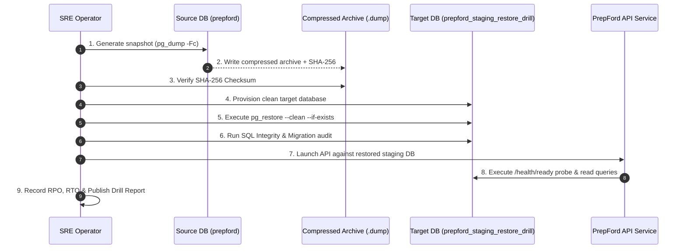

# PrepFord NCLEX — Phase 6 Staging PostgreSQL Restore Drill Plan

**Document File:** `docs/architecture/PHASE_6_RESTORE_DRILL_PLAN.md`  
**Execution Objective:** Demonstrate and empirically measure Disaster Recovery Objectives ($\text{RPO} \le 1\text{ hour}$, $\text{RTO} \le 15\text{ minutes}$)  
**Target Environment:** Isolated Staging PostgreSQL Database (`prepford_staging_restore_drill`)  
**Production Source Database:** `prepford` (Read-only snapshot extraction)  
**Database Engine:** PostgreSQL 16+ (PostgreSQL 18.6 verified)  
**Audit Lead:** Lead Database Reliability Engineer (DBRE) / Platform SRE  
**Execution Date:** November 5, 2026  

---

## 1. Disaster Recovery Criteria & Acceptance Targets

| Metric | Threshold Target | Validation Methodology |
| :--- | :---: | :--- |
| **Recovery Point Objective (RPO)** | **$\le 60$ Minutes** | Difference between the backup snapshot generation timestamp and failure simulation point. |
| **Recovery Time Objective (RTO)** | **$\le 15$ Minutes** | Total elapsed wall-clock duration from recovery initiation to operational readiness and passing health verification. |
| **Data Integrity Parity** | **100% Match** | Complete parity across table counts, applied migrations, user accounts, questions, examinations, and attempt histories. |
| **Relational Integrity** | **0 Orphaned Rows** | Verification that foreign-key relationships and attempt blueprints are completely preserved. |
| **Production Safety** | **Zero Production Impact** | Authoritative production database `prepford` is accessed in read-only mode during snapshot; restore is directed exclusively to `prepford_staging_restore_drill`. |

---

## 2. Safety Rules & Pre-Flight Checklist

1. **Strict Target Isolation:**  
   The restore command MUST target `prepford_staging_restore_drill`. Under no circumstances shall a restore command be pointed at `prepford` or `postgres`.
2. **Read-Only Snapshot Extraction:**  
   The source backup command uses `pg_dump` with transaction snapshot isolation, ensuring zero locking or interference with primary database traffic.
3. **No Sensitive PII Exposure:**  
   Restoration drill logs and test records must sanitize password hashes, auth tokens, and personally identifiable candidate emails.
4. **Clean Isolated Cleanup:**  
   Following post-restore verification and application smoke testing, the drill database state is documented and either frozen for audit or dropped cleanly without impacting ongoing services.

---

## 3. Step-by-Step Drill Execution Sequence



### Measured Chronology Milestones:
- $T_0$: Backup initiation timestamp on source database.
- $T_1$: Recovery initiation (decision to restore from snapshot).
- $T_2$: Target database creation / preparation completed.
- $T_3$: Backup integrity & checksum verified.
- $T_4$: PostgreSQL `pg_restore` completed.
- $T_5$: Database relational integrity & migration lineage verified.
- $T_6$: Application connectivity established (`DATABASE_URL` repointed).
- $T_7$: API readiness and critical workflow smoke tests passed.
- $T_{\text{end}}$: Drill formally closed.

**RTO Calculation:** $\text{RTO} = T_7 - T_1$. Target: $\le 15\text{ minutes}$ (900 seconds).  
**RPO Calculation:** $\text{RPO} = T_1 - T_0$. Target: $\le 60\text{ minutes}$ (3,600 seconds).

---

## 4. Post-Restore Verification Queries

```sql
-- 1. Table Count & EF Core Migrations
SELECT count(*) AS table_count FROM information_schema.tables WHERE table_schema = 'public';
SELECT count(*) AS migration_count FROM public."__EFMigrationsHistory";

-- 2. Critical Entity Record Parity
SELECT 
    (SELECT count(*) FROM public."Users") AS users,
    (SELECT count(*) FROM public."Questions") AS questions,
    (SELECT count(*) FROM public."QuestionOptions") AS options,
    (SELECT count(*) FROM public."Examinations") AS examinations,
    (SELECT count(*) FROM public."Exams") AS exams,
    (SELECT count(*) FROM public."SubscriptionPlans") AS plans,
    (SELECT count(*) FROM public."Orders") AS orders;

-- 3. Referential Integrity (Orphan Detection)
SELECT count(*) AS orphaned_options 
FROM public."QuestionOptions" qo 
LEFT JOIN public."Questions" q ON qo."QuestionId" = q."Id" 
WHERE q."Id" IS NULL;

-- 4. Attempt Metadata Snapshot Integrity
SELECT count(*) AS invalid_snapshots 
FROM public."ExamAttempts" 
WHERE "AttemptMetadataSnapshot" IS NULL AND "Status" = 'Completed';
```

---

## 5. Application Smoke Test Matrix

1. **API Readiness Probe:** `GET /health/ready` returns HTTP 200 OK.
2. **Liveness Probe:** `GET /health/live` returns HTTP 200 OK.
3. **Question Catalog Retrieval:** `GET /api/v1/questions` returns published questions without exposing answer keys.
4. **Subscription Plans Retrieval:** `GET /api/v1/subscriptions/plans` returns active tiers.
5. **Session Verification:** Query active session security policies.
