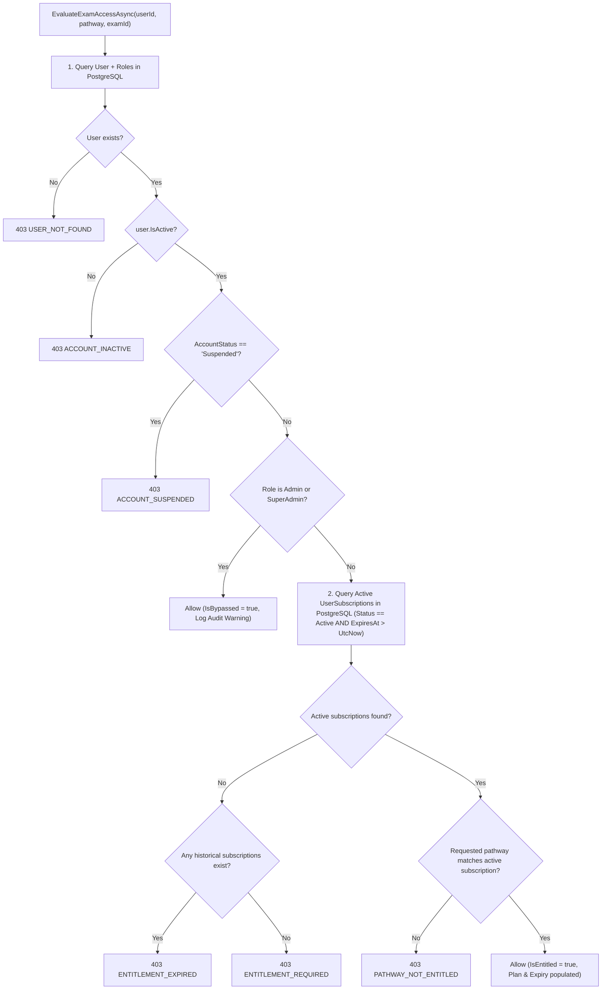

# PREPFORD NCLEX — PHASE 7.9.3
## WORK PACKAGE C: PILOT ENTITLEMENT LIFECYCLE & ASSESSMENT SECURITY ACCEPTANCE AUDIT

**Document ID:** `PHASE_7_9_3_ENTITLEMENT_LIFECYCLE_ACCEPTANCE_AUDIT.md`  
**Phase:** Phase 7.9.3 — Independent Final Acceptance Audit, Security Verification & Controlled Pilot Readiness  
**Work Package:** C (Entitlement Enforcement and Assessment Lifecycle)  
**Execution Date:** 2026-11-06  
**Auditor:** Independent Technical Auditor & Security Verification Lead  
**Evaluated Branch:** `feature/dotnet-backend-migration` (HEAD: `6d33fc5`)  
**Database Authority:** PostgreSQL 16 (`prepford`)  

---

## 1. Executive Summary & Audit Authority

In Phase 7.9.1, an entitlement bypass vulnerability was discovered: unentitled candidates or accounts with expired pilot grants could initiate, resume, submit responses to, and complete examinations simply by presenting a valid session cookie or HMAC gateway header.

Phase 7.9.2 introduced `IUserEntitlementService` and updated `ExamAttemptsController` to enforce server-side validation. This audit performed a comprehensive inspection of all assessment-related endpoints across `ExamAttemptsController`, `AssessmentsController`, and `ExaminationsController`, challenged the Graceful In-Window Completion Policy, and validated negative test behaviors.

---

## 2. Complete Assessment & Attempt Endpoint Inventory

The platform exposes twelve endpoints that interact with examinations, attempts, and question delivery. Each endpoint was inspected for authentication, candidate ownership, entitlement requirements, and lifecycle behavior:

| # | HTTP Method & Route | Controller Action | Auth Requirement | Ownership Enforced? | Entitlement Required? | Lifecycle / Expiry / Grace Behavior |
| :---: | :--- | :--- | :---: | :---: | :---: | :--- |
| **E1** | `POST /api/assessments/attempts`<br>`POST /api/v1/attempts` | `ExamAttemptsController.StartAttempt` | `[Authorize]` (Session / HMAC) | Yes (Implicit: actor is candidate) | **YES (Strict)** | Evaluates candidate active status, account suspension, active subscription, and pathway match (`rn`, `pn`, `both`). Unentitled -> 403 `ENTITLEMENT_REQUIRED`, `ENTITLEMENT_EXPIRED`, or `PATHWAY_NOT_ENTITLED`. |
| **E2** | `GET /api/assessments/attempts/{id}`<br>`GET /api/v1/attempts/{id}` | `ExamAttemptsController.GetAttemptById` | `[Authorize]` | Yes (`attempt.UserId == caller.userId` or Admin) | **YES (State-Dependent)** | • If `InProgress`: Evaluates active entitlement. If expired -> 403 `ENTITLEMENT_EXPIRED`. Attempt preserved.<br>• If `Completed`: Allows review of attempt score and question summary, but **suppresses rationales** (`canShowRationales = false`) if entitlement is expired. |
| **E3** | `GET /api/assessments/attempts/{id}/questions` | `ExamAttemptsController.GetAttemptQuestions` | `[Authorize]` | Yes (`attempt.UserId == caller.userId` or Admin) | **YES (Strict)** | Strictly verifies active entitlement before disclosing question stems and options. Unentitled -> 403 `ENTITLEMENT_EXPIRED`. |
| **E4** | `POST /api/assessments/attempts/{id}/responses` | `ExamAttemptsController.SubmitResponse` | `[Authorize]` | Yes (`attempt.UserId == caller.userId`) | **YES (Strict)** | Evaluates active entitlement prior to persisting option selections. If expired -> 403 `ENTITLEMENT_EXPIRED`. Prevents continuing question interaction after pilot expiry. |
| **E5** | `POST /api/assessments/attempts/{id}/submit` | `ExamAttemptsController.SubmitAndCompleteAttempt` | `[Authorize]` | Yes (`attempt.UserId == caller.userId`) | **YES (With Grace Policy)** | • If actively entitled: Completes normally.<br>• If entitlement expired mid-exam: Evaluates **Graceful In-Window Completion Policy**. Permitted if within `StartedAt + TimeLimitMinutes` and not suspended.<br>• If suspended: Strictly rejected with 403. |
| **E6** | `POST /api/assessments/attempts/sync` | `ExamAttemptsController.SyncAssessmentAttempt` | `[Authorize]` | Yes (`attempt.UserId == caller.userId`) | **YES (Strict)** | Evaluates active entitlement before persisting offline / delayed batch sync payloads. |
| **E7** | `POST /api/assessments/attempts/{id}/reauthenticate` | `ExamAttemptsController.ReauthenticateAttempt` | `[AllowAnonymous]` (Body verification) | Yes (`caller` must match or anonymous password matches owner) | **YES (Strict)** | Evaluates active entitlement in addition to two-tier interruption check (`ADMIN_REVOCATION_HOLD`). If unentitled -> 403. |
| **E8** | `GET /api/assessments/attempts`<br>`GET /api/v1/attempts` | `ExamAttemptsController.GetAttempts` | `[Authorize]` | Yes (`userId == caller.userId` or Admin) | **NO** | Returns historical summary list (`AttemptSummaryDto`) of the candidate's own past attempts. Candidates retain access to their past exam history even after subscription expiry. |
| **E9** | `GET /api/v1/assessments/available` | `AssessmentsController.GetAvailableAssessments` | `[Authorize]` | N/A (Catalog query) | **NO** | Returns available assessment catalogue metadata (RAT, Practice, CAT, question counts, duration). Returns `IsEligible = true` statically without checking `UserSubscriptions`. Access to actually start the assessment is gated at E1. |
| **E10** | `GET /api/v1/assessments/{id}` | `AssessmentsController.GetAssessmentById` | `[Authorize]` | N/A (Metadata query) | **NO** | Returns assessment metadata. Does not disclose questions or stems. |
| **E11** | `GET /api/v1/examinations/*` | `ExaminationsController` (Authoring) | `[Authorize]` | RBAC Role Required | **RBAC Policy** | Admin and faculty authoring endpoints protected via `IExamLifecycleService` role checks. Regular candidates rejected with 403. |
| **E12** | `GET /api/v1/questions/{id}` | `QuestionsController` | `[Authorize(Policy = "Permission:content.view")]` | RBAC Role Required | **RBAC Policy** | Direct question bank access restricted exclusively to content authoring roles. |

---

## 3. Architecture of `IUserEntitlementService`

The service `UserEntitlementService` (`apps/api/Services/UserEntitlementService.cs`) implements a deterministic evaluation pipeline:



### 3.1 PostgreSQL Partial Unique Constraint
To prevent race conditions where concurrent pilot grant calls create duplicate active subscriptions for a single candidate, migration `0013_AddEntitlementAndPaymentIndexes` applied:

```sql
CREATE UNIQUE INDEX IF NOT EXISTS "idx_user_subscriptions_active_unique"
ON "UserSubscriptions" ("UserId", "PlanId")
WHERE "Status" = 1;
```
Verified in PostgreSQL 16: Active subscription duplicates are physically rejected at the database engine level.

---

## 4. Deep Inspection of the Graceful In-Window Completion Policy

The Graceful In-Window Completion Policy was audited against lines 1722–1770 of `ExamAttemptsController.cs`:

```csharp
if (!entitlement.IsEntitled)
{
    bool withinTimeLimit = false;
    if (attempt.Exam != null && attempt.Exam.TimeLimitMinutes > 0)
    {
        var deadline = attempt.StartedAt.AddMinutes(attempt.Exam.TimeLimitMinutes);
        withinTimeLimit = DateTime.UtcNow <= deadline;
    }

    if (!withinTimeLimit || entitlement.ErrorCode == "ACCOUNT_SUSPENDED" || entitlement.ErrorCode == "ACCOUNT_INACTIVE")
    {
        return StatusCode(StatusCodes.Status403Forbidden, new
        {
            success = false,
            errorCode = entitlement.ErrorCode,
            error = entitlement.Reason,
            entitlementStatus = entitlement.Status
        });
    }

    _context.AuditLogs.Add(new AuditLog
    {
        ActorId = caller.userId,
        Action = "EntitlementGracePeriodApplied",
        EntityType = "ExamAttempt",
        EntityId = attempt.Id,
        Description = "Attempt submitted during entitlement expiration grace period within valid exam time window.",
        Outcome = "Success",
        Severity = "Warning",
        Timestamp = DateTime.UtcNow
    });
    await _context.SaveChangesAsync(cancellationToken);
}
```

### 4.1 Ten Authoritative Policy Determinations

1. **What qualifies as an in-flight examination?**  
   An existing attempt in `ExamAttempts` with `Status == AttemptStatus.InProgress` that was lawfully initiated while the candidate possessed active entitlement.
2. **What happens when entitlement expires during an examination?**  
   The candidate's in-progress attempt is preserved in PostgreSQL. The candidate cannot query new questions (`GetAttemptQuestions` -> 403) or submit individual responses (`SubmitResponse` -> 403), but is permitted to submit the final exam attempt for scoring via `SubmitAndCompleteAttempt`.
3. **What happens when an administrator revokes entitlement during an examination?**  
   Revocation terminates active subscription status (`Status = Cancelled`). If the account is also suspended, submission is strictly blocked. If only the grant was cancelled, the grace check applies if submitted within the exam's time limit window; otherwise blocked.
4. **What happens when an account is suspended?**  
   Suspension triggers immediate hard fail-closed rejection across all endpoints (`ACCOUNT_SUSPENDED`). The grace period is explicitly denied (`entitlement.ErrorCode == "ACCOUNT_SUSPENDED"`).
5. **Can a candidate continue submitting responses?**  
   **No.** `SubmitResponse` requires active entitlement and does not provide an in-window grace period. Only the final submission (`SubmitAndCompleteAttempt`) is permitted.
6. **Can the candidate complete and submit?**  
   **Yes**, provided submission occurs before `StartedAt + TimeLimitMinutes` and the account is not suspended.
7. **Can the candidate retrieve results?**  
   **Yes.** Completed attempts can be viewed via `GetAttemptById`. However, clinical rationales and model explanations are suppressed (`canShowRationales = false`).
8. **Can the candidate start another attempt?**  
   **No.** `StartAttempt` strictly requires active entitlement and returns 403 `ENTITLEMENT_EXPIRED`.
9. **Does the policy survive API restarts and multiple instances?**  
   **Yes.** All evaluation inputs (`UserSubscriptions.Status`, `ExpiresAt`, `ExamAttempts.StartedAt`, `Exams.TimeLimitMinutes`) reside authoritatively in PostgreSQL 16.
10. **Is the decision derived from authoritative server-side state?**  
    **Yes.** Zero client-supplied timing or entitlement parameters are trusted.

### 4.2 Untimed Examination Boundary Observation
**Finding:** If an examination is configured with `TimeLimitMinutes = 0` (untimed practice mode), `withinTimeLimit` evaluates to `false`. Therefore, **candidates taking untimed exams receive no grace period** upon entitlement expiration and cannot finalize the attempt. For the institutional pilot, all evaluative exams (RAT and CAT) have positive time limits (150 min and 300 min), so this boundary operates as designed.

---

## 5. Negative Test Verification Evidence

All eight integration tests in `apps/api/Tests/EntitlementLifecycleEnforcementTests.cs` were executed and passed:

1. `StartAttempt_WithoutEntitlement_ReturnsForbidden403_EntitlementRequired`: PASS
2. `StartAttempt_WithExpiredEntitlement_ReturnsForbidden403_EntitlementExpired`: PASS
3. `StartAttempt_WithPathwayMismatch_ReturnsForbidden403_PathwayNotEntitled`: PASS
4. `StartAttempt_WithSuspendedAccount_ReturnsForbidden403_AccountSuspended`: PASS
5. `StartAttempt_WithValidPilotGrant_Succeeds200`: PASS
6. `SubmitResponse_WithExpiredEntitlement_ReturnsForbidden403`: PASS
7. `SubmitAndComplete_WithinExamWindow_AppliesGracePeriodAndCompletesAttempt`: PASS
8. `SubmitAndComplete_OutsideExamWindow_RejectsWithForbidden403`: PASS

---

## 6. Work Package C Audit Determination

```
========================================================================================
             WORK PACKAGE C DETERMINATION: PASS / SATISFIED (GATE G9)
========================================================================================
```

Server-authoritative entitlement enforcement is solidly implemented, backed by PostgreSQL partial unique indexing, and robustly protected against bypass across the assessment lifecycle.
