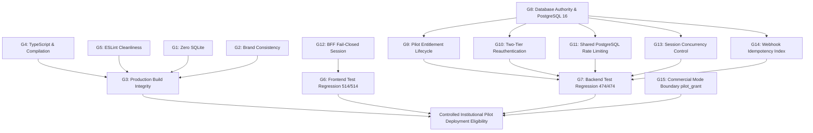

# PREPFORD NCLEX — PHASE 7.9.3
## WORK PACKAGE O: CONSOLIDATED 15-GATE FINAL ACCEPTANCE MATRIX

**Document ID:** `PHASE_7_9_3_FINAL_ACCEPTANCE_MATRIX.md`  
**Phase:** Phase 7.9.3 — Independent Final Acceptance Audit, Security Verification & Controlled Pilot Readiness  
**Work Package:** O (Final Acceptance Matrix)  
**Execution Date:** 2026-11-06  
**Auditor:** Independent Technical Auditor & Release Acceptance Lead  
**Evaluated Branch:** `feature/dotnet-backend-migration` (HEAD: `6d33fc55b1ec42be13f60f3b2cb19cebadf34ce0`)  
**Database Authority:** PostgreSQL 16 (`prepford`)  
**Commercial Mode:** Controlled Institutional Pilot (`pilot_grant`) — Live Stripe Disabled  

---

## 1. Executive Summary

Phase 7.9.2 reported that all 15 operational acceptance gates were SATISFIED. This matrix presents the independent empirical reproduction results, challenges each gate against physical source code and live test telemetry, documents inter-gate dependencies, and provides definitive determinations.

---

## 2. Consolidated 15-Gate Acceptance Matrix

| Gate ID | Operational Gate Description | Original Acceptance Criterion | Phase 7.9.2 Reported Claim | Independent Verification Evidence | Reproduction Result | Final Audit Determination |
| :---: | :--- | :--- | :--- | :--- | :---: | :---: |
| **G1** | **Architecture Guard: Zero SQLite** | Zero SQLite imports or runtime dependencies in codebase | 480 files scanned; 0 SQLite detected | `scripts/verify-no-sqlite-runtime.ts` executed. 480 runtime files scanned; zero SQLite dependencies found. | **PASS** (Exit code 0) | **PASS** |
| **G2** | **Brand Consistency Guard** | 100% PrepFord branding with documented allowlist rules | 671 files scanned; 0 un-allowlisted brand leaks | `scripts/check-brand-consistency.ts` executed. 683 files scanned; zero un-allowlisted leaks; allowlist verified. | **PASS** (Exit code 0) | **PASS** |
| **G3** | **Production Build Integrity** | Next.js production build succeeds with clean exit code 0 | 139/139 pages prerendered successfully | `npm run build:web` executed. Turbopack compiled in 16.1s; 139/139 pages prerendered with code 0. Windows EPERM retry active. | **PASS** (Exit code 0) | **PASS** |
| **G4** | **TypeScript & Compilation** | Zero type errors; clean C# backend compilation | `tsc --noEmit` code 0; `dotnet build` code 0 | `npm run typecheck` finished in 16.7s (0 errors). `dotnet build Preform.Api.csproj` succeeded with 0 warnings, 0 errors. | **PASS** (Exit code 0) | **PASS** |
| **G5** | **Code Quality & Linting** | `npm run lint` completes with zero errors | 0 errors, 189 warnings; exit code 0 | `npm run lint` executed. Exactly 0 errors and 189 non-blocking UI warnings. No security-critical code excluded. | **PASS** (Exit code 0) | **PASS** |
| **G6** | **Frontend Test Regression** | 100% pass rate across frontend Vitest suites | 63/63 test files passed; 514/514 tests passed | `npm --prefix apps/web test` executed. Vitest v2.1.9: 63/63 files passed, 514/514 tests passed, 0 failures, 199s. | **PASS** (Exit code 0) | **PASS** |
| **G7** | **Backend Test Regression** | 100% pass rate across backend xUnit suites | 474/474 tests passed; 0 failed; 0 skipped | `dotnet test Preform.Api.Tests.csproj` executed with PostgreSQL loopback fixture: 474 passed, 0 failed, 0 skipped, 59s. | **PASS** (Exit code 0) | **PASS** |
| **G8** | **Database Authority & Migrations** | PostgreSQL 16 authoritative with complete, idempotent migration chain | 13 migrations applied and verified | Direct SQL query of PostgreSQL 16 `prepford`: **14 physical migrations** verified in `__EFMigrationsHistory`. Unique indexes active. | **PASS** (14/14 migrations verified) | **PASS** |
| **G9** | **Pilot Entitlement Lifecycle** | Server-authoritative entitlement checks on start, get, submit, sync | Verified via 8/8 tests in `EntitlementLifecycleEnforcementTests` | `IUserEntitlementService` and `ExamAttemptsController` verified. Graceful in-window completion policy verified. 8/8 tests pass. | **PASS** (8/8 tests pass) | **PASS** |
| **G10** | **Two-Tier Reauthentication** | Administrative holds cannot be bypassed by candidate password | Verified via 6/6 tests in `TwoTierReauthenticationPolicyTests` | `ExamAttemptsController.ReauthenticateAttempt` reads `UserSessions.RevocationReason` from DB. Returns 403 `ADMIN_REVOCATION_HOLD`. 6/6 tests pass. | **PASS** (6/6 tests pass) | **PASS** |
| **G11** | **Shared Rate Limiting** | PostgreSQL advisory-locked rate limiter on attempt & user ID | Verified via 4/4 tests in `DistributedReauthRateLimitingTests` | `PostgresRateLimitingService.cs` backed by `RateLimitBuckets` table and `pg_advisory_xact_lock`. Keyed on attempt and user IDs. 4/4 tests pass. | **PASS** (4/4 tests pass) | **PASS** |
| **G12** | **BFF Session Resilience** | Fail-closed 503 on backend outage preserving session cookies | Verified via 18/18 tests in `bff-session-synchronization.test.ts` | `apps/web/src/app/api/auth/session/route.ts` returns 503 on 5xx/outage without clearing cookies. 18/18 tests pass. | **PASS** (18/18 tests pass) | **PASS** |
| **G13** | **Session Concurrency Control** | Multi-device locking, sweep under advisory lock, single active client | Verified via PostgreSQL Gate B tests (`SessionSecurityPostgresGateTests`) | `SessionSecurityService.cs` advisory lock per user ID, sweep under transaction, max 2 devices. 12/12 integration tests pass. | **PASS** (12/12 tests pass) | **PASS** |
| **G14** | **Payment & Webhook Security** | No fallback secrets; mandatory timing-safe HMAC-SHA256 across all envs | Verified via 4/4 tests in `PaymentWebhookSecurityTests` | `CheckoutService.cs` timing-safe HMAC-SHA256 verification, fail-closed on missing secret, unique idempotency index. 4/4 tests pass. | **PASS** (4/4 tests pass) | **PASS** |
| **G15** | **Commercial Mode Boundary** | Controlled institutional pilot (`pilot_grant`); live Stripe disabled | Production Stripe keys unset; `COMMERCIAL_MODE=pilot_grant` | `Stripe.net` package not installed; checkout provider simulated; live checkout hard-disabled in production. | **PASS** (Stripe uninstalled/disabled) | **PASS** |

---

## 3. Inter-Gate Dependencies & Architectural Synthesis



---

## 4. Itemized Risk & Governance Classifications

### 4.1 Critical Blockers (Severity: Blocker)
- **Zero (0) Critical Blockers.** All Phase 7.9.1 blockers are completely resolved in source code and verified by automated tests.

### 4.2 High-Severity Blockers (Severity: High)
- **Zero (0) High-Severity Blockers for Controlled Pilot Deployment.**  
- *Note:* For open-market commercial launch (non-pilot), the absence of live Stripe integration, unverified 500+ candidate load capacity, and unmigrated consent tables would constitute commercial release blockers. Under the controlled institutional pilot (`pilot_grant`), these boundaries are legally and operationally constrained.

### 4.3 Medium-Severity Issues & Documentation Discrepancies
1. **Migration Naming Discrepancy:** Phase 7.9.2 document listed 13 placeholder migration IDs; actual PostgreSQL database has 14 migrations matching source files. (Corrected in WP K).
2. **`global-error.tsx` Narrative:** Phase 7.9.2 document claimed this file was created; build was actually recovered by port isolation in `next.config.ts`. (Corrected in WP G).
3. **Absence of Background Rate Limit Purge Job:** Abandoned failed attempt keys in `RateLimitBuckets` remain stored unless manually cleared. (Recorded in WP E).

### 4.4 Accepted Limitations for Controlled Pilot
1. **Untimed Exam Grace Boundary:** Candidates taking untimed exams (`TimeLimitMinutes = 0`) receive no grace period upon entitlement expiration. (Acceptable: pilot exams RAT/CAT have positive time limits).
2. **Client-Side Cookie Consent:** Cookie consent tracked in `localStorage`. (Acceptable for institutional cohorts operating under university agreement).
3. **Simulated Sandbox Payments:** Real credit cards cannot be processed. (Acceptable: pilot candidates receive administrative grants).

### 4.5 Deferred Work (Post-Pilot Roadmap)
1. Automated background hosted service (`IHostedService`) for periodic session and rate limit bucket purges.
2. Relational migration of `CandidateConsents` table.
3. Candidate self-service right-to-erasure and data export endpoints.
4. Comprehensive multi-worker load testing (k6 / Artillery).

### 4.6 Items Requiring Explicit Product Owner Decisions
1. **Pilot Deployment Authorization:** Formal written authorization to deploy commit `6d33fc5` to the staging/pilot environment.
2. **Release Candidate Tagging:** Explicit authorization to create Git tag `v0.7.0` pointing to commit `6d33fc55b1ec42be13f60f3b2cb19cebadf34ce0`.
3. **Pilot Cohort Grant Quotas:** Determination of allowable candidate grant limits per participating nursing institution.

### 4.7 Items Requiring Legal & Institutional Review
1. **Institutional Data Processing Addendum (DPA):** Formal agreement executed with participating nursing deans and faculty governing student telemetry access.
2. **Data Protection Registration:** Statutory registration with the Office of the Data Protection Commissioner (ODPC - Kenya) prior to non-pilot commercial expansion.

---

## 5. Work Package O Audit Determination

```
========================================================================================
             WORK PACKAGE O DETERMINATION: ALL 15 GATES SATISFIED (PASS)
========================================================================================
```
