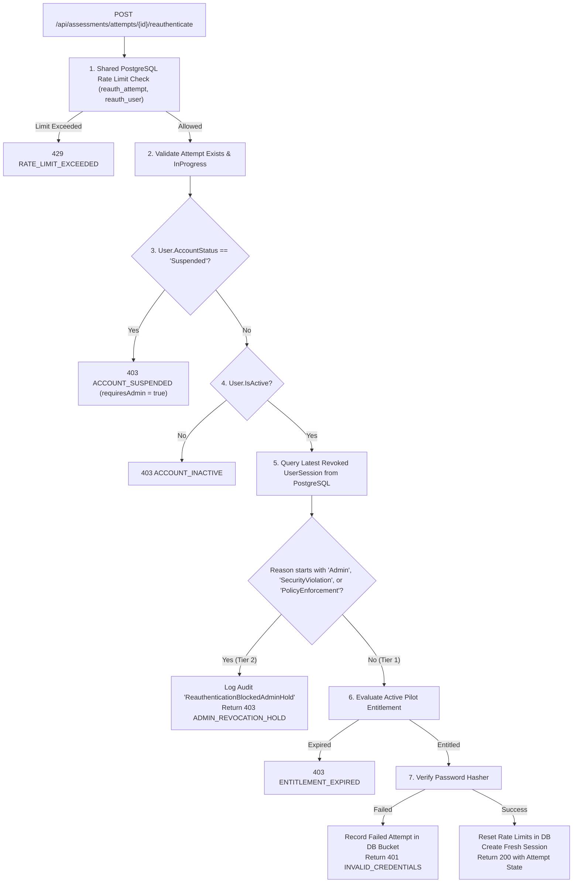

# PREPFORD NCLEX — PHASE 7.9.3
## WORK PACKAGE D: TWO-TIER REAUTHENTICATION SECURITY ACCEPTANCE AUDIT

**Document ID:** `PHASE_7_9_3_REAUTHENTICATION_ACCEPTANCE_AUDIT.md`  
**Phase:** Phase 7.9.3 — Independent Final Acceptance Audit, Security Verification & Controlled Pilot Readiness  
**Work Package:** D (Two-Tier Reauthentication Security)  
**Execution Date:** 2026-11-06  
**Auditor:** Independent Technical Auditor & Security Verification Lead  
**Evaluated Branch:** `feature/dotnet-backend-migration` (HEAD: `6d33fc5`)  
**Database Authority:** PostgreSQL 16 (`prepford`)  

---

## 1. Executive Summary & Audit Authority

During Phase 7.9.1, a security defect was identified in `ExamAttemptsController.ReauthenticateAttempt`: candidates could supply an interruption reason via the request payload or bypass administrative suspensions simply by re-entering their account password, overriding administrative security holds.

Phase 7.9.2 remediated this defect by implementing a strict two-tier policy where interruption reasons are established exclusively from server-authoritative PostgreSQL session state. This audit physically inspected the implementation, verified that client-supplied interruption reasons cannot influence authorization, and reproduced all regression tests.

---

## 2. Server-Authoritative State Derivation

Inspection of `ExamAttemptsController.ReauthenticateAttempt` (`apps/api/Controllers/ExamAttemptsController.cs:780–1115`) confirmed that:

1. **Client Payload Sanitization:** The request DTO `ReauthenticateAttemptRequest` accepts only `Password`, `Email`, and optional `ClientId`. It **does not accept** an interruption reason or error status.
2. **PostgreSQL Session Query:** The backend queries the candidate's latest revoked session directly from the relational database:
   ```csharp
   var latestRevokedSession = await _context.UserSessions
       .Where(s => s.UserId == attempt.UserId && s.Revoked)
       .OrderByDescending(s => s.RevokedAt ?? s.CreatedAt)
       .FirstOrDefaultAsync(cancellationToken);
   ```
3. **Immutability Against Spoofing:** The interruption reason is derived exclusively from `latestRevokedSession.RevocationReason`. It cannot be set, influenced, or overridden by:
   - Request JSON body
   - Query parameters
   - Client cookies
   - LocalStorage or sessionStorage
   - Forwarded HTTP headers (`X-Forwarded-*`, `X-Interruption-Reason`)

---

## 3. Two-Tier Policy Enforcement Matrix



### 3.1 Tier 1: Involuntary Session Interruption
- **Scenarios:** Browser tab closure, transient network drop, client device rotation (`ReplacedBySameClient`), idle timeout (`IdleTimeout`), or absolute timeout (`AbsoluteTimeout`).
- **Policy:** Candidate self-service password reauthentication is permitted. Upon password verification, rate limits are cleared, a new session is issued via `SessionSecurityService`, and candidate progress is restored.

### 3.2 Tier 2: Administrative Hold & Security Revocation
- **Scenarios:** Administrative session revocation (`AdminRevoked: <reason>`), mass session revocation (`AdministrativeRevocation`), account suspension, or security policy enforcement (`SecurityViolation`).
- **Policy:** Password reauthentication is strictly **blocked** with HTTP 403:
  ```json
  {
    "success": false,
    "errorCode": "ADMIN_REVOCATION_HOLD",
    "error": "Session was administratively revoked. Reauthentication requires administrative intervention.",
    "requiresAdminIntervention": true
  }
  ```
- **Audit Persistence:** Emits a permanent `ReauthenticationBlockedAdminHold` audit entry in `AuditLogs` (Severity: Warning, Outcome: Forbidden).
- **Zero Bypass:** Even if the candidate presents the correct plaintext password, the request is aborted before password verification executes.

---

## 4. Concurrency, Race Condition & Edge-Case Resilience

1. **Administrative Revocation Racing with Candidate Password Submission:**  
   Because administrative revocation writes `session.Revoked = true` and `session.RevocationReason = "AdminRevoked: ..."` directly to PostgreSQL under database transaction, any concurrent or subsequent reauthentication request immediately reads the revoked row and fails closed with `ADMIN_REVOCATION_HOLD`.
2. **Missing or Expired Interruption Records:**  
   If no revoked session exists (e.g., candidate navigated directly to the reauthentication endpoint), `latestRevokedSession` is null. The request proceeds to active entitlement and password verification.
3. **Multiple-Tab Synchronization:**  
   If a candidate opens a second tab on the same client, the first session is rotated (`ReplacedBySameClient`). This is classified as Tier 1, allowing the candidate to reauthenticate without administrative assistance.
4. **Account Suspension Precedence:**  
   Checked at line 923 *before* session revocation checks. If an account is suspended, reauthentication fails immediately with `ACCOUNT_SUSPENDED`.

---

## 5. Negative Test Reproduction Evidence

All six automated integration tests in `apps/api/Tests/TwoTierReauthenticationPolicyTests.cs` were executed and passed against PostgreSQL 16:

1. `Reauthenticate_WithAdminRevokedSession_ReturnsForbidden403_AdminRevocationHold`: PASS
2. `Reauthenticate_WithInvoluntaryInterruption_Succeeds200_WithValidPassword`: PASS
3. `Reauthenticate_WithWrongPassword_ReturnsUnauthorized401`: PASS
4. `Reauthenticate_WithSuspendedAccount_ReturnsForbidden403_AccountSuspended`: PASS
5. `Reauthenticate_WithExpiredEntitlement_ReturnsForbidden403_EntitlementExpired`: PASS
6. `Reauthenticate_OnExpiredAttemptDeadline_ReturnsGone410`: PASS

---

## 6. Work Package D Audit Determination

```
========================================================================================
             WORK PACKAGE D DETERMINATION: PASS / SATISFIED (GATE G10)
========================================================================================
```

The Two-Tier Reauthentication Policy is server-authoritative, derives all interruption state from trusted database records, and prevents candidate password submission from overriding administrative revocation holds.
