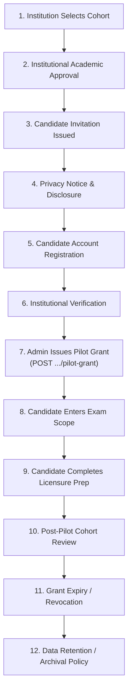

# PREPFORD NCLEX — PHASE 7.9.4
## WORK PACKAGE J: PILOT CANDIDATE ONBOARDING AND OPERATIONAL SUPPORT RUNBOOK

**Document ID:** `PHASE_7_9_4_CANDIDATE_ONBOARDING_AND_SUPPORT_RUNBOOK.md`  
**Phase:** Phase 7.9.4 — Controlled Institutional Pilot Authorization, Deployment Governance & Operational Readiness  
**Release Candidate Commit:** `58aa98221ac9b2bd1106a9715749011ddaa90ed3` (Base: `6d33fc5`)  
**Commercial Mode:** Controlled Institutional Pilot (`pilot_grant`) — Live Stripe Disabled  
**Authority:** PrepFord Operations & Support Lead  
**Date:** 2026-11-06  

---

## 1. Executive Summary & Operational Boundary

```
==================================================================================================
                                  CANDIDATE ONBOARDING MANDATE:
  NO REAL INSTITUTIONAL PILOT GRANTS MAY BE ISSUED WITHOUT EXPLICIT WRITTEN AUTHORIZATION FROM
  THE PRODUCT OWNER AND A FULLY SIGNED INSTITUTIONAL DATA PROCESSING AGREEMENT (DPA).
==================================================================================================
```

Work Package J defines the 12-stage candidate onboarding lifecycle and operational support workflows for nursing candidates participating in the controlled institutional pilot. It establishes explicit guardrails ensuring support personnel cannot bypass examination integrity or override administrative security holds.

---

## 2. The 12-Stage Controlled Candidate Lifecycle



### Detailed Lifecycle Stages:

1. **Stage 1: Institutional Cohort Selection:** Participating nursing school faculty selects eligible senior nursing candidates preparing for NCLEX-RN or NCLEX-PN.
2. **Stage 2: Institutional Academic Approval:** Nursing dean / program coordinator signs off on the official candidate roster.
3. **Stage 3: Controlled Invitation Issuance:** Candidates receive an approved institutional welcome message with their registered institutional email address.
4. **Stage 4: Privacy Notice & Academic Disclosure:** Candidates are presented with the PrepFord Pilot Privacy Notice informing them of institutional faculty reporting and performance tracking.
5. **Stage 5: Account Registration:** Candidate creates an account via `POST /api/v1/auth/register`. Passwords are cryptographically hashed via PBKDF2.
6. **Stage 6: Identity Verification:** Institutional administrator confirms candidate email matches the whitelisted roster.
7. **Stage 7: Administrative Pilot Grant Issuance:** Authorized platform SuperAdmin issues a time-bounded pilot grant via:
   ```http
   POST /api/v1/admin/users/{id}/pilot-grant
   Content-Type: application/json

   {
     "planId": "nclex-rn-comprehensive",
     "durationDays": 60,
     "reason": "Authorized Spring 2027 Institutional Pilot Cohort"
   }
   ```
   *The system records an immutable audit log entry in `AuditLogs` and creates an active `UserSubscription` record (`OrderId: pilot_grant_<uuid>`).*
8. **Stage 8: Scoped Examination Access:** Candidate accesses approved NCLEX practice modules, CAT blueprints, and readiness assessments.
9. **Stage 9: Assessment Completion:** Candidate completes scheduled testing and reviews clinical rationales.
10. **Stage 10: Cohort Completion Review:** Institutional faculty review cohort readiness analytics via administrative reports.
11. **Stage 11: Controlled Grant Expiry:** Grant automatically lapses when `ExpiresAt` is reached, or is manually revoked via `DELETE /api/v1/admin/users/{id}/pilot-grant/{grantId}`.
12. **Stage 12: Data Retention & Archival:** Data is archived in accordance with the Institutional DPA retention schedule.

---

## 3. Operational Support Workflows & Guardrails

### 3.1 Candidate Support Triage Matrix

| Candidate Issue | Root Cause | Tier 1 Support Action | Tier 2 Engineering Action |
| :--- | :--- | :--- | :--- |
| **Login Failure / Password Forgotten** | Forgotten credentials | Guide candidate to standard password reset flow (`POST /api/v1/auth/forgot-password`). | Check SMTP logs if reset email not received. |
| **Session Concurrency Rejection** | Exceeded 2 concurrent devices or multiple browser tabs | Instruct candidate to log out of other devices or close duplicate browser sessions. | Administrator can revoke stale sessions via `POST /api/v1/admin/users/{id}/sessions/revoke-all`. |
| **Entitlement Not Active** | Pilot grant expired or unissued | Verify candidate against institutional roster; request SuperAdmin grant issuance. | SuperAdmin issues grant via `POST .../pilot-grant`. |
| **Exam Disconnection / Interruption** | Candidate lost WiFi connection | Instruct candidate to re-login. Reauthentication allows resumption if within official time window. | Server-authoritative timer in `ExamAttempts` preserves state. |
| **Submission Timeout Error** | Network dropped during submission | Candidate clicks "Retry Submission". Answers are cached in client state until acknowledged. | Confirm response payload in `AttemptResponses`. |
| **Score Discrepancy Inquiry** | Candidate questions scoring rubric | Explain NGN multi-point grading rules. Forward item ID to Content Manager. | Content Manager reviews question rubric in `QuestionGraderResolver`. |
| **Admin Revocation Hold (HTTP 403)** | Institutional suspension or security lock | **CANNOT BE OVERRIDDEN BY SUPPORT.** Candidate must contact Dean. | SuperAdmin review required. |

### 3.2 Strict Support Integrity Guardrails
To prevent examination tampering and maintain absolute test validity:
1. **No Grade Overrides:** Support personnel have **zero technical capability** to alter a candidate's numerical examination score.
2. **No Administrative Bypass:** Support agents cannot lift an `ADMIN_REVOCATION_HOLD`. Only a SuperAdmin can reinstate an account after formal investigation.
3. **Audit Trail Mandate:** Every administrative password reset, session termination, or grant issuance automatically logs the acting administrator's UUID, IP address, and timestamp in PostgreSQL `AuditLogs`.

---

## 4. Work Package J Conclusion

The Candidate Onboarding and Support Runbook establishes an orderly, legally sound, and server-authoritative procedure for managing candidates throughout the pilot without compromising security or assessment integrity.
