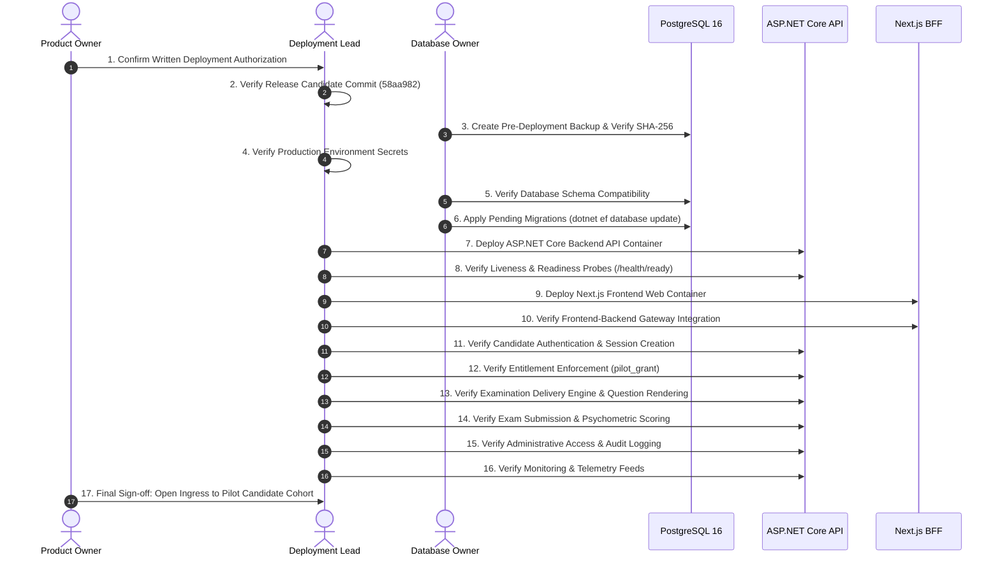

# PREPFORD NCLEX — PHASE 7.9.4
## WORK PACKAGE G: PRODUCTION DEPLOYMENT RUNBOOK AND ROLLBACK STRATEGY

**Document ID:** `PHASE_7_9_4_DEPLOYMENT_AND_ROLLBACK_RUNBOOK.md`  
**Phase:** Phase 7.9.4 — Controlled Institutional Pilot Authorization, Deployment Governance & Operational Readiness  
**Release Candidate Commit:** `58aa98221ac9b2bd1106a9715749011ddaa90ed3` (Base: `6d33fc5`)  
**Commercial Mode:** Controlled Institutional Pilot (`pilot_grant`) — Live Stripe Disabled  
**Deployment Authority:** PrepFord Product Owner  
**Date:** 2026-11-06  

---

## 1. Executive Summary & Governance Mandate

Work Package G defines the step-by-step operational runbook for deploying the PrepFord NCLEX platform to the controlled institutional pilot environment, and provides a comprehensive rollback and disaster mitigation strategy.

```
==================================================================================================
                                    OPERATIONAL MANDATE:
  THIS RUNBOOK IS A GOVERNANCE SPECIFICATION. DO NOT EXECUTE DEPLOYMENT ACTIONS WITHOUT EXPLICIT,
  DOCUMENTED, WRITTEN AUTHORIZATION FROM THE PREPFORD PRODUCT OWNER.
==================================================================================================
```

---

## 2. Deployment Operational Profile & Key Roles

| Role Title | Operational Responsibility | Authority Level |
| :--- | :--- | :--- |
| **Product Owner** | Executive deployment sign-off, cohort approval, final cutover authorization | Highest Executive Authority |
| **Deployment Lead** | Execution of build pipelines, container deployments, and health verifications | Technical Deployment Lead |
| **Database Migration Owner**| Execution of PostgreSQL migrations, schema verifications, and pre-deploy backups | Database Authority |
| **Security Lead** | Validation of secret injections, TLS configurations, and rate-limiting rules | Security Verification |
| **Institutional Coordinator**| Candidate cohort notification, roster verification, and support escalation | Institutional Liaison |

### Deployment Window & Maintenance Parameters
- **Target Deployment Window:** Off-peak hours (e.g., 01:00 UTC – 04:00 UTC). No active candidate testing may be scheduled during this window.
- **Candidate Notification:** 48 hours advance notice to participating nursing faculties.
- **Maintenance Banner:** Ingress proxy serves HTTP 503 Maintenance Mode page during the migration window.

---

## 3. Step-by-Step 17-Stage Deployment Sequence



### Detailed Sequence Protocol:

1. **Stage 1: Confirm Authorization**  
   Confirm that the Product Owner has signed the Phase 7.9.4 Authorization Package and that the participating institution's DPA is fully executed.
2. **Stage 2: Confirm Release Candidate**  
   Assert checkout is on commit `58aa98221ac9b2bd1106a9715749011ddaa90ed3`. Verify working tree is 100% clean.
3. **Stage 3: Pre-Deployment Database Snapshot**  
   Execute custom-format dump before any deployment actions:
   ```bash
   pg_dump --dbname="${DATABASE_URL}" --format=custom --compress=9 --file="pre_deploy_backup_$(date +%Y%m%d_%H%M%S).dump"
   sha256sum pre_deploy_backup_*.dump > pre_deploy_backup.dump.sha256
   ```
4. **Stage 4: Confirm Environment Secrets**  
   Confirm presence and length of `GATEWAY_SHARED_SECRET` (>= 32 chars), `SESSION_SECRET` (>= 32 chars), `DATABASE_URL`, and `COMMERCIAL_MODE=pilot_grant`. Confirm `STRIPE_SECRET_KEY` is completely unset.
5. **Stage 5: Confirm Database Compatibility**  
   Query `__EFMigrationsHistory` to verify all 14 baseline migrations are applied.
6. **Stage 6: Execute Migrations (Single Migration Owner)**  
   The Database Migration Owner applies any pending migrations out-of-band:
   ```bash
   dotnet ef database update --project apps/api/Preform.Api.csproj
   ```
7. **Stage 7: Deploy Backend API**  
   Deploy the ASP.NET Core Release container to the internal subnet.
8. **Stage 8: Verify Backend Health**  
   Probe endpoints:
   - `curl -f http://api-internal:4000/api/v1/health/live` -> HTTP 200 `Healthy`
   - `curl -f http://api-internal:4000/api/v1/health/ready` -> HTTP 200 `Healthy`
9. **Stage 9: Deploy Frontend Web App**  
   Deploy the Next.js 16.4.3 container to the ingress network.
10. **Stage 10: Verify BFF Gateway Integration**  
    Test mutual HMAC authentication between Next.js BFF and ASP.NET Core backend. Confirm zero 401 Gateway Signature errors.
11. **Stage 11: Smoke Test Authentication**  
    Execute test login for a verification account. Verify candidate session token generation in `UserSessions`.
12. **Stage 12: Verify Entitlement Enforcement**  
    Confirm that accounts without an active `pilot_grant` receive HTTP 403 when attempting to start an examination.
13. **Stage 13: Verify Examination Delivery**  
    Start a designated smoke test attempt. Verify question set rendering, NGN question types, and timer persistence.
14. **Stage 14: Verify Submission and Scoring**  
    Submit test attempt. Verify psychometric scoring engine, JSONB snapshot creation, and rationale display.
15. **Stage 15: Verify Administrative Access**  
    Log into Admin Portal. Verify that `AdminUsersController` and `AuditLogs` display the test actions.
16. **Stage 16: Verify Monitoring & Alerting**  
    Confirm logs are flowing to centralized logging with valid `CorrelationId` and zero uncaught exceptions.
17. **Stage 17: Open Pilot Cohort Access**  
    Disable the maintenance banner at the ingress proxy and notify the Institutional Coordinator that the pilot environment is operational.

---

## 4. Multi-Tier Rollback Strategy

Rollback operations must be carefully differentiated according to the component affected:

```
+--------------------------------------------------------------------------------------------------+
|                                  COMPONENT ROLLBACK MATRIX                                       |
+--------------------------------------------------------------------------------------------------+
| Tier 1: Frontend Web Rollback       | Fast, zero data impact. Revert container image to previous  |
|                                     | known good digest.                                         |
| Tier 2: Backend API Rollback        | Revert container image. Requires backend API to maintain   |
|                                     | backward compatibility with current database schema.        |
| Tier 3: Database Schema Rollback    | HIGH RISK. Never blindly run EF Core Down migrations in     |
|                                     | production. Dropping columns/tables deletes candidate data.|
| Tier 4: Disaster Point-in-Time      | Full database recovery to pre-deployment snapshot if schema |
|         Database Restore            | corruption or irrecoverable data loss occurs.               |
+--------------------------------------------------------------------------------------------------+
```

### 4.1 Rollback Triggers & Criteria
A rollback must be initiated immediately if any of the following occur during the post-deployment verification window:
1. Critical authentication failure affecting all candidate logins.
2. Inter-service HMAC mismatch (widespread HTTP 401s between BFF and backend).
3. Database connectivity timeout or pool exhaustion.
4. Failure to record candidate examination answers or corrupt psychometric scoring.
5. Inability to issue or validate institutional pilot grants.
6. Catastrophic unhandled exceptions causing container crash loops.

### 4.2 Database Rollback Safety Rules
- **NEVER** run `dotnet ef database update <PreviousMigration>` on a database containing active candidate data if the `Down()` method contains `migrationBuilder.DropTable` or `migrationBuilder.DropColumn`. Doing so permanently destroys candidate records and exam attempts.
- If a schema change introduced a bug, prefer:
  1. **Hotfix Forward:** Deploy an additive migration correcting the constraint.
  2. **Safe Schema Deprecation:** Keep new columns nullable; do not remove existing columns.
  3. **Full Restore (Last Resort):** If rollback is mandatory and candidate testing has not yet commenced, restore the pre-deployment snapshot (`pre_deploy_backup.dump`).

---

## 5. Escalation Contacts & Operational Roster

| Role | Responsibility | Contact Method |
| :--- | :--- | :--- |
| **Product Owner** | Authorizes deployment, abort, or rollback decisions | Direct Escalation Phone / Secure Chat |
| **Technical Lead** | Leads technical deployment and root cause investigation | Pager / Engineering Bridge |
| **Database Operations Lead** | Executes backups, restores, and database migrations | Database Ops Bridge |
| **Security Operations Lead** | Investigates authentication, secret, or access anomalies | Security Operations Center (SOC) |
| **Institutional Contact** | Communicates status updates to nursing school faculty | Institutional Email / Phone |

---

## 6. Work Package G Conclusion

The deployment and rollback strategy provides a controlled, deterministic sequence with rigorous verification gates at every transition. Execution remains strictly contingent upon written Product Owner authorization.
