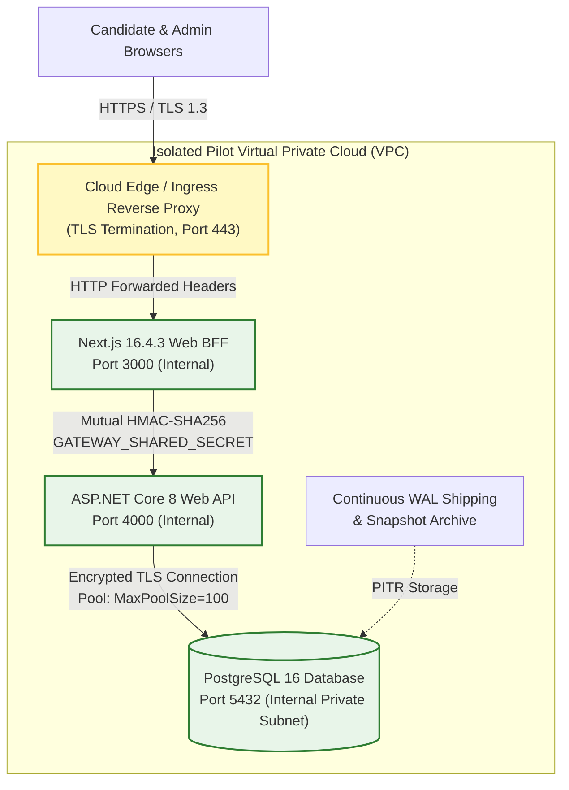

# PREPFORD NCLEX — PHASE 7.9.4
## WORK PACKAGE D: INFRASTRUCTURE AND DEPLOYMENT CONFIGURATION READINESS

**Document ID:** `PHASE_7_9_4_DEPLOYMENT_ENVIRONMENT_READINESS.md`  
**Phase:** Phase 7.9.4 — Controlled Institutional Pilot Authorization, Deployment Governance & Operational Readiness  
**Release Candidate Commit:** `58aa98221ac9b2bd1106a9715749011ddaa90ed3` (Base: `6d33fc5`)  
**Backend Runtime:** ASP.NET Core 8 / EF Core 8.0.10 / Npgsql 8.0.10  
**Frontend Runtime:** Next.js 16.4.3 / React 19.3.0 / Node.js >= 24  
**Persistence Authority:** PostgreSQL 16  
**Commercial Mode:** Controlled Institutional Pilot (`pilot_grant`)  
**Audit Date:** 2026-11-06  

---

## 1. Executive Summary & Purpose

Work Package D defines the definitive deployment architecture, runtime environments, configuration manifests, health-check probes, and infrastructure isolation boundaries for the PrepFord NCLEX platform.

In accordance with Phase 7.9.4 execution rules, no assumptions are made regarding hosting cloud providers, physical regions, or live domains that have not been explicitly provisioned or approved by the Product Owner. Where infrastructure decisions remain pending, they are formally designated **`PENDING PRODUCT OWNER DECISION`** or **`NOT VERIFIED (PENDING PROVISIONING)`**.

---

## 2. Platform Deployment Architecture

---

## 3. Frontend Deployment Configuration (Next.js 16.4.3)

### 3.1 Build & Runtime Specifications
- **Hosting Provider:** `PENDING PRODUCT OWNER DECISION` (e.g., Docker container on AWS ECS/Fargate, Azure App Service, Google Cloud Run, or Vercel Enterprise).
- **Node.js Engine:** `>= 24.0.0` (Repo package manager: `npm@11.19.0`).
- **Production Build Command:** `npm run build:web` (invokes `next build` with Turbopack optimization).
- **Prerender Flags (`next.config.ts`):**
  - `cpus: 1`, `staticGenerationMaxConcurrency: 1`, `staticGenerationRetryCount: 5`.
  - Windows file locking / EPERM resilience verified active.
- **Production Start Command:** `npm run start --workspace @prepford/web` (or `node apps/web/.next/standalone/server.js`).
- **Production Domain & TLS:** `PENDING PRODUCT OWNER DECISION` (e.g., `https://prepfordnclex.com` or `https://pilot.prepford.com`).

### 3.2 Environment Variable Manifest (Frontend)
Environment variables are strictly segregated between public client bundles and server-only BFF execution:

| Variable Name | Exposure | Required in Prod | Purpose / Constraints | Status |
| :--- | :---: | :---: | :--- | :---: |
| `NODE_ENV` | Server | **YES** | Set strictly to `production`. | Verified |
| `APP_ENV` | Server | **YES** | Set strictly to `production`. Activates fail-closed secret checks. | Verified |
| `PORT` | Server | **YES** | Default `3000`. Next.js HTTP listener port. | Verified |
| `INTERNAL_API_URL` | Server Only | **YES** | Private VPC origin of ASP.NET Core API (e.g. `http://api-internal:4000`). | Verified |
| `API_GATEWAY_URL` | Server Only | **YES** | Alternative gateway alias for internal API origin. | Verified |
| `GATEWAY_SHARED_SECRET` | Server Only | **YES** | Symmetric secret (>= 32 chars) for HMAC request signing. Fails closed if missing. | Verified |
| `SESSION_SECRET` | Server Only | **YES** | Cryptographic key (>= 32 chars) for BFF session cookie signing. | Verified |
| `NEXT_PUBLIC_APP_URL` | Public / Client | **YES** | Canonical public URL (e.g., `https://pilot.prepford.com`). | Pending Decision |
| `NEXT_PUBLIC_API_URL` | Public / Client | **NO** | Set to `/api` to route all browser traffic strictly through Next.js BFF. | Verified |
| `GOOGLE_CLIENT_ID` | Server Only | Optional | Google OAuth client ID (if social login enabled). | Optional |
| `GOOGLE_CLIENT_SECRET` | Server Only | Optional | Google OAuth client secret. | Optional |
| `STRIPE_SECRET_KEY` | Server Only | **PROHIBITED** | Must remain **UNSET** in pilot mode. Live Stripe is uninstalled. | Disabled |

### 3.3 BFF Cookie & Session Security Behavior
- **Cookie Name:** `prf_sess` (with legacy fallback `prepford_session`).
- **Security Attributes:** `HttpOnly; Secure; SameSite=Lax; Path=/`.
- **Fault Resilience:** If the backend API encounters an outage or returns HTTP 5xx, Next.js BFF session route (`apps/web/src/app/api/auth/session/route.ts`) returns HTTP 503 while preserving candidate cookies (preventing accidental candidate logouts).

---

## 4. Backend Deployment Configuration (ASP.NET Core 8)

### 4.1 Runtime & Container Specifications
- **Hosting Provider:** `PENDING PRODUCT OWNER DECISION` (e.g., Linux Docker container on AWS ECS, Azure Container Apps, or Kubernetes).
- **Target Framework:** `net8.0` (C# 12, ASP.NET Core 8).
- **Build / Publish Command:** `dotnet publish apps/api/Preform.Api.csproj -c Release -o /app/publish`.
- **Runtime Port:** `4000` (Binding: `http://0.0.0.0:4000`).
- **Process Model:** Kestrel behind trusted reverse proxy.

### 4.2 Environment Variable Manifest (Backend)

| Variable Name | Required in Prod | Purpose / Constraints | Status |
| :--- | :---: | :--- | :---: |
| `ASPNETCORE_ENVIRONMENT` | **YES** | Set strictly to `Production`. | Verified |
| `ASPNETCORE_URLS` | **YES** | `http://0.0.0.0:4000`. | Verified |
| `DATABASE_URL` | **YES** | PostgreSQL 16 connection string (e.g., `Host=...;Port=5432;Database=prepford;...;SSL Mode=Require;Trust Server Certificate=true;`). | Verified |
| `GATEWAY_SHARED_SECRET` | **YES** | High-entropy shared secret (>= 32 chars). Fails closed (HTTP 401) outside Dev/Test if unset. | Verified |
| `WEB_ORIGIN` | **YES** | Allowed CORS origin (e.g., `https://pilot.prepford.com`). Must match frontend origin. | Pending Decision |
| `COMMERCIAL_MODE` | **YES** | Set strictly to `pilot_grant`. Prevents commercial billing pathways. | Verified |
| `ReverseProxy__KnownProxies__0`| **YES** | IP address of immediate trusted reverse proxy/ingress. | Pending Decision |
| `ReverseProxy__ForwardLimit` | **YES** | Set to `1` (or matching ingress hop depth). | Verified |
| `WEBHOOK_SIGNING_SECRET` | Optional | HMAC key for simulated webhook verifications. Fails closed if empty. | Verified |
| `BOOTSTRAP_SUPERADMIN_ENABLED`| Initial Only | Set to `true` during first-time database initialization only; unset afterward. | Operational |

### 4.3 Health-Check Endpoints & Orchestration Probes
The backend exposes two standard RFC-compliant health check endpoints in `Program.cs`:
1. **Liveness Probe:**
   - **Path:** `GET /api/v1/health/live`
   - **Behavior:** Returns HTTP 200 `Healthy` immediately if the ASP.NET Core Kestrel process is accepting requests. Used by Kubernetes/ECS container orchestrators for process restarts.
2. **Readiness Probe:**
   - **Path:** `GET /api/v1/health/ready`
   - **Behavior:** Executes `PostgresHealthCheck`, testing physical connectivity and query execution against PostgreSQL 16. Returns HTTP 200 `Healthy` if the database is accessible; returns HTTP 503 `Unhealthy` if disconnected. Used by load balancers before routing candidate traffic.

### 4.4 Reverse Proxy & Forwarded Headers Configuration
- Configured in `Program.cs` via `ForwardedHeadersOptions`.
- Forwarded headers processed: `X-Forwarded-For` and `X-Forwarded-Proto`.
- Clear defaults: `options.KnownProxies.Clear(); options.KnownNetworks.Clear();`.
- Only explicitly configured ingress CIDR blocks or proxy IPs are trusted, completely mitigating IP spoofing vulnerabilities.

---

## 5. Persistence Configuration (PostgreSQL 16)

### 5.1 Database Instance Specifications
- **Engine Version:** PostgreSQL 16 (verified authoritative engine; zero SQLite dependencies).
- **Hosting Provider & Region:** `PENDING PRODUCT OWNER DECISION` (e.g., AWS RDS PostgreSQL 16, Azure Database for PostgreSQL, or Google Cloud SQL).
- **Network Isolation:** Private subnet only. Public Internet exposure (port 5432) is **strictly forbidden**.
- **Transport Security:** `SSL Mode=Require` enforced on all client connections.
- **Connection Pool Limit:** `MaxPoolSize=100`, `MinPoolSize=10`, `Connection Idle Lifetime=300s`.
- **Character Set & Collation:** `UTF8`, `en_US.UTF-8`.

### 5.2 Migration Execution Policy
- **Startup Migration Behavior:** In `Program.cs` lines 240–267, `dbContext.Database.Migrate()` is called during application startup.
- **Multi-Instance Warning & Operational Recommendation:** When scaling backend instances horizontally across multiple containers, running startup auto-migrations simultaneously risks database lock contention.
- **Mandatory Deployment Procedure:** Migrations must be executed by a single, designated migration runner (or Kubernetes InitContainer / deployment pipeline step via `npm run db:deploy` / `dotnet ef database update`) **prior** to scaling out web API worker replicas.

---

## 6. Environment Separation & Data Isolation Matrix

| Dimension | Local Development | Isolated Staging Drill | Production Pilot Environment | Separation Enforcement |
| :--- | :--- | :--- | :--- | :--- |
| **Database Host** | `localhost:5432` | Isolated DB `prepford_staging_restore_drill` | Dedicated Private Managed PostgreSQL 16 | Physical Host & Network Boundary |
| **Database Name** | `prepford` | `prepford_staging_restore_drill` | `prepford_pilot` / `prepford` | Logical Database Isolation |
| **`GATEWAY_SHARED_SECRET`** | Dev placeholder | Staging-unique secret | High-entropy vault-generated secret (>= 32 chars) | Unique Cryptographic Secret |
| **`SESSION_SECRET`** | Dev placeholder | Staging-unique secret | High-entropy vault-generated secret (>= 32 chars) | Unique Cryptographic Secret |
| **Candidate Records** | Mock test data | Anonymized staging data | Whitelisted institutional pilot cohort only | Data Segregation |
| **Payment Gateway** | Simulated mock | Simulated mock | **Disabled** (`pilot_grant` commercial mode) | Package Uninstalled |

---

## 7. Infrastructure Readiness Checklist

- [x] **Runtime Compatibility:** .NET 8.0 and Node 24 verified compatible.
- [x] **Zero SQLite Presence:** 480 files scanned; 0 SQLite runtime dependencies.
- [x] **PostgreSQL 16 Engine Authority:** 14 migrations verified in catalog.
- [x] **Health Check Endpoints:** `/api/v1/health/live` and `/api/v1/health/ready` operational.
- [x] **Fail-Closed Secret Enforcement:** Missing production secrets block boot.
- [ ] **Cloud Hosting Provisioning:** `NOT VERIFIED (PENDING PRODUCT OWNER DECISION)`.
- [ ] **Ingress TLS Certificate & DNS:** `NOT VERIFIED (PENDING PRODUCT OWNER DECISION)`.
- [ ] **Production Secrets Vault Injection:** `NOT VERIFIED (PENDING PRODUCT OWNER DECISION)`.
- [ ] **VPC Private Subnet Routing:** `NOT VERIFIED (PENDING PRODUCT OWNER DECISION)`.

---

## 8. Work Package D Conclusion

The application architecture and configuration templates are fully prepared and hardened for production deployment. Physical hosting provider provisioning, DNS routing, and secret vault injection await explicit Product Owner approval.
