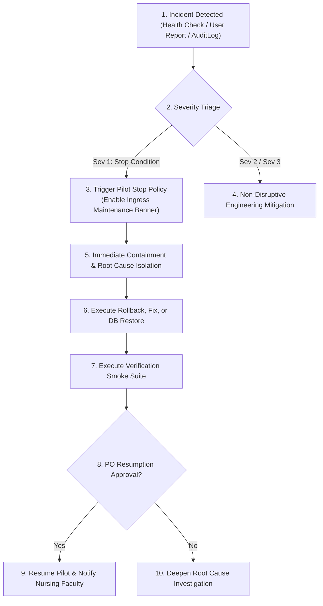

# PREPFORD NCLEX — PHASE 7.9.4
## WORK PACKAGE I: INCIDENT RESPONSE AND PILOT STOP POLICY SPECIFICATION

**Document ID:** `PHASE_7_9_4_INCIDENT_RESPONSE_AND_PILOT_STOP_POLICY.md`  
**Phase:** Phase 7.9.4 — Controlled Institutional Pilot Authorization, Deployment Governance & Operational Readiness  
**Release Candidate Commit:** `58aa98221ac9b2bd1106a9715749011ddaa90ed3` (Base: `6d33fc5`)  
**Commercial Mode:** Controlled Institutional Pilot (`pilot_grant`) — Live Stripe Disabled  
**Decision Authority:** PrepFord Product Owner  
**Date:** 2026-11-06  

---

## 1. Executive Summary & Operational Mandate

```
==================================================================================================
                                    INCIDENT RESPONSE MANDATE:
  THE PLATFORM MUST NOT CONTINUE OPERATING MERELY BECAUSE THE WEB FRONTEND REMAINS REACHABLE.
  If an incident impairs psychometric assessment integrity, causes candidate answer loss,
  violates data isolation boundaries, or breaches security, candidate testing MUST BE PAUSED
  immediately according to the authoritative Pilot Stop Policy.
==================================================================================================
```

Work Package I establishes the formal incident triage protocol, incident classification taxonomy, and concrete stop-the-line triggers for the PrepFord NCLEX Controlled Institutional Pilot.

---

## 2. Incident Response Organization & Critical Roles

| Incident Role | Responsibility in Critical Incident | Decision Authority |
| :--- | :--- | :--- |
| **Product Owner** | Authorizes emergency pilot pause, institutional notifications, and resumption cutovers | Final Executive Authority |
| **Technical Incident Commander**| Leads technical triage, coordinates engineering mitigation, and directs rollback | Technical Command |
| **Backend Operations Lead** | Diagnoses ASP.NET Core Kestrel, memory dumps, and API gateway routing | Backend Systems |
| **Database Operations Lead** | Handles PostgreSQL connection pooling, transaction deadlocks, and backup restores | Persistent Persistence |
| **Frontend Operations Lead** | Manages Next.js BFF error mitigation, caching, and client communication | Frontend Services |
| **Privacy / DPO Contact** | Evaluates statutory data breach notifications under KDPA / GDPR frameworks | Legal & Governance |
| **Institutional Contact** | Primary liaison to participating nursing school deans and faculty coordinators | Institutional Relations |
| **Candidate Support Lead** | Coordinates student ticketing, reauthentication guidance, and test reschedule notices| Candidate Communications |

---

## 3. Fourteen Standard Incident Response Procedures



The incident team follows documented procedures across 14 potential incident categories:
1. **Authentication Failure:** Inability of candidates to log in or validate session tokens. (Immediate check of `SESSION_SECRET` and `UserSessions` table).
2. **Unauthorized Candidate Access:** Cross-candidate assessment access. (Classified as immediate SEV-1; trigger instant pilot stop).
3. **Entitlement Bypass:** Unentitled users starting examinations without valid `pilot_grant`. (Check `IUserEntitlementService` and active plan records).
4. **Examination Integrity Incident:** Unintended exposure of question answers or rationale leaking prior to submission. (Quarantine affected examination revision).
5. **Candidate Answer Loss:** Responses failing to persist in `AttemptResponses`. (Trigger immediate pilot pause; preserve browser local storage).
6. **Database Outage:** PostgreSQL failure or pool exhaustion. (Deploy failover or execute disaster recovery runbook).
7. **Backup Failure:** Daily dump or WAL streaming disruption. (Triage storage buckets within 4 hours; non-disruptive to active testing).
8. **Candidate Data Exposure:** Accidental export or disclosure of candidate PII. (Engage Privacy Officer; initiate 48-hour statutory breach disclosure).
9. **Secret Compromise:** Exposure of `GATEWAY_SHARED_SECRET` or `SESSION_SECRET`. (Execute emergency secret rotation runbook).
10. **Unexpected Deployment Behavior:** High error rates post-rollout. (Execute immediate container rollback).
11. **Widespread Frontend Failure:** Next.js BFF crash loops or hydration errors. (Revert frontend container to prior stable digest).
12. **Widespread Backend Failure:** ASP.NET Core unhandled exceptions. (Drain traffic; inspect Problem Details logs).
13. **Payment Configuration Exposure:** Accidental attempts to trigger live Stripe. (Verify Stripe SDK is uninstalled; reassert `COMMERCIAL_MODE=pilot_grant`).
14. **Institutional Access Control Failure:** Unauthorized modifications to institutional administrative roles. (Revoke affected admin sessions via Tier 2 hold).

---

## 4. Definitive Pilot Stop Conditions Matrix

The occurrence of any condition below **mandates an immediate pause of the institutional pilot**:

| # | Pilot Stop Condition Trigger | Detection Signal | Severity | Immediate Containment Action | Who Can Stop Pilot | Resumption Conditions | Resumption Authority |
| :-: | :--- | :--- | :---: | :--- | :--- | :--- | :---: |
| **S1** | **Cross-Candidate Data Leakage** | Candidate views another learner's exam attempt | **SEV-1** | Activate ingress maintenance banner; revoke active sessions. | Any Engineer or PO | Root-cause code fix verified in integration tests; data isolation audited. | **Product Owner Only** |
| **S2** | **Candidate Answer Loss** | Unpersisted responses detected (> 1 candidate) | **SEV-1** | Halt active examination submissions; freeze exam state. | Tech Lead or PO | Database write pipeline verified; candidate responses recovered or rescheduled. | **Product Owner Only** |
| **S3** | **Confirmed Entitlement Bypass** | Examination taken without active `pilot_grant` | **SEV-1** | Revoke illicit attempts; verify `IUserEntitlementService`. | Security Lead or PO | Partial unique index and service logic re-audited and verified. | **Product Owner Only** |
| **S4** | **Psychometric Scoring Corruption** | System scores valid responses incorrectly | **SEV-1** | Suspend score publishing; freeze attempt completion. | Tech Lead or PO | `QuestionGraderResolver` verified against NGN rubric test suite. | **Product Owner Only** |
| **S5** | **Database Persistence Corruption** | Relation constraint violation or disk corruption | **SEV-1** | Terminate API connections; snapshot database disk. | DB Admin or PO | Database restored and verified via 10-step disaster recovery runbook. | **Product Owner Only** |
| **S6** | **Session Hijacking / Auth Bypass** | Forged session token accepted by API | **SEV-1** | Invalidate all session cookies via `SESSION_SECRET` rotation. | Security Lead or PO | Cryptographic token pipeline audited and patched; all users re-authenticated. | **Product Owner Only** |
| **S7** | **Candidate Submission Black Hole** | Submission endpoint returns 500 on > 1% calls | **SEV-1** | Pause new exam starts; direct active candidates to wait. | Tech Lead or PO | Submission latency and database locks restored to normal operating baseline. | **Product Owner Only** |
| **S8** | **Critical PII Data Exposure** | Database credentials or candidate PII in logs/web | **SEV-1** | Invalidate exposed credentials; purge public telemetry. | Privacy Lead or PO | Credential rotated; institutional DPA breach notification protocol executed. | **Product Owner Only** |
| **S9** | **Failed Operational Recovery Drill** | Recovery procedure fails to restore database | **SEV-1** | Abort deployment or cutover immediately. | DB Admin or PO | Root cause identified; successful restore verified in isolated environment. | **Product Owner Only** |
| **S10**| **Institutional Legal Challenge** | Institutional withdrawal or DPA non-compliance | **SEV-1** | Suspend cohort access immediately. | Product Owner | Institutional dispute resolved and documented in writing. | **Product Owner Only** |

---

## 5. Emergency Pilot Pause Procedure & Communications

### 5.1 Immediate Technical Containment (Under 3 Minutes)
1. **Engage Ingress Maintenance Mode:**
   - Configure edge reverse proxy / CDN to return HTTP 503 with the branded Institutional Pilot Maintenance Page:
     ```html
     <h1>PrepFord NCLEX — Scheduled Institutional Maintenance</h1>
     <p>The pilot testing environment is temporarily paused for technical maintenance. Active examination timers have been frozen. Please contact your institutional nursing coordinator.</p>
     ```
2. **Drain Active Traffic:** Disconnect active candidate WebSocket/HTTP connections gracefully.
3. **Notify Leadership:** Incident Commander opens an emergency incident war room.

### 5.2 Institutional Communication Protocol (Under 30 Minutes)
The Institutional Contact sends formal written notification to designated nursing faculty deans:
- **Notification Template:**
  > *"Dear Nursing Faculty Coordinator: The PrepFord NCLEX platform team has detected a technical issue requiring an immediate temporary pause of candidate assessments to ensure complete data integrity. All candidate examination attempts have been frozen at their current timestamp. No candidate answers will be lost. Our engineering team is currently investigating, and we will provide an authoritative status update within 60 minutes."*

### 5.3 Candidate Communication Protocol
- Support desk auto-responds to candidate queries with confirmation that exam progress and elapsed times are preserved on the server, and instructions on how to resume once the maintenance banner is cleared.

---

## 6. Work Package I Conclusion

The Incident Response and Pilot Stop Policy establishes unambiguous stop-the-line boundaries. Any compromise of assessment integrity, security, or data isolation triggers an immediate halt, prioritizing institutional candidate trust above all else.
