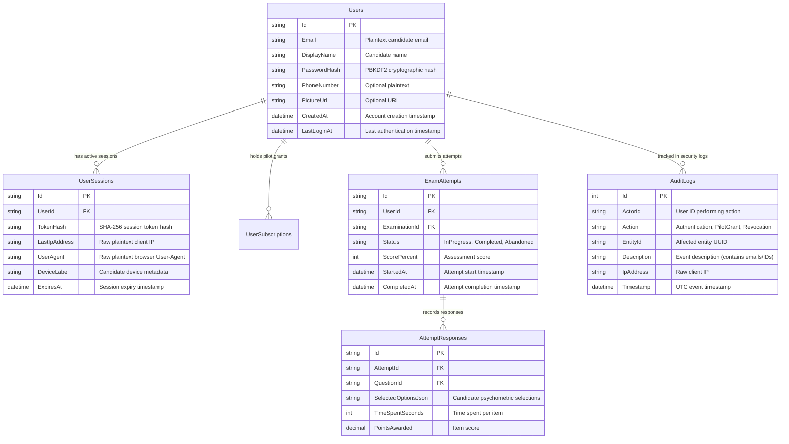

# PREPFORD NCLEX — PHASE 7.9.4
## WORK PACKAGE C: INSTITUTIONAL GOVERNANCE AND DATA-PROTECTION READINESS AUDIT

**Document ID:** `PHASE_7_9_4_INSTITUTIONAL_DATA_GOVERNANCE_READINESS.md`  
**Phase:** Phase 7.9.4 — Controlled Institutional Pilot Authorization, Deployment Governance & Operational Readiness  
**Release Candidate Commit:** `58aa98221ac9b2bd1106a9715749011ddaa90ed3` (Base: `6d33fc5`)  
**Applicable Legal Frameworks:** Kenya Data Protection Act 2019 (KDPA), GDPR (EU 2016/679), FERPA (US 34 CFR Part 99)  
**Database Authority:** PostgreSQL 16  
**Commercial Mode:** Controlled Institutional Pilot (`pilot_grant`)  
**Audit Date:** 2026-11-06  

---

## 1. Executive Summary & Statutory Disclaimer

```
==================================================================================================
                                    LEGAL STATUTORY DISCLAIMER:
  TECHNICAL READINESS DOES NOT CONSTITUTE STATUTORY LEGAL COMPLIANCE.
  This document evaluates the technical safeguards, software limitations, and data-handling
  architecture of the PrepFord platform. It does NOT constitute legal advice or formal certification
  of compliance with the Kenya Data Protection Act (KDPA 2019), the General Data Protection
  Regulation (GDPR), or the Family Educational Rights and Privacy Act (FERPA). Formal statutory
  compliance requires separate institutional legal review and an executed Data Processing Addendum.
==================================================================================================
```

Phase 7.9.3 established that while technical access controls, RBAC separation, cryptographic hashing, and immutable audit logging are verified in software, **server-authoritative candidate consent tracking, automated data retention purges, and automated account erasure pipelines remain unimplemented in the codebase**.

Work Package C provides an unvarnished audit of current software reality, establishes the legal and contractual division of responsibility between PrepFord and the participating institution, and defines the mandatory governance checklist required prior to pilot candidate onboarding.

---

## 2. Definitive Software Implementation Status vs Documented Designs

To maintain strict audit integrity, every candidate-data governance requirement is classified into its physical reality:

| Governance Dimension | Specific Requirement | Actual Codebase Reality | Authoritative Classification |
| :--- | :--- | :--- | :---: |
| **Candidate Consent Records** | Server-authoritative `CandidateConsents` relational table | **NOT IMPLEMENTED.** No table exists in PostgreSQL. Cookie/terms consent is tracked exclusively in browser `localStorage` (`prepford_cookie_consent`). | **DOCUMENTED DESIGN ONLY** |
| **Consent Versioning** | Server-side enforcement of Terms & Privacy Policy versions | **NOT IMPLEMENTED.** Login pipeline does not check consent version or redirect users to acceptance flows. | **DOCUMENTED DESIGN ONLY** |
| **Consent Timestamping** | Immutable server timestamp of candidate consent | **NOT IMPLEMENTED.** No database timestamp records when a candidate accepted privacy terms. | **DOCUMENTED DESIGN ONLY** |
| **Consent Withdrawal** | Self-service candidate portal to withdraw consent | **NOT IMPLEMENTED.** No endpoint or UI affordance exists for candidates to revoke consent. | **DOCUMENTED DESIGN ONLY** |
| **Account Deletion / Erasure** | Right to Erasure / Pseudonymization (KDPA Sec 40, GDPR Art 17) | **NOT IMPLEMENTED.** No candidate erasure route exists in `ProfileController` or `UsersController`. | **DOCUMENTED DESIGN ONLY** |
| **Data Retention Sweeps** | Automated background purge of expired sessions & buckets | **NOT IMPLEMENTED.** No `IHostedService` purges old `UserSessions`, `AuditLogs`, or `RateLimitBuckets`. | **DOCUMENTED DESIGN ONLY** |
| **Candidate Data Export** | Right to Data Portability (KDPA Sec 38, GDPR Art 20) | **PARTIAL (ADMIN ONLY).** `AdminReportsController.ExportReportCsv` exists for admins; no candidate self-service export. | **PARTIALLY IMPLEMENTED (ADMIN ONLY)** |
| **PII Minimization (IP & UA)** | Truncation / hashing of client IP (`/24`) and User-Agent | **PARTIAL.** Stored as plaintext raw strings in `UserSessions` and `AuditLogs`. No IP masking is applied. | **IMPLEMENTED SAFEGUARD (UNMASKED)** |
| **Access Logging** | Permanent log of security, session, and attempt actions | **IMPLEMENTED.** `AuditLogs` table stores actor ID, action, entity ID, description, timestamp, and IP. | **IMPLEMENTED SAFEGUARD** |
| **RBAC Isolation** | Strict candidate separation; no cross-candidate access | **IMPLEMENTED.** Server-authoritative ownership validation in `ExamAttemptsController` prevents cross-user access. | **IMPLEMENTED SAFEGUARD** |
| **Cross-Border Transfers** | Data residency controls and transfer restrictions | **NOT IMPLEMENTED.** No geofencing or jurisdictional routing controls are configured in code. | **OUTSTANDING OPERATIONAL DECISION** |
| **Institutional DPA** | Bilateral Data Processing Agreement with institution | **OUTSTANDING.** Requires Product Owner and University legal execution prior to candidate onboarding. | **MANDATORY PRE-PILOT CONDITION** |

---

## 3. Physical Storage & Telemetry Inventory

Inspection of the PostgreSQL 16 database schema identifies exactly where candidate data and telemetry reside:



---

## 4. Institutional Governance & Responsibility Division

Under applicable data protection law:
- **Participating Institution (Nursing School):** Acts as the **Data Controller**. The institution determines the academic necessity of testing, selects the eligible candidate cohort, and establishes the lawful basis for processing educational records.
- **PrepFord NCLEX:** Acts as the **Data Processor**. PrepFord provides the examination engine, psychometric scoring, and infrastructure strictly on behalf of the institution and pursuant to its written instructions.

### 4.1 Institutional Pilot Governance Checklist

Before any candidate account is provisioned or issued an institutional pilot grant, the participating institution must execute a written confirmation of the following 12 governance items:

- [ ] **1. Data Controller Confirmation:** Institution explicitly confirms it acts as Data Controller and designates an authorized academic representative.
- [ ] **2. Platform Operator Designation:** PrepFord operations team is designated as the authorized Data Processor.
- [ ] **3. Mandatory Candidate Data Agreement:** Confirmation that candidate Email, Display Name, and Examination Responses are strictly necessary for academic licensure preparation.
- [ ] **4. Optional Data Minimization:** Confirmation that candidate phone numbers and profile pictures remain optional.
- [ ] **5. Lawful Basis for Processing:** Institution documents its lawful basis (e.g., Performance of Educational Contract / Legitimate Academic Interest / Student Academic Consent).
- [ ] **6. Applicable Privacy Notice:** Institution approves the PrepFord Pilot Privacy Notice and incorporates it into student clinical orientation.
- [ ] **7. Data Retention Policy:** Institution approves a retention window for the pilot (e.g., Duration of Pilot + 90-day grading dispute window), after which candidate assessment data will be archived or purged.
- [ ] **8. Candidate Support & Dispute Channel:** Institution confirms student support contact points (`support@prepford.com` and institutional nursing coordinator).
- [ ] **9. Data Subject Rights Process:** Protocol agreed for handling candidate requests for access, correction, or deletion via institutional administrative escalation.
- [ ] **10. Security Breach Notification:** Agreement that PrepFord will notify the institution within **48 hours** of any confirmed security incident involving candidate records.
- [ ] **11. Hosting Region & Jurisdictional Transfer:** Institution approves the cloud hosting region and confirms compliance with cross-border data transfer rules.
- [ ] **12. Executed Data Processing Addendum (DPA):** Bilateral legal execution of the PrepFord Institutional Pilot Data Processing Addendum.

---

## 5. Consent Implementation Boundary & Pilot Viability Assessment

### 5.1 Technical Reality
Candidate consent tables (`CandidateConsents`) and automated retention background jobs are **not implemented** in release candidate `58aa982` (`6d33fc5`). 

### 5.2 Viability Determination for Controlled Pilot
Can the institution lawfully and operationally approve the pilot without these features?
- **YES, SUBJECT TO STRICT CONDITIONS:** Because this is a **controlled institutional pilot** operating under an institutional educational contract (and NOT an open public consumer application), the legal authority to process candidate data derives from the **Institutional Data Processing Agreement (DPA)** and institutional academic enrollment, rather than self-service consumer consent.
- **Mandatory Pre-Deployment Mitigation:**
  1. The participating institution must obtain or provide institutional student disclosure consenting to academic performance review.
  2. Candidate onboarding materials must explicitly state that test results are accessible to nursing faculty administrators.
  3. Deletion or retention requests during the pilot must be executed manually by database administrators under formal Product Owner escalation.

### 5.3 Post-Pilot Engineering Remediation (Pre-Commercial Launch)
Before open-market public commercial launch (outside of controlled institutional agreements), the following engineering work packages must be scheduled and implemented:
1. Migration of relational `CandidateConsents` table with versioning and immutable timestamping.
2. Implementation of `IHostedService` background worker to execute automated retention purges on expired sessions, rate-limit buckets, and audit logs.
3. Candidate self-service data export and account erasure endpoints.
4. IP address subnet masking (`/24`) in telemetry logs.

---

## 6. Work Package C Conclusion

Work Package C is **CONDITIONALLY SATISFIED FOR CONTROLLED INSTITUTIONAL PILOT**.

The technical access controls, RBAC separation, and audit logging provide adequate technical security for an institutional cohort. Full statutory data-protection compliance requires the execution of the Institutional Data Processing Addendum prior to onboarding candidates.
