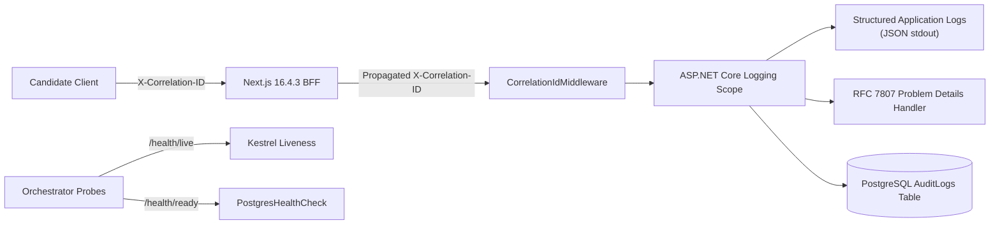

# PREPFORD NCLEX — PHASE 7.9.4
## WORK PACKAGE H: OBSERVABILITY, MONITORING, AND TELEMETRY HYGIENE PLAN

**Document ID:** `PHASE_7_9_4_OBSERVABILITY_AND_MONITORING_PLAN.md`  
**Phase:** Phase 7.9.4 — Controlled Institutional Pilot Authorization, Deployment Governance & Operational Readiness  
**Release Candidate Commit:** `58aa98221ac9b2bd1106a9715749011ddaa90ed3` (Base: `6d33fc5`)  
**Persistent Authority:** PostgreSQL 16  
**Commercial Mode:** Controlled Institutional Pilot (`pilot_grant`)  
**Audit Date:** 2026-11-06  

---

## 1. Executive Summary & Observability Baseline

Work Package H outlines the operational telemetry, alerting thresholds, health probe configurations, and privacy protection rules required to maintain full visibility into the PrepFord NCLEX platform during the controlled institutional pilot.

The platform architecture features built-in structured logging, HTTP correlation tracking, relational health diagnostics, and append-only administrative audit logging. This plan establishes the operational thresholds and monitoring protocols without assuming proprietary or unapproved commercial SaaS monitoring solutions.

---

## 2. Telemetry Architecture & Existing Instrumentation



### 2.1 Current Telemetry Assets
1. **Correlation ID Propagation:** `CorrelationIdMiddleware.cs` extracts incoming `X-Correlation-ID` or generates a cryptographically random UUID, injecting it into the HTTP response header and ASP.NET Core logging scope.
2. **RFC 7807 Problem Details:** `GlobalExceptionHandler.cs` formats all unhandled errors with standardized error types, titles, status codes, and the originating `TraceIdentifier`.
3. **Database Health Verification:** `PostgresHealthCheck.cs` validates relational persistence by executing `SELECT 1` on PostgreSQL 16.
4. **Authoritative Security Audit Logs:** PostgreSQL `AuditLogs` table captures critical security events (login attempts, session revocations, two-tier admin holds, pilot grant issuance, and grant cancellations).

---

## 3. Five Core Monitoring Categories & Alerting Thresholds

### 3.1 Availability Monitoring

| Signal | Source Endpoint / Query | Threshold / Condition | Severity | Immediate Operational Action |
| :--- | :--- | :--- | :---: | :--- |
| **Backend API Liveness** | `GET /api/v1/health/live` | Fails $\ge$ 3 consecutive checks (15s) | **CRITICAL** | Automated container restart by orchestrator. |
| **Database Readiness** | `GET /api/v1/health/ready` | Fails $\ge$ 2 consecutive checks (10s) | **CRITICAL** | Remove API container from load balancer pool; alert Database Admin. |
| **Frontend Web Health** | `GET /api/health` or `/` | HTTP 5xx rate > 1% over 5 minutes | **HIGH** | Inspect Next.js runtime logs and upstream API connectivity. |
| **Authentication Flow** | `POST /api/v1/auth/login` | HTTP 500 responses > 0 in 5 minutes | **HIGH** | Triage session service and database connection pool. |

### 3.2 Security Telemetry & Abuse Detection

| Signal | Detection Mechanism | Threshold | Severity | Immediate Operational Action |
| :--- | :--- | :--- | :---: | :--- |
| **Brute-Force Logins** | `AuditLogs` (Failed logins per IP/User) | $\ge$ 5 failures in 10 minutes | **MEDIUM** | Rate limit triggered; inspect IP access rules. |
| **Admin Revocation Holds**| HTTP 403 `ADMIN_REVOCATION_HOLD` | $\ge$ 1 candidate attempting override | **MEDIUM** | Security audit of affected candidate account. |
| **Session Concurrency Denials**| `SessionSecurityService` violations | $\ge$ 3 device limit rejections / hour | **LOW** | Notify candidate support; candidate may be sharing credentials. |
| **Gateway Signature Mismatches**| Backend returns HTTP 401 on HMAC | $\ge$ 5 occurrences in 5 minutes | **CRITICAL** | Potential configuration desync or secret exposure. Check `GATEWAY_SHARED_SECRET`. |
| **Advisory Rate-Limit Locks**| `RateLimitBuckets` advisory lock timeouts| $\ge$ 1 timeout detected | **HIGH** | Database transaction deadlock triage. |

### 3.3 Assessment Integrity & Psychometric Delivery

| Signal | Detection Metric | Threshold | Severity | Immediate Operational Action |
| :--- | :--- | :--- | :---: | :--- |
| **Exam Start Failures** | `POST .../attempts/start` failure | Any HTTP 5xx or unhandled exception | **HIGH** | Investigate blueprint snapshot generation. |
| **Response Submission Errors** | `POST .../attempts/{id}/responses` | Submission failure rate > 0.5% | **CRITICAL** | Check database write latency; verify candidate responses are buffered. |
| **Graceful In-Window Denials** | In-Window exam completion rejected | Rejection when candidate within time limit | **HIGH** | Bug triage in `IUserEntitlementService`. |
| **Attempt State Anomalies** | Abandoned attempt without candidate exit | Rate > 2% per examination cohort | **MEDIUM** | Assess candidate browser network stability. |

### 3.4 Performance & Infrastructure Saturation

| Signal | Measurement Metric | Warning Threshold | Critical Threshold | Resolution Action |
| :--- | :--- | :---: | :---: | :--- |
| **API Request Latency** | `p95` response time | > 500 ms | > 1,500 ms | Inspect PostgreSQL slow query log. |
| **Submission Processing Time**| Response submission duration | > 300 ms | > 1,000 ms | Scale API containers; optimize JSONB index. |
| **Database Connection Pool** | Active vs Max connections (100) | > 70 connections | > 90 connections | Investigate unclosed DbContext connections. |
| **CPU / Memory Utilization** | Container resource usage | > 75% for 10 minutes | > 90% for 5 minutes | Vertical or horizontal auto-scale trigger. |

### 3.5 Persistence, Backup & Storage Health

| Signal | Verification Target | Alerting Threshold | Severity | Operational Response |
| :--- | :--- | :---: | :---: | :--- |
| **Backup Execution** | Daily `pg_dump` completion | No successful backup in 24 hours | **CRITICAL** | Manual dump execution; backup pipeline triage. |
| **Backup Integrity** | SHA-256 digest validation | Mismatch or zero-byte file | **CRITICAL** | Immediate backup re-run and storage audit. |
| **WAL Archiving** | Continuous WAL archive lag | Lag > 1 hour | **HIGH** | Storage volume and WAL shipping daemon check. |
| **Database Disk Headroom** | Free disk space on PostgreSQL volume | < 25% free | < 10% free | Expand managed storage volume immediately. |

---

## 4. Telemetry Privacy & PII Sanitization Guards

To prevent statutory violations under KDPA and GDPR, logging systems must strictly adhere to the following data-hygiene rules:

```
+--------------------------------------------------------------------------------------------------+
|                               TELEMETRY PRIVACY SANITIZATION RULES                               |
+--------------------------------------------------------------------------------------------------+
| 1. Passwords & Secrets: Plaintext passwords, PBKDF2 hashes, session tokens, and gateway secrets  |
|    MUST NEVER appear in logs.                                                                    |
| 2. Candidate Responses: Candidate answer selections, psychometric choices, and diagnostic        |
|    rationales must not be logged in application stdout (stored strictly in encrypted DB).       |
| 3. Candidate PII: Candidate names and emails must not be interpolated into unindexed log strings. |
|    Use anonymized Entity UUIDs (`UserId`, `AttemptId`) for request tracing.                      |
| 4. IP Addresses: Raw candidate IP addresses should only be stored in security AuditLogs where    |
|    legally required for attribution. Routine request logs should truncate or mask client IPs.    |
+--------------------------------------------------------------------------------------------------+
```

---

## 5. Work Package H Conclusion

The observability and monitoring plan establishes comprehensive visibility across all five operational dimensions, protecting system availability, candidate assessment integrity, and data privacy throughout the controlled institutional pilot.
