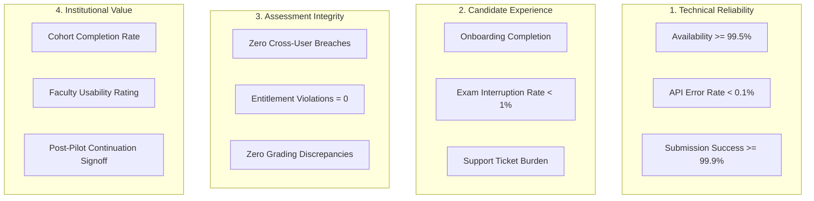

# PREPFORD NCLEX — PHASE 7.9.4
## WORK PACKAGE L: PILOT ACCEPTANCE METRICS AND SUCCESS CRITERIA

**Document ID:** `PHASE_7_9_4_PILOT_ACCEPTANCE_METRICS.md`  
**Phase:** Phase 7.9.4 — Controlled Institutional Pilot Authorization, Deployment Governance & Operational Readiness  
**Release Candidate Commit:** `58aa98221ac9b2bd1106a9715749011ddaa90ed3` (Base: `6d33fc5`)  
**Commercial Mode:** Controlled Institutional Pilot (`pilot_grant`)  
**Authority:** PrepFord Product Owner  
**Date:** 2026-11-06  

---

## 1. Executive Summary & Measurement Framework

Work Package L establishes the definitive operational metrics, reliability benchmarks, assessment integrity indicators, and institutional evaluation criteria for measuring the success of the PrepFord NCLEX Controlled Institutional Pilot.

To maintain audit integrity, no baseline targets or operational thresholds are fabricated. Where specific commercial or academic thresholds require formal sign-off, they are designated **`PENDING PRODUCT OWNER DECISION`**.

```
==================================================================================================
                                    DATA GOVERNANCE MANDATE:
  Candidate test outcomes, psychometric response patterns, and diagnostic scores collected during
  the institutional pilot may NOT be used for public marketing, algorithmic training, or external
  academic research without separate, explicit written consent and Institutional Review Board (IRB)
  or Data Processing Addendum (DPA) governance approval.
==================================================================================================
```

---

## 2. Four Core Pilot Measurement Dimensions



---

## 3. Comprehensive Pilot Acceptance Metrics Matrix

### 3.1 Technical & Operational Reliability Metrics

| Metric Dimension | Measurement Method / Source | Target Pilot Threshold | Tracking Frequency | Classification |
| :--- | :--- | :---: | :---: | :--- |
| **Platform Availability** | Uptime monitoring on `/api/v1/health/ready` | $\ge$ 99.5% during testing hours | Continuous | Standard SLA |
| **API Error Rate** | HTTP 5xx responses / Total HTTP requests | $\le$ 0.1% | Daily Aggregation | Production Standard |
| **Item Submission Latency** | `p95` latency on `POST .../responses` | $\le$ 500 ms | Real-Time Telemetry | Performance Target |
| **Authentication Success** | Successful logins / Total login attempts | $\ge$ 98.0% (excluding wrong passwords)| Daily Aggregation | Access Baseline |
| **Exam Start Success** | Successful `POST .../attempts/start` | $\ge$ 99.9% | Per Cohort Session | Assessment Critical |
| **Submission Success Rate** | Successfully persisted `AttemptResponses` | $\ge$ 99.9% (zero data loss) | Per Cohort Session | Assessment Critical |
| **Database Pool Headroom** | Active Npgsql connections / Max (100) | $\le$ 70% peak saturation | Real-Time Telemetry | Capacity Gate |
| **Backup Integrity** | Automated daily dump + SHA-256 validation | 100% daily success rate | Daily (03:00 UTC) | Disaster Recovery |
| **WAL Archiving Continuity** | WAL streaming archive replication lag | $\le$ 1 hour lag | Continuous | Disaster Recovery |

### 3.2 Candidate Experience & Workflow Usability

| Metric Dimension | Measurement Source | Target Threshold | Classification |
| :--- | :--- | :---: | :--- |
| **Successful Onboarding** | Registered accounts / Invited cohort roster | `PENDING PRODUCT OWNER DECISION` | Institutional Funnel |
| **Exam Completion Rate** | Completed attempts / Initiated attempts | $\ge$ 95.0% | Engagement Baseline |
| **Involuntary Interruption Rate**| Network disconnects resulting in session pause | $\le$ 2.0% of all attempts | Technical UX |
| **Graceful In-Window Success** | Lapsed grants completed within official time | 100% successful submissions | Entitlement UX |
| **Candidate Support Burden** | Support tickets raised per 100 candidates | $\le$ 5 tickets / 100 users / week | Operational Overhead |
| **Candidate Satisfaction** | Post-exam voluntary feedback score (1–5 scale)| `PENDING PRODUCT OWNER DECISION` | User Sentiment |

### 3.3 Assessment Integrity & Security Metrics

| Metric Dimension | Detection Mechanism | Authoritative Target | Action on Violation |
| :--- | :--- | :---: | :--- |
| **Cross-Candidate Breaches** | Attempt ownership validation queries | **EXACTLY ZERO (`0`)** | Immediate SEV-1 Pilot Stop |
| **Entitlement Bypasses** | Attempts started without valid `pilot_grant` | **EXACTLY ZERO (`0`)** | Immediate SEV-1 Pilot Stop |
| **Session Concurrency Bypasses**| Candidates exceeding 2 concurrent devices | **EXACTLY ZERO (`0`)** | Account Suspension |
| **Grading Discrepancies** | Re-score verification against rubric | **EXACTLY ZERO (`0`)** | Psychometric Audit |
| **Advisory Lock Collisions** | PostgreSQL rate-limit / session deadlocks | **EXACTLY ZERO (`0`)** | Database Triage |
| **Admin Overrides on Holds** | Attempted bypasses of Tier 2 admin holds | **EXACTLY ZERO (`0`)** | Security Triage |

### 3.4 Institutional Outcomes & Commercial Decision Criteria

| Metric Dimension | Measurement Method | Target Threshold | Decision Authority |
| :--- | :--- | :---: | :--- |
| **Participating Cohort Size** | Confirmed enrolled candidates | `PENDING PRODUCT OWNER DECISION` | Product Owner & Dean |
| **Active Testing Participation**| Candidates completing $\ge$ 1 full exam | $\ge$ 80% of enrolled cohort | Institutional Faculty |
| **Administrative Usability** | Faculty reporting satisfaction rating | `PENDING PRODUCT OWNER DECISION` | Nursing School Dean |
| **Institutional Faculty Review**| Faculty formal sign-off on curriculum coverage| Written Approval | Program Director |
| **Pilot Continuation Decision** | Executive recommendation for commercial phase | Formal Written Determination | Product Owner |

---

## 4. Work Package L Conclusion

The Pilot Acceptance Metrics establish quantitative, verifiable criteria across technical stability, candidate usability, assessment validity, and institutional satisfaction. Meeting these thresholds provides the empirical evidence required for subsequent commercial launch decisions.
