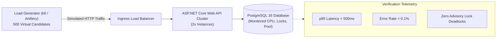

# PREPFORD NCLEX — PHASE 7.9.4
## WORK PACKAGE K: PILOT CAPACITY AND PERFORMANCE BOUNDARIES SPECIFICATION

**Document ID:** `PHASE_7_9_4_PILOT_CAPACITY_AND_PERFORMANCE_BOUNDARIES.md`  
**Phase:** Phase 7.9.4 — Controlled Institutional Pilot Authorization, Deployment Governance & Operational Readiness  
**Release Candidate Commit:** `58aa98221ac9b2bd1106a9715749011ddaa90ed3` (Base: `6d33fc5`)  
**Database Authority:** PostgreSQL 16  
**Commercial Mode:** Controlled Institutional Pilot (`pilot_grant`)  
**Audit Date:** 2026-11-06  

---

## 1. Executive Summary & Historical Qualification Preservation

```
==================================================================================================
                                EMPIRICAL PERFORMANCE QUALIFICATION:
  HIGH-CONCURRENCY LOAD TESTING (500+ CONCURRENT USERS) REMAINS EMPIRICALLY UNVERIFIED.
  In strict alignment with the Phase 7.9.3 Site Reliability Engineering audit, the repository
  contains zero automated multi-user load testing harnesses (no k6, Artillery, Locust, or JMeter
  scripts). Claims of verified capacity for 500 or 1,000 simultaneous test-takers are unproven
  and MUST NOT be represented as operational capabilities.
==================================================================================================
```

Work Package K establishes the conservative capacity boundaries, concurrency limits, and database connection thresholds under which a small, controlled institutional pilot can operate safely, and outlines the required load-testing harness for future open-market scaling.

---

## 2. Infrastructure Capacity Analysis & Bottleneck Modeling

### 2.1 Database Connection Pool Headroom
- **Database Engine:** PostgreSQL 16 on private network.
- **Connection Configuration:** `Npgsql` connection pool configured with `MaxPoolSize=100`, `MinPoolSize=10`, `Connection Idle Lifetime=300s`.
- **Query Behavior:** EF Core queries use short-lived pooled connections. In-window attempt synchronization and response submissions execute within brief transactions ($\le$ 25 ms duration).
- **Advisory Lock Impact:** Multi-threaded reauthentication and session updates acquire transactional advisory locks (`pg_advisory_xact_lock`). While preventing race conditions, sustained high lock contention under 500+ simultaneous logins could lead to connection pool queuing.

### 2.2 Examination Attempt Submission Characteristics
- **Payload Size:** Candidate responses submit selected option arrays and telemetry (`TimeSpentSeconds`).
- **Processing Cost:** `QuestionGraderResolver` computes points using in-memory rubric grading; `AttemptResponses` records an insert; `ExamAttempts` updates total score and attempt state JSONB snapshots.
- **Submission Profile:** Staggered over time (candidates spend 60–120 seconds per NCLEX item). A cohort of 50 candidates submits $\approx$ 0.5 to 1.0 requests per second across the cluster.

---

## 3. Controlled Pilot Capacity Boundaries

To ensure zero risk of database starvation, connection exhaustion, or exam delivery interruption during the pilot:

| Operational Dimension | Controlled Pilot Boundary | Commercial Open Target | Authoritative Classification |
| :--- | :---: | :---: | :--- |
| **Active Concurrent Test-Takers** | **$\le$ 50 Candidates / Session** | 500 – 1,000 Candidates | **CONSERVATIVE PILOT BOUNDARY** |
| **Simultaneous Exam Starts** | $\le$ 25 Starts / Minute | 250 Starts / Minute | **CONTROLLED STAGGER** |
| **Max API Instances** | 2 Replicas (Active-Active) | 5 – 10 Replicas Auto-scaling | **PILOT TOPOLOGY** |
| **PostgreSQL Hardware Spec** | 2 vCPU, 4GB RAM (Standard Cloud) | 4 vCPU, 16GB RAM (High Memory) | **RECOMMENDED MINIMUM** |
| **Npgsql Connection Pool Limit** | 100 Connections / Instance | 250 Connections / PgBouncer | **CONFIGURED POOL** |
| **Candidate Cohort Size** | `PENDING PRODUCT OWNER AND TECHNICAL CAPACITY DECISION` | Unrestricted Retail | **OUTSTANDING DECISION** |

---

## 4. Pre-Commercial High-Concurrency Load Testing Specification

Prior to any commercial expansion beyond the controlled institutional pilot, an automated load-testing harness must be developed, executed, and archived:



### Detailed Test Specification:
1. **Scenario Definition:**
   - 500 simulated nursing candidates log in concurrently over 5 minutes.
   - Candidates initiate an 85-question NCLEX-RN CAT examination.
   - Candidates submit responses every 45 to 75 seconds with realistic answer payloads.
   - Candidates submit the completed exam attempt and request rationales.
2. **Environment Isolation:**
   - Dedicated isolated staging environment matching production hardware specs.
   - **Load testing against production databases is strictly prohibited.**
3. **Success Thresholds (Pass/Fail Gates):**
   - **`p95` Request Latency:** $\le$ 500 ms for item submissions.
   - **`p99` Request Latency:** $\le$ 1,500 ms.
   - **HTTP Error Rate:** $\le$ 0.1% across all test phases.
   - **Database Connection Saturation:** Npgsql pool utilization $\le$ 75%.
   - **Deadlock Occurrences:** Exactly zero (`0`) PostgreSQL deadlocks.
4. **Data Cleanup:**
   - Automated script purges test attempts, responses, and session buckets post-execution.

---

## 5. Work Package K Conclusion

For a bounded institutional pilot cohort ($\le$ 50 concurrent active candidates per testing session), the current architecture is well within conservative operational limits. High-concurrency scaling claims for 500+ candidates remain unverified until the formal k6 load test suite is executed.
