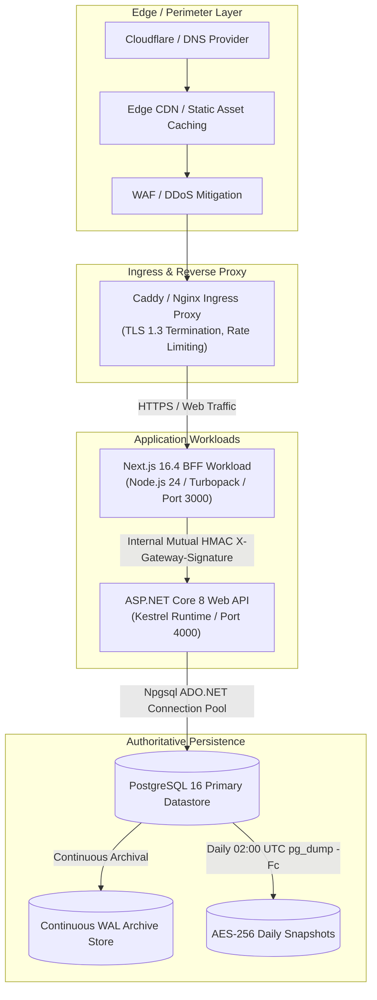

# PrepFord NCLEX — Phase 7 Environment & Infrastructure Inventory

**Document File:** `docs/architecture/PHASE_7_ENVIRONMENT_INVENTORY.md`  
**Phase:** Phase 7 — Controlled Production Launch  
**Repository Branch:** `feature/dotnet-backend-migration`  
**Date:** November 5, 2026  
**Auditor Roles:** DevOps Lead, SRE Lead, Lead Security Architect  

---

## 1. Top-Level Infrastructure Topology

PrepFord NCLEX employs a decoupled, containerized multi-tier architecture designed for horizontal scalability, zero-downtime rolling updates, and complete data isolation:

---

## 2. Environment Matrix & Configuration

| Parameter | Development | Integration (CI) | Staging / Pre-Prod | Production |
| :--- | :--- | :--- | :--- | :--- |
| **Node.js Runtime** | Node.js 24.x | Node.js 24.x | Node.js 24.x | Node.js 24.x (LTS) |
| **.NET SDK / CLR** | .NET 8.0.407 | .NET 8.0.x | .NET 8.0.x | .NET 8.0.x (Release Build) |
| **PostgreSQL Version** | 18.6 (Local Loopback) | 16-alpine (Container) | 18.6 (Dedicated Staging DB) | 16+ Managed PostgreSQL |
| **Database Name** | `prepford` | `preform` | `prepford_staging_restore_drill` | `prepford_production` |
| **BFF Port** | `3000` | Dynamic | `3000` | `3000` (Internal container) |
| **API Port** | `4000` | Dynamic | `4000` | `4000` (Internal container) |
| **TLS / SSL** | Self-signed / HTTP | N/A | TLS 1.3 (Let's Encrypt) | TLS 1.3 (Strict HSTS) |
| **Gateway Auth** | Shared Secret HMAC | Shared Secret HMAC | Shared Secret HMAC | Secure Ephemeral Secret HMAC |
| **Mock Checkout** | Enabled (`true`) | Enabled (`true`) | Enabled (`true`) | **Strictly Forbidden (`false`)** |

---

## 3. Subsystem Hosting & Service Mapping

### 3.1 Frontend Service (`apps/web`)
- **Technology:** Next.js 16.4.3 (App Router), React 19, Tailwind CSS, TypeScript 5.8.
- **Build Mode:** Next.js Standalone Build output with Turbopack bundler.
- **Key Routes:**
  - Public Marketing: `/`, `/pricing`, `/about`, `/faq`, `/contact`.
  - Curriculum & Study Guide: `/study-guide`, `/study-guide/*`.
  - Learner Dashboard: `/dashboard`, `/dashboard/study`, `/dashboard/practice`, `/dashboard/exams`, `/dashboard/analytics`, `/dashboard/settings/security`.
  - Administrator Portal: `/admin/questions`, `/admin/examinations`, `/admin/users`, `/admin/roles`, `/admin/reports`, `/admin/monitoring`.
- **Health Endpoints:** Served via Next.js Route Handlers.
- **Static Assets:** Cached at edge via Cloudflare / CDN with immutable headers for hashed bundles.

### 3.2 Backend Service (`apps/api`)
- **Technology:** ASP.NET Core 8 Web API, Entity Framework Core 8/10, Npgsql.
- **Host Configuration:** Kestrel listening on `http://0.0.0.0:4000` behind reverse proxy.
- **Health & Readiness Endpoints:**
  - `GET /api/v1/health/live`: Fast process liveness probe (returns `{"status":"ok"}`).
  - `GET /api/v1/health/ready`: Deep dependency readiness probe checking PostgreSQL connectivity via `PostgresHealthCheck` (returns `{"status":"ready"}`).
- **Security Middleware Chain:**
  1. Forwarded Headers Middleware (respects trusted reverse proxy `X-Forwarded-For`).
  2. IP Access Rules Middleware (`IpFilteringMiddleware`).
  3. Shared Rate Limiting (Sliding window bucket backed by PostgreSQL).
  4. Mutual HMAC Authentication Handler (`PrepfordAuthHandler`).
  5. Security Audit Logging Middleware.

### 3.3 Database Service (`PostgreSQL 16+`)
- **Database Engine:** PostgreSQL 16+ (PostgreSQL 18.6 verified in local/CI environment).
- **Relational Lineage:** 13 sequential EF Core migrations recorded in `__EFMigrationsHistory`.
- **Relational Tables:** 37 normalized public schema tables.
- **Connection Pooling:** Npgsql connection pooling with minimum 5, maximum 100 pooled connections.
- **Backups:**
  - Tooling: `scripts/backup-db.sh` and `scripts/backup-db.ps1`.
  - Format: Custom compressed archive (`pg_dump -Fc -Z 9`) with SHA-256 integrity hash.
  - Recovery Tooling: `scripts/restore-db.sh` and `scripts/restore-db.ps1`.

---

## 4. Secret & Configuration Inventory

| Variable Name | Required Scope | Secret? | Production Policy |
| :--- | :--- | :---: | :--- |
| `DATABASE_URL` | API | Yes | Fail-closed at boot if missing or contains default password |
| `JWT_SECRET` | API & BFF | Yes | Minimum 256-bit cryptographically random key; rotation policy active |
| `GATEWAY_SHARED_SECRET` | API & BFF | Yes | Minimum 32-character shared secret for BFF-to-API mutual HMAC |
| `WEBHOOK_SIGNING_SECRET` | API | Yes | Used for verifying incoming Stripe payment webhook HMAC signatures |
| `ENABLE_MOCK_CHECKOUT` | API | No | MUST be `false` in production. Boot gate prevents mock payments |
| `APP_ENV` / `ASPNETCORE_ENVIRONMENT` | All | No | Set to `production` |
| `PORT` | API | No | Default `4000` |
| `WEB_ORIGIN` | API | No | Production frontend origin (e.g. `https://prepford.com`) for strict CORS |
