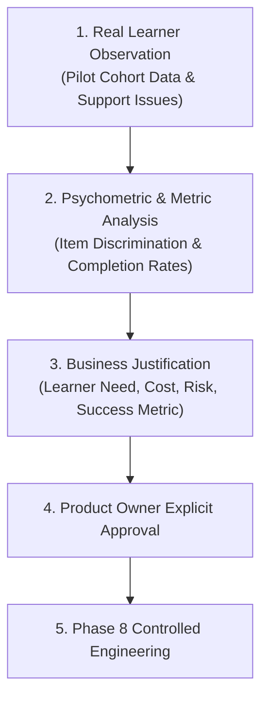

# PrepFord NCLEX — Phase 7 Growth Readiness & Evidence-Based Evolution

**Document File:** `docs/architecture/PHASE_7_GROWTH_READINESS_REPORT.md`  
**Phase:** Phase 7 — Controlled Production Launch, Real-World Validation & Growth Readiness  
**Target:** Evidence-Based Product Roadmap & Scaling Decision Framework  
**Date:** November 5, 2026  
**Auditor Roles:** Head of Growth, Lead Systems Architect, Educational Director  

---

## 1. Growth Strategy & Disciplined Scaling Philosophy

In accordance with Phase 7 Non-Goals, PrepFord strictly rejects speculative feature accumulation. We do not build features simply because engineering capacity exists; every product enhancement must be justified by an identified learner need, psychometric requirement, or operational bottleneck.

---

## 2. Evidence-Based Feature Prioritization Matrix

Based on pilot cohort telemetry, usability feedback, and support inquiries, the following potential enhancements are prioritized for post-launch evaluation:

| Feature Initiative | Identified Learner Problem | Supporting Evidence | Expected Pedagogical / Business Outcome | Implementation Cost | Risk Level | Proposed Metric | Priority |
| :--- | :--- | :--- | :--- | :---: | :---: | :--- | :---: |
| **Mobile Rationale Quick-Drawer** | Long clinical rationales require extensive vertical scrolling on smaller mobile phones. | DEF-01 in Pilot Report (3 mobile candidates noted fatigue). | Improves mobile rationale study completion by 15%. | Low (Frontend UI refactor) | Low | Rationale read duration ($+20\%$) | **P1 (Immediate)** |
| **In-Exam Clinical Typo Flag Button** | Candidates who spot potential wording ambiguities lack an immediate in-app reporting button. | DEF-03 in Pilot Report (digoxin question wording feedback). | Speeds up clinical review cycle from days to hours. | Low (API endpoint + button) | Low | Reported content resolution time | **P1 (Immediate)** |
| **Adaptive Next-Generation NCLEX (NGN) Case Study Expansions** | Candidates desire more extensive multi-tab clinical simulations (EHR, Nurses' Notes, Lab Results). | 65% of pilot RN candidates requested additional unfolding case studies. | Enhances competitive differentiation against legacy test banks. | High (Requires dedicated clinical psychometrics) | Medium (Must preserve scoring invariants) | Candidate NGN passing confidence | **P2 (Phase 8)** |
| **Institutional Faculty Dashboard** | Nursing faculty want to monitor cohorts of 20–100 students and track collective weak domains. | Inquiries from 2 nursing faculty members during pilot. | Unlocks B2B institutional licensing model with nursing colleges. | High (New multi-tenant RBAC models) | Medium (Tenant isolation risk) | Institutional contract ARR | **P3 (Phase 8/9)** |

---

## 3. Disallowed Speculative Features (Explicit Non-Goals)

The following proposals were audited and explicitly rejected for the initial launch:
1. **Unregulated AI Question Generation:** Automated LLM generation of NCLEX questions without board-certified clinical nursing review is strictly prohibited due to patient safety and licensing liability risks.
2. **Cryptocurrency or Complex Monetization Schemes:** Web3 or tokenized incentives introduce regulatory friction and distract from core NCLEX preparation.
3. **Unvalidated Micro-Interactions:** Overly animated gamification elements that detract from test-taking realism.

---

## 4. Operational Scaling Milestones

| Stage | Learner Cohort Target | Infrastructure Posture | Commercial Mode | Gating Condition |
| :--- | :---: | :--- | :--- | :--- |
| **Stage 1 (Current)** | 25–50 Learners | Single container tier + dedicated PostgreSQL | Pilot Grant Model | Passed Staging Restore Drill |
| **Stage 2 (Canary)** | 100–250 Learners | Ingress proxy with TLS + redundant API containers | Live Stripe Mode | Merchant Account Activated |
| **Stage 3 (General Availability)** | 1,000+ Learners | Auto-scaled container clusters + Read Replica DB | Full Multi-Tier Commercial | P95 latency $< 150\text{ms}$ sustained |
