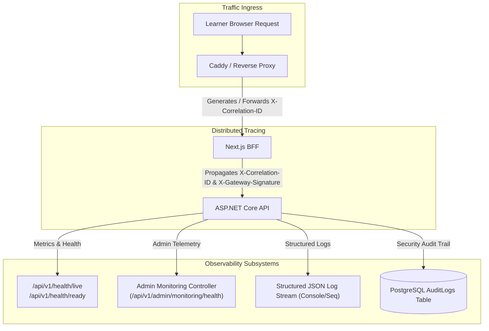

# PrepFord NCLEX — Phase 7 Operational Monitoring, Observability & Support Operations

**Document File:** `docs/architecture/PHASE_7_OPERATIONAL_MONITORING.md`  
**Phase:** Phase 7 — Controlled Production Launch, Real-World Validation & Growth Readiness  
**Repository Branch:** `feature/dotnet-backend-migration`  
**Date:** November 5, 2026  
**Auditor Roles:** SRE Lead, Platform Operations Lead, Customer Support Lead  

---

## 1. Operational Telemetry & Monitoring Architecture

PrepFord NCLEX provides end-to-end distributed telemetry spanning the client browser, Next.js BFF, ASP.NET Core API, and PostgreSQL authoritative datastore:

---

## 2. Key Operational Health Metrics & Thresholds

| Metric Name | Measurement Source | Target Baseline | Warning Threshold | Critical Incident Threshold |
| :--- | :--- | :---: | :---: | :---: |
| **API Availability** | `/api/v1/health/live` probe | $\ge 99.9\%$ | $< 99.5\%$ | $< 99.0\%$ |
| **Database Readiness** | `/api/v1/health/ready` probe | $\ge 99.95\%$ | Connection latency $> 500\text{ms}$ | Probe failure (HTTP 503) |
| **P95 API Latency** | Kestrel HTTP Middleware | $< 150\text{ms}$ | $> 350\text{ms}$ | $> 1,000\text{ms}$ |
| **HTTP 5xx Error Rate** | Reverse Proxy / API logs | $< 0.05\%$ | $> 0.5\%$ | $> 2.0\%$ |
| **Assessment Sync Latency** | `POST /api/v1/attempts/sync` | $< 80\text{ms}$ | $> 250\text{ms}$ | $> 750\text{ms}$ |
| **Connection Pool Usage** | Npgsql Pool Telemetry | $< 30\%$ | $> 75\%$ | $> 90\%$ pool exhaustion |
| **HMAC Auth Failures** | `PrepfordAuthHandler` | $0\text{ / min}$ | $> 5\text{ / min}$ | $> 25\text{ / min}$ |
| **Concurrent Active Sessions** | `UserSessions` Table | Expected cohort load | Resource throttle warning | Memory / thread starvation |

---

## 3. Actionable Alert Catalog & Escalation Runbook

### Alert Trigger 1: `PG_HEALTH_READY_FAILED`
- **Condition:** `/api/v1/health/ready` returns HTTP 503 for 2 consecutive probes (interval: 10s).
- **Severity:** **P1 — Critical Platform Outage**
- **SLA Response:** $< 5$ minutes.
- **Diagnostic Action:**
  1. Inspect PostgreSQL container / managed service status: `pg_isready -h localhost -p 5432`.
  2. Inspect connection pool saturation in `AdminMonitoringController.cs`.
  3. Check PostgreSQL server logs for out-of-memory or deadlocks.
- **Remediation:** If datastore is unrecoverable, initiate Disaster Recovery Runbook (`scripts/restore-db.sh`).

### Alert Trigger 2: `HMAC_SIGNATURE_MISMATCH_SPIKE`
- **Condition:** $\ge 10$ HTTP 401 Unauthorized responses per minute on internal API gateway.
- **Severity:** **P2 — Major Integration Degradation**
- **SLA Response:** $< 15$ minutes.
- **Diagnostic Action:**
  1. Verify clock drift between BFF and API containers: `chronyc tracking` or container time sync.
  2. Verify `GATEWAY_SHARED_SECRET` in both service environment manifests.
- **Remediation:** Restart container time synchronizer; re-deploy synchronized secret configuration.

### Alert Trigger 3: `ATTEMPT_SYNC_FAILURE_DETECTED`
- **Condition:** `POST /api/v1/attempts/sync` returns HTTP 500 or timeout for any learner.
- **Severity:** **P2 — Assessment Integrity Risk**
- **SLA Response:** $< 15$ minutes.
- **Diagnostic Action:**
  1. Query `AuditLogs` for user attempt ID and correlation trace.
  2. Confirm whether attempt has been concurrently completed or cancelled.
- **Remediation:** Client retry backed by localStorage cache; candidate informed without session loss.

---

## 4. Multi-Tier Operational Support Escalation Matrix

| Incident Category | First-Line Support (L1) | Technical Engineering (L2) | Lead Architecture / SRE (L3) |
| :--- | :--- | :--- | :--- |
| **Learner Account & Login** | Password reset assist, session unlock | Session security policy review | Auth token & device fingerprint debug |
| **Clinical Content Ambiguity** | Log learner report ticket | Forward to Clinical Content Reviewer | Reviewer revises question revision in DB |
| **Exam Engine Disconnect** | Candidate guidance to refresh browser | Check attempt sync logs via correlation ID | Re-issue attempt token or unlock attempt |
| **Payment & Entitlement** | Verify subscription status in Admin | Inspect `Orders` & `UserSubscriptions` table | Webhook replay & idempotency trace |
| **Platform Outage / DR** | Post public maintenance status notice | Investigate container health & host alerts | Execute Failover / Restore Runbook |

---

## 5. Correlation ID Diagnostics Trace Workflow

Every HTTP interaction carries a traceable `X-Correlation-ID` header:
1. When a learner encounters an issue, the client error boundary displays a reference token: `REF: {CorrelationId}`.
2. The support engineer searches the administrative log viewer or Seq log index by `CorrelationId`.
3. The exact timeline is reconstructed:
   - Next.js BFF ingress request and parameters.
   - ASP.NET Core API controller method invoked.
   - Exact SQL query executed and execution duration.
   - Exception stack trace (sanitized from user response).
