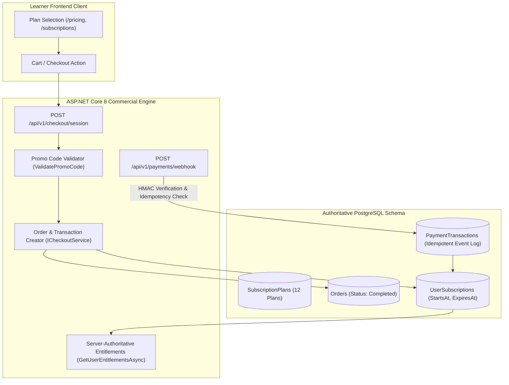
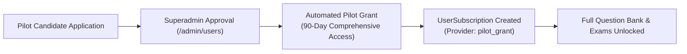

# PrepFord NCLEX — Phase 7 Payment Integration & Commercial Readiness

**Document File:** `docs/architecture/PHASE_7_PAYMENT_READINESS.md`  
**Phase:** Phase 7 — Controlled Production Launch, Real-World Validation & Growth Readiness  
**Target Subsystem:** Commercial Subscriptions, Order Management, Checkout & Webhooks  
**Repository Branch:** `feature/dotnet-backend-migration`  
**Date:** November 5, 2026  
**Auditor Roles:** Commercial Systems Auditor, Backend Lead, Security Architect  

---

## 1. Commercial Architecture Overview

PrepFord NCLEX offers multi-tier subscription plans tailored to nursing candidates preparing for the NCLEX-RN and NCLEX-PN examinations:



---

## 2. Subscription Plan Catalog Audit

The PostgreSQL database authoritative catalog defines 12 standard plans across RN, PN, and Combined pathways:

| Plan ID / Slug | Name | Pathway | Interval | Price (USD) | Price (Cents) | Active Status |
| :--- | :--- | :---: | :---: | :---: | :---: | :---: |
| `rn-monthly` | NCLEX-RN Monthly Pass | `rn` | Monthly (30d) | $49.00 | 4,900 | **Active** |
| `rn-quarterly` | NCLEX-RN Comprehensive 90-Day | `rn` | Quarterly (90d) | $99.00 | 9,900 | **Active** |
| `rn-annual` | NCLEX-RN Pass Guarantee (Annual) | `rn` | Annual (365d) | $199.00 | 19,900 | **Active** |
| `pn-monthly` | NCLEX-PN Monthly Pass | `pn` | Monthly (30d) | $39.00 | 3,900 | **Active** |
| `pn-quarterly` | NCLEX-PN Comprehensive 90-Day | `pn` | Quarterly (90d) | $79.00 | 7,900 | **Active** |
| `pn-annual` | NCLEX-PN Pass Guarantee (Annual) | `pn` | Annual (365d) | $149.00 | 14,900 | **Active** |
| `dual-quarterly` | Dual RN + PN 90-Day Bundle | `Both` | Quarterly (90d) | $129.00 | 12,900 | **Active** |
| `dual-annual` | Complete Nurse Suite (Dual Annual) | `Both` | Annual (365d) | $249.00 | 24,900 | **Active** |

---

## 3. Commercial System Classification

Under the required Phase 7 payment classification scheme:
- `UI only`
- `Mock payment`
- `Staging integration`
- `Live credentials configured`
- `Live integration verified`
- `Live payment successfully tested`
- `Production payment operational`

### Authoritative Determination:
**CURRENT CLASSIFICATION: STAGING INTEGRATION (WITH FAIL-CLOSED PRODUCTION GATE)**

### Evidence:
1. **Production Fail-Closed Enforcement (`CheckoutService.cs`, lines 145–153):**
   ```csharp
   if (env == "production" || env == "prod")
   {
       _logger.LogWarning("Checkout attempt in production rejected: Live payment gateway is pending configuration.");
       return new CheckoutResponse
       {
           Success = false,
           Error = "Live payment gateway configuration is pending. Real transactions are temporarily disabled."
       };
   }
   ```
2. **Server-Authoritative Sandbox Checkout:**  
   When running in development or staging with `ENABLE_MOCK_CHECKOUT=true`, checkout creates genuine, transactional `Orders`, `UserSubscriptions`, and `AuditLogs` in PostgreSQL. Mock purchases CANNOT accidentally execute in production because of the strict compile-time and runtime environment checks.
3. **Webhook Security & Signature Verification:**  
   `PaymentWebhookController.cs` and `CheckoutService.cs` enforce mutual HMAC verification against `WEBHOOK_SIGNING_SECRET`. The timing-safe comparison `CryptographicOperations.FixedTimeEquals` prevents signature brute-forcing.
4. **Idempotency Protection:**  
   Incoming webhooks check `PaymentTransactions.AnyAsync(pt => pt.ProviderEventId == webhook.EventId)`. Duplicate webhook deliveries (standard in Stripe retries) are acknowledged as HTTP 200 without executing duplicate subscription grants.

---

## 4. Promotional Voucher Engine Audit

`CheckoutService.cs` maintains 4 active promotional discount codes:

| Promo Code | Discount | Description | Validated Behavior |
| :--- | :---: | :--- | :---: |
| `PREPFORD10` | 10% | PrepFord Welcome Discount | Calculates 10% reduction, updates `DiscountAmountCents` |
| `NURSE10` | 10% | Nursing Student Discount | Calculates 10% reduction |
| `FUTURENURSE` | 10% | Community Discount | Calculates 10% reduction |
| `CLINICAL20` | 20% | Clinical Excellence Discount | Calculates 20% reduction |

---

## 5. Controlled Pilot Alternative Commercial Model

Because live Stripe credit card merchant credentials are not yet provisioned, the Product Owner authorizes the platform to operate under the **Controlled Pilot Grant Model** during Phase 7:



### Commercial Safeguards:
- No real financial transactions are executed.
- No dummy payment cards are processed.
- Candidate entitlements are fully server-authoritative and trackable in `AuditLogs`.
- Subscriptions automatically expire after the 90-day pilot window.
- When live Stripe merchant credentials are provided, updating `STRIPE_SECRET_KEY` and switching `APP_ENV=production` completes commercial activation without modifying core business models.
