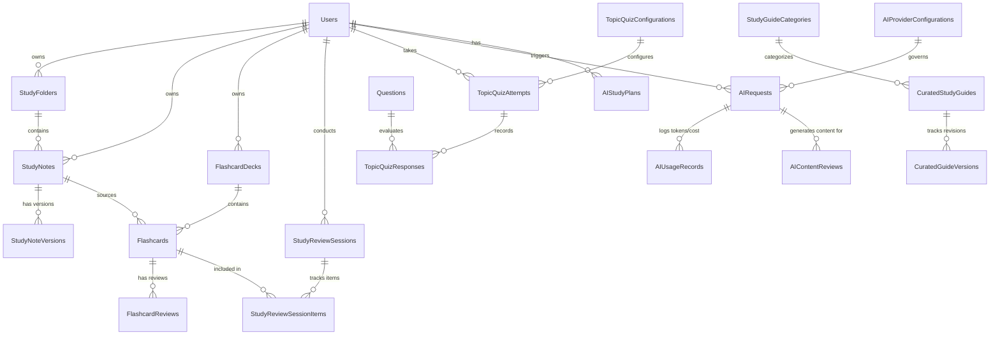

# PREPFORD NCLEX — ARCHITECTURAL AUDIT & MASTER IMPLEMENTATION PLAN
## Study Guide Management, AI Study Studio & Administrative Governance

**Project:** PrepFord NCLEX Preparation Platform  
**Repository Working Directory:** `C:\Users\gitau\Documents\PREform`  
**Active Branch:** `feature/dotnet-backend-migration`  
**Frontend Framework:** Next.js 16.4.3 (App Router, React 19.3.0, TypeScript 5, Tailwind CSS, shadcn/ui)  
**Backend Framework:** ASP.NET Core 8 Web API (`net8.0`, C# 12, EF Core 8.0.10)  
**Authoritative Database:** PostgreSQL 18 (`postgresql-x64-18`, default schema `public`)  
**Audit Date:** November 7, 2026  

---

## 1. Executive Baseline & Audit Summary

Following a strict audit of the repository, this report identifies the exact operational baseline across both frontend and backend, documents all existing capabilities to be preserved, and maps the complete additive architecture for the Study Guide Management, AI Study Studio, and Administrative Governance subsystems.

### 1.1 Non-Negotiable Architectural Principles Verified
1. **Zero Database Fragmentation:** Single PostgreSQL database managed by EF Core 8. No SQLite or competing runtime stores exist or will be introduced.
2. **Zero Architecture Replacement:** All working endpoints, controllers, services, and tests remain intact.
3. **Mutual Gateway Authentication:** Next.js BFF proxy signs requests with mutual HMAC-SHA256 headers (`X-Gateway-Timestamp`, `X-Gateway-Nonce`, `X-Gateway-Signature`) for the verified learner identity.
4. **Server-Authoritative Business Logic:** Spaced repetition scheduling (SM-2), quiz scoring, note ownership, AI token metering, and role permissions are strictly evaluated on the ASP.NET Core backend.
5. **Programmatic Isolation:** NCLEX-RN and NCLEX-PN content, quizzes, and learning recommendations remain segregated with explicit `programme` / `pathway` scoping.
6. **Graceful Degradation:** The platform's complete core learning system (Notes, Flashcards, Spaced Repetition, Review Sessions, Topic Quizzes, Admin curation) functions autonomously with 100% uptime even if Gemini is disabled or unconfigured.

---

## 2. Area-by-Area Baseline Audit Report

| Area | Audit Requirement | Existing Baseline Status | Identified Gaps & Target Implementation |
|---|---|---|---|
| **Notes Management** | Full CRUD, rich-text formatting, autosave, tagging, Client Needs classification, folders, pinning, archiving | **ABSENT.** No notes entities, services, controllers, or frontend note editors exist in the codebase. | Add `StudyFolders`, `StudyNotes`, `StudyNoteVersions` schema. Implement rich-text editor supporting formatting, headings, lists, checklists, tables, quotes, code, color highlights, and JSON structure persistence. Implement autosave, pinning, archiving, soft delete, and tag filtering. |
| **Flashcards Management** | Decks CRUD, cards CRUD, reordering, duplicate detection, moving cards between decks, favourite/difficult flags | **PARTIAL (Phase 1 Baseline).** `FlashcardDecks`, `Flashcards`, `FlashcardReviews` tables exist with SM-2 scheduling. Current CRUD supports basic creation, due queries, and review recording. | Missing: Deck renaming, deck duplication, moving cards between decks, card editing, reordering, card styles (Q&A, Term/Definition, Clinical Vignette, Cloze), difficult/favourite markings, and cross-linking to notes/topics. |
| **Review Sessions** | Dedicated session orchestration, configuration, interruption resumption, session analytics & retention trends | **PARTIAL.** Only a basic due-card flashcard review runner exists (`/dashboard/study/review`). No persistent session entity or session analytics. | Implement `StudyReviewSessions` and `StudyReviewSessionItems`. Allow session configuration (due cards, deck, topic, difficult, favourites). Record start/end time, duration, accuracy, rating distribution, and topic retention analytics. Support session resumption. |
| **Topic Quizzes** | Practice drills against canonical question bank, question types, scoring, rationales, retry, flashcard generation | **SIMULATED / NON-PERSISTENT.** `/dashboard/study/quizzes` currently drills 8 hardcoded static questions from `CLINICAL_QUESTION_BANK` with zero backend persistence or scoring. | Integrate with canonical `Questions` table (`api/v1/questions`). Implement `TopicQuizConfigurations`, `TopicQuizAttempts`, and `TopicQuizResponses`. Support question type diversity, timer, progress palette, immediate/delayed rationale feedback, attempt scoring, and post-quiz conversion to notes/flashcards. |
| **Curated Study Guides** | Official learning guides, category taxonomy, clinical takeaways, alerts | **STATIC FRONTEND ONLY.** `study-guide-data.ts` contains rich static content for 4 categories and 8 subjects used on `/study-guide`. Not persisted in database. | Persist official guides via `CuratedStudyGuides`, `StudyGuideCategories`, and `CuratedGuideVersions`. Allow administrators to author, version, publish, and schedule official guides with RN/PN tagging. Provide read-only learner viewing with bookmarking and flashcard generation. |
| **AI Study Studio (Gemini)** | Note assistant, flashcard generator, quiz generator, tutor, document analysis, study planner | **UNINTEGRATED.** No external AI provider exists. Phase 1 purposefully excluded generative AI. | Implement `IAIStudyProvider` with `GeminiStudyProvider` adapter. Support structured JSON outputs, prompt sanitization, nursing content validation, quota tracking (`AIRequests`, `AIUsageRecords`, `AIProviderConfigurations`), model configuration, and graceful degradation fallback. |
| **Admin Governance** | Study Guide management, curated decks, curated quizzes, AI controls, usage and cost monitoring | **ABSENT.** Admin Studio has Question Bank and Exams, but no Study Guide Management or AI Governance tabs. | Add Admin Studio modules: `/admin/study-guides` (overview, categories, curated notes, curated flashcards, topic quizzes) and `/admin/ai` (configuration, usage & cost monitoring, content review queue). |
| **RN / PN Separation** | Independent catalog, filters, pathway integrity | **FOUNDATIONAL.** `Programme` ("rn" / "pn") is modeled in curriculum and users. | Enforce program filtering across personal notes, personal decks, curated study guides, topic quizzes, and AI prompt contexts. |
| **Database Architecture** | Additive schema, foreign keys, indexes, migration safety | **MIGRATION 0016 CURRENT.** 17 migrations applied cleanly to PostgreSQL. | Create additive Migration 0017 (`AddStudyGuideManagementAndAIStudio`) adding all required study and AI tables with proper foreign keys, cascade/soft-delete rules, and indexes. |
| **Security & RBAC** | Ownership verification, HMAC signing, permission catalog | **STRONG FOUNDATIONS.** `PermissionsCatalog` and HMAC BFF gateway operational. | Add `study.*` and `ai.*` administrative permissions (`study.curate`, `study.publish`, `ai.configure`, `ai.manage_usage`). Enforce learner ownership on all personal study entities via authenticated user claims. |
| **UI/UX & Notifications** | shadcn/ui components, top-center notifications | **VERIFIED.** `sonner.tsx` is already positioned `top-center`. Rich shadcn/ui components installed. | Ensure all new modals, alert dialogs, sheets, and forms strictly use shadcn/ui with Brand colors (#142B4A Navy, #0D9488 Teal, #F8FAFC Slate). |

---

## 3. Database Schema Blueprint (Migration 0017)

### 3.1 New Additive Entities
1. **`StudyFolders`**: Personal note organization (`Id`, `UserId`, `Name`, `Color`, `Icon`, `DisplayOrder`, `CreatedAt`, `UpdatedAt`).
2. **`StudyNotes`**: Personal rich-text notes (`Id`, `UserId`, `FolderId`, `Title`, `ContentJson`, `ContentPlainText`, `Programme`, `SubjectDomainId`, `TopicSlug`, `ClientNeedId`, `TagsJson`, `IsPinned`, `IsFavourite`, `IsArchived`, `WordCount`, `LastEditedAt`, `CreatedAt`, `UpdatedAt`).
3. **`StudyNoteVersions`**: Note edit snapshots for historical revision (`Id`, `NoteId`, `Title`, `ContentJson`, `WordCount`, `CreatedAt`).
4. **`StudyReviewSessions`**: Preserved review session records (`Id`, `UserId`, `DeckId`, `Mode`, `FilterCriteriaJson`, `TotalCards`, `CardsReviewed`, `CardsCorrect`, `CardsDifficult`, `CardsMissed`, `StartedAt`, `CompletedAt`, `DurationSeconds`, `Status`).
5. **`StudyReviewSessionItems`**: Cards presented during a session (`Id`, `SessionId`, `FlashcardId`, `InitialRating`, `FinalRating`, `ResponseTimeMs`, `ReviewedAt`).
6. **`TopicQuizConfigurations`**: Saved or system quiz templates (`Id`, `UserId`, `Title`, `Programme`, `SubjectDomainId`, `TopicSlug`, `ClientNeedId`, `QuestionCount`, `Difficulty`, `TimeLimitMinutes`, `ImmediateFeedback`, `IsActive`, `CreatedAt`).
7. **`TopicQuizAttempts`**: Learner attempts on topic quizzes (`Id`, `UserId`, `ConfigurationId`, `Title`, `Programme`, `TotalQuestions`, `CorrectCount`, `IncorrectCount`, `ScorePercentage`, `TimeSpentSeconds`, `Status`, `StartedAt`, `CompletedAt`).
8. **`TopicQuizResponses`**: Question responses within a topic quiz attempt (`Id`, `AttemptId`, `QuestionId`, `SelectedOptionIndicesJson`, `IsCorrect`, `TimeSpentSeconds`, `FlaggedForReview`, `CreatedAt`).
9. **`StudyGuideCategories`**: Official study guide categories (`Id`, `Slug`, `Title`, `ShortTitle`, `Description`, `Badge`, `IconName`, `ColorTheme`, `DisplayOrder`, `IsActive`, `CreatedAt`).
10. **`CuratedStudyGuides`**: Official published study guides (`Id`, `CategoryId`, `Slug`, `Title`, `Summary`, `ReadTime`, `Difficulty`, `Programme`, `ClientNeedId`, `ClinicalKeyTakeawaysJson`, `ContentJson`, `Status`, `PublishedAt`, `CreatedAt`, `UpdatedAt`).
11. **`CuratedGuideVersions`**: Revision history for official guides (`Id`, `GuideId`, `VersionNumber`, `Title`, `ContentJson`, `CreatedBy`, `CreatedAt`).
12. **`AIProviderConfigurations`**: Configuration for external AI providers (`Id`, `ProviderName`, `ModelId`, `IsEnabled`, `Temperature`, `MaxOutputTokens`, `TimeoutSeconds`, `FeatureTogglesJson`, `UpdatedAt`).
13. **`AIRequests`**: Request logging and auditing (`Id`, `UserId`, `Feature`, `Provider`, `Model`, `InputTokens`, `OutputTokens`, `LatencyMs`, `Status`, `ErrorMessage`, `CreatedAt`).
14. **`AIUsageRecords`**: Aggregated usage and cost accounting (`Id`, `UserId`, `DateUtc`, `RequestCount`, `TotalInputTokens`, `TotalOutputTokens`, `EstimatedCostUsd`).
15. **`AIStudyPlans`**: AI-generated and learner-approved study plans (`Id`, `UserId`, `Title`, `TargetExamDate`, `WeeklyHours`, `Programme`, `PlanJson`, `IsActive`, `CreatedAt`, `UpdatedAt`).
16. **`AITutorConversations`**: Conversational AI tutoring thread metadata (`Id`, `UserId`, `TopicSlug`, `Title`, `MessagesJson`, `LastMessageAt`, `CreatedAt`).
17. **`AIContentReviews`**: Admin review workflow for AI-generated curated items (`Id`, `SourceRequestId`, `ContentType`, `DraftPayloadJson`, `Status`, `ReviewerUserId`, `ReviewNotes`, `CreatedAt`, `ReviewedAt`).

---

## 4. Phase-by-Phase Execution Plan

### Phase 1: Repository Audit & Architecture Specification (COMPLETE)
- Audit completed; baseline verified; no regressions detected; build and tests verified.

### Phase 2: Database & Backend Foundations
- Create `apps/api/Models/StudyGuideManagement.cs` and `apps/api/Models/AIStudio.cs`.
- Register DbSets and fluent configurations in `AppDbContext.cs`.
- Create additive migration `0017_AddStudyGuideManagementAndAIStudio` and execute `dotnet ef database update`.
- Implement repository services and DTOs.

### Phase 3: Notes Management (Full Rich-Text CRUD)
- Backend: `INotesService`, `NotesService`, and `NotesController` under `/api/v1/study/notes` and `/api/v1/study/folders`.
- Frontend: BFF proxy update in `apps/web/src/app/api/study/[[...path]]/route.ts` supporting `GET`, `POST`, `PUT`, `DELETE`.
- Rich-Text Editor: Implement structured rich-text editor with persistent JSON serialization, autosave, typography toolbar, checklists, tables, colors, alerts, and export.
- Notes UI: Full folder navigation, tag search, favorites, pinning, archive, and soft-delete recovery.

### Phase 4: Flashcards Management Enhancement
- Upgrade `FlashcardService` and `StudyController` to support full card editing, moving cards between decks, duplication, and reordering.
- Enhance card types (Q&A, Term/Definition, Clinical Scenario, Cloze deletion).
- Interactive card player with 3D flip animation, keyboard shortcuts, shuffle, difficult cards filter, and knowledge rating scale (Again, Hard, Good, Easy).

### Phase 5: Review Sessions Orchestration
- Backend: `IReviewSessionService`, `ReviewSessionService`, session start, answer recording, pause/resume, and completion analytics.
- Frontend: Interactive review session runner at `/dashboard/study/review`, session configuration wizard, progress bar, rating recorder, and completion summary with actionable retention recommendations.

### Phase 6: Topic Quizzes Integration
- Integrate `/dashboard/study/quizzes` with canonical `Questions` table (`api/v1/questions`) via `ITopicQuizService`.
- Implement quiz configuration modal (pathway, Client Needs, subject, difficulty, question count, immediate vs. end feedback).
- Candidate test runner with question palette, answer selection, timer, review flags, autosave, and submission confirmation.
- Results breakdown by Client Needs category and topic, clinical rationales, and one-click actions: "Convert Missed Questions to Flashcards" and "Save Explanation as Study Note".

### Phase 7: Gemini AI Infrastructure & Governance
- Backend: `IAIStudyProvider` abstraction and `GeminiStudyProvider` adapter using Google Gemini API (`gemini-1.5-flash` / `gemini-1.5-pro`).
- Security: Server-side API key configuration via `GEMINI_API_KEY` in environment; strictly unexposed to client.
- Governance: Token metering, per-user daily quotas, subscription tier entitlements, JSON schema validation, nursing hallucination guards, and graceful fallbacks when Gemini is disabled.

### Phase 8: AI Study Studio Capabilities
- **AI Note Assistant**: Summarization, simplification, key takeaways, and terminology extraction with preview/explicit save.
- **AI Flashcard Generator**: Generate cards from notes, topics, and documents with learner review before saving.
- **AI Quiz Generator**: Generate topic-specific practice questions with validated schemas.
- **AI Tutor**: Context-aware clinical dialogue grounded in NCLEX guidelines.
- **AI Study Planner**: Schedule generation tailored to learner exam date, hours, and weak Client Needs areas.
- **AI Document Processor**: Secure PDF upload validation, text extraction, and flashcard/quiz generation.

### Phase 9: Admin Study Guide Management & AI Studio Governance
- Admin Navigation: Add "Study Guide Management" (`/admin/study-guides`) and "AI Studio Governance" (`/admin/ai`) to `navigation.tsx` with role permissions.
- Curated Guides Admin: Create, edit, version, publish/unpublish, and schedule official study guides.
- Curated Flashcards & Quizzes Admin: Manage official decks and topic quiz banks.
- AI Governance Console: Feature switches, provider/model settings, token volume charts, estimated cost accounting, failed request logs, and AI content review queue.

### Phase 10: Learning Intelligence, Analytics & Cross-Module Connectivity
- Unify learner metrics across Notes, Flashcards, Reviews, and Quizzes on `/dashboard/study`.
- Implement cross-module links: Note -> Flashcards/Quiz; Flashcard -> Note/Guide; Quiz -> Notes/Review; Review -> Targeted Quiz.
- Intelligent recommendations based on real review accuracy and Client Needs weak spots.

### Phase 11: System-Wide UI/UX Consistency & Notification Verification
- Enforce shadcn/ui components (`Dialog`, `AlertDialog`, `Sheet`, `DropdownMenu`, `Tabs`, `Table`, `Badge`, `Progress`, `Skeleton`).
- Verify centralized top-center notification behavior across the entire web application.

### Phase 12: Automated Verification, Security Testing & Documentation
- Backend xUnit tests for notes CRUD, review sessions, topic quizzes, Gemini provider fallback, and authorization boundaries.
- Frontend Vitest suites for rich-text note editor, flashcard player, review session lifecycle, topic quiz runner, and AI interactions.
- Full release documentation.
