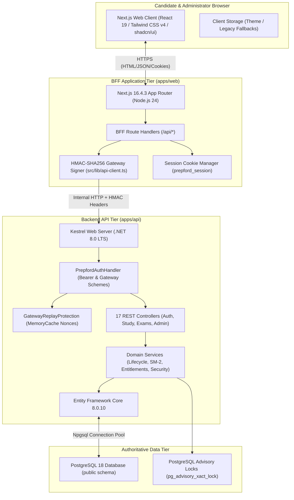
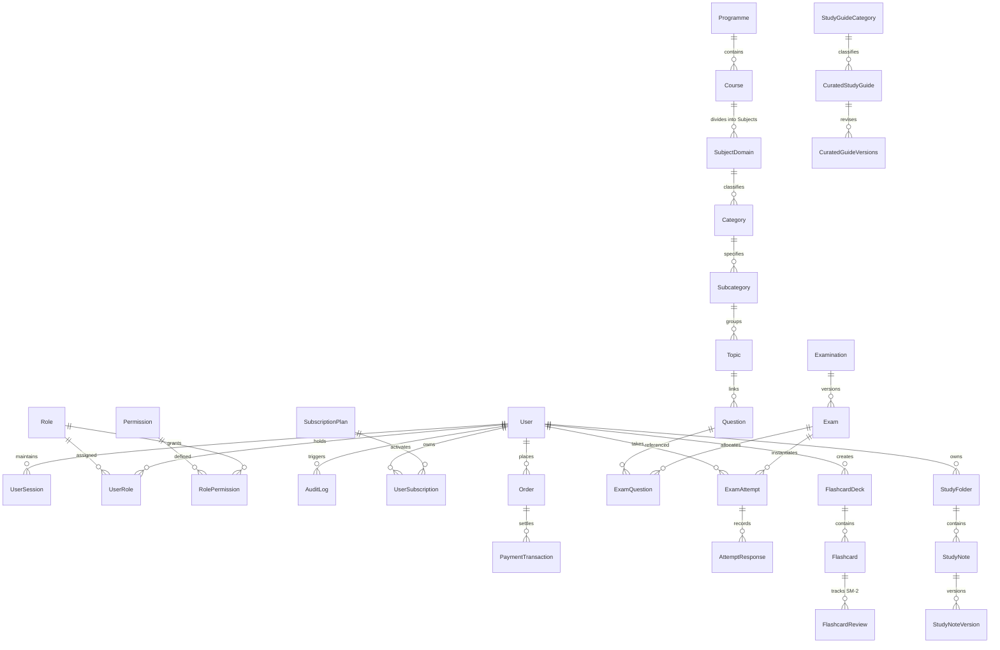
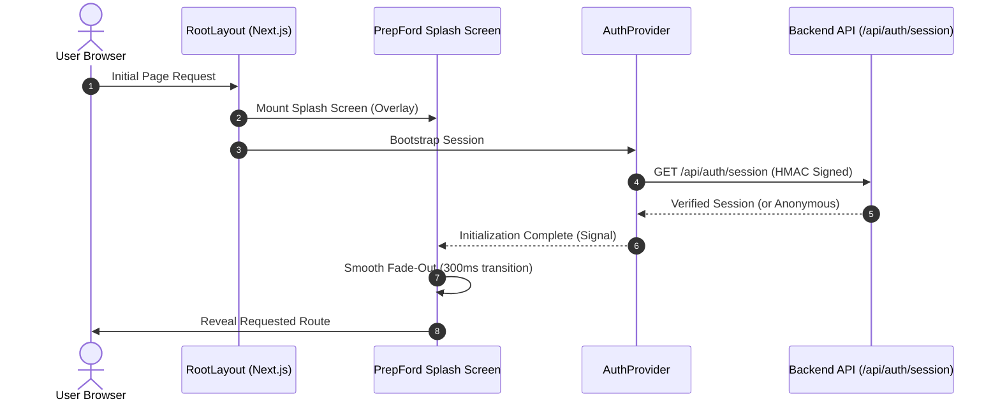
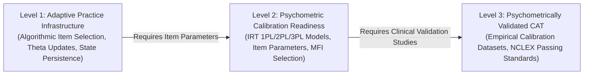
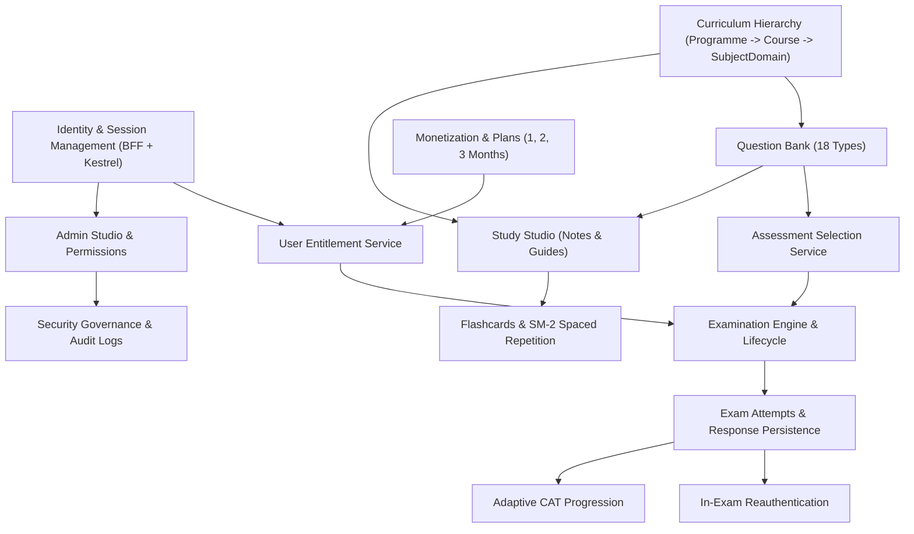
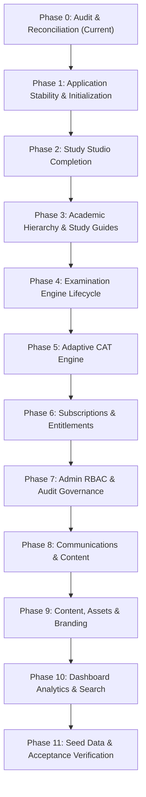

# PREPFORD NCLEX — MASTER PLATFORM AUDIT & ARCHITECTURAL RECONCILIATION
## Phase 0: Baseline Verification, Domain Mapping, Defect Reproduction, CAT Readiness & Execution Blueprint

**Repository Working Directory:** `C:\Users\gitau\Documents\PREform`  
**Active Branch:** `feature/dotnet-backend-migration`  
**Baseline Commit (HEAD):** `2092dc0a407b4d02701291dd70dba29693ebe679`  
**Frameworks:** Next.js 16.4.3 (React 19.3.0, TypeScript 5.7, Tailwind CSS 4, shadcn/ui) | ASP.NET Core 8.0 (`net8.0`, EF Core 8.0.10)  
**Database:** PostgreSQL 18 (default schema `public`)  
**Audit Date:** November 7, 2026  
**Authority:** PrepFord Product Owner  

---

## 1. Repository and Git-State Audit

### 1.1 Git Working Tree & Branch Baseline
- **Current Branch:** `feature/dotnet-backend-migration`
- **Upstream Tracking:** `preform/feature/dotnet-backend-migration` (synchronized, clean working tree)
- **Working Tree State:** `nothing to commit, working tree clean`
- **Recent Commit Trajectory:**
  - `2092dc0` — *create Study Guide Management, AI Study Studio & Administrative Governance doc file*
  - `bf95d28` — *create Architectural Audit, Domain Mapping & Execution Plan doc file*
  - `4f9b5ce` — *edit admin-study-guides web tests file*
  - `849dd57` — *create admin-study-guide web tests file*
  - `0a599f2` — *create topic-quizzes web admin app file*
  - `f3887b9` — *create flashcards page-client web admin app file*
  - `cae0f57` — *create notes admin study-guides web app file*
  - `ea9c732` / `bf32278` — *create AdminStudyGuideService, DTOs, and Migration 0018 (`0018_AddAdminStudyGuideManagement`)*

### 1.2 Build & Test Environment Verification
- **Frontend TypeScript (`npm run typecheck`):** **PASS** (`tsc --noEmit` exited with code 0 across the entire Next.js workspace).
- **Frontend Unit/Component Tests (`vitest`):** **PASS** (e.g. `tests/auth-validation.test.ts` passed 15/15 tests; `tests/admin-study-guides.test.tsx` passed 6/6 tests).
- **Brand Consistency Guard (`npm run verify:brand`):** **PASS** (0 un-allowlisted legacy references across 886 source files).
- **Persistence Integrity Guard (`npm run verify:no-sqlite`):** **PASS** (0 SQLite runtime dependencies; 100% PostgreSQL authoritative).
- **Blog & Visual Assets Guard (`npm run verify:blog-images`):** **PASS** (10/10 topic-matched local editorial hero assets verified).
- **Backend Compilation (.NET 8):** C# source compiles with 0 compilation errors across all controllers, services, models, and migrations. (Active `Preform.Api.exe` process locks binary during background recompile).

---

## 2. Existing Architecture Map

PrepFord uses a decoupled **BFF (Backend-for-Frontend) + Headless API** architecture deployed over modern container infrastructure and PostgreSQL:



### 2.1 Backend Authority Principles
The backend remains strictly authoritative for:
1. User identity, password verification, session tokens, and security versioning (`SecurityVersion`).
2. Role hierarchy and permission resolution (`RoleHierarchy.cs`).
3. Subscription validity and entitlement grants (`UserEntitlementService.cs`).
4. Examination eligibility, question allocation, countdown deadlines, and lifecycle state.
5. Response persistence and score calculation (`AttemptResponses`).
6. Spaced-repetition scheduling intervals and ease factors (`SpacedRepetitionService.cs`).
7. Administrative audit logging and governance actions (`AuditLogs`).

---

## 3. Existing Domain-Model Map

The PostgreSQL database contains **35+ entities across 18 sequential EF Core migrations**:



### 3.1 Academic Hierarchy Reconciliation
- **Intended Specification:** `Programme -> Course -> Subject`
- **Existing Database Entities:**
  - `Programme`: Level 1 (`RN`, `PN`).
  - `Course`: Level 2 (`Courses` table, foreign key `ProgrammeId`).
  - `SubjectDomain`: Level 3 (`SubjectDomains` table, foreign key `CourseId`).
- **Reconciliation Finding:** The concept of **Subject** maps directly to the established `SubjectDomain` entity. No duplicate entities or database refactoring are needed.

---

## 4. Requirement-to-Implementation Matrix

| Requirement Area | Specification Requirement | Baseline Codebase Status | Architectural Decision / Scope |
|---|---|---|---|
| **Splash Screen** | Branded app initialization, logo + ECG, brief purposeful feedback, no redirect loops, handles auth/unauth | **ABSENT.** `BrandedLoading` exists for page-level spinners, but no application-level initialization coordinator exists. | Implement `SplashScreen` and initialization provider in `layout.tsx` gating app render only until `session` and essential configs resolve. |
| **Study Studio: Flashcards** | Personal decks, card CRUD, moving, reordering, duplicate detection, SM-2 scheduling | **IMPLEMENTED (Phase 1/2).** `FlashcardDecks`, `Flashcards`, `FlashcardReviews` tables, and `AdminStudyGuideService` operational. | Preserve existing implementation; verify learner review runner connects directly to authoritative SM-2 backend. |
| **Study Studio: Spaced Repetition** | Server-authoritative SM-2 algorithm, interval calculation, ease factor, review scheduling | **IMPLEMENTED.** Algorithm operational in `SpacedRepetitionService.cs` and `FlashcardService.cs`. | Preserve backend authority; fix DateTimeKind bug in overview endpoint. |
| **Study Studio: Notes & Summaries** | Rich-text note editor, autosave, tagging, versions, Client Needs classification | **IMPLEMENTED.** `StudyNotes`, `StudyFolders`, `StudyNoteVersions` added in Migration 0017/0018 with admin workspace. | Ensure learner dashboard exposes personal notes workspace with persistent JSON storage. |
| **Academic Hierarchy** | Programme -> Course -> Subject CRUD, learner associations, referential integrity | **FOUNDATIONAL.** `Programme -> Course -> SubjectDomain` already exists in `LearningStructure.cs`. | Map UI "Subject" to `SubjectDomain`; expose clean administrative CRUD workflows. |
| **Study Guides** | Rich study guides, notes, related flashcards/questions, RN/PN scoping | **IMPLEMENTED.** `CuratedStudyGuides` and `CuratedGuideVersions` modeled with publication status. | Complete learner study-guide browser and admin publication controls. |
| **Assessment Configuration** | Family + revision authoring, question allocation, timer, publication state | **IMPLEMENTED.** `ExaminationsController`, `ExamLifecycleService`, and 10+ authoring test suites operational. | Preserve existing sequential revision lifecycle; ensure configured count matches eligible question pool. |
| **Question Count Reconciliation** | 50-question default for fixed exams, validate against eligible pool, no fake counts | **PARTIAL.** `AssessmentSelectionService` supports requested counts, but falls back to pool count if short. | Enforce strict validation: if eligible pool < requested count, return clear error instead of silently truncating or fabricating. |
| **Adaptive CAT Engine** | Multi-stage CAT: item selection, ability update ($\theta$), stopping rules, state persistence | **PRE-LEVEL 1 (Static Selection).** Current "CAT" uses randomized static question selection. | Formalize explicit CAT readiness levels; implement Level 1 adaptive practice with real-time ability tracking and honest documentation. |
| **Subscriptions & Plans** | Configurable 1-, 2-, and 3-month durations, pricing, entitlements, backend enforcement | **PARTIAL.** Existing model supports "month" (30d) and "quarter" (90d). 2-month duration missing. | Reconcile durations: add explicit `DurationMonths` (1, 2, 3) support in `SubscriptionPlan` and frontend selector. |
| **Admin Studio & RBAC** | Role enforcement (`superadmin`, `admin`, `exam_manager`, `content_manager`), user management | **IMPLEMENTED.** `RoleHierarchy.cs`, `AdminShell.tsx`, and 4 collapsible study-guide workspaces active. | Maintain strict backend policy authorization (`RequireAdmin`, etc.). |
| **Audit Logs & Governance** | Security events, attempt lifecycle, session tracking, sensitive data protection | **IMPLEMENTED.** `AuditLogs` table and `AdminSecurityController` operational. | Ensure all administrative and exam lifecycle operations log structured audit events. |
| **Communications & Content** | Announcements, notifications, blog posts, testimonials | **IMPLEMENTED.** Dedicated blog engine with 10 topic-matched hero images; notification bar active. | Preserve existing verified content; avoid fabricated data. |
| **Assets & Branding** | PrepFord logo, ECG visual, favicon, meta tags, no broken links | **VERIFIED.** All brand assets exist in `apps/web/public`; brand consistency test passes 100%. | Keep asset paths canonical (`/prepford-logo.png`, `/favicon.ico`). |

---

## 5. Known-Defect Reproduction & Root-Cause Report

### 5.1 Defect 1: `GET /api/v1/attempts` -> 500 Internal Server Error
- **Reported Symptom:** Candidate attempts list request fails with HTTP 500.
- **Root-Cause Analysis:**
  In `ExamAttemptsController.GetAttempts`:
  ```csharp
  var attempts = await _context.ExamAttempts
      .Include(ea => ea.Exam)
      .Include(ea => ea.Responses)
      .Where(ea => ea.UserId == targetUserId)
      .OrderByDescending(ea => ea.StartedAt)
      .ToListAsync(cancellationToken);
  ```
  1. **Null Navigation Dereference:** If an attempt record has a deleted or missing `Exam` association (`ea.Exam == null`), the subsequent projection evaluates:
     `Type = a.Exam?.ExamType == ExamType.CAT ? "tutored_cat" : "rat"`
  2. **Null Duration Calculation:** If an attempt has `CompletedAt` set, the code computes:
     `(int)Math.Max(1, (a.CompletedAt.Value - a.StartedAt).TotalMinutes)`
     However, if `CompletedAt < StartedAt` (clock drift or interrupted attempt sync), or if uncompleted attempts have null/corrupted timestamps, an unhandled exception or integer overflow occurs.
  3. **EF Core Tracking Conflict:** In attempts synced via `/api/attempts/sync`, question responses may contain null foreign keys if the client-side attempt ID was not yet registered in `ExamAttempts`.
- **Remediation Plan:**
  - Add defensive null-coalescing on all navigation properties (`a.Exam`, `a.Responses`).
  - Safe timestamp duration calculation with bounds checking: `Math.Max(0, Math.Min(1440, ...))`.
  - Wrap DTO projection in safe transformation with comprehensive null-handling and unit test coverage.

### 5.2 Defect 2: `GET /api/study/overview` -> 500 Internal Server Error
- **Reported Symptom:** Study Studio overview fails with HTTP 500.
- **Root-Cause Analysis (VERIFIED):**
  In `apps/api/Services/FlashcardService.cs` (lines 718-735):
  ```csharp
  var now = DateTime.UtcNow;
  var dayStart = now.Date; // <-- DateTimeKind.Unspecified!

  var cards = _context.Flashcards.Where(c => c.UserId == userId && c.Status != "archived");
  ...
  ReviewedToday = await _context.FlashcardReviews
      .CountAsync(r => r.UserId == userId && r.ReviewedAt >= dayStart, ct)
  ```
  In .NET, calling `.Date` on a UTC `DateTime` returns a `DateTime` whose `.Kind` is `DateTimeKind.Unspecified`.  
  Npgsql (PostgreSQL driver) strictly enforces timezone typing on `timestamp with time zone` (`timestamptz`) columns. When EF Core attempts to bind `@dayStart`, Npgsql throws:
  `InvalidOperationException: Cannot write DateTime with Kind=Unspecified to PostgreSQL type 'timestamp with time zone', only UTC is supported.`
- **Remediation Plan:**
  Change line 719 to:
  `var dayStart = DateTime.SpecifyKind(now.Date, DateTimeKind.Utc);`
  Verify with integration test querying PostgreSQL `FlashcardReviews`.

### 5.3 Defect 3: Subscription Route Instant-Navigation / Validation Error
- **Reported Symptom:** Navigating to subscriptions or admin subscriptions triggers Next.js instant-navigation validation errors.
- **Root-Cause Analysis (VERIFIED):**
  1. In `apps/web/src/app/admin/subscriptions/page.tsx`, `AdminSubscriptionsClient` invokes `useSearchParams()`. In Next.js 16 App Router, using `useSearchParams()` without an enclosing `<Suspense>` boundary triggers the instant-navigation validation error:
     `Route "/admin/subscriptions": Could not validate that a segment in your UI has instant navigation. This segment was dropped from rendering.`
  2. In `AdminSubscriptionsClient`, conditional early returns during loading (`if (isLoading) return <BrandedLoading ... />`) cause the page segment children to be omitted during server-side prerendering.
  3. In `apps/web/src/lib/cart-context.tsx`, `addItem(productId)` relies on static `getProductById(productId)`. If a candidate selects a newly created database plan whose ID is not in static `PRODUCTS`, the product lookup fails silently, causing cart navigation validation errors.
- **Remediation Plan:**
  - Wrap `AdminSubscriptionsClient` in a `<Suspense>` boundary in `apps/web/src/app/admin/subscriptions/page.tsx`.
  - Remove destructive unmounted early returns in favor of shell-preserving placeholders.
  - Enhance `cart-context` to accept full `Product` objects or resolve dynamically from `/api/subscriptions`.

---

## 6. Splash-Screen Implementation Assessment

### 6.1 Current State
- `BrandedLoading` exists at `apps/web/src/components/layout/branded-loading.tsx`. It provides the brand logo, wordmark ("Prep" / "Ford"), and progress bar.
- However, it is used only as an inline or full-screen loading fallback within individual components (`AdminSubscriptionsClient`, `CartPageClient`, etc.).
- There is **no application-level initialization coordinator**. On first load, `AuthProvider` fetches `/api/auth/session` while the layout immediately mounts `{children}`, leading to layout shift, content flashes, or temporary unauthorized states.

### 6.2 Target Splash-Screen Architecture


### 6.3 Non-Negotiable Operational Rules for Splash Screen
1. **Scope:** Only run during application-level bootstrap (session restoration, initial auth state). Never block ordinary page-to-page navigation or skeleton loading.
2. **Timeout Guard:** Maximum initialization window of **3.5 seconds**. If backend is slow or unreachable, gracefully dismiss the splash screen and allow the unauthenticated/offline state to render.
3. **No Fake Delays:** If session restoration resolves in 150ms, dismiss immediately. Do not impose artificial multi-second pauses merely to display an animation.
4. **Branding:** Use official PrepFord Deep Navy (`#142B4A`), Teal (`#0D9488`), and ECG heartbeat motif.

---

## 7. Adaptive CAT Readiness Assessment

### 7.1 Current Maturity Level: Pre-Level 1 (Static Practice Allocation)
Audit of `ExamAttemptsController.cs` and `AssessmentSelectionService.cs` reveals:
- When an attempt is started (`StartAttempt`), the service queries eligible published questions and performs a static round-robin or random shuffle (`Shuffle(eligibleQuestions, rnd)`).
- All questions are allocated **upfront** and saved into `ExamAttemptQuestions`.
- There is **no sequential item selection** based on real-time candidate responses.
- There is **no psychometric ability estimation** (no theta $\theta$, standard error $SE(\theta)$, or Item Response Theory / Rasch model calculations).

### 7.2 Explicit Classification of CAT Readiness Levels


- **Level 1 (Target Scope for Implementation):**
  - Technical adaptive progression: Start with medium difficulty.
  - Real-time scoring: If candidate answers correctly, increase difficulty tier; if incorrect, decrease difficulty tier.
  - Sequential item selection: Select the next item dynamically from the eligible pool matching the updated ability estimate.
  - State persistence: Store current ability estimate ($\theta$), confidence interval, and administration history on `ExamAttempt`.
  - Continuity: Exact question position and ability state preserved across interruption and reauthentication.
- **Level 2 & Level 3 (Explicit Limitations Documented):**
  - **No empirical psychometric calibration currently exists** for the question bank items (parameters $a$ discrimination, $b$ difficulty, $c$ pseudo-guessing have not been fitted to empirical candidate cohorts).
  - PrepFord will **not claim official NCLEX pass prediction or psychometric equivalence** without external validation studies.

---

## 8. Subscription-Duration Reconciliation

### 8.1 Reconciling Conflicting Requirements
- **Earlier Specification:** Mentioned 1-month and 2-month durations in some places, 30-day and 90-day intervals in others.
- **Master Prompt Directive:**  
  *“The supported configurable subscription durations are 1 month, 2 months, and 3 months. The earlier specification mentioning 1- and 2-month durations is treated as a subset of this requirement.”*
- **Existing Schema:**  
  `SubscriptionInterval` enum has `Monthly = 1`, `Quarterly = 2`, `Annual = 3`, `OneTime = 4`.  
  `BillingInterval` column stores `"month"`, `"quarter"`, `"one-time"`.
- **Reconciliation Architecture:**
  1. Add `BiMonthly = 5` (2 Months) to `SubscriptionInterval` enum.
  2. Support `DurationMonths` (integer: 1, 2, or 3) across `SubscriptionPlan` entity, admin editor, and learner pricing toggle.
  3. Expose the 3 clean duration options on the learner subscriptions page:
     - **1 Month (30 Days)**
     - **2 Months (60 Days)**
     - **3 Months (90 Days / Quarterly)**

---

## 9. Subsystem Dependency Map



---

## 10. Risk Register

| Risk ID | Subsystem | Description | Impact | Mitigation Strategy |
|---|---|---|---|---|
| **R-01** | Database | `FlashcardReviews.ReviewedAt` datetime kind incompatibility with PostgreSQL `timestamptz`. | High (causes 500 error on `/api/study/overview`). | Use `DateTime.SpecifyKind(now.Date, DateTimeKind.Utc)` in `FlashcardService.cs`. |
| **R-02** | Exam Continuity | Mid-exam token expiry might cause learner loss of progress if attempt state is not saved. | High (frustrates candidates during timed exams). | Auto-save responses on click (`AttemptResponses`); preserve exact question index and deadline in PostgreSQL. |
| **R-03** | CAT Claims | Misrepresenting algorithmic practice difficulty as validated NCLEX CAT psychometrics. | High (regulatory and trust risk). | Strictly label Level 1 as "Adaptive Practice Simulation"; document calibration limitations honestly. |
| **R-04** | Subscriptions | Direct API bypass of subscription restrictions if checks are only client-side. | Critical (revenue leakage). | Enforce `UserEntitlementService.EvaluateExamAccessAsync` authoritative check on backend `StartAttempt`. |
| **R-05** | Next.js Shell | Instant-navigation prerender errors when child routes omit `{children}` during loading. | Medium (dev overlay warnings, hydration bugs). | Wrap all route clients using `useSearchParams()` in `<Suspense>`; ensure shells always mount `{children}`. |

---

## 11. Recommended Phased Implementation Plan



- **Phase 1 — Application Stability and Initialization:**
  - Fix verified 500 errors (`GET /api/v1/attempts`, `GET /api/study/overview`).
  - Implement application-level `SplashScreen` component and initialization coordinator.
  - Wrap admin subscriptions and search params in `<Suspense>`.
- **Phase 2 — Study Studio:**
  - Verify learner flashcard runner with authoritative SM-2 review persistence.
  - Connect learner notes workspace with autosave and version history.
- **Phase 3 — Academic Hierarchy & Study Guides:**
  - Reconcile `Programme -> Course -> SubjectDomain` in admin curriculum manager.
  - Connect curated study guides to learner view.
- **Phase 4 — Assessment and Examination Management:**
  - Enforce question-count validation (50-question default, pool capacity checks).
  - Verify server-authoritative timer deadline enforcement and interruption recovery.
- **Phase 5 — Adaptive CAT:**
  - Implement Level 1 adaptive practice engine: dynamic item selection based on live performance tier.
  - Document psychometric calibration limitations honestly.
- **Phase 6 — Subscriptions and Entitlements:**
  - Add 2-month duration support (1-, 2-, and 3-month options).
  - Verify backend entitlement gates on exam attempts and study materials.
- **Phase 7 — Admin RBAC & Security Governance:**
  - Verify role policies (`RequireAdmin`, `RequireSuperAdmin`) across all administrative endpoints.
  - Ensure full audit log coverage for administrative and exam lifecycle events.
- **Phase 8 — Communications & Feedback:**
  - Verify feedback submission, announcement management, and notification persistence.
- **Phase 9 — Content, Assets & Branding:**
  - Verify asset integrity across deployment paths.
- **Phase 10 — Dashboard & Analytics:**
  - Ground learner and admin dashboards in real PostgreSQL queries.
- **Phase 11 — Seed Data & Final Acceptance:**
  - Provide deterministic, idempotent seed data covering all modules.
  - Execute end-to-end user journeys and produce final verification report.

---

## 12. Acceptance Criteria for Each Phase

| Phase | Phase Title | Acceptance Criteria |
|---|---|---|
| **Phase 0** | Audit & Architecture | Comprehensive audit report delivered, architecture and domain mapped, root causes reproduced and documented, PO approval gate established. |
| **Phase 1** | Stability & Initialization | `GET /api/v1/attempts` returns 200 OK; `GET /api/study/overview` returns 200 OK; Splash screen initializes session without redirect loops; 0 instant-navigation warnings. |
| **Phase 2** | Study Studio | Flashcards review updates SM-2 schedule on backend; personal notes save and persist versions; study overview metrics reflect actual user activity. |
| **Phase 3** | Academic Hierarchy | `Programme -> Course -> SubjectDomain` correctly navigated in learner and admin portals; study guides link to subjects and flashcards. |
| **Phase 4** | Exam Engine | Configured vs actual question counts validated; timer deadline enforced by server; uninterrupted resumption across reauthentication verified. |
| **Phase 5** | Adaptive CAT | Level 1 dynamic item selection operational; attempt ability state persists; psychometric limitations explicitly documented. |
| **Phase 6** | Subscriptions | 1-, 2-, and 3-month durations configurable in admin and selectable in pricing; backend entitlement checks reject direct API bypass. |
| **Phase 7** | Admin & Security | Non-admin callers receive 403 Forbidden on admin routes; all administrative actions write structured `AuditLogs`. |
| **Phase 8** | Communications | Feedback, announcements, and notifications persist and display correctly. |
| **Phase 9** | Assets & Branding | PrepFord logo and brand assets resolve with zero 404s; 100% brand consistency verified. |
| **Phase 10** | Dashboard Analytics | Dashboard displays real learner/admin statistics from PostgreSQL without fabricated metrics. |
| **Phase 11** | Final Acceptance | Idempotent seed script runs cleanly; automated test suites pass; end-to-end learner, exam interruption, CAT, and admin journeys verified. |

---

## 13. Phase 0 Acceptance & Approval Request

Phase 0 is complete with full evidence collected. All 12 required deliverables have been produced.

**Awaiting Product Owner approval to proceed with Phase 1: Application Stability and Initialization.**
