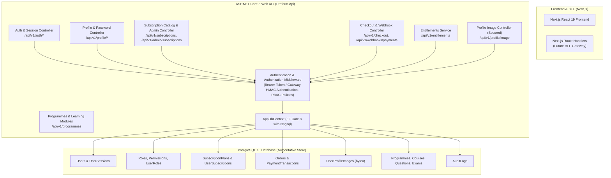

# PrepFord Phase 2 — Backend Completion Implementation Plan

**Document Version:** 1.0  
**Date:** 2026-10-29  
**Branch:** `feature/dotnet-backend-migration`  
**Target:** ASP.NET Core 8 Web API + PostgreSQL (EF Core 8)

---

## 1. Overview and Objective

The objective of Phase 2 is to complete and verify the ASP.NET Core + PostgreSQL backend so that it can authoritatively fulfill every application capability currently handled by embedded SQLite in `apps/web`. The frontend will remain operational on its current configuration during Phase 2; all backend capabilities are implemented, migrated, and verified independently with integration tests against PostgreSQL.

---

## 2. Architecture & Domain Responsibility Matrix

---

## 3. Detailed Endpoint Matrix & Missing Capabilities

| Endpoint | HTTP Method | Auth Required | Allowed Roles | Request DTO | Response DTO | PostgreSQL Persistence | Status / Task |
| :--- | :--- | :--- | :--- | :--- | :--- | :--- | :--- |
| `/api/v1/auth/register` | `POST` | Anonymous | Any | `RegisterRequest` | `AuthResponse` | `Users`, `UserRoles`, `UserSessions`, `AuditLogs` | Implement |
| `/api/v1/auth/login` | `POST` | Anonymous | Any | `LoginRequest` | `AuthResponse` | `Users`, `UserSessions`, `AuditLogs` | Implement |
| `/api/v1/auth/logout` | `POST` | Yes | Authenticated | None | `SuccessResponse` | `UserSessions` (`revoked = true`) | Implement |
| `/api/v1/auth/session` | `GET` | Yes | Authenticated | None | `SessionResponse` | `UserSessions`, `Users`, `UserSubscriptions` | Implement |
| `/api/v1/profile` | `GET` | Yes | Authenticated | None | `UserProfileDto` | `Users`, `UserProfileImages` | Implement |
| `/api/v1/profile` | `PUT` | Yes | Authenticated | `UpdateProfileRequest` | `UserProfileDto` | `Users` (allowlist only), `AuditLogs` | Implement |
| `/api/v1/profile/change-password` | `POST` | Yes | Authenticated | `ChangePasswordRequest` | `SuccessResponse` | `Users`, `UserSessions` (revokes all), `AuditLogs` | Implement |
| `/api/v1/profile/image` | `GET` | Yes | Authenticated | Query `userId` | Binary (`image/*`) | `UserProfileImages` | Secure auth |
| `/api/v1/profile/image` | `PUT`/`POST` | Yes | Authenticated | Binary / Form | `ProfileImageMetadataDto` | `UserProfileImages`, `Users`, `AuditLogs` | Secure auth |
| `/api/v1/profile/image` | `DELETE` | Yes | Authenticated | None | `SuccessResponse` | `UserProfileImages`, `Users`, `AuditLogs` | Secure auth |
| `/api/v1/subscriptions` | `GET` | No | Public | None | `SubscriptionCatalogDto` | `SubscriptionPlans` (Active only) | Harmonize schema |
| `/api/v1/subscriptions/{idOrSlug}` | `GET` | No | Public | None | `SubscriptionPlanDetailDto` | `SubscriptionPlans` | Harmonize schema |
| `/api/v1/admin/subscriptions` | `GET` | Yes | Admin, SuperAdmin | None | `SubscriptionCatalogDto` | `SubscriptionPlans` (All plans) | Implement |
| `/api/v1/admin/subscriptions` | `POST` | Yes | Admin, SuperAdmin | `CreateSubscriptionPlanDto`| `SubscriptionPlanDto` | `SubscriptionPlans`, `AuditLogs` | Implement |
| `/api/v1/admin/subscriptions/{id}` | `PUT` | Yes | Admin, SuperAdmin | `UpdateSubscriptionPlanDto`| `SubscriptionPlanDto` | `SubscriptionPlans`, `AuditLogs` | Implement |
| `/api/v1/admin/subscriptions/{id}` | `DELETE` | Yes | Admin, SuperAdmin | None | `SuccessResponse` | `SubscriptionPlans` (`IsActive = false`) | Implement |
| `/api/v1/checkout` | `POST` | Yes | Authenticated | `CheckoutRequest` | `CheckoutResponse` | `Orders`, `UserSubscriptions` (if mock), `AuditLogs` | Implement |
| `/api/v1/entitlements` | `GET` | Yes | Authenticated | None | `EntitlementsResponse` | `UserSubscriptions`, `SubscriptionPlans` | Implement |
| `/api/v1/webhooks/payments` | `POST` | Webhook Sig | Provider | Raw payload | `WebhookResponse` | `PaymentTransactions`, `Orders`, `UserSubscriptions` | Implement |
| `/api/v1/health/live` | `GET` | No | Public | None | Health status | In-memory | Existing |
| `/api/v1/health/ready` | `GET` | No | Public | None | DB readiness status | PostgreSQL query check | Enhance |

---

## 4. Implementation Sequencing

```mermaid
flowchart LR
    Step1["1. Schema Harmonization<br/>EF Core Models & Migration 0004"] --> Step2["2. Authentication &<br/>Session Management"]
    Step2 --> Step3["3. Server-Side RBAC &<br/>Permission Policies"]
    Step3 --> Step4["4. Profile &<br/>Password APIs"]
    Step4 --> Step5["5. Subscription Catalog &<br/>Admin Management"]
    Step5 --> Step6["6. Checkout, Payments &<br/>Entitlement Engine"]
    Step6 --> Step7["7. Security Hardening of<br/>Media & Audit"]
    Step7 --> Step8["8. Automated PostgreSQL<br/>Integration Testing"]
```

### Step 1: Schema Harmonization & EF Core Migrations
1. Update `SubscriptionPlan` model with missing attributes (`Slug`, `Pathway`, `PlanType`, `OriginalPriceCents`, `Currency`, `BillingInterval`, `DurationLabel`, `FeaturesJson`, `Popular`, `BgColour`, `AccentColour`, `TextColour`, `BadgeText`, `DisplayOrder`, `EntitlementsJson`).
2. Update `User` model with `TargetExamDate`, `ActivePlan`, `EmailNotifications`, and `StudyReminders`.
3. Add `UserSession` model (`Id`, `UserId`, `Email`, `Role`, `DisplayName`, `TokenHash`, `CsrfToken`, `CreatedAt`, `ExpiresAt`, `LastActiveAt`, `Revoked`).
4. Add `Order` model (`Id`, `UserId`, `PlanId`, `AmountCents`, `Currency`, `Status`, `Provider`, `ProviderSessionId`, `CreatedAt`, `UpdatedAt`).
5. Add `PaymentTransaction` model (`Id`, `OrderId`, `ProviderEventId`, `EventType`, `AmountCents`, `Status`, `PayloadJson`, `CreatedAt`).
6. Register entities in `AppDbContext.cs`, configure constraints and indexes.
7. Create and verify Migration `0004_HarmonizeBackendSchema`.

### Step 2: Authentication & Session Management
1. Implement `IPasswordHasher<User>` service using PBKDF2/ASP.NET Core Identity standards.
2. Implement `ISessionService` supporting token generation, session persistence, rotation, and revocation.
3. Register custom Authentication Handler (`PrepfordAuthHandler`) in `Program.cs` supporting both:
   - Direct candidate Bearer session tokens.
   - Verified Gateway HMAC signatures for Next.js BFF forwarding.
4. Implement `AuthController` (`register`, `login`, `logout`, `session`).

### Step 3: Server-Side RBAC
1. Define roles: `superadmin`, `admin`, `content_manager`, `exam_manager`, `reviewer`, `instructor`, `candidate`.
2. Configure Authorization Policies in `Program.cs` (`RequireAdmin`, `RequireSuperAdmin`, `RequireCandidate`).
3. Document RBAC matrix in `docs/rbac-permission-matrix.md`.

### Step 4: Profile & Password APIs
1. Implement `ProfileController` (`GET`, `PUT`).
2. Strict field allowlisting for `PUT`: only `DisplayName`, `TargetExamDate`, `EmailNotifications`, `StudyReminders`. Reject attempts to escalate role or modify pathway/plans with `403 Forbidden`.
3. Implement `POST /api/v1/profile/change-password` with credential verification and global session revocation.

### Step 5: Subscription Catalog & Admin APIs
1. Seed the 12 canonical PrepFord subscription plans into PostgreSQL on database initialization.
2. Update `SubscriptionsController` to support lookup by ID or slug and return complete product DTOs.
3. Implement `AdminSubscriptionsController` with full CRUD, display ordering, WCAG contrast verification, and soft-delete.

### Step 6: Checkout, Payment & Entitlement Engine
1. Implement `CheckoutController`:
   - Validates plan and server-side pricing.
   - Supports isolated simulated checkout when `ENABLE_MOCK_CHECKOUT=true` in staging/dev.
   - Enforces strict fail-closed production rules.
2. Implement `EntitlementsController` to serve authoritative candidate pathway access.
3. Implement `PaymentWebhookController` with signature validation, transaction idempotency, and entitlement grant/revocation.

### Step 7: Media Security Hardening & Audit Logging
1. Update `ProfileImageController` to extract verified user identity from `HttpContext.User` instead of trusting raw request headers.
2. Emit structured `AuditLogs` for all security-sensitive operations.

### Step 8: Comprehensive PostgreSQL Integration Tests
1. Update test project to include unit and integration tests executing against real PostgreSQL database.
2. Verify all endpoints, error handling, session revocation, and security boundaries.

---

## 5. Acceptance Criteria

- All 19 endpoints documented and implemented.
- PostgreSQL schema updated via version-controlled EF Core migration and applied cleanly.
- Startup health check (`/api/v1/health/ready`) verifies real relational PostgreSQL connectivity.
- Passwords hashed using industry-standard cryptography; zero plain text passwords.
- Server-side RBAC denying unauthorized access by default.
- Automated tests pass with 100% success rate against PostgreSQL.
