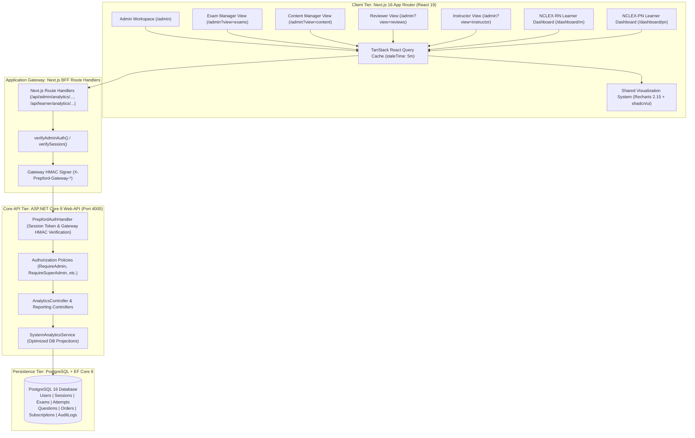

# PREPFORD NCLEX — DASHBOARD INTELLIGENCE ARCHITECTURE
## System Architecture, Data Flow, Security Topology & Visualization Engine Specification

**Document Version:** 1.0.0  
**Effective Date:** November 8, 2026  
**System Scope:** PrepFord NCLEX Enterprise Intelligence Platform  

---

## 1. ARCHITECTURE TOPOLOGY & DATA FLOW

The system topology enforces a strict **three-tier architecture** with a security-hardened Backend-for-Frontend (BFF) proxying requests to an authoritative ASP.NET Core 8 Web API:

---

## 2. KEY ARCHITECTURAL TENETS

1. **Database-Authoritative Aggregations:**
   All calculations (averages, pass rates, decile groupings, time-series counts, revenue sums) are executed within PostgreSQL via LINQ-to-Entities projections (`.GroupBy()`, `.SumAsync()`, `.AverageAsync()`, `.CountAsync()`). No table scans or full-entity in-memory loading is permitted in production code paths.
2. **Deterministic Role Resolution:**
   Every administrative view adapts dynamically based on the authoritative `RoleHierarchy.GetEffectiveRole(user)`. Users with specific roles (`exam_manager`, `content_manager`, `reviewer`, `instructor`) receive their dedicated operational workspaces automatically.
3. **Strict Pathway Separation:**
   NCLEX-RN and NCLEX-PN are managed as entirely independent educational and clinical assessment tracks:
   - Separate candidate enrollment populations.
   - Separate examination catalogs and blueprints.
   - Separate curriculum and Client Needs competencies (e.g. RN *Management of Care* vs PN *Coordinated Care*).
   - Independent performance benchmarks and readiness trajectories.
4. **Resilient Offline and Zero-State Handling:**
   Every KPI card and chart component provides three mandatory states:
   - `LoadingState`: Layout-stable skeleton preventing CLS (Cumulative Layout Shift).
   - `EmptyState`: Contextual illustration explaining that data will appear once activity occurs.
   - `ErrorState`: Top-center notification and retry trigger without crashing the dashboard shell.
5. **No Fabricated Data or Artificial Predictions:**
   Where historical comparison data is unavailable, comparison badges are omitted. Revenue reflects only collected net revenue from completed orders. Pass predictions are never fabricated.

---

## 3. SECURITY & DATA ISOLATION MODEL

### Gateway Authentication Scheme
All requests between the Next.js BFF and ASP.NET Core API are signed using an HMAC-SHA256 signature calculated from:
- Request HTTP Method.
- Normalized Request Path and Query String.
- UTC Timestamp (with a 5-minute clock-skew rejection window to prevent replay attacks).
- Request Body SHA-256 hash.
- Shared Secret (`GATEWAY_SHARED_SECRET`).

### Data Isolation Boundaries
- **Learner Records:** Candidates can only access assessment attempts and recommendations matching their authenticated `userId`.
- **Financial Intelligence:** Restricted strictly to `superadmin` and `admin` roles. Attempts by instructors, reviewers, or learners to access monetization endpoints trigger immediate 403 Forbidden responses.
- **Audit Trails:** Sensitive credential hashes, session secrets, and customer PII are strictly stripped from platform activity endpoints.

---

## 4. TANSTACK QUERY & CACHING STRATEGY

To maximize UI performance and prevent repetitive load on PostgreSQL:
- **Default Stale Time:** 5 minutes (`300,000ms`).
- **Garbage Collection Time:** 10 minutes (`600,000ms`).
- **Refetch on Window Focus:** `false` (avoids abrupt visual re-rendering during operational multitasking).
- **Query Key Hierarchy:**
  - `['analytics', 'admin', 'overview', timeRange, pathway]`
  - `['analytics', 'admin', 'users', timeRange, pathway]`
  - `['analytics', 'admin', 'examinations', timeRange, pathway]`
  - `['analytics', 'admin', 'academics', pathway]`
  - `['analytics', 'admin', 'monetization', timeRange, courseFilter]`
  - `['analytics', 'admin', 'activity', timeRange]`
  - `['analytics', 'role', roleName, timeRange]`
  - `['analytics', 'learner', pathway, userId, timeRange]`

---

## 5. REUSABLE VISUALIZATION DESIGN SYSTEM SPECIFICATION

The shared visualization engine adheres to PrepFord's design tokens:
- Deep Navy (`#142B4A`)
- Medical Teal (`#0D9488`)
- Soft Slate (`#F8FAFC`)
- Borders (`#E2E8F0` / dark: `hsl(215 28% 17%)`)

### Chart Primitives
1. `TrendChart`: Area and Line trends with cubic interpolation, subtle gradient fills, active dots on hover, and custom KaTeX/currency tooltips.
2. `DistributionBarChart`: Vertical bar charts with rounded corners (`radius={[6, 6, 0, 0]}`), benchmark reference lines, and responsive labels.
3. `DonutDistributionChart`: Multi-segment donut charts with center value badge and compact legend layout.
4. `HorizontalRankingChart`: Clean horizontal bars for Client Needs category masteries.
5. `ActivityTimeline`: Chronological event log with action badges and actor tags.

---

## 6. PHASE 1 ARCHITECTURAL SIGN-OFF

The architectural blueprint is fully specified and ready for implementation in Phase 2.
