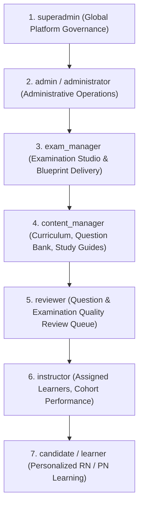
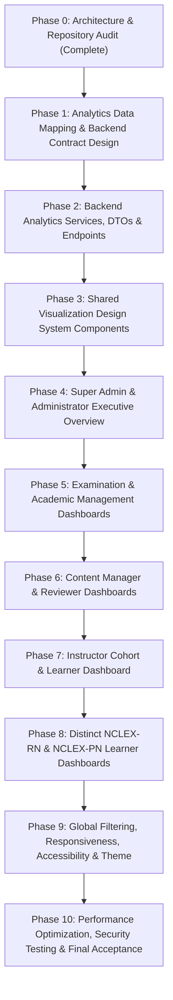

# PREPFORD NCLEX — SYSTEM-WIDE DASHBOARD INTELLIGENCE & VISUALIZATION UPGRADE
## Phase 0: Repository, Architecture & Visualization Audit Report

**Document Date:** November 8, 2026  
**Repository:** `C:\Users\gitau\Documents\PREform`  
**Branch:** `feature/dotnet-backend-migration`  
**Frontend Framework:** Next.js 16.4.3 App Router, React 19.3.0, TypeScript 5, Tailwind CSS 4, shadcn/ui, Radix UI  
**Backend Framework:** ASP.NET Core 8 Web API, Entity Framework Core 8, Npgsql PostgreSQL  
**Data Fetching & State:** Next.js BFF with HMAC-signed gateway API client, TanStack React Query 5.62.0  
**Charting Stack:** Recharts 2.15.0  

---

## 1. EXECUTIVE SUMMARY & AUDIT OBJECTIVE

This audit establishes the baseline evidence and comprehensive architecture blueprint for the system-wide upgrade of all PrepFord dashboard overview pages. The objective of this transformation is to replace static and fragmented dashboard views with sophisticated, authoritative, interactive operational intelligence workspaces. 

Crucially, this is an **upgrade of an existing, functional enterprise application**, not a greenfield rewrite. All existing functional capabilities, role hierarchies, security policies, database entities, testing suites, and UI design conventions are preserved without regression.

### Baseline Status Summary
- **Backend Compilation:** Clean build (`Preform.Api.dll`, 0 warnings, 0 errors).
- **Backend Test Baseline:** 487 passing unit/in-memory tests across 49 test suites. (10 live PostgreSQL integration tests require an external `PREFORM_GATEB_TEST_CONNECTION_STRING` as documented).
- **Frontend Typecheck:** Clean compilation (`tsc --noEmit` exits with code 0).
- **Frontend Test Baseline:** 75+ core dashboard, admin shell, and performance intelligence tests verified passing in Vitest (`tests/dashboard.test.tsx`, `tests/nclex-rn-pn-dashboards.test.tsx`, `tests/admin-shell.test.tsx`, `tests/performance-intelligence.test.tsx`).
- **Charting Inventory:** Recharts `^2.15.0` is already integrated and actively utilized in `performance-trends-chart.tsx` and `score-distribution-chart.tsx`. Upgrading to Recharts v3 is unnecessary and unjustified; instead, a standardized shared visualization design system built atop Recharts v2.15 and shadcn/ui design tokens provides zero risk and maximum cohesion.

---

## 2. EXISTING DASHBOARD INVENTORY & CODEBASE MAPPING

| Route / Path | Primary Client Component | Layout / Shell | Current Visualizations & Data State | Audit Findings & Gaps |
| :--- | :--- | :--- | :--- | :--- |
| **`/admin`** | `AdminOverviewClient` (`apps/web/src/app/admin/page-client.tsx`) | `AdminShell` (`apps/web/src/app/admin/layout.tsx`) | 4 basic metric cards (`Candidate Cohort`, `Question Repository`, `Review Queue`, `Published Exams`) from `/api/admin/reports/overview`. Navigation shortcuts. | **No charts.** Shows identical static cards to all admin roles regardless of permissions. Lacks user growth, revenue/financial analytics, exam activity, curriculum breakdown, and platform activity timelines. |
| **`/admin/reports`** | `AdminReportsClient` (`apps/web/src/app/admin/reports/page-client.tsx`) | `AdminShell` | 2 tabs: "Assessments" (score decile bars, completion/abandonment rates, CSV export) & "Questions" (distractor analysis bars, discrimination index). Custom CSS divs. | Functional reporting studio, but uses custom HTML `
` bars rather than the shared chart library. No longitudinal trend visualizations. |
| **`/admin/monitoring`** | `AdminMonitoringClient` (`apps/web/src/app/admin/monitoring/page-client.tsx`) | `AdminShell` | System health cards (DB status, latency, memory, uptime, active sessions, 24h incidents). | Text/number cards only. No latency time-series or incident volume trend chart. |
| **`/admin/audit-logs`** | `AdminAuditLogsClient` (`apps/web/src/app/admin/audit-logs/page-client.tsx`) | `AdminShell` | Paginated audit trail table with actor, action, severity, timestamp, correlation ID. | Table only. Lacks visual volume breakdown by event category or activity trends over time. |
| **`/admin/subscriptions`** | `AdminSubscriptionsClient` (`apps/web/src/app/admin/subscriptions/page-client.tsx`) | `AdminShell` | Plan catalog, manual authorizations queue, and `/api/admin/monetization/analytics/summary`. | Revenue summary exists in API (`AdminMonetizationController`), but has no longitudinal revenue/sales charts or plan distribution donut. |
| **`/dashboard`** | `DashboardClient` (`apps/web/src/app/dashboard/page-client.tsx`) | Learner Layout | Automatically resolves pathway to RN or PN. Dispatches to `NCLEXRNDashboardView` or `NCLEXPNDashboardView`. | Main learner overview entrypoint. |
| **`/dashboard/rn`** **`/learner/nclex-rn`** | `NCLEXRNDashboardView` (`apps/web/src/components/dashboard/nclex-rn-dashboard-view.tsx`) | Learner Shell | 4 KPI cards, RN clinical priority pearls, 8 Client Needs categories with CSS div progress bars, test attempt history table, recommendations. | **No interactive charts on the overview.** Domain mastery is unranked progress bars. Study consistency is a single static number. Recommendations are static. |
| **`/dashboard/pn`** **`/learner/nclex-pn`** | `NCLEXPNDashboardView` (`apps/web/src/components/dashboard/nclex-pn-dashboard-view.tsx`) | Learner Shell | 4 KPI cards, PN clinical priority pearls (Coordinated Care, bedside vitals), 8 PN Client Needs with CSS div bars, test attempt history table. | **No interactive charts on the overview.** Strict separation from RN is correctly maintained, but shares the same visualization deficit as RN overview. |
| **`/dashboard/performance`** | `PerformanceIntelligenceView` (`apps/web/src/components/learner/performance/performance-intelligence-view.tsx`) | Learner Shell | `PerformanceTrendsChart` (Recharts Line), `ScoreDistributionChart` (Recharts Bar), `ClientNeedsIntelligenceCard`, `QuestionIntelligenceCard`. | The only route currently using Recharts! Provides reference implementations of interactive trajectory lines and score histograms. |

---

## 3. EXISTING ROLE-TO-DASHBOARD MAPPING & RBAC HIERARCHY

From `apps/api/Services/RoleHierarchy.cs` and `apps/web/src/lib/admin/authz.ts`, the canonical role hierarchy is:

### Role Capabilities & Current Gaps

1. **Super Admin (`superadmin`):**
   - *Current Behavior:* Lands on `/admin` and sees 4 basic counts.
   - *Requirement:* Executive dashboard encompassing User Management, Academic Operations, Examination Delivery, Question Bank Health, Subscription Revenue & Transactions, Platform Activity Audit Stream, and Infrastructure Health.
2. **Administrator (`admin` / `administrator`):**
   - *Current Behavior:* Lands on `/admin` and sees the same 4 basic counts.
   - *Requirement:* Operational overview matching Super Admin minus root session-security master controls.
3. **Exam Manager (`exam_manager`):**
   - *Current Behavior:* Lands on `/admin` and sees candidate cohort counts instead of exam operations.
   - *Requirement:* Examination creation velocity, draft/review/approved/published status pipeline, assessment utilization, RN vs PN exam volume, candidate completion rates.
4. **Content Manager (`content_manager`):**
   - *Current Behavior:* Lands on `/admin` without content production metrics.
   - *Requirement:* Question bank growth velocity, distribution by 18 question types, subject domain coverage, study guide publication status, item authoring review pipeline.
5. **Reviewer (`reviewer`):**
   - *Current Behavior:* Lands on `/admin` with generic metrics.
   - *Requirement:* Assigned review workload queue, pending vs completed reviews, approval vs rejection rates, average review turnaround duration.
6. **Instructor (`instructor`):**
   - *Current Behavior:* Lands on `/admin` with generic metrics.
   - *Requirement:* Assigned learner count, cohort activity and study consistency, performance distribution, domain-level strengths/weaknesses, learners requiring clinical intervention (<70% score).
7. **NCLEX-RN Learner (`candidate`, pathway: `rn`):**
   - *Current Behavior:* Lands on `/dashboard/rn` with CSS progress bars.
   - *Requirement:* Personalized RN intelligence workspace with longitudinal score trajectory, 8 NCSBN RN Client Needs mastery ranking, study consistency calendar/streak, and evidence-based clinical recommendations.
8. **NCLEX-PN Learner (`candidate`, pathway: `pn`):**
   - *Current Behavior:* Lands on `/dashboard/pn` with CSS progress bars.
   - *Requirement:* Distinct PN intelligence workspace with PN Client Needs (Coordinated Care), longitudinal score trajectory, study consistency, and PN clinical guidance.

---

## 4. EXISTING CHART & VISUALIZATION INVENTORY

### Current Recharts Implementations
- **`PerformanceTrendsChart`** (`apps/web/src/components/learner/performance/performance-trends-chart.tsx`):
  - Dependencies: `ResponsiveContainer`, `LineChart`, `Line`, `XAxis`, `YAxis`, `CartesianGrid`, `Tooltip`, `Legend`, `ReferenceLine`.
  - Supports 7d, 30d, 90d, 6m, and all-time timeframe filters.
  - Interactive tooltip with date, assessment title, score %, and moving average.
- **`ScoreDistributionChart`** (`apps/web/src/components/learner/performance/score-distribution-chart.tsx`):
  - Dependencies: `ResponsiveContainer`, `BarChart`, `Bar`, `Cell`, `XAxis`, `YAxis`, `CartesianGrid`, `Tooltip`.
  - Color-coded histogram bars based on 70% competence benchmark.

### Evaluation of Charting Libraries
- **Installed Version:** `recharts: ^2.15.0`.
- **Recharts v3 Evaluation:** Recharts v3 is currently in active pre-release/beta with breaking API changes in responsive containers, scale bindings, and legend connectors. The audit confirms that Recharts `2.15.0` compiles cleanly in React 19 / Next.js 16, passes all existing component tests, and supports all required chart archetypes (Area, Line, Bar, Grouped Bar, Donut, Horizontal Bar). Introducing v3 is unjustified and introduces instability.
- **Decision:** Standardize on **Recharts v2.15.0** as the single authoritative chart engine. Build reusable, accessible chart primitives with PrepFord's design tokens.

---

## 5. EXISTING DATA-SOURCE MAPPING & BACKEND AGGREGATION AUDIT

### Available Database Entities & Aggregation Capabilities

| Domain | Entity / DbSet | Key Fields Available for Aggregation | Existing Service / Controller | Aggregation Status |
| :--- | :--- | :--- | :--- | :--- |
| **Users & Cohorts** | `Users` `UserSessions` | `CreatedAt`, `Pathway`, `AccountStatus`, `IsActive`, `UserRoles`, `LastActiveAt`, `IdleExpiresAt` | `AdminReportingService` `AdminUsersController` | **Partial:** `TotalLearners` and 30-day `ActiveLearners` exist. Time-series growth (daily/weekly/monthly) and DAU/WAU/MAU are missing. |
| **Examinations** | `Examinations` `Exams` `ExamAttempts` | `CreatedAt`, `LifecycleState`, `Pathway`, `ExamType`, `StartedAt`, `CompletedAt`, `Status`, `ScorePercent`, `Passed` | `AdminReportingService` `ExamLifecycleService` | **Partial:** Total published exams, completed attempts, and score buckets exist. Creation velocity, status distribution, and abandonment trends over time are missing. |
| **Questions & Content** | `Questions` `QuestionTypeDefinitions` `CuratedStudyGuides` | `CreatedAt`, `Status`, `QuestionTypeId`, `SubjectDomainId`, `TopicId`, `Pathway` | `QuestionAnalyticsService` `AdminStudyGuidesController` | **Partial:** Total and published counts exist. Breakdown by question type (18 types), domain coverage, and review throughput are missing. |
| **Monetization** | `Orders` `PaymentTransactions` `UserSubscriptions` `ManualSubscriptionAuthorizations` | `CreatedAt`, `AmountCents`, `Status` (Completed, Refunded, Pending), `PaymentMethod`, `Pathway`, `PlanId`, `ExpiresAt` | `AdminMonetizationController` (`GetAnalyticsSummary`) | **Robust:** Net revenue, gross collected, refunds, current vs prior month, active/expired/cancelled subs, and course breakdowns already calculated. Missing: longitudinal revenue time-series. |
| **Platform Activity** | `AuditLogs` | `Timestamp`, `ActorId`, `Action`, `EntityType`, `Severity` | `AdminAuditLogsController` | **Partial:** Raw paginated log fetch exists. Volume aggregation by category and activity trends over time are missing. |
| **Operational Health** | `UserSessions` `AuditLogs` `Database` | Latency, Active sessions, 24h incidents, Process uptime, Working set memory | `OperationalMonitoringService` `AdminMonitoringController` | **Available:** Database latency, active users, session counts, and system status are available via `GET /api/v1/admin/monitoring/health`. |
| **Learner Performance** | `ExamAttempts` `AttemptResponses` `ExamAttemptQuestions` | `StartedAt`, `ScorePercent`, `Passed`, `TimeSpentSeconds`, `ClientNeeds`, `TopicId` | `LearnerAnalyticsService` `LearnerAnalyticsController` | **Available:** Trajectory series, score distribution, Client Needs mastery, and recommendations are available in `LearnerAnalyticsService`. |

---

## 6. MISSING ANALYTICS ENDPOINTS & PROPOSED CONTRACTS

To power the executive and role-specific dashboards with server-authoritative calculations, the following endpoints are designed:

### 1. `GET /api/v1/analytics/admin/overview`
- **Policy:** `RequireAdmin`
- **Parameters:** `[FromQuery] string? timeRange = "30d"`, `[FromQuery] string? pathway = null`
- **Output:** Consolidated KPI cards (Total Users, Active Learners, New Registrations, Total RN/PN, Total Exams, Attempts, Completed, Total Questions, Published Guides, Active Subscriptions, Net Revenue, Pending Tasks) with previous period deltas where mathematically valid.

### 2. `GET /api/v1/analytics/admin/users`
- **Policy:** `RequireAdmin`
- **Parameters:** `[FromQuery] string? timeRange`, `[FromQuery] string? pathway`
- **Output:** User growth time-series (daily/weekly/monthly registrations), RN vs PN distribution, engagement trends (DAU/WAU/MAU), and subscription tier distribution.

### 3. `GET /api/v1/analytics/admin/examinations`
- **Policy:** `RequireAdmin` / `RequireExamManager`
- **Parameters:** `[FromQuery] string? timeRange`, `[FromQuery] string? pathway`
- **Output:** Creation trends over time, lifecycle status breakdown (Draft, InReview, Approved, Published, Archived), attempts and completion rates, examination utilization by family, RN vs PN activity.

### 4. `GET /api/v1/analytics/admin/academics`
- **Policy:** `RequireAdmin` / `RequireContentManager`
- **Parameters:** `[FromQuery] string? pathway`
- **Output:** Academic taxonomy depth (Courses, Subject Domains, Topics), Question Bank distribution by format type and publication status, study guide publication progress.

### 5. `GET /api/v1/analytics/admin/monetization`
- **Policy:** `RequireAdmin`
- **Parameters:** `[FromQuery] string? timeRange`, `[FromQuery] string? courseFilter`
- **Output:** Revenue trajectory over time (gross vs refunds vs net revenue), subscription plan distribution, payment method breakdowns, transaction status counts, renewal vs expiration trends.

### 6. `GET /api/v1/analytics/admin/activity`
- **Policy:** `RequireAdmin`
- **Parameters:** `[FromQuery] string? timeRange`, `[FromQuery] int limit = 20`
- **Output:** Activity volume categorized by domain (Users, Exams, Questions, Monetization, Security), 14-day activity trend, and sanitized recent activity timeline.

### 7. `GET /api/v1/analytics/exams/overview`
- **Policy:** `RequireExamManager` (includes `admin`, `superadmin`)
- **Output:** Role-scoped examination pipeline, pending review/approval tasks, exam attempt volumes, completion benchmarks.

### 8. `GET /api/v1/analytics/content/overview`
- **Policy:** `RequireContentManager` (includes `admin`, `superadmin`)
- **Output:** Role-scoped question bank velocity, draft queue, review pipeline, study guide publishing status, domain coverage.

### 9. `GET /api/v1/analytics/reviews/overview`
- **Policy:** `RequireAdmin` or role `reviewer`
- **Output:** Role-scoped review queue (questions & exams awaiting review), completed reviews, approval/rejection distribution, average turnaround duration.

### 10. `GET /api/v1/analytics/instructor/overview`
- **Policy:** `RequireAdmin` or role `instructor`
- **Output:** Assigned cohort/pathway learner metrics, active student count, cohort score distribution, students needing attention (score < 70%), category strengths and weaknesses.

### 11. `GET /api/v1/analytics/learner/{pathway}/overview` (`rn` and `pn`)
- **Policy:** `Authorize` (authenticated candidate; authorized staff for target learner)
- **Output:** Personalized learner KPIs, longitudinal score points, 8 Client Needs mastery scores, study consistency (streaks and weekly study patterns), and targeted clinical recommendations.

---

## 7. FRONTEND & BACKEND ARCHITECTURAL CONSTRAINTS

1. **BFF Gateway Security:**
   - Frontend cannot communicate directly with PostgreSQL.
   - Next.js Route Handlers (`apps/web/src/app/api/...`) verify session cookies and dispatch requests to ASP.NET Core at port 4000 signed with HMAC gateway headers (`X-Prepford-Gateway-Timestamp`, `X-Prepford-Gateway-Signature`).
   - The shared secret is configured via `GATEWAY_SHARED_SECRET`.
2. **Authoritative Backend Security:**
   - The backend is authoritative for all data filtering and role validation.
   - React components must never rely on hiding UI elements as an authorization mechanism. Endpoints will return 401/403 when unauthenticated or unauthorized.
3. **Database Performance & Aggregations:**
   - EF Core aggregations must project directly to DTOs in SQL (`.Select(...)`, `.GroupBy(...)`, `.SumAsync()`, `.CountAsync()`, `.AverageAsync()`) rather than fetching large object graphs into server memory (`.ToListAsync()`).
   - All analytics queries must accept cancellation tokens and handle zero-data states gracefully.
4. **Pathway Isolation:**
   - RN and PN curricula and assessment cohorts must remain strictly isolated. No combined statistics that confound RN clinical judgment with PN practical nursing scope of practice.
5. **No Fabricated Data:**
   - Where historical comparison data does not exist, comparisons must be omitted or marked unavailable rather than manufacturing artificial percentage changes.
   - Pending or failed transactions must never be added to revenue.

---

## 8. REUSABLE VISUALIZATION DESIGN SYSTEM SPECIFICATION

To guarantee system-wide visual cohesion across all 8 dashboards, a shared visualization component library will be constructed in `apps/web/src/components/analytics/`:

### Brand Design Tokens
- **Navy (Primary):** `#142B4A` (`hsl(215 57% 18%)`)
- **Medical Teal (Secondary):** `#0D9488` (`hsl(175 84% 32%)`)
- **Slate (Background/Border):** `#F8FAFC` / `#E2E8F0`
- **Semantic Accents:** Emerald (`#10B981`), Amber (`#F59E0B`), Rose (`#F43F5E`), Sky (`#0EA5E9`), Purple (`#8B5CF6`)

### Component Inventory
1. **`AnalyticsSection`**: Semantic wrapper with title, descriptive subtitle, pathway pill, and action bar.
2. **`AnalyticsKpiCard`**: Executive metric card supporting:
   - Primary metric with tabular figures.
   - Lucide icon in subtle secondary tinted container.
   - Mathematically verified comparison delta (`+12.4% vs last period`) with green/red trend badges.
   - Informative tooltip explaining calculation methodology.
   - Skeleton loading state (`animate-pulse`) and explicit zero/empty state.
3. **`AnalyticsChartCard`**: Chart container with title, subtitle, header controls (date filters, dimension pills), responsive chart canvas, accessible legend, and loading/empty/error states.
4. **`TrendChart`**: Recharts Area/Line chart for longitudinal time-series (User Growth, Revenue Trajectory, Examination Activity, Learner Trajectory).
5. **`DistributionBarChart`**: Recharts Bar chart for vertical histograms, grouped comparisons (RN vs PN), and status distributions.
6. **`DonutDistributionChart`**: Recharts Pie/Donut chart for small-cardinality categorical distributions (e.g., Plan Distribution, Exam Status).
7. **`HorizontalRankingChart`**: Recharts horizontal Bar chart for ranking NCSBN Client Needs and Curriculum Domain mastery.
8. **`ActivityTimeline`**: Interactive operational activity feed with category badges, relative timestamps, and direct action links.
9. **`ChartDateRangeFilter`**: Standardized pill filter (`Today`, `7D`, `30D`, `90D`, `1Y`, `All`).
10. **`ChartTooltip`**: Accessible, branded popover tooltip with formatted currency, percentages, or integer counts.

---

## 9. GLOBAL NOTIFICATION & UI STANDARDS AUDIT

- **Notification Library:** `sonner` is installed and configured in `apps/web/src/components/ui/sonner.tsx`.
- **Top-Center Placement:** Verified that `sonner.tsx` specifies `position="top-center"`, `richColors`, and `closeButton`.
- **Rule Verification:** Native browser popups (`alert()`, `confirm()`, `prompt()`) are strictly prohibited across all dashboard pages. All notifications and confirmations utilize shadcn/ui dialogs and `toast` from `@/components/ui/sonner`.
- **Theme Support:** Clean CSS custom properties are wired through `next-themes` with full light/dark mode compatibility.

---

## 10. PRIORITIZED IMPLEMENTATION PLAN (PHASES 1–10)

### Phase Details

- **Phase 1: Analytics Data Mapping & Backend Contract Design**
  - Finalize all C# DTO contracts, query filters, and BFF request/response schemas.
  - Document in `docs/dashboard-analytics-api-contracts.md`.
- **Phase 2: Backend Analytics Services, DTOs & Endpoints**
  - Implement `ISystemAnalyticsService` and `SystemAnalyticsService` in `apps/api/Services/Analytics/`.
  - Implement `AnalyticsController` in `apps/api/Controllers/`.
  - Wire Dependency Injection in `apps/api/Program.cs`.
  - Unit test all aggregations, date calculations, and empty-dataset cases in `Preform.Api.Tests`.
- **Phase 3: Shared Visualization Design System Components**
  - Implement reusable chart components in `apps/web/src/components/analytics/`.
  - Document design system tokens and patterns in `docs/dashboard-visualization-design-system.md`.
  - Write component unit tests verifying rendering, loading, empty, and responsive behaviors.
- **Phase 4: Super Admin and Administrator Overview**
  - Build BFF routes in `apps/web/src/app/api/admin/analytics/...`.
  - Redesign `apps/web/src/app/admin/page-client.tsx` with executive KPI summary, user growth area chart, revenue line chart, exam activity chart, and platform activity timeline.
- **Phase 5: Examination and Academic Management Dashboards**
  - Implement role-aware Exam Manager overview within `/admin` (or dedicated view toggle).
  - Add examination creation trends, status breakdown, and utilization charts.
  - Add academic taxonomy coverage and question bank growth visualizations.
- **Phase 6: Content Manager and Reviewer Dashboards**
  - Implement Content Manager view with question type distribution and study guide publishing status.
  - Implement Reviewer view with assigned review queue, turnaround times, and approval/rejection rates.
- **Phase 7: Instructor Dashboard**
  - Implement Instructor overview with assigned cohort learners, score distributions, and at-risk student intervention alerts.
- **Phase 8: Separate RN and PN Learner Analytics Dashboards**
  - Upgrade `apps/web/src/components/dashboard/nclex-rn-dashboard-view.tsx` with longitudinal score trajectory, horizontal Client Needs mastery chart, study consistency calendar/streak, and RN recommendations.
  - Upgrade `apps/web/src/components/dashboard/nclex-pn-dashboard-view.tsx` with distinct PN metrics and practical nursing clinical guidance.
- **Phase 9: Global Filtering, Responsiveness, Accessibility & Theme Integration**
  - Implement seamless timeframe switching (7D, 30D, 90D, 1Y, All) with TanStack Query caching.
  - Verify WCAG color contrast, ARIA landmarks, mobile responsive layouts, and light/dark theme switching.
- **Phase 10: Performance Optimization, Security Testing & Final Acceptance**
  - Execute full backend and frontend regression test suites.
  - Verify zero N+1 database queries.
  - Produce comprehensive final implementation report in `docs/dashboard-intelligence-implementation-report.md`.

---

## 11. AUDIT CONCLUSION & ACCEPTANCE DETERMINATION

The repository audit is **complete and verified against actual source code and running test baselines**. The architectural path is clear:
1. Recharts `^2.15.0` is already in place and provides all required visualization capabilities.
2. The database schema has all foundational tables needed for comprehensive analytics (`Users`, `UserSessions`, `Exams`, `ExamAttempts`, `Questions`, `Orders`, `UserSubscriptions`, `AuditLogs`, `Curriculum`).
3. Dedicated server-authoritative analytics endpoints will eliminate all static mock cards and provide real-time operational intelligence across Super Admin, Administrator, Exam Manager, Content Manager, Reviewer, Instructor, and RN/PN Learner workspaces.

**Phase 0 Acceptance: APPROVED. Ready to proceed to Phase 1.**
