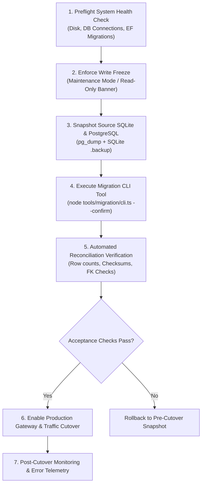

# PrepFord Phase 4 — Data Migration Cutover and Rollback Strategy

**Document Version:** 1.0  
**Date:** 2026-10-29  
**Branch:** `feature/dotnet-backend-migration`  
**Target:** Planned production cutover from SQLite to ASP.NET Core & PostgreSQL 18.

---

## 1. Overview & Principles

This document outlines the operational runbook for executing the future production database cutover from SQLite to the authoritative PostgreSQL 18 database. 

**Guiding Principles:**
1. **Zero Data Loss:** Complete database backups must be verified and checksummed before touching live traffic.
2. **Explicit Maintenance Window:** A short, planned maintenance window (write freeze) avoids the inconsistency and split-brain risks inherent in dual-write architectures.
3. **Fail-Closed Security:** All endpoints fail closed if database connectivity or schema verification fails.
4. **Deterministic Rollback:** Rollback procedures are fully rehearsed and account for any potential post-cutover writes.

---

## 2. Pre-Cutover Verification & Preflight Checklist



### Preflight Checklist:
- [ ] **PostgreSQL Readiness:** Target PostgreSQL 18 database `prepford` is reachable, healthy, and all EF Core migrations (up to `0004_HarmonizeBackendSchema`) are applied.
- [ ] **Storage Headroom:** Target disk has >= 5x database size in free space to accommodate WAL logs and indexing.
- [ ] **BFF Gateway Key:** `GATEWAY_SHARED_SECRET` environment variable is provisioned and matches between Next.js and ASP.NET Core.
- [ ] **Dry-Run Validation:** `node --experimental-strip-types tools/migration/cli.ts --dry-run` ran cleanly against source data with 0 unexpected schema conflicts.

---

## 3. Step-by-Step Cutover Runbook

### Step 1: Schedule & Announce Maintenance Window
- Window Duration: 30 minutes (anticipated execution time < 5 minutes).
- Off-peak window (e.g. 02:00 UTC).

### Step 2: Establish Write Freeze
1. Deploy maintenance banner or activate read-only mode in Next.js:
   - Route handlers reject non-GET mutations (`PUT /api/profile`, `POST /api/checkout`, `POST /api/auth/register`) with HTTP `503 Service Unavailable` (`"Scheduled maintenance in progress. Please retry shortly."`).
2. Verify in logs that active database writes have settled.

### Step 3: Source & Target Backup
Execute authoritative snapshots before any data modification:
```bash
# 1. SQLite Snapshot (Clean WAL flush)
sqlite3 apps/web/.data/prepford.sqlite ".backup 'apps/web/.data/prepford_pre_cutover_backup.sqlite'"

# 2. PostgreSQL Pre-Cutover Backup
pg_dump -h localhost -U postgres -d prepford -F c -b -v -f "prepford_pre_cutover_backup.dump"
```
Compute and record SHA-256 checksums of both backup files.

### Step 4: Execute Authoritative Migration Tool
Run the verified migration CLI utility with deliberate confirmation:
```bash
node --experimental-strip-types tools/migration/cli.ts \
  --source apps/web/.data/prepford.sqlite \
  --target "$DATABASE_URL" \
  --confirm \
  --output-sql docs/cutover-execution.sql \
  --json-report docs/cutover-reconciliation.json
```

### Step 5: Post-Migration Reconciliation & Acceptance Verification
Verify critical invariants in PostgreSQL:
1. **User Count Verification:**
   ```sql
   SELECT COUNT(*) FROM "Users";
   -- Must equal source user count (4)
   ```
2. **Subscription Plan Integrity:**
   ```sql
   SELECT COUNT(*), COUNT(DISTINCT "Slug") FROM "SubscriptionPlans" WHERE "IsActive" = true;
   -- Must match active catalog tiers
   ```
3. **Orphan Check (Must return 0):**
   ```sql
   SELECT COUNT(*) FROM "UserProfileImages" WHERE "UserId" NOT IN (SELECT "Id" FROM "Users");
   SELECT COUNT(*) FROM "UserSessions" WHERE "UserId" NOT IN (SELECT "Id" FROM "Users");
   ```
4. **Session Revocation Invariant:**
   ```sql
   SELECT COUNT(*) FROM "UserSessions" WHERE "Revoked" = false AND "TokenHash" LIKE 'legacy_migrated%';
   -- Must be 0 (All legacy sessions must be revoked)
   ```

### Step 6: Traffic Switch & BFF Cutover
1. Update `API_GATEWAY_URL` in Next.js production environment to point to the live ASP.NET Core API (`https://api.prepford.com`).
2. Lift the write freeze / maintenance mode.
3. Perform synthetic smoke test:
   - Candidate login (`POST /api/auth/login`)
   - Profile update (`PUT /api/profile`)
   - Subscriptions catalog query (`GET /api/subscriptions`)
   - Health check probe (`GET /api/v1/health/ready`)

### Step 7: Post-Cutover Monitoring (48 Hours)
- Monitor 5xx HTTP error rates on both BFF and ASP.NET Core (alert threshold: > 0.5%).
- Monitor database connection pool saturation.
- Monitor audit logs for unauthorized privilege elevation attempts.

---

## 4. Rollback Plan & Recovery Procedures

### 4.1 Rollback Trigger Criteria
An immediate rollback must be initiated if any of the following occur during or immediately following cutover:
1. Migration CLI aborts or PostgreSQL transaction fails.
2. Reconciliation queries detect mismatched user counts or broken foreign keys.
3. Health check probe (`/api/v1/health/ready`) fails for > 2 consecutive minutes after cutover.
4. Error rate on authentication or profile routes exceeds 1.0% within the first 15 minutes of live traffic.

### 4.2 Rollback Procedure (Within Maintenance Window)
If cutover fails before or during verification:
1. **Re-engage Maintenance Mode** immediately.
2. **Restore PostgreSQL Database:**
   ```bash
   dropdb -h localhost -U postgres prepford
   createdb -h localhost -U postgres prepford
   pg_restore -h localhost -U postgres -d prepford -v "prepford_pre_cutover_backup.dump"
   ```
3. **Restore SQLite Database:**
   ```bash
   cp "apps/web/.data/prepford_pre_cutover_backup.sqlite" "apps/web/.data/prepford.sqlite"
   ```
4. **Revert Next.js BFF Target Configuration:**
   - Point Next.js BFF back to fallback/pre-cutover settings.
5. **Lift Maintenance Mode** and verify system returns to normal operation.
6. **Conduct Post-Mortem:** Inspect logs and migration errors before scheduling a new window.

### 4.3 Handling Post-Cutover Writes (After Traffic Switch)
If an issue is detected several hours *after* traffic was switched:
- A blind database restore would overwrite new transactions or candidate quiz attempts created since cutover.
- **Incremental Reconciliation Runbook:**
  1. Export newly created records from PostgreSQL:
     ```sql
     COPY (SELECT * FROM "Orders" WHERE "CreatedAt" > '<cutover_timestamp>') TO '/tmp/new_orders.csv' CSV HEADER;
     COPY (SELECT * FROM "Users" WHERE "CreatedAt" > '<cutover_timestamp>') TO '/tmp/new_users.csv' CSV HEADER;
     ```
  2. Perform hotfixes forward if possible; if database rollback is strictly necessary, merge new records into the restored database using the transaction CSVs.

---

## 5. Architectural Decision: Avoiding Dual-Write
PrepFord explicitly rejects dual-write patterns (writing simultaneously to SQLite and PostgreSQL):
- Two independent datastores lack distributed ACID guarantees. Network timeouts or partial failures on one database inevitably lead to silent state divergence, data corruption, and race conditions.
- A clean maintenance window with pre-cutover snapshots and deterministic reconciliation guarantees 100% data consistency.
