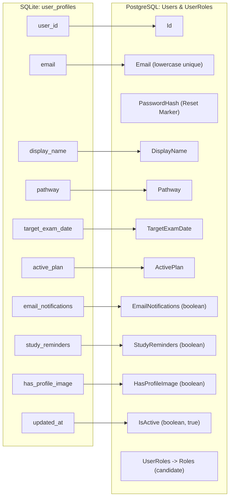

# PrepFord Phase 4 — Safe SQLite-to-PostgreSQL Data Migration Plan

**Document Version:** 1.0  
**Date:** 2026-10-29  
**Branch:** `feature/dotnet-backend-migration`  
**Prerequisites:** Phase 1 SQLite Audit, Phase 2 ASP.NET Core & EF Core PostgreSQL Harmonization, Phase 3 Frontend API Migration.  
**Target:** Authoritative PostgreSQL 18 relational datastore (`prepford`).

---

## 1. Migration Scope & Source Inventory

### 1.1 Source Database Discovery
The repository audit identified the following SQLite sources containing candidate, catalog, image, and session data:
1. **Primary Runtime Database:**
   - Path: `apps/web/.data/prepford.sqlite` (with `-wal` and `-shm` transaction logs)
   - Size: ~172 KB database file
   - Engine: SQLite 3 / Node.js `node:sqlite` (WAL journal mode)
2. **Derived Test Environments:**
   - Ephemeral in-memory and isolated file test fixtures (`apps/web/.data/test_*.sqlite`) used during vitest test isolation.

### 1.2 Source Table & Schema Inventory
The source SQLite database contains four active tables:

| Source Table | Source Columns & Types | Row Count | Destination Entity in PostgreSQL |
| :--- | :--- | :--- | :--- |
| `user_profiles` | `user_id` (TEXT PK), `email` (TEXT UNIQUE), `display_name` (TEXT), `pathway` (TEXT), `target_exam_date` (TEXT), `active_plan` (TEXT), `email_notifications` (INTEGER), `study_reminders` (INTEGER), `has_profile_image` (INTEGER), `profile_image_updated_at` (TEXT), `updated_at` (TEXT) | 4 | `Users`, `UserRoles` |
| `user_profile_images`| `id` (TEXT PK), `user_id` (TEXT UNIQUE), `user_email` (TEXT UNIQUE), `image_data` (BLOB), `content_type` (TEXT), `size_bytes` (INTEGER), `sha256_hash` (TEXT), `created_at` (TEXT), `updated_at` (TEXT) | 1 | `UserProfileImages` |
| `subscription_plans` | `id` (TEXT PK), `slug` (TEXT UNIQUE), `name` (TEXT), `description` (TEXT), `audience` (TEXT), `pathway` (TEXT), `plan_type` (TEXT), `price` (INTEGER), `original_price` (INTEGER), `currency` (TEXT), `billing_interval` (TEXT), `duration_label` (TEXT), `features_json` (TEXT), `popular` (INTEGER), `bg_colour` (TEXT), `accent_colour` (TEXT), `text_colour` (TEXT), `badge_text` (TEXT), `display_order` (INTEGER), `is_active` (INTEGER), `entitlements_json` (TEXT), `created_at` (TEXT), `updated_at` (TEXT) | 26 | `SubscriptionPlans` |
| `user_sessions` | `id` (TEXT PK), `user_id` (TEXT), `email` (TEXT), `role` (TEXT), `display_name` (TEXT), `csrf_token` (TEXT), `created_at` (TEXT), `expires_at` (TEXT), `last_active_at` (TEXT), `revoked` (INTEGER) | 21 | `UserSessions` (Imported in revoked state) |

---

## 2. Source-to-Target Entity & Column Mapping

### 2.1 Identity & Candidate Profiles (`user_profiles` -> `Users` & `UserRoles`)

- **Primary Key:** `user_id` preserved directly as `Users.Id`.
- **Email Normalization:** `email.toLowerCase().trim()`.
- **Password Hashes:** SQLite `user_profiles` contained no password hashes. Migrated users without existing bcrypt/PBKDF2 hashes receive a secure password-reset marker (`RESET_REQUIRED_<random_token>`) requiring password setup or passwordless verification upon first login. Plaintext passwords or dummy weak hashes are strictly prohibited.
- **Role Assignment:** SQLite profiles did not store role columns. The migration cross-references `user_sessions.role`:
  - If a user record only has `role = 'candidate'` (or no sessions), it is mapped to the `"candidate"` role in `UserRoles`.
  - Under no circumstances is an administrative role (`admin`, `superadmin`) assigned by default.
  - Accounts with administrative sessions undergo explicit allowlist review.
- **Type Conversions:**
  - `email_notifications` (INTEGER 0/1) -> `EmailNotifications` (boolean)
  - `study_reminders` (INTEGER 0/1) -> `StudyReminders` (boolean)
  - `has_profile_image` (INTEGER 0/1) -> `HasProfileImage` (boolean)
  - `updated_at` (TEXT ISO) -> `UpdatedAt` (TIMESTAMPTZ)
  - `created_at` (derived from earliest session or `updated_at`) -> `CreatedAt` (TIMESTAMPTZ)

---

### 2.2 Profile Image Binaries (`user_profile_images` -> `UserProfileImages`)

| SQLite Source Column | Target Column | Target Type | Transformation Rule |
| :--- | :--- | :--- | :--- |
| `id` | `Id` | `text` PK | Preserved or mapped to clean UUID if missing. |
| `user_id` | `UserId` | `text` FK | Must match an existing migrated `Users.Id`. Orphan images are flagged and skipped. |
| `user_email` | `UserEmail` | `text` | Normalized to lowercase. |
| `image_data` | `ImageData` | `bytea` | Binary BLOB preserved. Magic bytes (JPEG, PNG, WebP) and 2MB limit verified. |
| `content_type` | `ContentType` | `text` | Sanitized to `image/jpeg`, `image/png`, or `image/webp`. |
| `size_bytes` | `SizeBytes` | `integer` | Verified against actual byte length of `image_data`. |
| `sha256_hash` | `Sha256Hash` | `text` | Recalculated via SHA-256 and verified against source checksum. |
| `created_at` | `CreatedAt` | `timestamptz` | Parsed ISO 8601 string to UTC timestamp. |
| `updated_at` | `UpdatedAt` | `timestamptz` | Parsed ISO 8601 string to UTC timestamp. |

---

### 2.3 Subscription Catalog (`subscription_plans` -> `SubscriptionPlans`)

| SQLite Source Column | Target Column | Target Type | Transformation Rule |
| :--- | :--- | :--- | :--- |
| `id` | `Id` | `text` PK | Preserved directly (e.g. `rn-pro`, `pn-pro-90`). |
| `slug` | `Slug` | `text` UNIQUE | Preserved directly (e.g. `nclex-rn-pro`). |
| `name` | `Name` | `text` | Preserved directly. |
| `description` | `Description` | `text` | Preserved directly. |
| `audience` | `Audience` | `text` NULL | Preserved directly. |
| `pathway` | `Pathway` | `text` | Normalized to `"RN"`, `"PN"`, or `"Both"`. |
| `plan_type` | `PlanType` | `text` | Normalized (`starter`, `pro`, `premium`, `readiness`). |
| `price` | `PriceCents` | `integer` | Converted from dollars to cents (`price * 100`). |
| `original_price` | `OriginalPriceCents` | `integer` NULL | Converted to cents (`original_price * 100`) if present. |
| `currency` | `Currency` | `text` | Default to `"USD"`. |
| `billing_interval` | `BillingInterval` & `Interval` | `text` & `integer` | Mapped to interval enum: `month` -> 1 (Monthly), `quarter` -> 2 (Quarterly), `one-time` -> 4 (OneTime). |
| `duration_label` | `DurationLabel` | `text` NULL | Preserved directly. |
| `features_json` | `FeaturesJson` | `text` | Validated as valid JSON array string. |
| `popular` | `Popular` | `boolean` | Converted from INTEGER (1 -> true, 0 -> false). |
| `bg_colour` | `BgColour` | `text` NULL | Verified valid hex color. |
| `accent_colour` | `AccentColour` | `text` NULL | Verified valid hex color. |
| `text_colour` | `TextColour` | `text` NULL | Verified valid hex color. |
| `badge_text` | `BadgeText` | `text` NULL | Preserved directly. |
| `display_order` | `DisplayOrder` | `integer` | Preserved directly. |
| `is_active` | `IsActive` | `boolean` | Converted from INTEGER (1 -> true, 0 -> false). |
| `entitlements_json` | `EntitlementsJson` | `text` | Validated as valid JSON array string (`["rn"]`, `["pn"]`, `["rn","pn"]`). |

---

### 2.4 User Sessions (`user_sessions` -> `UserSessions`)
- **Safety Policy:** Section 4 dictates: *"Never transfer trust in unsigned legacy cookie contents. Revoke legacy or unverifiable sessions. Prefer requiring users to sign in again."*
- SQLite sessions did not store secure token hashes compatible with ASP.NET Core Bearer token lookup.
- All migrated sessions are inserted with **`Revoked = true`** and **`TokenHash = 'legacy_migrated_revoked_' || id`**.
- This preserves the audit log of prior sessions without granting unauthorized bypass to incoming HTTP requests. Users seamlessly re-authenticate on next visit, acquiring authoritative PostgreSQL session tokens.

---

### 2.5 Orders, Transactions & Entitlement Reconciliation
- SQLite had no `orders` or `user_subscriptions` relational tables.
- **Fail-Closed Entitlement Rule:** Under Phase 4 rules:
  1. Default free plans (`active_plan = 'NCLEX-RN Complete Preparation Plan'`) represent standard candidate onboarding and are retained in `Users.ActivePlan`.
  2. Users with claimed paid plans (e.g. `NCLEX-RN & PN All-Access`) without a verifiable payment transaction are placed in an **Ambiguous Entitlement Review Queue**.
  3. No phantom `Order` or `PaymentTransaction` records are fabricated.

---

## 3. Conflict Detection & Validation Policies

| Category | Potential Conflict | Detection & Resolution Rule |
| :--- | :--- | :--- |
| **Email Collision** | Different `user_id` values share the same normalized email. | Flagged as duplicate. The migration skips the conflicting duplicate and writes an audit exception record. |
| **Orphan Profile Images** | Image references a `user_id` not present in `user_profiles`. | Image is skipped and logged as an orphan. No orphan binary is written to PostgreSQL. |
| **Orphan Sessions** | Session references a `user_id` not present in `user_profiles`. | Session is skipped and logged. |
| **Target Identity Exists** | A user with the same email already exists in PostgreSQL. | If target user exists: merge non-destructive profile attributes (`targetExamDate`, notification preferences) only if verified; never overwrite newer target timestamps. |
| **Plan Slug Collision** | SQLite plan slug matches existing PostgreSQL plan. | Update existing plan metadata only if source timestamp is newer; preserve existing price in target if locked. |

---

## 4. Migration Utility Architecture

The migration tool is implemented as a standalone, deterministic CLI utility in `tools/migration/`:
- **Module:** `tools/migration/migrate.ts`
- **Execution:** `node --experimental-strip-types tools/migration/cli.ts [options]`
- **Supported Options:**
  - `--dry-run`: Validates source databases, checks foreign keys, runs type transformations, and outputs a complete reconciliation report without executing writes.
  - `--source <path>`: Explicit SQLite database path (default: `apps/web/.data/prepford.sqlite`).
  - `--target <conn_string>`: Explicit PostgreSQL connection string (default: from `DATABASE_URL` or `appsettings.json`).
  - `--confirm`: Mandatory flag required for non-dry-run database writes.
  - `--batch-size <n>`: Transaction batch size (default: 50).
- **Production Guard:**
  - The tool inspects the target database name and host. If the connection string or `APP_ENV` indicates production, the tool immediately aborts unless an explicit emergency override is provided.
- **Transactional Atomicity:**
  - Data insertion runs within a single PostgreSQL transaction (`BEGIN ... COMMIT`). Any unexpected failure triggers an immediate `ROLLBACK`.

---

## 5. Testing & Verification Strategy

Disposable database fixtures and unit tests will be executed:
1. **Sanitized Fixture:** [`tools/migration/fixtures/sample-source.sqlite`](file:///c:/Users/gitau/Documents/PREform/tools/migration/fixtures/sample-source.sqlite) containing:
   - Valid candidate and admin records.
   - Profile images with valid JPEG/PNG magic bytes.
   - Deliberate edge cases: duplicate emails, orphan images, expired sessions, unverified paid plans.
2. **Automated Tests:** [`tests/data-migration.test.ts`](file:///c:/Users/gitau/Documents/PREform/apps/web/tests/data-migration.test.ts) covering:
   - Dry run safety (zero target writes).
   - Valid data transformation and primary/foreign key preservation.
   - Idempotency: running the migration twice produces identical row counts with zero duplicate key errors.
   - Conflict detection and orphan handling.
   - Production target safety guard.
