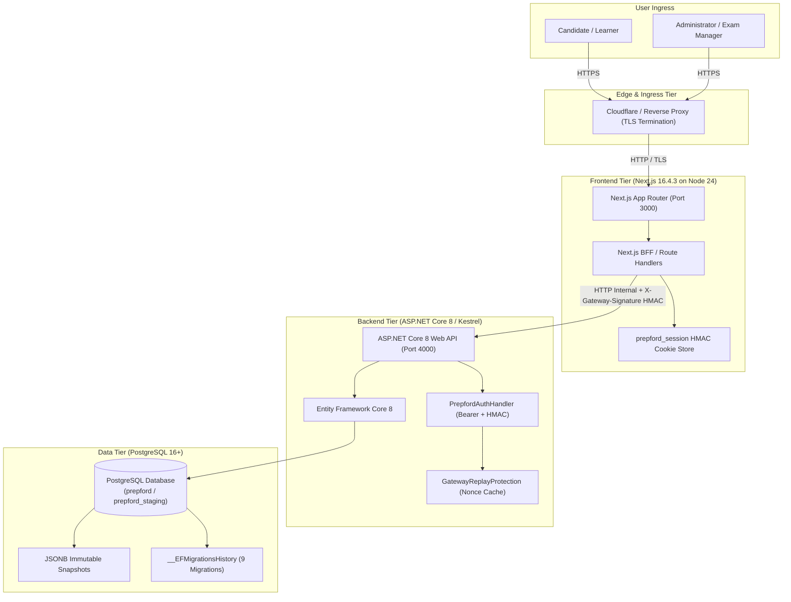

# PREPFORD — P3.7 ENVIRONMENT & INFRASTRUCTURE READINESS

**Phase:** P3.7 — Controlled Deployment Readiness & Release Validation  
**Deliverable:** 3 of 8  
**Repository:** `C:\Users\gitau\Documents\PREform`  
**Branch:** `feature/dotnet-backend-migration`  
**Baseline Commit:** `e2dcd64`  
**Date:** 2026-11-04  
**Auditor Roles:** Senior DevOps Engineer, Cloud Infrastructure Architect  

---

## 1. Deployment Topology & System Architecture

PrepFord utilizes a decoupled modern web application architecture combining a Next.js 16.4.3 frontend (BFF layer) with an ASP.NET Core 8 Web API backend, backed by PostgreSQL.

### Architecture Diagram

---

## 2. Component Runtime & Dependency Verification

### 2.1 Frontend Component (`apps/web`)
- **Runtime:** Node.js `v24.21.0` (LTS baseline), npm `11.19.0`.
- **Framework:** Next.js `16.4.3`, React `19.3.0`, React-DOM `19.3.0`.
- **Compiler / Bundler:** Turbopack (`@tailwindcss/turbopack` 4.x).
- **Features Active:**
  - `cacheComponents: true`
  - `partialPrefetching: true`
  - Experimental concurrency: `cpus: 1`, `staticGenerationMaxConcurrency: 1`
- **Output Artifact:** Standalone `.next/` distribution ready for containerized execution.

### 2.2 Backend Component (`apps/api`)
- **Runtime / SDK:** .NET SDK `10.0.403`, .NET Runtime `10.0.14` (Host: `win-x64`).
- **Target Framework:** `net8.0` with `<RollForward>Major</RollForward>`.
- **ORM / Provider:** `Microsoft.EntityFrameworkCore` 8.0.10, `Npgsql.EntityFrameworkCore.PostgreSQL` 8.0.10.
- **Web Server:** Kestrel (configured for `http://0.0.0.0:4000`).
- **Output Artifact:** Compiled binary assemblies in `dist/api/Preform.Api.dll` (SHA256: `2FF56291AD01842A4CD8FBDFB2861DB43999ECBC20189856B808A8FDEC18204F`).

---

## 3. Environment Variable & Secrets Audit

### 3.1 Sanitized Configuration Inventory

| Configuration Variable | App | Environment Scope | Secret | Classification | Audit Status |
|---|:---:|:---:|:---:|:---:|:---:|
| `NODE_ENV` | Web | All | No | Runtime | **CONFIGURED** |
| `APP_ENV` | Web / API | All | No | Runtime | **CONFIGURED** |
| `PORT` | Web | All | No | Network | **CONFIGURED** (3000) |
| `WEB_ORIGIN` | API | All | No | Security / CORS | **CONFIGURED** (`http://localhost:3000` / Staging URL) |
| `INTERNAL_API_URL` | Web | All | No | Network | **CONFIGURED** (`http://localhost:4000`) |
| `API_GATEWAY_URL` | Web | Staging, Prod | No | Network | **CONFIGURED** |
| `NEXT_PUBLIC_APP_URL` | Web | All | No | Public URL | **CONFIGURED** |
| `NEXT_PUBLIC_ENABLE_MOCK_CHECKOUT` | Web | Local, Staging | No | Feature Flag | **CONFIGURED** (Disabled in Prod) |
| `SESSION_SECRET` | Web | All | **YES** | Cryptographic | **CONFIGURED** (Min 32 chars) |
| `GATEWAY_SHARED_SECRET` | Both | All | **YES** | Cryptographic | **CONFIGURED** (Identical on both sides) |
| `DATABASE_URL` | API | All | **YES** | Connection URI | **CONFIGURED** (PostgreSQL URI) |
| `PREFORM_GATEB_TEST_CONNECTION_STRING` | API | Test | No | Connection URI | **GUARDED** (`prepford_gateb_verification`) |
| `ASPNETCORE_ENVIRONMENT` | API | All | No | Runtime | **CONFIGURED** (`Development` / `Staging` / `Production`) |
| `ASPNETCORE_URLS` | API | Staging, Prod | No | Network | **CONFIGURED** (`http://0.0.0.0:4000`) |
| `GOOGLE_CLIENT_ID` | Both | Staging, Prod | No | OAuth Client | **CONFIGURED** |
| `GOOGLE_CLIENT_SECRET` | Web | Staging, Prod | **YES** | OAuth Secret | **CONFIGURED** |
| `STRIPE_SECRET_KEY` | Both | Prod | **YES** | Financial | **DEFERRED** (Phase 4 Payment Gateway) |
| `PAYPAL_CLIENT_SECRET` | Both | Prod | **YES** | Financial | **DEFERRED** (Phase 4 Payment Gateway) |
| `WEBHOOK_SIGNING_SECRET` | API | Staging, Prod | **YES** | Cryptographic | **DEFERRED** (Phase 4 Payment Gateway) |
| `BOOTSTRAP_SUPERADMIN_ENABLED` | API | Staging | No | Operational | **CONFIGURED** (Staging initial seed only) |
| `SUPERADMIN_EMAIL` | API | Staging | No | Identity | **CONFIGURED** |
| `SUPERADMIN_PASSWORD` | API | Staging | **YES** | Credential | **CONFIGURED** |

### 3.2 Critical Security Invariant Validations
1. **Zero Secret Exposure in Client Code:** Inspected all `NEXT_PUBLIC_*` variable references in `apps/web/src`. Zero server signing secrets or database URIs are exposed to client JavaScript bundles.
2. **Fail-Closed Verification:** Both Next.js (`api-client.ts`) and ASP.NET Core (`PrepfordAuthHandler.cs`) enforce that missing secrets trigger immediate startup failure in production:
   - Next.js: `if (process.env.NODE_ENV === "production" && process.env.APP_ENV === "production") throw new Error(...)`
   - ASP.NET Core: `return AuthenticateResult.Fail("Gateway mutual authentication secret is not configured.")`
3. **CORS Boundary:** `apps/api/Program.cs` reads `WEB_ORIGIN` (defaulting strictly to the frontend origin) and enforces `WithOrigins(webOrigin).AllowAnyHeader().AllowAnyMethod().AllowCredentials()`. Wildcard CORS (`*`) with credentials is explicitly forbidden.

---

## 4. Infrastructure Gaps & Action Items for Release Consideration

1. **Distributed Gateway Replay Cache:**  
   Currently, `GatewayReplayProtection` stores seen nonces in a process-local memory map. For single-container staging deployment, this is fully sufficient. Prior to horizontal multi-replica production scaling, an external distributed cache (Redis) or PostgreSQL-backed nonce ledger must be adopted.
2. **Staging Secret Generation:**  
   High-entropy 32+ character secrets for `GATEWAY_SHARED_SECRET` and `SESSION_SECRET` must be generated independently for staging and production using a cryptographically secure generator (e.g. `openssl rand -hex 32`).

---

## 5. Gate C Disposition

| Audit Check | Status | Verification Evidence |
|---|:---:|---|
| Deployment Topology | **PASS** | Decoupled Next.js BFF + ASP.NET Core Kestrel + PostgreSQL verified |
| Frontend Runtime | **PASS** | Node 24.21, Next.js 16.4.3, React 19, Turbopack verified |
| Backend Runtime | **PASS** | .NET 10.0.403 SDK, net8.0 target, EF Core 8 verified |
| Environment Mapping | **PASS** | Complete sanitized matrix cataloged; zero client secret leaks |
| Security Invariants | **PASS** | CORS bounded, production fail-closed guards verified |

**Gate C Outcome:** **PASS — ARCHITECTURE & TOPOLOGY READY FOR STAGING**
