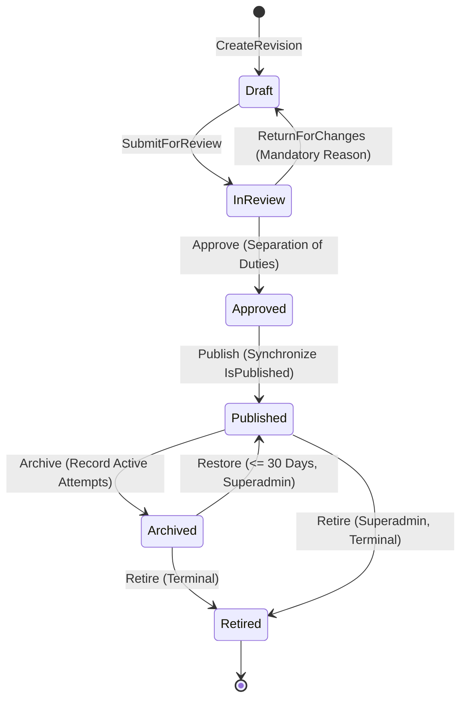

# PrepFord Examination Management — P3.1 Consolidated Implementation Specification

**Phase:** P3.1 — Examination Domain Foundation  
**Status:** SPECIFICATION COMPLETE — AWAITING IMPLEMENTATION AUTHORIZATION  
**Specification Date:** 3 November 2026  
**Decision Authority:** PrepFord Product Owner  

---

## 1. Executive Summary & Approval Baseline

This document provides the consolidated, internally consistent technical implementation specification for Phase P3.1 (Examination Domain Foundation). It synthesizes all fifteen owner-approved decisions (D1–D15) from `docs/exam-management-p3-1-owner-approved-decision-register.md` and `docs/exam-management-p3-1-final-owner-decision-register.md`.

### 1.1 Scope Boundaries
- **In Scope for this Specification:** Complete domain modeling, schema definitions, lifecycle transition rules, authorization policies, code generation algorithms, JSONB snapshot contracts, concurrency management, and PostgreSQL verification preflight.
- **Authorization Boundary:** This specification documents the target implementation. In accordance with Section 5 of the Final Owner Decision Register, application code changes, EF Core migrations, database mutations, and frontend modifications remain pending explicit implementation authorization.

### 1.2 Summary of Approved Policies
1. **D1 (Architecture):** Separate stable `Examination` identity + version-specific `Exam` revision model (Option B).
2. **D2 (Lifecycle):** 6-state lifecycle: `Draft`, `InReview`, `Approved`, `Published`, `Archived`, `Retired`.
3. **D3 (Snapshot):** Immutable, server-generated metadata snapshot captured at attempt initialization.
4. **D4 (Separation of Duties):** Revision creator cannot approve that revision.
5. **D5 (Concurrency):** Application-managed optimistic concurrency token on revision rows.
6. **D6 & D9 (Exam Code):** Sequential, pathway-scoped codes (`RN-EX-000001` / `PN-EX-000001`) allocated at stable identity creation.
7. **D7 (Publication Source):** Lifecycle state is canonical source of truth; `IsPublished` is a derived compatibility bridge.
8. **D8 (Verification):** Dedicated local isolated PostgreSQL verification (`prepford_gateb_verification`).
9. **D10 (Role Authority):** Reviewer recommends/returns; Admin approves; Exam Manager publishes; Content Manager has no exam lifecycle authority by default.
10. **D11 (Admin Overrides):** Narrow, explicitly audited administrative overrides; historical attempts/snapshots cannot be rewritten.
11. **D12 (Instructor Access):** Instructors view `Published` examinations only.
12. **D13 (Restoration & Retirement):** 30-calendar-day restoration window from `Archived`; retirement is terminal; revival requires successor link.
13. **D14 (Archival with Active Attempts):** Archiving blocks new attempts; existing in-progress attempts continue undisturbed; active attempt count recorded.
14. **D15 (Snapshot Storage):** Versioned JSONB snapshot on `ExamAttempt` + relational `ExamAttemptQuestion` membership.

---

## 2. Domain Entity Model & Schema Specification

The target domain model builds additively upon the existing ASP.NET Core EF Core architecture without disrupting Gate C candidate integrity guarantees.

```text
┌─────────────────────────────────┐
│          Examination            │
│  (Stable Examination Identity)  │
├─────────────────────────────────┤
│ Id (PK, Guid)                   │
│ Pathway (RN / PN)               │
│ Code (RN-EX-000001)             │
│ Title / FamilyName              │
│ CreatedAtUtc                    │
│ CreatedBy                       │
│ CurrentRevisionId (FK, nullable)│
│ SuccessorExaminationId (FK, opt)│
└────────────────┬────────────────┘
                 │ 1
                 │
                 │ *
┌────────────────┴────────────────┐
│              Exam               │
│      (Revision Entity)          │
├─────────────────────────────────┤
│ Id (PK, Guid)                   │
│ ExaminationId (FK -> Examination)│
│ RevisionNumber (int, 1..N)      │
│ LifecycleState (Enum)           │
│ ConcurrencyToken (long)         │
│ Title                           │
│ Description                     │
│ Pathway                         │
│ ExamType                        │
│ TimeLimitMinutes                │
│ PassingScorePercent             │
│ IsPublished (Compat Derived)    │
│ CreatedBy, CreatedAtUtc         │
│ SubmittedBy, SubmittedAtUtc     │
│ ReviewedBy, ReviewedAtUtc       │
│ ApprovedBy, ApprovedAtUtc       │
│ PublishedBy, PublishedAtUtc     │
│ ArchivedBy, ArchivedAtUtc       │
│ RetiredBy, RetiredAtUtc         │
└───────┬──────────────────┬──────┘
        │ 1                │ 1
        │                  │
        │ *                │ *
┌───────┴──────────┐ ┌─────┴──────────────────────────────────┐
│   ExamQuestion   │ │                 ExamAttempt            │
│  (Revision Item) │ │             (Candidate Attempt)        │
└──────────────────┘ ├────────────────────────────────────────┤
                     │ Id (PK, Guid)                          │
                     │ ExamId (FK -> Exam revision)           │
                     │ CandidateId                            │
                     │ Status (InProgress, Submitted, etc.)   │
                     │ StartedAtUtc, SubmittedAtUtc           │
                     │ Score, IsPassed                        │
                     │ MetadataSnapshot (JSONB, Nullable)     │
                     └───────────────────┬────────────────────┘
                                         │ 1
                                         │
                                         │ *
                     ┌───────────────────┴────────────────────┐
                     │          ExamAttemptQuestion           │
                     │   (Authoritative Relational Members)   │
                     ├────────────────────────────────────────┤
                     │ AttemptId (PK, FK)                     │
                     │ QuestionId (PK, FK)                    │
                     │ SequenceNumber                         │
                     │ Response / Grading Data                │
                     └────────────────────────────────────────┘
```

### 2.1 `Examination` Entity (Stable Identity)
```csharp
public class Examination
{
    public Guid Id { get; set; } = Guid.NewGuid();
    public string Pathway { get; set; } = string.Empty; // "RN" or "PN"
    public string Code { get; set; } = string.Empty; // e.g., "RN-EX-000001"
    public string Title { get; set; } = string.Empty;
    public DateTime CreatedAtUtc { get; set; } = DateTime.UtcNow;
    public string CreatedBy { get; set; } = string.Empty;

    public Guid? CurrentRevisionId { get; set; }
    public Exam? CurrentRevision { get; set; }

    public Guid? SuccessorExaminationId { get; set; }
    public Examination? SuccessorExamination { get; set; }

    public ICollection<Exam> Revisions { get; set; } = new List<Exam>();
}
```

**Database Constraints & Indexes:**
- Primary Key: `Id`
- Unique Index: `(Pathway, Code)` (and global unique index on `Code`)
- Foreign Key: `SuccessorExaminationId` references `Examination(Id)` (ON DELETE RESTRICT)

### 2.2 `Exam` Entity (Revision Configuration)
```csharp
public enum ExamLifecycleState
{
    Draft = 1,
    InReview = 2,
    Approved = 3,
    Published = 4,
    Archived = 5,
    Retired = 6
}

public class Exam
{
    public Guid Id { get; set; } = Guid.NewGuid();
    public Guid ExaminationId { get; set; }
    public Examination? Examination { get; set; }

    public int RevisionNumber { get; set; } = 1;
    public ExamLifecycleState LifecycleState { get; set; } = ExamLifecycleState.Draft;
    public long ConcurrencyToken { get; set; } = 1;

    // Examination Settings
    public string Title { get; set; } = string.Empty;
    public string? Description { get; set; }
    public string Pathway { get; set; } = string.Empty;
    public string ExamType { get; set; } = "Practice";
    public int TimeLimitMinutes { get; set; } = 120;
    public decimal PassingScorePercent { get; set; } = 75.0m;

    // Compatibility Property (derived/synchronized from LifecycleState == Published)
    public bool IsPublished { get; set; } = false;

    // Audit and Staffing Metadata
    public string CreatedBy { get; set; } = string.Empty;
    public DateTime CreatedAtUtc { get; set; } = DateTime.UtcNow;
    public string? SubmittedBy { get; set; }
    public DateTime? SubmittedAtUtc { get; set; }
    public string? ReviewedBy { get; set; }
    public DateTime? ReviewedAtUtc { get; set; }
    public string? ApprovedBy { get; set; }
    public DateTime? ApprovedAtUtc { get; set; }
    public string? PublishedBy { get; set; }
    public DateTime? PublishedAtUtc { get; set; }
    public string? ArchivedBy { get; set; }
    public DateTime? ArchivedAtUtc { get; set; }
    public string? RetiredBy { get; set; }
    public DateTime? RetiredAtUtc { get; set; }

    // Navigation properties
    public ICollection<ExamQuestion> ExamQuestions { get; set; } = new List<ExamQuestion>();
    public ICollection<ExamAttempt> Attempts { get; set; } = new List<ExamAttempt>();
}
```

**Database Constraints & Indexes:**
- Primary Key: `Id`
- Foreign Key: `ExaminationId` references `Examination(Id)` (ON DELETE RESTRICT)
- Unique Index: `(ExaminationId, RevisionNumber)`
- Indexes: `LifecycleState`, `Pathway`, `IsPublished`

### 2.3 `ExamAttempt` Entity Updates
```csharp
public class ExamAttempt
{
    public Guid Id { get; set; }
    public Guid ExamId { get; set; } // Points to exact Exam revision row
    public Exam? Exam { get; set; }

    public string CandidateId { get; set; } = string.Empty;
    public string Status { get; set; } = "InProgress";
    public DateTime StartedAtUtc { get; set; } = DateTime.UtcNow;
    public DateTime? SubmittedAtUtc { get; set; }

    public decimal? ScorePercent { get; set; }
    public bool? IsPassed { get; set; }

    // Immutable metadata snapshot stored as PostgreSQL JSONB
    public string? MetadataSnapshot { get; set; }

    public ICollection<ExamAttemptQuestion> AttemptQuestions { get; set; } = new List<ExamAttemptQuestion>();
}
```

---

## 3. Examination Code Allocation System

### 3.1 Format Specification
- Registered Nursing: `RN-EX-000001`
- Practical Nursing: `PN-EX-000001`
- Numeric range: `000001` to `999999` (6 digits zero-padded).
- Sequences are pathway-isolated.

### 3.2 Allocation Mechanism
PostgreSQL database sequences provide transaction-safe, atomic allocation:
```sql
CREATE SEQUENCE IF NOT EXISTS exam_code_rn_seq START WITH 1 INCREMENT BY 1;
CREATE SEQUENCE IF NOT EXISTS exam_code_pn_seq START WITH 1 INCREMENT BY 1;
```

Allocation algorithm in `ExaminationCodeService`:
1. Validate requested pathway (`"RN"` or `"PN"`).
2. In the same database transaction as the `Examination` insert:
   - For RN: Execute `SELECT nextval('exam_code_rn_seq');`
   - For PN: Execute `SELECT nextval('exam_code_pn_seq');`
3. Format as `$"RN-EX-{val:D6}"` or `$"PN-EX-{val:D6}"`.
4. Assign to `Examination.Code`.
5. On transaction abort or rollback, the counter advances without leaving orphaned database rows (standard PostgreSQL sequence behavior).
6. Hard constraint `UNIQUE (Code)` prevents duplicate collisions.

---

## 4. Lifecycle State Machine & Transition Logic



### 4.1 State Transition Validation Matrix

| Action | From State | To State | Role Authorized | Business Rules & Invariants | Audit Event |
|---|---|---|---|---|---|
| `CreateRevision` | None / Published | `Draft` | Exam Manager, Admin | `RevisionNumber = Max(Existing) + 1` | `ExamRevisionCreated` |
| `SubmitForReview` | `Draft` | `InReview` | Exam Manager, Admin | Revision must contain >= 1 question; valid settings | `ExamRevisionSubmitted` |
| `ReturnForChanges`| `InReview` | `Draft` | Reviewer, Admin | Reason required (non-empty string); returns to draft | `ExamRevisionReturned` |
| `Approve` | `InReview` | `Approved` | Admin, Superadmin | **`CreatedBy != ActorId`**; content locked | `ExamRevisionApproved` |
| `Publish` | `Approved` | `Published` | Exam Manager, Admin | Sets `IsPublished = true`; previous revision archived | `ExamRevisionPublished` |
| `Archive` | `Published` | `Archived` | Exam Manager, Admin | **Existing attempts continue; new attempts blocked**; record active attempt count | `ExamRevisionArchived` |
| `Restore` | `Archived` | `Published` | Superadmin | **`NowUtc - ArchivedAtUtc <= 30 Days`**; mandatory reason | `ExamRevisionRestored` |
| `Retire` | `Archived` / `Published` | `Retired` | Exam Manager, Superadmin | **Terminal state**; cannot be undone | `ExamRevisionRetired` |

### 4.2 In-Progress Attempts During Archival
When `Archive` executes:
1. Query active in-progress attempts:
   ```csharp
   int activeCount = await db.ExamAttempts
       .CountAsync(a => a.ExamId == revision.Id && a.Status == "InProgress");
   ```
2. Set `LifecycleState = ExamLifecycleState.Archived`, `IsPublished = false`, `ArchivedAtUtc = DateTime.UtcNow`.
3. In-progress attempts are **unmodified**: candidates can continue answering and submit their attempts.
4. Attempt creation endpoints check `LifecycleState == ExamLifecycleState.Published`; attempts on archived revisions are rejected.
5. Record `activeCount` in the `ExamRevisionArchived` audit log payload.

### 4.3 30-Day Restoration Window & Terminal Retirement
- Restoration is permitted if:
  `DateTime.UtcNow <= revision.ArchivedAtUtc.Value.AddDays(30)`
- If `> 30` days, restoration API rejects with HTTP 422 Unprocessable Entity ("Restoration window has expired. Examination must be retired or cloned.").
- Once in `Retired` state, no transition out of `Retired` is accepted.
- Re-introduction of a retired exam requires creating a new `Examination` with `SuccessorExaminationId = retiredExam.ExaminationId`.

---

## 5. Authorization & Separation of Duties

### 5.1 Role Authority Matrix

| Role | Permitted Actions | Prohibited Actions |
|---|---|---|
| **Superadmin** | Administrative overrides (audited), Restore (<= 30d), Emergency Retire | Silently rewrite attempts, bypass audit, alter grading, self-approve revision |
| **Admin** | Approve revisions, Review, Create, Submit, Archive, Standard Retire | **Approve revisions created by self**, alter attempt grading, rewrite history |
| **Exam Manager**| Create revisions, Submit for review, Publish approved revisions, Archive | **Approve revisions**, alter grading, override lifecycle rules |
| **Reviewer** | Review revision, Return for changes (to Draft), Recommend approval | Approve revision, Publish revision, Edit draft content |
| **Instructor** | **View Published examinations only** | View Draft/InReview/Approved/Archived/Retired, any lifecycle mutations |
| **Content Mgr** | No examination lifecycle approval or publication authority by default | Approve revision, Publish revision, Submit revision |
| **Candidate** | Start attempt and submit responses on eligible Published exams | Any administrative access or viewing unapproved content |

### 5.2 Separation of Duties Enforcement
In `ExamLifecycleService.ApproveAsync(Guid revisionId, string actorId)`:
```csharp
var revision = await _db.Exams.FindAsync(revisionId);
if (revision.CreatedBy.Equals(actorId, StringComparison.OrdinalIgnoreCase))
{
    throw new SecurityException("Separation of duties violation: Creators cannot approve their own revisions.");
}
```

### 5.3 Administrative Override Audit Contract
Every administrative override requires:
- `ActorId`: Identifier of the administrative user.
- `EffectiveRole`: `"admin"` or `"superadmin"`.
- `TargetRevisionId` & `TargetExaminationId`.
- `PreviousState` & `NewState`.
- `Reason`: Minimum 10 characters explaining operational necessity.
- `TimestampUtc`: Server UTC timestamp.
- `OperationType`: `"EmergencyRestore"`, `"ForcedRetirement"`, etc.

---

## 6. Attempt Metadata Snapshot Contract

### 6.1 JSON Schema (Version 1)
Stored in `ExamAttempt.MetadataSnapshot` (`jsonb` column in PostgreSQL):
```json
{
  "$schema": "https://json-schema.org/draft/2020-12/schema",
  "title": "ExamAttemptMetadataSnapshot",
  "type": "object",
  "required": ["schemaVersion", "snapshotCreatedAtUtc", "examination", "revision", "deliverySettings"],
  "properties": {
    "schemaVersion": { "type": "integer", "const": 1 },
    "snapshotCreatedAtUtc": { "type": "string", "format": "date-time" },
    "examination": {
      "type": "object",
      "required": ["id", "code", "pathway"],
      "properties": {
        "id": { "type": "string", "format": "uuid" },
        "code": { "type": "string" },
        "pathway": { "type": "string" }
      }
    },
    "revision": {
      "type": "object",
      "required": ["id", "revisionNumber", "title", "examType", "timeLimitMinutes", "passingScorePercent"],
      "properties": {
        "id": { "type": "string", "format": "uuid" },
        "revisionNumber": { "type": "integer" },
        "title": { "type": "string" },
        "description": { "type": ["string", "null"] },
        "examType": { "type": "string" },
        "timeLimitMinutes": { "type": "integer" },
        "passingScorePercent": { "type": "number" },
        "publishedAtUtc": { "type": ["string", "null"], "format": "date-time" }
      }
    },
    "deliverySettings": {
      "type": "object",
      "properties": {
        "shuffleQuestions": { "type": "boolean" },
        "allowReview": { "type": "boolean" }
      }
    }
  }
}
```

### 6.2 Generation & Legacy Fallback Rules
1. **Creation:** At `POST /api/candidate/exams/{examId}/attempts`, the server populates `MetadataSnapshot` using the current `Exam` revision and `Examination` records. The insert commits atomically with the attempt.
2. **Immutability:** No UPDATE statements ever touch `MetadataSnapshot`.
3. **Legacy Fallback:** If `attempt.MetadataSnapshot == null`:
   - Fallback logic dynamically constructs a transient snapshot DTO from `attempt.Exam`.
   - The response includes `"snapshotSource": "legacy_fallback"`.
   - The database is **not updated** (no fabricated historical records).

---

## 7. Optimistic Concurrency Control

### 7.1 Mechanism
- Every `Exam` revision record contains `ConcurrencyToken` (`long`).
- Incremented on every valid update: `revision.ConcurrencyToken++`.
- Update API requests must supply `expectedConcurrencyToken`.

```csharp
var rowsAffected = await _db.Database.ExecuteSqlInterpolatedAsync($@"
    UPDATE ""Exams""
    SET ""Title"" = {request.Title},
        ""ConcurrencyToken"" = ""ConcurrencyToken"" + 1
    WHERE ""Id"" = {revisionId} AND ""ConcurrencyToken"" = {request.ExpectedConcurrencyToken};
");

if (rowsAffected == 0)
{
    throw new ConcurrencyException("The examination revision has been modified by another administrator.");
}
```
On mismatch: Service returns HTTP 409 Conflict with current revision state.

---

## 8. Publication & Data Migration Bridge

1. **Source of Truth:** `LifecycleState == ExamLifecycleState.Published` is authoritative.
2. **Synchronization Bridge:**
   - Any lifecycle change updating `LifecycleState` automatically syncs `IsPublished`:
     `revision.IsPublished = (revision.LifecycleState == ExamLifecycleState.Published);`
   - Direct writes to `IsPublished` are prohibited in domain services.
3. **Legacy Migration:**
   - Existing `Exam` rows with `IsPublished == true` are initialized to `LifecycleState = Published`.
   - Existing `Exam` rows with `IsPublished == false` are initialized to `LifecycleState = Draft`.
   - Existing attempts remain tied to their existing `ExamId`.

---

## 9. Non-Destructive PostgreSQL Verification Preflight Plan

### 9.1 Verification Objectives
Ensure the local test environment meets all requirements for integration verification:
- PostgreSQL service active and accessible on loopback.
- Guard contract `PREFORM_GATEB_TEST_CONNECTION_STRING` verified.
- Target database `prepford_gateb_verification` verified without modifying production/shared databases.
- Confirm schema capabilities (`jsonb`, sequences, constraints).

### 9.2 Preflight Checklist
- [ ] Verify PostgreSQL service state (`localhost:5432`).
- [ ] Check `PREFORM_GATEB_TEST_CONNECTION_STRING` environment configuration.
- [ ] Confirm presence or create isolated local verification database `prepford_gateb_verification`.
- [ ] Execute non-destructive query confirming Npgsql / JSONB support.
- [ ] Verify test suite isolation guards remain intact.

---

## 10. Status & Next Gate

- **Specification Status:** COMPLETE, INTERNALLY CONSISTENT, OWNER APPROVED.
- **Implementation Status:** PENDING EXPLICIT OWNER IMPLEMENTATION AUTHORIZATION.
