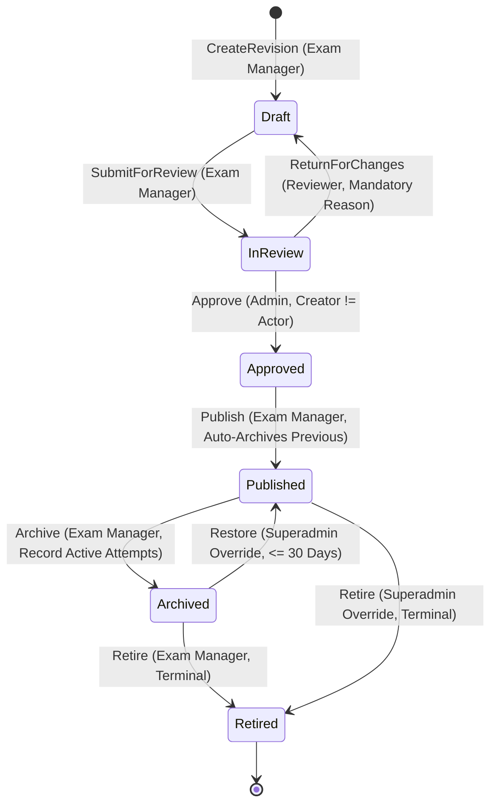

# PrepFord Examination Management — P3.1 Consolidated Implementation Specification

**Phase:** P3.1 — Examination Domain Foundation  
**Stage:** Architecture Review Remediation  
**Status:** SPECIFICATION REMEDIATED & COMPLETE — AWAITING IMPLEMENTATION AUTHORIZATION  
**Specification Date:** 3 November 2026  
**Decision Authority:** PrepFord Product Owner  

---

## 1. Executive Summary & Governance Baseline

This document provides the authoritative, internally consistent technical implementation specification for Phase P3.1 (Examination Domain Foundation). It reflects the complete reconciliation with the existing PrepFord backend codebase and incorporates the resolutions to all findings identified during the architecture review (Findings F-01 through F-08).

### 1.1 Scope & Governance Boundaries
- **In Scope for this Specification:** Complete domain modeling, additive schema definitions, lifecycle state machine, role-based authorization policies, sequence-based examination code allocation, JSONB metadata snapshot contract, EF Core optimistic concurrency control, audit log mapping, and migration inventory protocols.
- **Strict Implementation Safeguard:** This document specifies technical designs only. In strict accordance with the owner's governance mandate, application code modifications, entity/DTO changes, EF Core migrations, and frontend updates remain prohibited until explicit owner implementation authorization is granted.

### 1.2 Preservation of the 15 Owner-Approved Decisions
All fifteen owner-approved architectural and policy decisions are preserved intact without modification:
1. **D1 (Architecture):** Separate stable `Examination` identity + version-specific `Exam` revisions (Option B).
2. **D2 (Lifecycle):** 6-state lifecycle: `Draft`, `InReview`, `Approved`, `Published`, `Archived`, `Retired`.
3. **D3 (Snapshot):** Immutable server-generated metadata snapshot captured atomically at attempt start.
4. **D4 (Separation of Duties):** Revision creator cannot approve that revision (`CreatedBy != currentActorId`).
5. **D5 (Concurrency):** Application-managed optimistic concurrency token on revision rows.
6. **D6 & D9 (Exam Code):** Sequential, pathway-scoped codes (`RN-EX-000001` / `PN-EX-000001`) allocated at stable identity creation.
7. **D7 (Publication Source):** Lifecycle state is canonical source of truth; `IsPublished` is a derived compatibility bridge.
8. **D8 (Verification):** Dedicated local isolated PostgreSQL verification (`prepford_gateb_verification`).
9. **D10 (Role Authority):** Reviewer recommends or returns; Admin approves; Exam Manager publishes; Content Manager has no examination lifecycle authority by default.
10. **D11 (Admin Overrides):** Narrow, explicitly audited administrative overrides; historical attempts/snapshots cannot be rewritten.
11. **D12 (Instructor Access):** Instructors view `Published` examinations only.
12. **D13 (Restoration & Retirement):** 30-calendar-day restoration window from `Archived`; retirement is terminal; revival requires successor link.
13. **D14 (Archival with Active Attempts):** Archiving blocks new attempts; existing in-progress attempts continue undisturbed; active attempt count recorded in audit log.
14. **D15 (Snapshot Storage):** Versioned JSONB snapshot on `ExamAttempt` + relational `ExamAttemptQuestion` membership.

---

## 2. Reconciled Domain Entity Model & Additive Schema

The entity model reconciles the proposed architecture with the actual existing PrepFord backend in `apps/api/Models/Assessments.cs`, `Identity.cs`, and `AppDbContext.cs`. All primary keys in the existing database are represented as `string` (UUID strings), and all existing candidate, scoring, and attempt relationships are preserved without renaming.

```text
┌─────────────────────────────────────────┐
│              Examination                │
│       (Stable Examination Family)       │
├─────────────────────────────────────────┤
│ Id : string (PK, text)                  │
│ Pathway : string (varchar(10), "rn"/"pn")│
│ Code : string (varchar(16), UNIQUE)     │
│ Title : string (varchar(128))           │
│ CreatedAt : DateTime (timestamp with tz)│
│ CreatedBy : string (varchar(128))       │
│ CurrentRevisionId : string? (FK -> Exam)│
│ SuccessorExaminationId : string? (FK)   │
└────────────────────┬────────────────────┘
                     │ 1
                     │
                     │ *
┌────────────────────┴────────────────────┐
│                  Exam                   │
│         (Revision Configuration)        │
├─────────────────────────────────────────┤
│ Id : string (PK, text)                  │
│ ExaminationId : string (FK -> Exam'n)   │
│ RevisionNumber : int (1..N)             │
│ LifecycleState : ExamLifecycleState     │
│ ConcurrencyToken : long (Concurrency)   │
│ Title : string (varchar(128))           │
│ Description : string (varchar(1024))    │
│ Pathway : string (varchar(10))          │
│ ExamType : ExamType (enum)              │
│ TimeLimitMinutes : int (default 0)      │
│ PassingScorePercent : decimal           │
│ IsPublished : bool (Derived/Compat)     │
│ CreatedAt, UpdatedAt : DateTime         │
│ CreatedBy : string (varchar(128))       │
│ SubmittedBy, SubmittedAt : str?, DT?    │
│ ReviewedBy, ReviewedAt : str?, DT?      │
│ ApprovedBy, ApprovedAt : str?, DT?      │
│ PublishedBy, PublishedAt : str?, DT?    │
│ ArchivedBy, ArchivedAt : str?, DT?      │
│ RetiredBy, RetiredAt : str?, DT?        │
└───────────┬──────────────────────┬──────┘
            │ 1                    │ 1
            │                      │
            │ *                    │ *
┌───────────┴──────────┐ ┌─────────┴──────────────────────────────┐
│     ExamQuestion     │ │                 ExamAttempt            │
│   (Revision Items)   │ │             (Candidate Attempt)        │
├──────────────────────┤ ├────────────────────────────────────────┤
│ Id : string (PK)     │ │ Id : string (PK, text)                 │
│ ExamId : string (FK) │ │ UserId : string (FK -> User)           │
│ QuestionId : string  │ │ ExamId : string (FK -> Exam revision)  │
│ DisplayOrder : int   │ │ Status : AttemptStatus (enum)          │
└──────────────────────┘ │ ScorePercent : decimal                 │
                         │ Passed : bool                          │
                         │ StartedAt : DateTime                   │
                         │ CompletedAt : DateTime?                │
                         │ MetadataSnapshot : string? (JSONB)     │
                         └───────────────────┬────────────────────┘
                                             │ 1
                                             │
                                             │ *
                         ┌───────────────────┴────────────────────┐
                         │          ExamAttemptQuestion           │
                         │   (Authoritative Relational Members)   │
                         ├────────────────────────────────────────┤
                         │ Id : string (PK, text)                 │
                         │ ExamAttemptId : string (FK -> Attempt) │
                         │ QuestionId : string (FK -> Question)   │
                         │ DisplayOrder : int (Ordering)          │
                         │ AssignedAt : DateTime                  │
                         └────────────────────────────────────────┘
```

### 2.1 New Entity: `Examination` (Stable Identity)
```csharp
namespace Preform.Api.Models;

[Table("Examinations", Schema = "public")]
public class Examination
{
    [Key]
    public string Id { get; set; } = Guid.NewGuid().ToString();

    [Required]
    [MaxLength(10)]
    public string Pathway { get; set; } = "rn"; // "rn" or "pn"

    [Required]
    [MaxLength(16)]
    public string Code { get; set; } = string.Empty; // e.g. "RN-EX-000001"

    [Required]
    [MaxLength(128)]
    public string Title { get; set; } = string.Empty;

    public DateTime CreatedAt { get; set; } = DateTime.UtcNow;

    [Required]
    [MaxLength(128)]
    public string CreatedBy { get; set; } = string.Empty;

    [MaxLength(128)]
    public string? CurrentRevisionId { get; set; }
    public Exam? CurrentRevision { get; set; }

    [MaxLength(128)]
    public string? SuccessorExaminationId { get; set; }
    public Examination? SuccessorExamination { get; set; }

    public ICollection<Exam> Revisions { get; set; } = new List<Exam>();
}
```

### 2.2 Additive Extension to `Exam` (Revision Configuration)
```csharp
namespace Preform.Api.Models;

public enum ExamLifecycleState
{
    Draft = 1,
    InReview = 2,
    Approved = 3,
    Published = 4,
    Archived = 5,
    Retired = 6
}

// Extends existing Exam model in apps/api/Models/Assessments.cs
public partial class Exam
{
    // Existing fields preserved:
    // Id (string), Title (string), Description (string), Pathway (string),
    // ExamType (ExamType), TimeLimitMinutes (int), PassingScorePercent (decimal),
    // IsPublished (bool), CreatedAt (DateTime), UpdatedAt (DateTime),
    // ExamQuestions, Attempts

    // Additive P3.1 Foundation Fields:
    [Required]
    public string ExaminationId { get; set; } = string.Empty;
    public Examination Examination { get; set; } = null!;

    public int RevisionNumber { get; set; } = 1;

    public ExamLifecycleState LifecycleState { get; set; } = ExamLifecycleState.Draft;

    [ConcurrencyCheck]
    public long ConcurrencyToken { get; set; } = 1;

    // Staffing & Lifecycle Audit Trail
    [Required]
    [MaxLength(128)]
    public string CreatedBy { get; set; } = string.Empty;

    [MaxLength(128)]
    public string? SubmittedBy { get; set; }
    public DateTime? SubmittedAt { get; set; }

    [MaxLength(128)]
    public string? ReviewedBy { get; set; }
    public DateTime? ReviewedAt { get; set; }

    [MaxLength(128)]
    public string? ApprovedBy { get; set; }
    public DateTime? ApprovedAt { get; set; }

    [MaxLength(128)]
    public string? PublishedBy { get; set; }
    public DateTime? PublishedAt { get; set; }

    [MaxLength(128)]
    public string? ArchivedBy { get; set; }
    public DateTime? ArchivedAt { get; set; }

    [MaxLength(128)]
    public string? RetiredBy { get; set; }
    public DateTime? RetiredAt { get; set; }
}
```

### 2.3 Additive Extension to `ExamAttempt`
```csharp
// Extends existing ExamAttempt model in apps/api/Models/Assessments.cs
public partial class ExamAttempt
{
    // Existing fields preserved:
    // Id (string), UserId (string), ExamId (string), Status (AttemptStatus),
    // ScorePercent (decimal), Passed (bool), StartedAt (DateTime), CompletedAt (DateTime?),
    // Responses (ICollection<AttemptResponse>)

    // Additive P3.1 Attempt Metadata Snapshot:
    [Column(TypeName = "jsonb")]
    public string? MetadataSnapshot { get; set; }

    // Relationship to exact question set preserved:
    // ExamAttemptQuestions (ICollection<ExamAttemptQuestion>)
}
```

### 2.4 Entity Framework Core Model Configuration (`AppDbContext.cs`)
```csharp
// In AppDbContext.OnModelCreating(ModelBuilder modelBuilder):

// 1. Examination (Stable Identity)
modelBuilder.Entity<Examination>(entity =>
{
    entity.ToTable("Examinations", "public");
    entity.HasKey(e => e.Id);
    entity.Property(e => e.Id).HasColumnType("text");
    entity.Property(e => e.Code).IsRequired().HasMaxLength(16);
    entity.Property(e => e.Pathway).IsRequired().HasMaxLength(10);
    entity.Property(e => e.Title).IsRequired().HasMaxLength(128);
    entity.Property(e => e.CreatedBy).IsRequired().HasMaxLength(128);

    entity.HasIndex(e => e.Code).IsUnique();
    entity.HasIndex(e => new { e.Pathway, e.Code }).IsUnique();

    entity.HasOne(e => e.SuccessorExamination)
          .WithMany()
          .HasForeignKey(e => e.SuccessorExaminationId)
          .OnDelete(DeleteBehavior.Restrict);

    entity.HasOne(e => e.CurrentRevision)
          .WithMany()
          .HasForeignKey(e => e.CurrentRevisionId)
          .OnDelete(DeleteBehavior.SetNull);
});

// 2. Exam (Revision Entity)
modelBuilder.Entity<Exam>(entity =>
{
    entity.Property(e => e.ExaminationId).IsRequired().HasColumnType("text");
    entity.Property(e => e.RevisionNumber).IsRequired();
    entity.Property(e => e.LifecycleState).IsRequired();
    entity.Property(e => e.ConcurrencyToken).IsConcurrencyToken();

    entity.HasOne(e => e.Examination)
          .WithMany(ex => ex.Revisions)
          .HasForeignKey(e => e.ExaminationId)
          .OnDelete(DeleteBehavior.Restrict);

    // Invariant: Unique revision numbers per Examination
    entity.HasIndex(e => new { e.ExaminationId, e.RevisionNumber }).IsUnique();

    // Invariant: At most one revision may be Published per Examination family
    entity.HasIndex(e => e.ExaminationId)
          .HasDatabaseName("IX_Exams_ExaminationId_SinglePublished")
          .HasFilter(@"""LifecycleState"" = 4")
          .IsUnique();

    // Invariant: At most one revision may be actively in Draft per Examination family
    entity.HasIndex(e => e.ExaminationId)
          .HasDatabaseName("IX_Exams_ExaminationId_ActiveDraft")
          .HasFilter(@"""LifecycleState"" = 1")
          .IsUnique();

    entity.HasIndex(e => e.LifecycleState);
});

// 3. ExamAttempt Updates
modelBuilder.Entity<ExamAttempt>(entity =>
{
    entity.Property(ea => ea.MetadataSnapshot).HasColumnType("jsonb");
});
```

---

## 3. Examination Code Allocation System

### 3.1 Format Specification
- Registered Nursing: `RN-EX-000001`
- Practical Nursing: `PN-EX-000001`
- Range: `000001` to `999999` (6 digits, zero-padded).
- Assigned strictly upon creation of the stable `Examination` family, retained permanently across all subsequent revisions.

### 3.2 PostgreSQL Sequence Mechanics & Gapping Invariants
```sql
CREATE SEQUENCE IF NOT EXISTS exam_code_rn_seq 
    START WITH 1 
    INCREMENT BY 1 
    MINVALUE 1 
    MAXVALUE 999999 
    NO CYCLE;

CREATE SEQUENCE IF NOT EXISTS exam_code_pn_seq 
    START WITH 1 
    INCREMENT BY 1 
    MINVALUE 1 
    MAXVALUE 999999 
    NO CYCLE;
```

**Key Technical Rules:**
1. **Non-Transactional Allocation:** In PostgreSQL, calling `nextval()` advances the sequence immediately and is **not rolled back** if the enclosing transaction fails or aborts.
2. **Gap Tolerance:** Aborted creation attempts will leave numerical gaps in the sequence. In accordance with approved Decision 1 (D6 & D9), **numerical gaps are acceptable**; uniqueness and pathway isolation are the enforced invariants.
3. **Safe Ceiling:** The `MAXVALUE 999999 NO CYCLE` clause prevents silent wrapping. If the sequence is exhausted, an error is thrown, preventing duplicate code allocation.
4. **Permanent Immutability:** `Examination.Pathway` and `Examination.Code` can never be edited or reassigned after initial insert.

---

## 4. Lifecycle State Machine & Invariants



### 4.1 State Transition Validation Matrix

| Action | From State | To State | Permitted Role | Preconditions & Invariants | Audit Event (`AuditLog.Action`) |
|---|---|---|---|---|---|
| `CreateRevision` | None / Published | `Draft` | Exam Manager | Parent `Examination` exists; at most one active `Draft` per Examination; `RevisionNumber = Max + 1` | `ExamRevisionCreated` |
| `SubmitForReview` | `Draft` | `InReview` | Exam Manager | Contains >= 1 question; valid title, pathway, duration; locks editing | `ExamRevisionSubmitted` |
| `RecommendApproval` | `InReview` | `InReview` | Reviewer | Clinical review completed; advisory audit event; does NOT change state | `ExamRevisionReviewRecommended` |
| `ReturnForChanges` | `InReview` | `Draft` | Reviewer | Mandatory non-empty reason; unlocks for author edits | `ExamRevisionReturnedForChanges` |
| `Approve` | `InReview` | `Approved` | Admin | **Separation of duties: `CreatedBy != ActorId`**; content locked | `ExamRevisionApproved` |
| `Publish` | `Approved` | `Published` | Exam Manager | **Atomically archives previous Published revision**; syncs `IsPublished = true` | `ExamRevisionPublished` |
| `Archive` | `Published` | `Archived` | Exam Manager | **Existing attempts continue undisturbed**; new attempts blocked; records active attempt count | `ExamRevisionArchived` |
| `Restore` | `Archived` | `Published` | Superadmin (Override) | **`Now <= ArchivedAt + 30 Days`**; mandatory reason; **no other revision is currently Published** | `ExamRevisionRestored` |
| `Retire` | `Archived` | `Retired` | Exam Manager | **Terminal state**; cannot be undone | `ExamRevisionRetired` |
| `EmergencyRetire` | `Published` | `Retired` | Superadmin (Override) | Terminal state; mandatory reason; archives active revision | `ExamLifecycleOverride` |

### 4.2 Revision and Publication Invariants
1. **Single Published Revision Enforcement:**
   When an `Approved` revision is published:
   ```csharp
   // Executed inside an explicit database transaction:
   var existingPublished = await db.Exams
       .FirstOrDefaultAsync(e => e.ExaminationId == revision.ExaminationId 
                              && e.LifecycleState == ExamLifecycleState.Published);

   if (existingPublished != null)
   {
       int activeAttempts = await db.ExamAttempts
           .CountAsync(a => a.ExamId == existingPublished.Id && a.Status == AttemptStatus.InProgress);

       existingPublished.LifecycleState = ExamLifecycleState.Archived;
       existingPublished.IsPublished = false;
       existingPublished.ArchivedAt = DateTime.UtcNow;
       existingPublished.ArchivedBy = actorId;

       // Log archive event with active attempts count
       db.AuditLogs.Add(CreateAuditLog(actorId, "ExamRevisionArchived", existingPublished.Id, new {
           reason = "Superseded by new revision publication",
           activeAttemptsCount = activeAttempts,
           supersededByRevisionId = revision.Id
       }));
   }

   revision.LifecycleState = ExamLifecycleState.Published;
   revision.IsPublished = true;
   revision.PublishedAt = DateTime.UtcNow;
   revision.PublishedBy = actorId;

   revision.Examination.CurrentRevisionId = revision.Id;
   await db.SaveChangesAsync();
   ```
2. **Restoration Guard Against Dual-Published Inconsistency:**
   If a Superadmin attempts to restore an `Archived` revision within the 30-day window, the service checks whether another revision under that `ExaminationId` is currently `Published`. If yes, restoration is rejected with HTTP 422 Unprocessable Entity. The administrator must first archive the current published revision before restoring the older revision.

---

## 5. Reconciled Role-Based Authorization & Separation of Duties

### 5.1 Canonical Authority Matrix

| Role | Lifecycle Actions Authorized | Strict Governance Prohibitions |
|---|---|---|
| **Reviewer** | `Review`, `RecommendApproval`, `ReturnForChanges` | **Cannot approve**; cannot publish; cannot edit draft content |
| **Admin** | `Approve` eligible revisions | **Cannot approve own revision**; **cannot publish**; cannot return for changes |
| **Exam Manager** | `CreateRevision`, `EditDraft`, `SubmitForReview`, `Publish`, `Archive`, `Retire` | **Cannot approve revisions**; cannot bypass review |
| **Content Manager** | *None* by default for examination lifecycle | Cannot create, submit, review, approve, or publish examinations |
| **Instructor** | View **Published** examinations only | **Cannot view Draft, InReview, Approved, Archived, or Retired exams**; no mutations |
| **Candidate** | View/take eligible **Published** examinations | No access to unpublished content; cannot view unfinalized scoring details |
| **Superadmin** | Exceptional audited overrides only (`EmergencyRestore`, `EmergencyRetire`) | **Excluded from ordinary approvals and ordinary publication**; cannot rewrite attempts |

### 5.2 Separation of Duties Enforcement
Enforced in `ExamLifecycleService.ApproveAsync(string revisionId, ClaimsPrincipal user)`:
```csharp
var actorId = user.FindFirst(ClaimTypes.NameIdentifier)?.Value;
if (string.IsNullOrWhiteSpace(actorId))
{
    throw new UnauthorizedAccessException("Authentication required.");
}

var revision = await _db.Exams.FindAsync(revisionId);
if (revision == null) throw new NotFoundException("Revision not found.");

if (string.Equals(revision.CreatedBy, actorId, StringComparison.OrdinalIgnoreCase))
{
    throw new SecurityException("Separation of duties violation: The revision creator cannot approve this revision.");
}
```

---

## 6. Attempt Metadata Snapshot Contract

### 6.1 Storage & Relational Boundaries
- Stored as a PostgreSQL `jsonb` document in `ExamAttempt.MetadataSnapshot`.
- **Relational Independence:** `ExamAttemptQuestion` remains the exact, authoritative source of truth for question membership, display ordering (`DisplayOrder`), and attempt responses (`AttemptResponse`).
- **No Scoring Leakage:** The snapshot never duplicates question text, candidate responses, answer keys, or grading outcomes.

### 6.2 JSON Snapshot Schema (`schemaVersion = 1`)
```json
{
  "schemaVersion": 1,
  "snapshotCreatedAtUtc": "2026-11-03T11:00:00Z",
  "examination": {
    "id": "exam_fam_001",
    "code": "RN-EX-000001",
    "pathway": "rn",
    "title": "Comprehensive Nursing Licensure Exam"
  },
  "revision": {
    "id": "exam_rev_001",
    "revisionNumber": 1,
    "title": "Comprehensive Nursing Licensure Exam - Core Practice",
    "description": "Standard preparatory practice exam for RN candidates.",
    "examType": 1,
    "timeLimitMinutes": 150,
    "passingScorePercent": 75.0,
    "publishedAt": "2026-11-01T08:00:00Z"
  },
  "deliverySettings": {
    "shuffleQuestions": true,
    "allowReview": true
  }
}
```

### 6.3 Generation, Immutability & Fallback Rules
1. **Generation:** Captured atomically during `ExamAttemptsController.StartAttempt` inside the attempt initialization transaction.
2. **Application-Wide Immutability:** No API endpoint, background worker, or administrative flow allows modification of `MetadataSnapshot` after insert.
3. **Legacy Fallback Specification:**
   - If `attempt.MetadataSnapshot == null`: The read endpoint queries the associated `Exam` revision record dynamically and sets `"snapshotSource": "legacy_fallback"`.
   - **Documentation Invariant:** The system explicitly notes that this fallback represents the *current* state of the associated revision and does not claim to reconstruct historical modifications if the legacy record was altered prior to P3.1. Zero retroactive writes to `MetadataSnapshot` are performed.
4. **Future Schema Version Handling:** If `schemaVersion > 1`, deserialization gracefully parses known envelope properties and preserves raw payload without throwing exceptions.

---

## 7. Optimistic Concurrency Control

### 7.1 EF Core Integration
- Configured via `modelBuilder.Entity<Exam>().Property(e => e.ConcurrencyToken).IsConcurrencyToken();`.
- Initialized to `1` on creation.
- On each valid update, the service layer increments: `revision.ConcurrencyToken++;`.
- The update predicate verifies the concurrency token. If another transaction modified the row concurrently, EF Core throws `DbUpdateConcurrencyException`.

### 7.2 Conflict Resolution & Audit
- The API intercepts `DbUpdateConcurrencyException` and responds with **HTTP 409 Conflict**:
  ```json
  {
    "error": "ConcurrencyConflict",
    "message": "The examination revision has been modified by another administrator.",
    "currentRevisionNumber": 1,
    "currentConcurrencyToken": 2
  }
  ```
- The conflict event is written to `AuditLogs` with `Outcome = "Conflict"`.

---

## 8. Audit Infrastructure & Archival Race Protection

### 8.1 Reuse of Existing `AuditLog` Entity
All examination lifecycle transitions and administrative overrides map directly to the existing `AuditLog` model (`apps/api/Models/Identity.cs`):

| `AuditLog` Field | Mapping for Examination Lifecycle |
|---|---|
| `Id` | `Guid.NewGuid().ToString()` |
| `ActorId` | `user.FindFirst(ClaimTypes.NameIdentifier)?.Value` |
| `Action` | One of `ExamRevisionCreated`, `ExamRevisionSubmitted`, `ExamRevisionReviewRecommended`, `ExamRevisionReturnedForChanges`, `ExamRevisionApproved`, `ExamRevisionPublished`, `ExamRevisionArchived`, `ExamRevisionRestored`, `ExamRevisionRetired`, `ExamLifecycleOverride` |
| `EntityType` | `"Exam"` (for revision actions) or `"Examination"` (for family actions) |
| `EntityId` | `Exam.Id` or `Examination.Id` |
| `Description` | Serialized JSON containing `{ previousState, newState, reason, activeAttemptsCount, revisionNumber, examinationCode }` |
| `Outcome` | `"Success"` or `"Conflict"` |
| `IpAddress` | `HttpContext.Connection.RemoteIpAddress?.ToString()` |
| `Timestamp` | `DateTime.UtcNow` |

### 8.2 Archival vs Attempt Initialization Race Condition Guard
To ensure a candidate attempt cannot start on an examination at the exact moment it is being archived:
- `ExamAttemptsController.StartAttempt` queries the revision within an explicit transaction:
  ```csharp
  var exam = await db.Exams.FirstOrDefaultAsync(e => e.Id == request.ExamId 
                                                  && e.LifecycleState == ExamLifecycleState.Published);
  if (exam == null)
  {
      return UnprocessableEntity(new { error = "ExamNotAvailable", message = "Examination is not published for new attempts." });
  }
  ```
- If an archival operation commits prior to the attempt insertion, the attempt transaction detects that `LifecycleState != Published` and aborts cleanly.
- Existing in-progress attempts (`AttemptStatus.InProgress`) are unaffected and may be completed normally.

---

## 9. Non-Destructive Legacy Publication Migration Plan

### 9.1 Database Inventory Protocol
Before applying any migration to existing environments, run the following read-only inventory script:
```sql
SELECT 
    e."Id", e."Title", e."Pathway", e."IsPublished", e."CreatedAt",
    (SELECT COUNT(*) FROM public."ExamAttempts" a WHERE a."ExamId" = e."Id") AS "AttemptCount",
    (SELECT COUNT(*) FROM public."ExamQuestions" q WHERE q."ExamId" = e."Id") AS "QuestionCount"
FROM public."Exams" e
ORDER BY e."Pathway", e."CreatedAt";
```

### 9.2 Legacy Record Classification Rules
1. **Safely Mappable (Class A):**
   - Single published exam per pathway with active/completed attempts.
   - Allocate new `Examination` (`RN-EX-000001` / `PN-EX-000001`), assign `RevisionNumber = 1`, set `LifecycleState = Published`, `IsPublished = true`.
2. **Requires Owner Decision (Class B):**
   - Multiple published exams for the same pathway/family (requires owner determination of which is canonical published and which are archived).
   - Unpublished exams (`IsPublished = false`) that possess historical attempts.
3. **Insufficient Evidence (Class C):**
   - Empty, orphaned draft exams without attempts or questions.

---

## 10. Status & Next Gate

- **Specification Status:** REMEDIATED, INTERNALLY CONSISTENT, RECONCILED WITH BACKEND CODEBASE.
- **Review Findings:** ALL 8 FINDINGS (F-01 TO F-08) FULLY RESOLVED.
- **Implementation Status:** PENDING EXPLICIT OWNER IMPLEMENTATION AUTHORIZATION.
