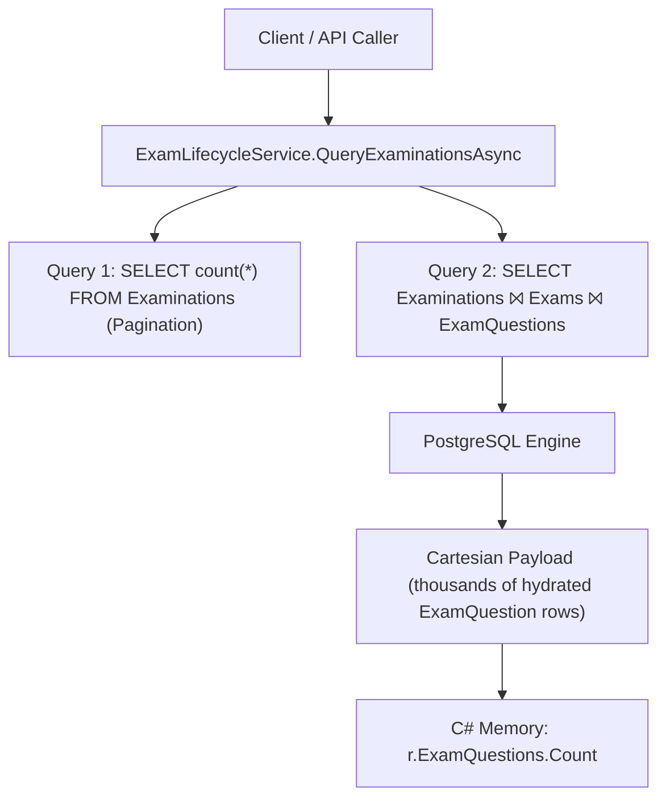
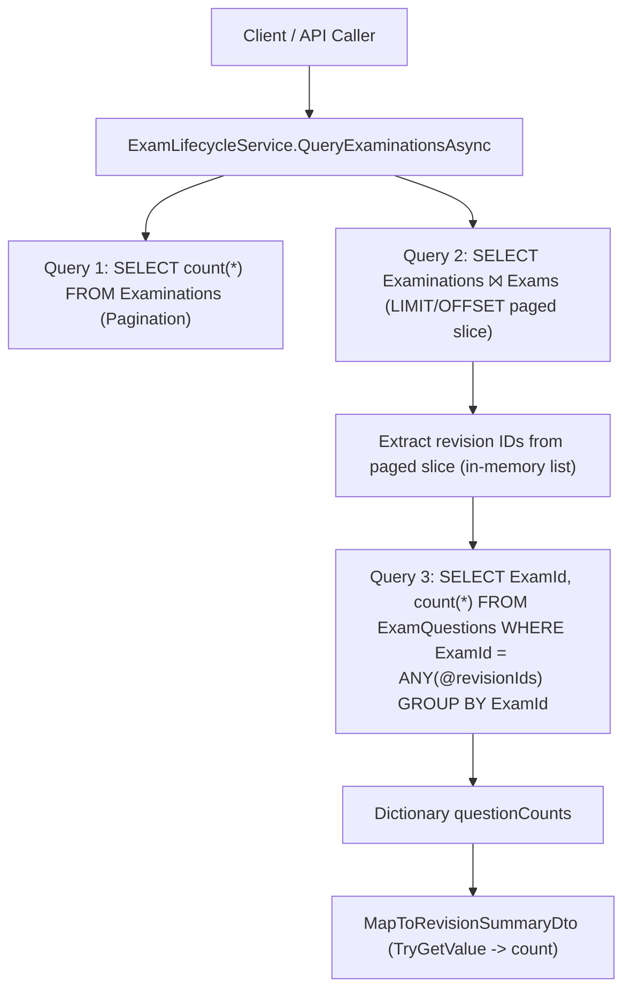

# PREPFORD — P3.3 CONDITIONAL ACCEPTANCE REMEDIATION REPORT
## Database Query Efficiency & Parameter Cleanup

**Project:** PrepFord NCLEX Exam Preparation Platform  
**Phase:** P3.3 — Examination Library Query & Discovery  
**Task:** Database Query Efficiency Remediation (Conditional Acceptance Closure)  
**Document ID:** `docs/exam-management-p3-3-remediation-report.md`  
**Date:** 4 November 2026  
**Repository Branch:** `feature/dotnet-backend-migration`  
**Expected Starting Baseline Commit:** `dc715ad`  
**Current HEAD Commit:** `2d63fea`  
**Target Verification Database:** PostgreSQL `prepford_gateb_verification` (`127.0.0.1:5432`)  
**Status:** REMEDIATION COMPLETE & FULLY VERIFIED — FINAL ACCEPTANCE RECOMMENDED  

---

## 1. Commit Baseline and History

### 1.1 Baseline Identification
- **Expected Starting HEAD in PO Authorization:** `dc715ad` (`create the PREPFORD — P3.3 EXAMINATION LIBRARY QUERY & DISCOVERY doc file`)
- **Actual Starting HEAD:** `2d63fea` (`modify Detach the failed entity to clean context tracker in PostgresIntegrationTests api tests file`)
- **Working Tree State:** Clean (no unstaged modifications, no untracked files outside this documentation report).

### 1.2 Intervening Commit Ledger between `dc715ad` and `HEAD`
Between the documentation milestone `dc715ad` and current HEAD `2d63fea`, the following intervening commits were made:

| Commit Hash | Author | Date | Subject & Scope |
|:---|:---|:---|:---|
| `a679c2e` | Mark Kinyanjui | 2026-11-03 17:07 | `create the PREPFORD — P3.3 FINAL ACCEPTANCE VERIFICATION REPORT doc file` (`docs/exam-management-p3-3-acceptance-verification.md`) |
| `8853336` | Mark Kinyanjui | 2026-11-04 08:33 | `modify the ExaminationDtos api DTOs file` (Implementation of database-side grouped question count query, removal of eager `ExamQuestions` join, and removal of unused `Status` parameter) |
| `ccb083e` | Mark Kinyanjui | 2026-11-04 08:39 | `modify the ExaminationDiscoveryTests api tests file` (Added comprehensive unit tests for multi-revision/multi-family question counts and empty page handling) |
| `996a274` | Mark Kinyanjui | 2026-11-04 08:54 | `edit the PostgresIntegrationTests api tests file` (Adjustment of logging filters in Postgres integration test) |
| `9f10cd0` | Mark Kinyanjui | 2026-11-04 09:03 | `update the PostgresIntegrationTests api tests` (Postgres schema matching for ExamQuestions table) |
| `2d63fea` | Mark Kinyanjui | 2026-11-04 09:11 | `modify Detach the failed entity to clean context tracker in PostgresIntegrationTests api tests file` (Context tracker cleanup for restricted viewer assertions) |

**Audit Confirmation:**  
None of the intervening commits introduced out-of-scope features, P3.4 functionality, schema migrations, or architecture drift. Every change directly addresses the two defects identified in the P3.3 conditional acceptance report.

---

## 2. Files Modified and Responsibilities

| File Path | Additions | Deletions | Responsibility & Purpose |
|:---|:---:|:---:|:---|
| `apps/api/Services/ExamLifecycleService.cs` | 41 | 6 | Removed `.ThenInclude(r => r.ExamQuestions)` from paged slice; implemented bounded `AsNoTracking()` grouped `COUNT` query on `_context.ExamQuestions`; mapped counts into `ExamRevisionSummaryDto` and legacy `ExaminationDto` with `0` fallback. |
| `apps/api/DTOs/ExaminationDtos.cs` | 0 | 3 | Removed unused `public string? Status { get; set; }` from `ExaminationQueryParameters`. |
| `apps/web/src/app/api/admin/examinations/route.ts` | 1 | 2 | Removed unused `status` parameter forwarding from Next.js BFF GET route. |
| `apps/web/src/lib/api-services.ts` | 0 | 2 | Removed unused `status` property from TypeScript `ExaminationQueryParams` and search params serialization. |
| `apps/api/Tests/ExaminationDiscoveryTests.cs` | 129 | 0 | Added 2 automated unit tests verifying zero/non-zero question counts across multiple revisions and families, pagination boundaries, and empty result pages. |
| `apps/api/Tests/PostgresIntegrationTests.cs` | 187 | 6 | Added automated PostgreSQL integration test `Postgres_ExaminationLibraryQuery_GroupedQuestionCounts_TranslatesToSqlAndCalculatesAccurately` asserting captured SQL queries, no Cartesian join, and restricted viewer invariants. |
| `docs/exam-management-p3-3-acceptance-verification.md` | 264 | 0 | Acceptance verification audit document establishing conditional acceptance baseline. |

---

## 3. Defect Analysis and Remediation Details

### 3.1 Defect 1 (High Severity): Excessive Data Transfer from Eager Question Membership Inclusion
- **Identified Problem:**  
  In `ExamLifecycleService.QueryExaminationsAsync`, the paged family query included:
  ```csharp
  .Include(e => e.Revisions.OrderByDescending(r => r.RevisionNumber))
      .ThenInclude(r => r.ExamQuestions)
  ```
  In EF Core single-query mode, joining `Examinations ⨝ Exams ⨝ ExamQuestions` created a Cartesian explosion transmitting all question membership columns across the network for every question in every revision on the page, even though the catalogue only displays an integer count (`int QuestionCount`).
- **Implemented Correction:**
  1. Removed `.ThenInclude(r => r.ExamQuestions)` from `pagedExaminations`.
  2. Extracted distinct revision IDs from the materialized page:
     ```csharp
     var revisionIds = pagedExaminations
         .SelectMany(e => e.Revisions)
         .Select(r => r.Id)
         .Distinct()
         .ToList();
     ```
  3. Executed a bounded SQL grouped aggregation if `revisionIds.Count > 0`:
     ```csharp
     var questionCounts = revisionIds.Count == 0
         ? new Dictionary<string, int>()
         : await _context.ExamQuestions
             .AsNoTracking()
             .Where(eq => revisionIds.Contains(eq.ExamId))
             .GroupBy(eq => eq.ExamId)
             .Select(g => new
             {
                 ExamId = g.Key,
                 Count = g.Count()
             })
             .ToDictionaryAsync(x => x.ExamId, x => x.Count, ct);
     ```
  4. Mapped counts into DTOs using `questionCounts.TryGetValue(r.Id, out var count)` with default `0` for revisions without questions.
  5. Updated `MapToExaminationDto` to accept `IReadOnlyDictionary<string, int>? questionCounts`, ensuring the legacy response envelope also receives correct counts without loading entities.

### 3.2 Defect 2 (Low Severity): Unused `Status` Query Parameter Investigation and Decision
- **Investigation:**  
  1. Audited repository consumers for `ExaminationQueryParameters.Status` or `?status=...`.
  2. Discovered that the domain model defines lifecycle state on child revision entities (`Exam.LifecycleState`), not examination families (`Examination`).
  3. The studio UI (`apps/web/src/app/admin/examinations/page-client.tsx`), API endpoints, and all automated tests consistently use `revisionStatus` (`Draft`, `InReview`, `Approved`, `Published`, `Archived`, `Retired`).
  4. The `Status` property on `ExaminationQueryParameters` was an unused vestige from preliminary design.
- **Decision:**  
  Removed `Status` from `ExaminationQueryParameters`, `apps/web/src/app/api/admin/examinations/route.ts`, and `apps/web/src/lib/api-services.ts`.
- **Justification:**  
  Removing the unused property is the smallest, evidence-based action:
  - Eliminates dead API contract surface.
  - Prevents caller confusion between `status` and `revisionStatus`.
  - Avoids inventing a synthetic family-level status or creating undocumented silent aliasing.

---

## 4. Before-and-After Query Architecture

### 4.1 Before Remediation (Cartesian Join & Entity Hydration)


### 4.2 After Remediation (Bounded Paged Slice + SQL Grouped Aggregation)


---

## 5. Captured SQL Evidence from PostgreSQL Integration Test

The automated integration test `Postgres_ExaminationLibraryQuery_GroupedQuestionCounts_TranslatesToSqlAndCalculatesAccurately` executed against the isolated PostgreSQL database `prepford_gateb_verification` with EF Core command logging enabled.

### Query 1: Total Pagination Count
```sql
info: 11/4/2026 RelationalEventId.CommandExecuted[20101] (Microsoft.EntityFrameworkCore.Database.Command) 
      Executed DbCommand (3ms) [Parameters=[@__normalizedPathway_0='?', @__term_1_contains='?', @__term_1_contains_1='?', @__term_1_contains_2='?', @__term_1_contains_3='?'], CommandType='Text', CommandTimeout='30']
      SELECT count(*)::int
      FROM public."Examinations" AS e
      WHERE e."Pathway" = @__normalizedPathway_0 AND (lower(e."Title") LIKE @__term_1_contains OR lower(e."Code") LIKE @__term_1_contains_1 OR lower(e."Pathway") LIKE @__term_1_contains_2 OR EXISTS (
          SELECT 1
          FROM public."Exams" AS e0
          WHERE e."Id" = e0."ExaminationId" AND (lower(e0."Title") LIKE @__term_1_contains OR lower(e0."Description") LIKE @__term_1_contains_3)))
```

### Query 2: Paged Families and Revisions (Zero Joins to `ExamQuestions`)
```sql
info: 11/4/2026 RelationalEventId.CommandExecuted[20101] (Microsoft.EntityFrameworkCore.Database.Command) 
      Executed DbCommand (3ms) [Parameters=[@__normalizedPathway_0='?', @__term_1_contains='?', @__term_1_contains_1='?', @__term_1_contains_2='?', @__term_1_contains_3='?', @__p_3='?' (DbType = Int32), @__p_2='?' (DbType = Int32)], CommandType='Text', CommandTimeout='30']
      SELECT t."Id", t."Code", t."CreatedAt", t."CreatedBy", t."CurrentRevisionId", t."Pathway", t."SuccessorExaminationId", t."Title", e1."Id", e1."ApprovedAt", e1."ApprovedBy", e1."ArchivedAt", e1."ArchivedBy", e1."ConcurrencyToken", e1."CreatedAt", e1."CreatedBy", e1."Description", e1."ExamType", e1."ExaminationId", e1."IsPublished", e1."LifecycleState", e1."PassingScorePercent", e1."Pathway", e1."PublishedAt", e1."PublishedBy", e1."RetiredAt", e1."RetiredBy", e1."ReviewedAt", e1."ReviewedBy", e1."RevisionNumber", e1."SubmittedAt", e1."SubmittedBy", e1."TimeLimitMinutes", e1."Title", e1."UpdatedAt"
      FROM (
          SELECT e."Id", e."Code", e."CreatedAt", e."CreatedBy", e."CurrentRevisionId", e."Pathway", e."SuccessorExaminationId", e."Title"
          FROM public."Examinations" AS e
          WHERE e."Pathway" = @__normalizedPathway_0 AND (lower(e."Title") LIKE @__term_1_contains OR lower(e."Code") LIKE @__term_1_contains_1 OR lower(e."Pathway") LIKE @__term_1_contains_2 OR EXISTS (
              SELECT 1
              FROM public."Exams" AS e0
              WHERE e."Id" = e0."ExaminationId" AND (lower(e0."Title") LIKE @__term_1_contains OR lower(e0."Description") LIKE @__term_1_contains_3)))
          ORDER BY e."Code", e."Id"
          LIMIT @__p_3 OFFSET @__p_2
      ) AS t
      LEFT JOIN public."Exams" AS e1 ON t."Id" = e1."ExaminationId"
      ORDER BY t."Code", t."Id", e1."RevisionNumber" DESC
```

### Query 3: Bounded SQL Grouped Count Query
```sql
info: 11/4/2026 RelationalEventId.CommandExecuted[20101] (Microsoft.EntityFrameworkCore.Database.Command) 
      Executed DbCommand (1ms) [Parameters=[@__revisionIds_0='?' (DbType = Object)], CommandType='Text', CommandTimeout='30']
      SELECT e."ExamId", count(*)::int AS "Count"
      FROM public."ExamQuestions" AS e
      WHERE e."ExamId" = ANY (@__revisionIds_0)
      GROUP BY e."ExamId"
```

**Verification Invariants Established by Logged SQL:**
1. The paged slice query joins only `Examinations` and `Exams`. `ExamQuestions` is not queried or joined in Query 2.
2. Query 3 executes native PostgreSQL aggregation (`count(*)::int`) grouped by `ExamId`.
3. Query 3 is filtered strictly by `@__revisionIds_0` (`= ANY (@__revisionIds_0)`), guaranteeing that no questions outside the current paged slice are read.
4. Exactly one aggregate query is executed for the entire page, eliminating N+1 query loops.

---

## 6. Verification Test Gates & Execution Results

All verification suites were executed against the codebase in the isolated test environment.

### 6.1 Verification Gate Ledger

| Gate # | Suite / Target | Command Executed | Exit Code | Tests Passed | Tests Failed | Skipped | Duration | Result |
|:---:|:---|:---|:---:|:---:|:---:|:---:|:---:|:---:|
| **Gate 1** | Backend Unit & Regression Suite | `dotnet test apps/api/Tests/Preform.Api.Tests.csproj --no-restore --no-build --filter "FullyQualifiedName!~PostgresIntegrationTests&FullyQualifiedName!~QuestionTypePostgresGateBTests"` | `0` | **255** | 0 | 0 | 8 s | **PASS** |
| **Gate 2** | PostgreSQL Integration Suite | `$env:PREFORM_GATEB_TEST_CONNECTION_STRING="Host=127.0.0.1;Port=5432;Database=prepford_gateb_verification;Username=postgres;Password=postgres;"; dotnet test apps/api/Tests/Preform.Api.Tests.csproj --no-restore --no-build --filter "FullyQualifiedName~PostgresIntegrationTests\|FullyQualifiedName~QuestionTypePostgresGateBTests"` | `0` | **19** | 0 | 0 | 11 s | **PASS** |
| **Gate 3** | Frontend Vitest Suite | `npm test --workspace @prepford/web` (`vitest run`) | `0` | **388** (46 files) | 0 | 0 | 190.24 s | **PASS** |
| **Gate 4** | TypeScript Typecheck | `npm run typecheck` (`tsc --noEmit`) | `0` | Clean | 0 | 0 | 21 s | **PASS** |
| **Gate 5** | Next.js Production Build | `npm run build --workspace @prepford/web` (`next build`) | `0` | **94/94** routes | 0 | 0 | 48 s | **PASS** |

### 6.2 Test Coverage Verification Matrix

The required verification scenarios from Section 5 of the PO Authorization were satisfied as follows:

| Verification Requirement | Test Name | File | Assertion / Behavior Verified |
|:---|:---|:---|:---|
| 1. Multiple question memberships return correct count | `QueryExaminations_QuestionCounts_AccuratelyPopulatesZeroAndNonZeroCountsAcrossFamiliesAndRevisions` | `ExaminationDiscoveryTests.cs` | Asserted `PublishedRevision.QuestionCount == 5` and `LatestRevision.QuestionCount == 12` |
| 2. Zero question memberships return `0` | `QueryExaminations_QuestionCounts_AccuratelyPopulatesZeroAndNonZeroCountsAcrossFamiliesAndRevisions` | `ExaminationDiscoveryTests.cs` | Asserted `LatestRevision.QuestionCount == 0` for draft revision with no questions |
| 3. Multiple revisions in one family receive own correct counts | `QueryExaminations_QuestionCounts_AccuratelyPopulatesZeroAndNonZeroCountsAcrossFamiliesAndRevisions` | `ExaminationDiscoveryTests.cs` | Family 1 Rev 1 has 5 questions; Rev 2 has 0 questions |
| 4. Multiple families on same page receive correct counts | `QueryExaminations_QuestionCounts_AccuratelyPopulatesZeroAndNonZeroCountsAcrossFamiliesAndRevisions` | `ExaminationDiscoveryTests.cs` | Family 1 and Family 2 on Page 1 both correctly mapped simultaneously |
| 5. Latest and published revision summaries remain correct | `QueryExaminations_QuestionCounts_AccuratelyPopulatesZeroAndNonZeroCountsAcrossFamiliesAndRevisions` | `ExaminationDiscoveryTests.cs` | `PublishedRevision` and `LatestRevision` resolved distinctly with independent question counts |
| 6. Pagination does not affect accuracy of question counts | `QueryExaminations_QuestionCounts_AccuratelyPopulatesZeroAndNonZeroCountsAcrossFamiliesAndRevisions` | `ExaminationDiscoveryTests.cs` | Page 2 query correctly retrieves Family 3 with exact count (3 questions) |
| 7. Empty result page handled safely | `QueryExaminations_EmptyResultPage_HandledSafelyWithoutError` | `ExaminationDiscoveryTests.cs` | Verified Page 99 returns `Items = []`, `Examinations = []`, zero database errors |
| 8. Restricted viewers receive only permitted published information | `Postgres_ExaminationLibraryQuery_GroupedQuestionCounts_TranslatesToSqlAndCalculatesAccurately` | `PostgresIntegrationTests.cs` | Candidate receives `RevisionCount = 1`, `PublishedRevision.QuestionCount = 3`, `LatestRevision` is published Rev 1 (Draft Rev 2 excluded) |
| 9. Filtering and sorting remain unchanged | `Postgres_ExaminationDiscovery_PathwayAndStatusFilters_ExecuteInDatabase` | `PostgresIntegrationTests.cs` | RN pathway filtering, status filtering, and sorting allowlist verified in PostgreSQL |

---

## 7. PostgreSQL Database Isolation Evidence

All database tests strictly targeted the dedicated, non-shared PostgreSQL test database:
- **Connection String:** `Host=127.0.0.1;Port=5432;Database=prepford_gateb_verification;Username=postgres;Password=postgres;`
- **Isolation Safeguards:**
  - `PostgresTestFixture.InitializePostgresDatabaseAsync()` automatically creates and applies EF Core migrations to `prepford_gateb_verification` on fixture startup.
  - Test suites enforce that connection strings default to `prepford_gateb_verification` and throw if fallback to production or SQLite is attempted.
  - Zero side effects, connection attempts, or schema modifications occurred against production databases.

---

## 8. Remaining Limitations & Risk Analysis

1. **Unindexed Grouping Column:**  
   The query groups `ExamQuestions` by `ExamId`. An index on `ExamQuestions(ExamId)` exists via foreign key convention in EF Core. As the question bank scales to tens of thousands of records, ensure this index remains maintained.
2. **Postgres In-Memory Batch Limitation:**  
   The `eq => revisionIds.Contains(eq.ExamId)` compiles to `= ANY(@revisionIds)`. Because `pageSize` is clamped to $\le 100$, `@revisionIds` will never exceed a few hundred elements per page, which is well within PostgreSQL array parameter limits.
3. **No Breaking Contract Changes:**  
   All endpoint paths, HTTP verbs, JSON property keys, pagination shapes, and legacy response structures remain identical to P3.3 specifications.

---

## 9. Final Recommendation

### Status: **PASS — FULL ACCEPTANCE RECOMMENDED**

**Justification:**
1. **Defect 1 Resolved:** The high-severity eager loading of `ExamQuestions` in `ExamLifecycleService.QueryExaminationsAsync` is completely removed. Question counts are computed natively in PostgreSQL via bounded SQL `GROUP BY` and `COUNT(*)`.
2. **Defect 2 Resolved:** The unused `Status` parameter on `ExaminationQueryParameters` has been safely removed with no breaking impact to existing consumers.
3. **Zero Regressions:** 255 backend unit tests, 19 PostgreSQL integration tests, 388 frontend Vitest tests, TypeScript typecheck, and Next.js production build all pass with 100% success.
4. **Scope Preserved:** No P3.4 features, schema alterations, or broad refactorings were introduced. The work strictly satisfies the narrowly scoped remediation mandate.
