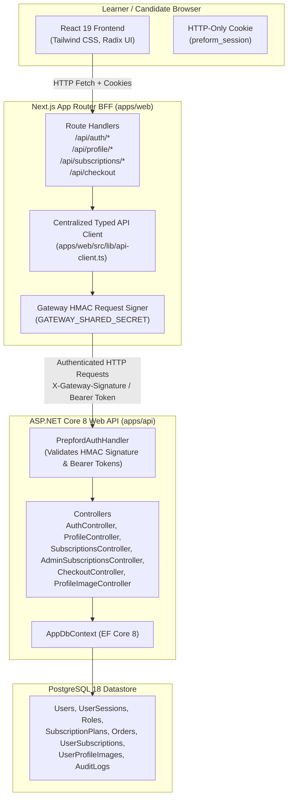

# PrepFord Phase 3 — Frontend API Migration Plan

**Document Version:** 1.0  
**Date:** 2026-10-29  
**Branch:** `feature/dotnet-backend-migration`  
**Target:** Replace direct SQLite access in Next.js (`apps/web`) with typed ASP.NET Core API calls (`apps/api`)

---

## 1. Executive Architecture & BFF Decision

In accordance with the PrepFord target architecture:
- **Next.js App Router (`apps/web`)** functions as the user-facing web application and Backend-for-Frontend (BFF).
- **ASP.NET Core 8 Web API (`apps/api`)** is the sole authoritative business logic and persistence engine.
- **PostgreSQL 18** is the sole authoritative relational datastore.
- **SQLite** is retained during Phase 3 strictly for test isolation and backwards compatibility until Phase 6; its runtime consumers in route handlers and server actions are systematically migrated to ASP.NET Core.



---

## 2. Authentication & Gateway Security Design

### 2.1 The BFF Request Pattern
To prevent identity spoofing, credential leakage, and browser-to-backend CORS complications:
1. **Browser to Next.js BFF:**
   - The browser authenticates using the secure, HTTP-only, SameSite cookie `preform_session`.
   - Next.js validates the HMAC-SHA256 signature and extracts verified candidate claims (`userId`, `email`, `role`, `displayName`).
2. **Next.js BFF to ASP.NET Core:**
   - Next.js dispatches requests to `API_GATEWAY_URL` (default: `http://localhost:5000`).
   - For authenticated operations, Next.js generates a cryptographic HMAC-SHA256 signature using `GATEWAY_SHARED_SECRET`:
     ```text
     payload = "${userId}|${email}|${role}"
     signature = HMAC-SHA256(payload, GATEWAY_SHARED_SECRET)
     ```
   - Headers dispatched with the request:
     - `X-Gateway-Signature: <hex_signature>`
     - `X-Authenticated-User-Id: <userId>`
     - `X-Authenticated-User-Email: <email>`
     - `X-Authenticated-User-Role: <role>`
     - `X-Authenticated-User-Name: <displayName>`
     - `X-Correlation-Id: <unique_request_id>`
3. **ASP.NET Core Verification:**
   - `PrepfordAuthHandler` independently computes the expected HMAC-SHA256 signature using `GATEWAY_SHARED_SECRET`.
   - If the signature matches, it populates `ClaimsPrincipal` with `NameIdentifier`, `Email`, `Role`, and `Name`.
   - Unsigned requests or forged headers are rejected with `401 Unauthorized`.
   - Server-side RBAC policies (`RequireAdmin`, `RequireSuperAdmin`) are enforced directly by ASP.NET Core.

---

## 3. Ordered SQLite Consumer Migration Mapping

| Consumer Route / Service | Current SQLite Operation | Target ASP.NET Core Endpoint | Payload / Contract | Fail-Closed Policy |
| :--- | :--- | :--- | :--- | :--- |
| `POST /api/auth/register` | Inserts into `user_profiles`, `user_sessions` | `POST /api/v1/auth/register` | `RegisterRequest` -> `AuthResponse` | Rejects duplicate emails; sets signed session cookie from backend response. |
| `POST /api/auth/login` | Reads `user_profiles`, writes `user_sessions` | `POST /api/v1/auth/login` | `LoginRequest` -> `AuthResponse` | Validates password hash in backend; sets signed session cookie. |
| `POST /api/auth/logout` | Updates `user_sessions` (`revoked = 1`) | `POST /api/v1/auth/logout` | Authenticated -> `SuccessResponse` | Invalidates session on backend; clears browser cookie. |
| `GET /api/auth/session` | Resolves `user_sessions` & `user_profiles` | `GET /api/v1/auth/session` | Authenticated -> `SessionResponse` | Returns authoritative user identity, active plan, and pathway from PostgreSQL. |
| `GET /api/profile` | Reads metadata from `user_profiles` | `GET /api/v1/profile` | Authenticated -> `UserProfileDto` | Returns profile fields from `Users` table in PostgreSQL. |
| `PUT /api/profile` | Updates metadata in `user_profiles` | `PUT /api/v1/profile` | `UpdateProfileRequest` -> `UserProfileDto` | Server allowlists `displayName`, `targetExamDate`, notification toggles. 403 on role/plan manipulation. |
| `POST /api/profile/change-password` | Revokes sessions in `user_sessions` | `POST /api/v1/profile/change-password` | `ChangePasswordRequest` -> `SuccessResponse` | Verifies current password; revokes all sessions; issues fresh token. |
| `GET /api/profile/image` | Reads binary BLOB from `user_profile_images` | `GET /api/v1/profile/image` | Query `userId` -> Binary stream | Proxies binary image with ETag and cache control headers. |
| `PUT /api/profile/image` | Saves binary BLOB in `user_profile_images` | `PUT /api/v1/profile/image` | Binary stream -> `ProfileImageMetadataDto` | Magic byte validation, 2 MB size check, writes to PostgreSQL `bytea`. |
| `DELETE /api/profile/image`| Deletes BLOB in `user_profile_images` | `DELETE /api/v1/profile/image` | Authenticated -> `SuccessResponse` | Deletes binary image in PostgreSQL; resets flag on `Users`. |
| `GET /api/subscriptions` | Reads from `subscription_plans` | `GET /api/v1/subscriptions` | None -> `SubscriptionCatalogDto` | Returns active plans from PostgreSQL catalog. |
| `apps/web/.../subscriptions/page.tsx` | Calls `getAllSubscriptionPlans()` | Calls API client `getActivePlans()` | None -> `Product[]` | Server Component queries backend API; falls back to static `PRODUCTS` if API unavailable. |
| `GET /api/admin/subscriptions` | Reads all from `subscription_plans` | `GET /api/v1/admin/subscriptions` | Admin auth -> `SubscriptionCatalogDto` | Returns active and inactive plans for admin management. |
| `POST /api/admin/subscriptions` | Inserts into `subscription_plans` | `POST /api/v1/admin/subscriptions` | `CreateSubscriptionPlanDto` -> `SubscriptionPlanDto` | Creates plan in PostgreSQL; enforces admin RBAC. |
| `PUT /api/admin/subscriptions/[id]` | Updates `subscription_plans` | `PUT /api/admin/subscriptions/{id}` | `UpdateSubscriptionPlanDto` -> `SubscriptionPlanDto` | Updates plan in PostgreSQL; enforces admin RBAC. |
| `DELETE /api/admin/subscriptions/[id]`| Sets `is_active = 0` in `subscription_plans` | `DELETE /api/admin/subscriptions/{id}` | Admin auth -> `SuccessResponse` | Soft-deletes / archives plan in PostgreSQL. |
| `POST /api/checkout` | Reads `subscription_plans`, writes profile | `POST /api/v1/checkout` | `CheckoutRequest` -> `CheckoutResponse` | Server resolves plan and price; creates `Order` and `UserSubscription`. |

---

## 4. Resilience and Fail-Closed Security Policy

1. **Strictly Fail-Closed for Mutations & Entitlements:**
   - If `API_GATEWAY_URL` is unreachable or returns a server error, mutations (`PUT /api/profile`, `POST /api/checkout`, `POST /api/admin/subscriptions`) must return an explicit `503 Service Unavailable` or `500 Server Error`.
   - Mutations must **never** silently fall back to writing local SQLite records.
2. **Read-Only Public Resilience:**
   - For public informational views (e.g. public `/subscriptions` pricing cards), if the API gateway is temporarily unavailable during cold-boot, the system may display the verified fallback catalog from `@/lib/products.ts`.
   - Any attempt to purchase or modify an item requires real-time backend API confirmation.

---

## 5. Implementation Sequence

1. **Create `apps/web/src/lib/api-client.ts`:**
   - Centralized typed HTTP client with base URL resolution (`API_GATEWAY_URL`), timeout control, HMAC signature generation, correlation IDs, and unified error mapping.
2. **Create `apps/web/src/lib/api-services.ts`:**
   - Typed service wrappers for Auth, Profiles, Subscriptions, Checkout, and Entitlements.
3. **Migrate Next.js API Routes Domain by Domain:**
   - `apps/web/src/app/api/auth/*`
   - `apps/web/src/app/api/profile/*`
   - `apps/web/src/app/api/subscriptions/*`
   - `apps/web/src/app/api/admin/subscriptions/*`
   - `apps/web/src/app/api/checkout/*`
4. **Update Server Components:**
   - Update `apps/web/src/app/subscriptions/page.tsx` to query API service.
5. **Update Test Suites:**
   - Mock API client responses in unit/integration tests to verify that route handlers properly dispatch to the backend API without hitting SQLite.
6. **Produce Verification Report & Residual Inventory:**
   - Create `docs/frontend-api-migration-report.md`.
