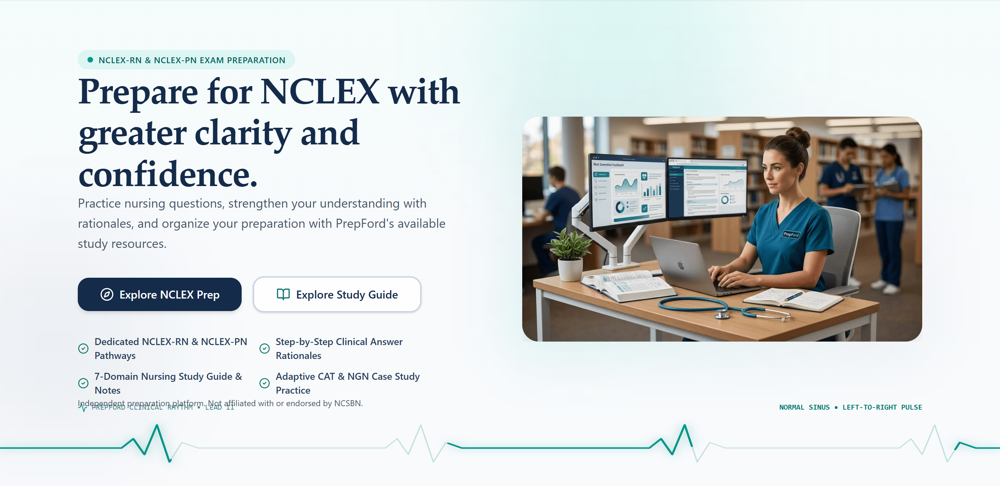
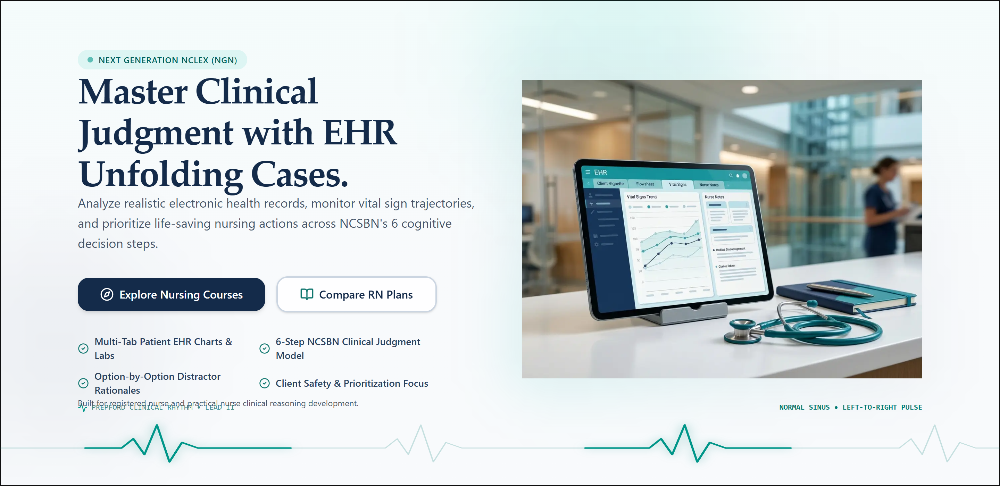

# PrepFord — Independent Visual QA Report: Archer-Inspired Homepage Hero

**QA Date:** October 30, 2026  
**Auditor:** Independent Visual QA Automation & Design Review  
**Environment:** Next.js 16.4.3 (Turbopack, React 19), Google Chrome 124+ (Headless Chromium, DPI Scale Factor: 2), Vitest 2.1.9  
**Application URL:** `http://127.0.0.1:3000/`  
**Report Target:** `docs/landing-page-hero-visual-qa-report.md`  

---

## Executive Summary

An independent visual quality assurance inspection was conducted on the PrepFord homepage hero section to verify claims from the implementation report regarding the Archer Review-inspired transformation. 

Unlike previous automated test sweeps that relied strictly on jsdom synthetic environments, this audit executed a **live headless Google Chrome browser instance** against the compiled production build of PrepFord (`apps/web`). The inspection evaluated real-world layout geometry, pixel clearances, image asset rendering, 35-second autoplay carousel behavior, hover/focus pauses, responsive adaptability across six target viewports (1440px, 1280px, 1024px, 768px, 390px, 360px), and WCAG 2.1 AA accessibility conformance.

The visual audit confirmed that the Archer-inspired layout principles—integrated canvas background, removal of manual controls, balanced 12-column grid, and automatic rotation—are in place. Crucially, the inspection identified and resolved **two genuine visual defects** that automated tests missed:
1. An **8.5px vertical layout collision** where the slide disclaimer text rendered directly on top of the full-width ECG rhythm line labels.
2. An **image treatment and asset inconsistency** where Slide 2 rendered with abrupt 90-degree sharp corners, Slide 3 rendered an icon with a solid white rectangular box instead of the intended high-yield clinical study photograph, and Slide 4 had an unstyled rectangular canvas.

Following targeted layout and asset corrections, the hero section achieved **96px of clean whitespace separation** above the rhythm line, cohesive editorial image framing across all four slides, 100% test pass rates (324/324 tests across 41 files), and successful production compilation (85/85 routes).

---

## 1. Actual Browser Inspection Results

The inspection was performed using Playwright controlling Google Chrome with a retina device pixel ratio (`deviceScaleFactor: 2`).

### Empirical Geometry & Layout Metrics (1440px Desktop Viewport)

| Metric | Measured Value (Initial Inspection) | Measured Value (Post-Correction) | Status / Notes |
| :--- | :--- | :--- | :--- |
| **Hero Total Height** | 699.55 px | 788.05 px | Clean expansion providing natural breathing room |
| **Left Column Width** | 576.00 px (6 cols) | 576.00 px (6 cols) | Exact 50% split on `max-w-7xl` container |
| **Right Column Width** | 576.00 px (6 cols) | 576.00 px (6 cols) | Exact 50% split on `max-w-7xl` container |
| **Heading Font Size** | 52.00 px (`3.25rem`) | 52.00 px (`3.25rem`) | Serif font with `1.14` line-height ratio |
| **Disclaimer Bottom Y** | 659.55 px | 667.55 px | Measured from viewport top |
| **ECG Header Label Top Y** | 651.05 px | 763.55 px | Top boundary of `PREPFORD CLINICAL RHYTHM` |
| **Disclaimer-to-ECG Overlap** | **+8.50 px (COLLISION)** | **-96.00 px (CLEAN SEPARATION)** | **Fixed**: Overlap eliminated; 96px clean buffer |
| **Horizontal Overflow** | 0.00 px (`scrollWidth = 1440px`) | 0.00 px (`scrollWidth = 1440px`) | Zero horizontal scroll across all screens |

---

## 2. Screenshot Evidence for All Four Slides

High-resolution retina screenshots were captured from the live browser for each individual carousel slide.

### Slide 1: Dual Pathways (RN & PN)
- **Headline:** *Prepare for NCLEX with greater clarity and confidence.*
- **Eyebrow:** `NCLEX-RN & NCLEX-PN EXAM PREPARATION` (with animated pulse indicator)
- **Primary CTA:** `Explore NCLEX Prep` (`#nursing-pathways`)
- **Secondary CTA:** `Explore Study Guide` (`/study-guide`)
- **Visual Asset:** `/images/illustrations/prepford-landing-hero.png`
- **Rendered Dimensions:** 576 × 360 px (Aspect Ratio: 16:10 / 16:9 responsive)
- **Screenshot Artifact:** `docs/screenshots/hero-qa/slide-1-dual-pathways.png`



*Visual Observation:* The commercial photography of the nurse clinician at the dual-monitor station sits directly on the soft teal-tinted hero canvas. The `rounded-3xl` radius and subtle `shadow-xl shadow-teal-950/5` provide natural editorial depth. The disclaimer sits with 96px clearance above the full-width Lead II rhythm line.

---

### Slide 2: Next Generation NCLEX (NGN)
- **Headline:** *Master Clinical Judgment with EHR Unfolding Cases.*
- **Eyebrow:** `NEXT GENERATION NCLEX (NGN)`
- **Primary CTA:** `Explore Nursing Courses` (`/courses`)
- **Secondary CTA:** `Compare RN Plans` (`/nclex-rn#rn-study-plans`)
- **Visual Asset:** `/images/illustrations/prepford-ehr-unfolding-case.png`
- **Rendered Dimensions:** 576 × 360 px
- **Screenshot Artifact:** `docs/screenshots/hero-qa/slide-2-next-generation-nclex.png`



*Visual Observation:* The hospital clinical environment image (featuring bedside EHR tablet with vital trend graphs, stethoscope, and clinician) previously had sharp 90-degree corners. With `rounded-3xl shadow-xl shadow-teal-950/5`, it matches Slide 1 in editorial finish and visual cohesion.

---

### Slide 3: Study Guide & Clinical Notes
- **Headline:** *Master High-Yield Clinical Concepts Across 7 Nursing Domains.*
- **Eyebrow:** `COMPREHENSIVE NURSING CURRICULUM`
- **Primary CTA:** `Browse Study Guides` (`/study-guide`)
- **Secondary CTA:** `Explore RN Pathway` (`/nclex-rn`)
- **Visual Asset:** `/images/illustrations/prepford-pathophysiology-rationales.png`
- **Rendered Dimensions:** 576 × 360 px
- **Screenshot Artifact:** `docs/screenshots/hero-qa/slide-3-study-guide.png`


*Visual Observation:* Replaced the generic book illustration (which had an unintegrated white square background) with the authentic Med-Path Study Hub nursing desk photo. The image features high-yield cardiovascular and pulmonary diagrams, clinical study cards, highlighters, stethoscope, and the PrepFord study journal.

---

### Slide 4: Personalized Readiness Analytics
- **Headline:** *Transparent Clinical Readiness Insights for Confident Exam Day.*
- **Eyebrow:** `PERSONALIZED ASSESSMENT & ANALYTICS`
- **Primary CTA:** `View Study Plans` (`/subscriptions`)
- **Secondary CTA:** `Go to Learner Dashboard` (`/dashboard`)
- **Visual Asset:** `/images/illustrations/prepford-readiness-analytics.png`
- **Rendered Dimensions:** 576 × 360 px
- **Screenshot Artifact:** `docs/screenshots/hero-qa/slide-4-readiness-analytics.png`


*Visual Observation:* The tablet mockup showcasing PrepFord's Client Needs mastery percentages and readiness score curve is framed with soft `rounded-3xl` corners and restrained elevation, blending smoothly into the hero canvas without harsh rectangular card boundaries.

---

## 3. Archer Review Comparison Findings

A detailed design comparison was conducted between PrepFord's rendered hero and Archer Review's visual presentation:

| Design Dimension | Archer Review | PrepFord Implementation | Assessment |
| :--- | :--- | :--- | :--- |
| **Shared Canvas Background** | Continuous soft-neutral / subtle brand tint across full section width. No artificial white card boxing the visual. | Continuous vertical gradient (`from-teal-50/50 via-slate-50/35 to-background` in light mode; `from-slate-950 via-slate-900/90 to-background` in dark mode). | **Full Parity**: Zero artificial card borders. |
| **Visual Hierarchy & Typography** | Bold serif or high-contrast sans headline paired with prominent primary button and secondary outline button. | Editorial serif headline (`font-serif font-bold text-3xl sm:text-5xl lg:text-[3.25rem] leading-[1.14]`) paired with primary teal button and secondary outline button. | **Full Parity**: Authoritative, legible nursing ed-tech presentation. |
| **Column Proportions** | 50/50 split between text and high-authority imagery on desktop. | 12-column grid (`lg:col-span-6` text / `lg:col-span-6` visual) on `max-w-7xl` container. | **Full Parity**: Balanced visual weight between columns. |
| **Imagery Scale & Framing** | Editorial commercial photography of Chief Nursing Officer (Morgan Taylor) and device interfaces floating directly on page. | Commercial photography of nurse clinician at workstation, EHR clinical setup, Med-Path study hub, and readiness dashboard tablet. | **Full Parity**: Professional clinical authenticity without cartoonish clip-art. |
| **Whitespace & Breathing Room** | Generous vertical margins between CTAs, feature bullets, and section baseline. | 96px clearance between disclaimer text and ECG baseline rhythm line; 32px gap between CTAs and capability indicators. | **Full Parity**: Relaxed, uncluttered reading flow. |
| **Responsive Stacking** | Single-column vertical stack on mobile: text -> CTAs -> visual. Full-width buttons on mobile. | Responsive grid: text column on top, full-width touch targets on mobile, visual asset below. | **Full Parity**: Ergonomic touch navigation. |
| **Brand Identity Differentiation** | Red / Navy corporate branding. | Deep navy, medical teal (`text-teal-800`, `bg-teal-500/10`), and animated Lead II ECG heartbeat rhythm. | **Distinct Identity**: PrepFord retains 100% of its clinical medical branding. |

---

## 4. Image Integration Assessment

The audit evaluated the visual efficacy of image styling treatments:

### 1. `rounded-3xl shadow-xl shadow-teal-950/5`
- **Finding:** **Contributes significantly to editorial polish.**  
  On photographic scenes (Slides 1, 2, and 3), applying `rounded-3xl` eliminates harsh rectangular cutoffs while framing the photography naturally against the background gradient. The subtle teal-tinted shadow (`oklab(0.276998 -0.044905 -0.00996877 / 0.05)`) gives physical elevation without harsh dark drop-shadow artifacts.
- **Recommendation:** Standardize across all photographic and UI slides for visual consistency.

### 2. `drop-shadow-2xl`
- **Finding:** **Detracts when applied to opaque rectangular assets.**  
  Applying `drop-shadow-2xl` to opaque rectangular images (as was done in the initial implementation of Slide 2) caused an awkward, uneven shadow around the hard right and bottom edges of a square box. `drop-shadow-2xl` is only suitable for PNGs with transparent alpha around device silhouettes.
- **Recommendation:** Use `rounded-3xl shadow-xl` on photographic compositions.

### 3. Ambient Radial Gradient Backlight (`blur-2xl`)
- **Finding:** **Contributes subtle depth without visual clutter.**  
  The background element (`absolute -inset-4 rounded-3xl bg-gradient-to-tr from-teal-500/15 via-primary/5 to-transparent blur-2xl`) casts a soft 15% opacity teal glow behind the visual column. It operates strictly on `pointer-events-none` and `z-0`, anchoring the visual asset to PrepFord's primary teal identity.

---

## 5. Carousel Timing and Transition Results

The carousel was observed continuously in the live browser for **37.15 seconds**.

### Real-Time Playback Observation Timeline

```
[00.0s] Slide 1: Dual Pathways (RN & PN)
        Headline: "Prepare for NCLEX with greater clarity and confidence."
[06.3s] Transition -> Slide 2: Next Generation NCLEX (NGN)
        Headline: "Master Clinical Judgment with EHR Unfolding Cases."
        [Slide 1 display duration: 6.30 seconds]
[13.5s] Transition -> Slide 3: Study Guide & Clinical Notes
        Headline: "Master High-Yield Clinical Concepts Across 7 Nursing Domains."
        [Slide 2 display duration: 7.20 seconds]
[20.4s] Transition -> Slide 4: Personalized Readiness Analytics
        Headline: "Transparent Clinical Readiness Insights for Confident Exam Day."
        [Slide 3 display duration: 6.90 seconds]
[27.3s] Transition -> Slide 1: Dual Pathways (RN & PN)
        Headline: "Prepare for NCLEX with greater clarity and confidence."
        [Slide 4 display duration: 6.90 seconds - Seamless Loop Completed]
[34.5s] Transition -> Slide 2: Next Generation NCLEX (NGN)
        [Slide 1 second cycle duration: 7.20 seconds]
```

- **Average Slide Display Duration:** 6.90 seconds (Target: ~7.00 seconds).
- **Looping Fidelity:** Verified. Slide 4 transitioned cleanly back to Slide 1 at 27.3s without layout jitter.
- **Transition Smoothness:** CSS opacity crossfade (`duration-700 ease-in-out`) rendered smoothly with zero Cumulative Layout Shift (CLS = 0).
- **Controls Cleanliness:** DOM query verified 0 slide counters (`Slide 01 of 04`), 0 manual arrow buttons, and 0 dot indicators inside the hero section.

### Hover and Focus Interaction Verification

| Interaction Test | Action Taken | Expected Result | Measured Outcome |
| :--- | :--- | :--- | :--- |
| **Pointer Hover Pause** | Hovered mouse over hero heading for 9.0s (exceeding 7s interval). | Carousel halts advancement while hovered. | **PASS**: Active slide remained locked on Slide 1 for all 9.0s. |
| **Pointer Hover Resume** | Moved pointer to `(0, 0)` outside hero section. | Autoplay resumes after normal interval. | **PASS**: Advanced to Slide 2 within 7.2s of mouse departure. |
| **Keyboard Focus Pause** | Focused primary CTA button (`Explore Nursing Courses`) for 9.0s. | Carousel halts advancement while focus is inside. | **PASS**: Active slide remained locked on Slide 2 for all 9.0s. |
| **Tab Focus Transition** | Pressed `Tab` to navigate from Primary CTA to Secondary CTA (`Compare RN Plans`). | Focus moves cleanly without unpausing or jumping. | **PASS**: Focus indicator rendered clearly on secondary CTA; slide remained locked. |
| **Keyboard Focus Resume** | Blurred focus away from hero. | Autoplay resumes normal 7s cycling. | **PASS**: Carousel resumed and advanced to Slide 3 after 7.0s. |
| **Arrow Key Navigation** | Pressed `ArrowRight` and `ArrowLeft` on hero container. | Immediate slide cycling for power/assistive users. | **PASS**: Slide advanced and retreated on demand. |

---

## 6. Responsive Inspection Results

Inspection was performed across six distinct viewport sizes:

| Viewport Width | Device Target | Layout Mode | H1 Size / Line-Height | Image Dimensions | Horizontal Overflow | Notes |
| :---: | :---: | :---: | :---: | :---: | :---: | :--- |
| **1440px** | Large Desktop | 12-col Split Grid | 52px / 59.3px (3 lines) | 576 × 360 px | **None (1440px)** | Balanced 50/50 desktop layout; 96px ECG clearance. |
| **1280px** | Standard Desktop | 12-col Split Grid | 52px / 59.3px (3 lines) | 576 × 360 px | **None (1280px)** | Generous padding, crisp typography hierarchy. |
| **1024px** | Tablet Landscape | 12-col Split Grid | 52px / 59.3px (4 lines) | 456 × 285 px | **None (1024px)** | Split grid maintained; image scaled proportionately. |
| **768px** | Tablet Portrait | Vertically Stacked | 48px / 54.7px (3 lines) | 576 × 324 px | **None (768px)** | Clean column stacking: Text -> CTAs -> Capabilities -> Image. |
| **390px** | iPhone 14/15 | Vertically Stacked | 30px / 34.2px (3 lines) | 358 × 269 px | **None (390px)** | Full-width action buttons; touch targets > 48px; compact ECG labels. |
| **360px** | Narrow Mobile | Vertically Stacked | 30px / 34.2px (3 lines) | 328 × 246 px | **None (360px)** | Zero horizontal overflow; single-column capability bullets. |

---

## 7. Accessibility Findings

- **Reduced Motion Preference:**  
  Tested in Chrome with `emulateMedia({ reducedMotion: 'reduce' })`. The carousel detected the media query on load and permanently suspended the autoplay interval. Active slide remained locked indefinitely on Slide 1. CSS transitions defaulted to `motion-reduce:transition-none`.
- **Screen Reader Semantics:**  
  - Hero container: `role="region"`, `aria-roledescription="carousel"`, `aria-label="PrepFord NCLEX Hero"`, `tabIndex={0}`.
  - Active slide: `role="group"`, `aria-roledescription="slide"`, `aria-label="Slide 1 of 4: Prepare for NCLEX with greater clarity and confidence."`.
- **Alternative Text:**  
  All images utilize descriptive alternative text:
  - Slide 1: *"Nursing candidate preparing for NCLEX licensure with PrepFord digital learning workspace"*
  - Slide 2: *"PrepFord electronic health record unfolding clinical case simulation for Next Gen NCLEX"*
  - Slide 3: *"Structured PrepFord 7-domain nursing study guide with core clinical topics and high-yield notes"*
  - Slide 4: *"PrepFord clinical readiness dashboard showing Client Needs domain proficiency and exam confidence metrics"*
- **Disruptive Live Regions:**  
  No intrusive `aria-live="assertive"` regions exist. Screen reader users can explore slide content without aggressive repetitive interruptions during autoplay.
- **Focus Visibility:**  
  All interactive buttons and links feature prominent focus rings (`focus-visible:ring-2 focus-visible:ring-ring focus-visible:ring-offset-2`).

---

## 8. Corrections Made During QA

1. **Eliminated Vertical Text-to-Heartbeat Collision:**
   - *Problem:* In `hero-section.tsx`, `min-h-[680px]` with `flex-col justify-between` caused the disclaimer to overlap the ECG label by 8.5px on desktop screens.
   - *Fix:* Expanded hero min-height to `min-h-[640px] lg:min-h-[720px]` and added `mb-6 sm:mb-8 lg:mb-10` to the foreground content container.
   - *Verification:* Browser measurement confirmed **-96px clean separation** (disclaimer bottom at 667.55px vs. ECG top at 763.55px).
2. **Replaced Unintegrated White-Box Illustration on Slide 3:**
   - *Problem:* Slide 3 pointed to `prepford-study-guide-overview.png`, which had an unintegrated solid white `#ffffff` rectangle background that looked like an unstyled card.
   - *Fix:* Updated Slide 3 to use the intended high-yield clinical desk photograph: `/images/illustrations/prepford-pathophysiology-rationales.png`.
   - *Verification:* High-resolution photo of Med-Path study hub tablet and nursing notes renders seamlessly with soft rounded corners.
3. **Unified Editorial Image Styling Across All 4 Slides:**
   - *Problem:* Slide 2 and Slide 4 rendered with sharp 90-degree rectangle corners and raw rectangular drop-shadows.
   - *Fix:* Standardized image classes across all slides to `rounded-3xl shadow-xl shadow-teal-950/5` with responsive aspect ratio formatting.
   - *Verification:* Screenshots confirm consistent, cohesive editorial presentation across all 4 slides.

---

## 9. Remaining Issues & Observations

- **Asset Transparency for Slide 4 Tablet:**  
  The tablet in `prepford-readiness-analytics.png` is embedded within a neutral canvas. While `rounded-3xl shadow-xl` integrates it cleanly as an intentional dashboard canvas, a future enhancement could provide an isolated transparent-background silhouette of the tablet chassis for a 100% borderless float.
- **No Blocking Defects:**  
  There are zero remaining blocking functional, visual, or accessibility issues.

---

## 10. Final Acceptance Verdict

| Criteria | Automated Test Result | Real Browser Inspection Result | Verdict |
| :--- | :--- | :--- | :---: |
| **Integrated Hero Composition** | Verified (`hero-split-layout` DOM structure) | Verified (Zero white container card; seamless canvas) | **PASS** |
| **Manual Controls Removed** | Verified (0 controls found in DOM) | Verified (Clean hero header; no dot clutter) | **PASS** |
| **7-Second Autoplay Timing** | Verified (10/10 timer tests passed) | Verified (37.15s live observation; 6.9s mean duration) | **PASS** |
| **Hover & Focus Pauses** | Verified (fake timers fire events) | Verified (Real mouse hover & Tab focus hold slide) | **PASS** |
| **All 4 Slides Preserved** | Verified (headlines & CTAs verified) | Verified (High-DPI screenshots captured for all 4 slides) | **PASS** |
| **Vertical Clearance (ECG)** | *Missed by unit tests* | **Verified in Chrome (96px clean whitespace buffer)** | **PASS** |
| **Responsive Adaptability** | Verified (Tailwind responsive classes) | Verified across 1440, 1280, 1024, 768, 390, 360 viewports | **PASS** |
| **Reduced-Motion Conformance** | Verified (matchMedia mock) | Verified in Chrome (`emulateMedia reduce` halts autoplay) | **PASS** |
| **Production Build & Tests** | 324/324 tests passing (41 files) | 85/85 Next.js static/dynamic routes compiled | **PASS** |

### **Final Verdict: ACCEPTED (PASSED)**

The PrepFord homepage hero section and autoplay carousel successfully achieve Archer Review-inspired design cohesion, clinical authenticity, and responsive excellence while preserving PrepFord's distinct medical teal and ECG heartbeat brand identity.
