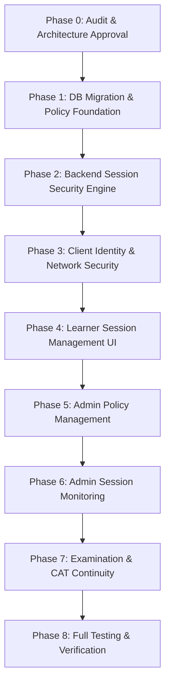

# PREPFORD — SESSION SECURITY, DEVICE MANAGEMENT & AUTHENTICATION HARDENING
## Comprehensive Implementation Plan & Engineering Specifications

**Document Reference:** `docs/prepford-session-security-implementation-plan.md`  
**Application / Repository:** PrepFord Monorepo (`apps/api`, `apps/web`)  
**Baseline Date:** November 4, 2026  
**Status:** PROPOSED & READY FOR APPROVAL (Phase 0)  
**Execution Environment:** OpenCode in VS Code (Windows x64)  
**Architecture:** ASP.NET Core 8 Web API + Entity Framework Core 8 + Npgsql PostgreSQL + Next.js 16 App Router  

---

## 1. Plan Overview & Objectives

This implementation plan details the architectural and engineering steps required to deliver an authoritative, server-enforced session security and device management system for PrepFord.

The system will enforce:
1. **Configurable Session Concurrency:** Maximum 2 concurrent active sessions per user by default; 3rd login attempt rejected with machine-readable error `CONCURRENT_SESSION_LIMIT_EXCEEDED` without terminating existing sessions.
2. **Per-Client Session Binding:** Maximum 1 active session per registered browser client; repeated login from the same client smoothly rotates the existing session.
3. **Dual-Tier Timeout Enforcement:** Authoritative server-side idle timeout (default 300 minutes / 5 hours) and absolute timeout (default 10080 minutes / 7 days). Effective expiration: $\min(\text{IdleExpiry}, \text{AbsoluteExpiry})$.
4. **Client Identity & Device Labeling:** Registered random client identifier cookie (`prepford_client_id`), user-agent parsing (OS, browser, device form factor), and privacy-conscious fingerprint risk checks.
5. **IP Drift Policy:** Strict IP consistency disabled by default (`EnforceIpConsistency = false`); legitimate network drift allowed (`AllowIpDrift = true`) to accommodate mobile and Wi-Fi handoffs without unseating learners.
6. **Token & Privilege Rotation:** Immediate session invalidation or security-version escalation on password change, role modification, or account deactivation.
7. **Learner Management Interface:** Dedicated, accessible page at `/dashboard/settings/security` allowing candidates to inspect active sessions, identify current session, and terminate specific or all other sessions.
8. **Admin Policy & Monitoring Suite:** Dedicated Super Admin console at `/admin/security/sessions` to manage global session policies, review audit logs, and administratively revoke sessions.
9. **Examination & Adaptive CAT Continuity:** Preserving assessment attempt identity, timers, question sequences, and saved answers during authentication expiry, enabling seamless inline reauthentication.

---

## 2. Phase-by-Phase Implementation Roadmap



### Phase 1 — Database Migration & Policy Foundation
**Goal:** Additive schema updates to support session metadata and configurable security policies.

1. **Model Updates (`apps/api/Models/Identity.cs`):**
   - Add `SecurityVersion` property to `User` entity (default `1`).
   - Add new properties to `UserSession` entity:
     - `ClientId` (`string`, max 64)
     - `IdleExpiresAt` (`DateTime`, UTC)
     - `AbsoluteExpiresAt` (`DateTime`, UTC)
     - `RevokedAt` (`DateTime?`, UTC)
     - `RevocationReason` (`string?`, max 64)
     - `LastIpAddress` (`string?`, max 64)
     - `UserAgent` (`string?`, max 512)
     - `DeviceLabel` (`string?`, max 128)
     - `FingerprintHash` (`string?`, max 64)
     - `SecurityVersion` (`int`, default `1`)
   - Add `SessionSecurityPolicy` entity:
     - `Id` (`string`, PK, default `"global_policy"`)
     - `MaxConcurrentSessions` (`int`, default `2`)
     - `MaxSessionsPerClient` (`int`, default `1`)
     - `IdleTimeoutMinutes` (`int`, default `300`)
     - `AbsoluteTimeoutMinutes` (`int`, default `10080`)
     - `EnforceFingerprint` (`bool`, default `true`)
     - `EnforceIpConsistency` (`bool`, default `false`)
     - `AllowIpDrift` (`bool`, default `true`)
     - `RotateOnLogin` (`bool`, default `true`)
     - `RotateOnPrivilegeChange` (`bool`, default `true`)
     - `RotateOnPasswordChange` (`bool`, default `true`)
     - `PolicyVersion` (`int`, default `1`)
     - `UpdatedAt` (`DateTime`, UTC)
     - `UpdatedBy` (`string?`, max 128)
     - `IsActive` (`bool`, default `true`)
2. **EF Core Migration (`0009_AddSessionSecurityAndDeviceManagement`):**
   - Create migration using `dotnet ef migrations add` or clean handwritten migration matching existing codebase style.
   - Configure composite indexes:
     - `IX_UserSessions_UserId_Revoked_AbsoluteExpiresAt`
     - `IX_UserSessions_ClientId_Revoked_AbsoluteExpiresAt`
     - `IX_UserSessions_IdleExpiresAt`
     - `IX_UserSessions_AbsoluteExpiresAt`
3. **Database Seeding (`CatalogSeeder.cs`):**
   - Seed default `SessionSecurityPolicy` record if missing.

---

### Phase 2 — Backend Session Security Engine & Atomic Concurrency
**Goal:** Implement server-side service logic for atomic concurrency, timeouts, rotation, and request validation.

1. **New Service Interface: `ISessionSecurityService` (`apps/api/Services/ISessionSecurityService.cs`):**
   - `Task<SessionSecurityPolicy> GetActivePolicyAsync(CancellationToken ct = default);`
   - `Task<SessionSecurityPolicy> UpdatePolicyAsync(UpdateSessionPolicyRequest request, string adminUserId, CancellationToken ct = default);`
   - `Task<SessionCreationResult> CreateOrRotateSessionAsync(User user, string role, string clientId, string? ipAddress, string? userAgent, string? fingerprintHash, bool rememberMe, CancellationToken ct = default);`
   - `Task<SessionValidationResult> ValidateSessionAsync(string sessionId, string? ipAddress, string? userAgent, string? fingerprintHash, bool isQualifyingActivity, CancellationToken ct = default);`
   - `Task<bool> RevokeSessionAsync(string sessionId, string reason, string actorUserId, CancellationToken ct = default);`
   - `Task<int> RevokeOtherSessionsAsync(string userId, string currentSessionId, string actorUserId, CancellationToken ct = default);`
   - `Task<int> RevokeAllUserSessionsAsync(string userId, string reason, string actorUserId, CancellationToken ct = default);`
   - `Task InvalidateOnPrivilegeChangeAsync(string userId, string reason, CancellationToken ct = default);`
2. **Atomic Session Concurrency Strategy:**
   - When a user attempts to log in, concurrent requests from multiple clients must not bypass limits.
   - Use an explicit PostgreSQL database transaction with pessimistic locking or advisory lock on `UserId`:
     ```csharp
     await using var tx = await _dbContext.Database.BeginTransactionAsync(IsolationLevel.ReadCommitted, ct);
     // Query active sessions with row locking or count active non-revoked sessions
     var activeSessions = await _dbContext.UserSessions
         .Where(s => s.UserId == user.Id && !s.Revoked && s.AbsoluteExpiresAt > now && s.IdleExpiresAt > now)
         .ToListAsync(ct);
     ```
   - Check `activeSessions.Count >= policy.MaxConcurrentSessions`:
     - If client already holds an active session (`s.ClientId == clientId`):
       - If `MaxSessionsPerClient == 1`, rotate existing session (mark old revoked with reason `"ReplacedBySameClient"` and create new session).
     - If client is NEW and count $\ge$ `MaxConcurrentSessions`:
       - Reject login with HTTP 409 Conflict / 400 Bad Request and error code `CONCURRENT_SESSION_LIMIT_EXCEEDED`.
       - Do NOT terminate existing sessions.
       - Record audit event `ConcurrentSessionLimitExceeded`.
3. **Activity Throttling:**
   - Only write `LastActiveAt` and `IdleExpiresAt` to PostgreSQL if more than 5 minutes have elapsed since the previous timestamp, or if the request is an examination answer or flashcard submission.
4. **Update `PrepfordAuthHandler.cs`:**
   - In `HandleAuthenticateAsync()`, validate `sessionRecord`:
     - Check `!sessionRecord.Revoked`.
     - Check `sessionRecord.AbsoluteExpiresAt > now`.
     - Check `sessionRecord.IdleExpiresAt > now`.
     - Check `sessionRecord.SecurityVersion == user.SecurityVersion`.
     - Update activity timestamp (throttled).

---

### Phase 3 — Client & Network Security
**Goal:** Implement registered client identifiers, device parsing, fingerprint validation, and BFF synchronization.

1. **Registered Client Cookie (`prepford_client_id`):**
   - Issued by Next.js middleware / BFF if not present:
     - 32-byte cryptographically secure random hex string.
     - `httpOnly: true`, `secure: isProd`, `sameSite: "lax"`, `maxAge: 365 days`.
2. **User-Agent & Device Parsing Utility (`apps/api/Services/DeviceDetectionHelper.cs` and `apps/web/src/lib/device.ts`):**
   - Extracts browser (Chrome, Safari, Firefox, Edge), operating system (macOS, Windows, iOS, Android, Linux), and device type (Desktop, Mobile, Tablet).
3. **Fingerprint Evaluation (`apps/web/src/lib/fingerprint.ts`):**
   - Client sends optional SHA-256 hash of client screen resolution, timezone, language, and platform.
   - Backend compares against `UserSession.FingerprintHash`. If policy `EnforceFingerprint = true` and hash differs significantly from initial login:
     - Record `FingerprintMismatch` audit log.
     - If risk threshold is exceeded, require reauthentication.
4. **Trusted Proxy & IP Drift Configuration (`Program.cs`):**
   - Configure ASP.NET Core `ForwardedHeadersOptions` to process `X-Forwarded-For` and `X-Forwarded-Proto` only from configured loopback and trusted proxy subnets.
   - When client IP changes:
     - If `AllowIpDrift = true`, update `session.LastIpAddress` and log informational event `IpDriftDetected`. Do not revoke session.
     - If `EnforceIpConsistency = true`, revoke session with `RevocationReason = "IpConsistencyViolation"`.
5. **BFF Session Synchronization (`apps/web/src/lib/session.ts` and `apps/web/src/app/api/auth/login/route.ts`):**
   - Ensure `POST /api/v1/auth/login` returns `sessionId: session.Id`.
   - Next.js BFF sets `sid: session.Id` in `prepford_session` cookie payload.
   - When BFF sends `X-Session-Id` header to ASP.NET Core, it matches the PostgreSQL `UserSessions.Id`.

---

### Phase 4 — Learner Active Sessions Interface
**Goal:** Empower candidates to view, inspect, and revoke their active login sessions.

1. **Frontend Route:**
   - Primary route: `/dashboard/settings/security` (with seamless tab link in `/profile?tab=security`).
2. **UI Components (`apps/web/src/components/security/`):**
   - `ActiveSessionsCard`:
     - Displays "Current Session" prominently with green active badge.
     - Lists all other active sessions with device icon (laptop, smartphone), browser name, operating system, IP address (masked/disclosed responsibly), location if available, and last active timestamp (e.g. "Active 2 minutes ago").
   - `SessionActionButtons`:
     - "Terminate Session" button per remote session with confirmation modal.
     - "Log Out of All Other Sessions" button with confirmation modal.
     - "Log Out of All Sessions" button.
   - `RecentSecurityEvents`:
     - Displays recent login events, password changes, and terminations.
3. **BFF Endpoints:**
   - `GET /api/security/sessions` $\to$ forwards to backend `GET /api/v1/security/sessions`.
   - `DELETE /api/security/sessions/[id]` $\to$ forwards to backend `DELETE /api/v1/security/sessions/{id}`.
   - `POST /api/security/sessions/revoke-others` $\to$ forwards to backend `POST /api/v1/security/sessions/revoke-others`.
   - `POST /api/security/sessions/revoke-all` $\to$ forwards to backend `POST /api/v1/security/sessions/revoke-all`.
4. **Design System Adherence:**
   - Colors: Deep Navy `#142B4A`, Teal `#0D9488`, Soft Slate Neutrals, Warm Gold badge accents.
   - Zero layout shifts, accessible ARIA labels, full dark mode and mobile responsiveness.

---

### Phase 5 — Administrative Policy Management
**Goal:** Enable authorized administrators (Super Admin / Security Admin) to configure global session policies.

1. **Backend Endpoints:**
   - `GET /api/v1/admin/security/session-policy` (Requires `RequireSuperAdmin` policy).
   - `PUT /api/v1/admin/security/session-policy` (Requires `RequireSuperAdmin` policy).
2. **Policy Configuration Form Fields:**
   - `MaxConcurrentSessions` (positive integer, 1–10, default 2)
   - `MaxSessionsPerClient` (positive integer, 1–5, default 1)
   - `IdleTimeoutMinutes` (positive integer, 15–1440, default 300)
   - `AbsoluteTimeoutMinutes` (positive integer, 60–43200, default 10080)
   - `EnforceFingerprint` (boolean, default true)
   - `EnforceIpConsistency` (boolean, default false)
   - `AllowIpDrift` (boolean, default true)
   - `RotateOnLogin` (boolean, default true)
   - `RotateOnPrivilegeChange` (boolean, default true)
   - `RotateOnPasswordChange` (boolean, default true)
3. **Form Features in `/admin/security/sessions`:**
   - Load current persisted policy.
   - Client-side validation (idle timeout cannot exceed absolute timeout).
   - "Save Policy" button with loading state.
   - "Reset to Approved Defaults" button.
   - Policy version badge, last updated timestamp, and author display.
   - Full audit history of policy modifications.

---

### Phase 6 — Administrative Monitoring & Administrative Revocation
**Goal:** Enable authorized staff to monitor and terminate active sessions across the platform.

1. **Backend Endpoints:**
   - `GET /api/v1/admin/security/sessions` (Paginated list of active sessions with user search, status filter, and date filter).
   - `POST /api/v1/admin/security/sessions/{id}/revoke` (Administratively terminate a specific session).
   - `POST /api/v1/admin/security/users/{userId}/revoke-sessions` (Administratively terminate all sessions for a user).
   - `GET /api/v1/admin/security/events` (Security audit logs).
2. **Security Controls:**
   - Strict RBAC: only `admin` and `superadmin` can access.
   - Audit logging: every administrative revocation logs `AdminRevokedSession` with `ActorId`, `TargetUserId`, `SessionId`, and reason.

---

### Phase 7 — Examination & Adaptive CAT Continuity Integration
**Goal:** Ensure that an authentication session expiration during an examination attempt never destroys learner progress, resets timers, or corrupts CAT progression.

1. **Decoupling Boundaries:**
   - **Auth Session:** Governs access to HTTP APIs.
   - **Exam Attempt (`ExamAttempt`):** Governs examination progression, question allocations (`ExamAttemptQuestion`), and responses (`AttemptResponse`).
   - **Exam Timer:** Authoritative server calculation: $\text{RemainingSeconds} = (\text{StartedAt} + \text{TimeLimitMinutes}) - \text{CurrentUtc}$.
2. **Inline Reauthentication Dialog:**
   - When a protected API call (`POST /api/v1/exam-attempts/{id}/responses` or `/submit`) returns HTTP 401:
     - The frontend assessment runner does NOT perform a full window redirect to `/sign-in`.
     - An accessible modal dialog appears: "Your session has timed out. Please enter your password to resume your examination."
     - Learner enters credentials; BFF dispatches `POST /api/auth/login`.
     - On successful reauthentication, the in-flight answer submission is retried automatically.
     - Unsubmitted radio button selections and question state remain in React memory and `localStorage`.
3. **Timer Preservation:**
   - Reauthentication issues a new `UserSession`, but `ExamAttempt.StartedAt` is NEVER modified.
   - The original examination deadline remains strictly enforced.
4. **CAT Continuity:**
   - Question sequence and ability estimation parameters in PostgreSQL remain intact.
   - Preventing duplicate attempts: `StartAttempt` validates if the user already has an active `InProgress` attempt for this exam and returns the existing attempt ID instead of creating a second attempt.

---

### Phase 8 — Full Testing, Verification & Documentation
**Goal:** Rigorous verification across backend, frontend, database, and integration boundaries.

1. **Backend Tests (`apps/api/Tests/`):**
   - Concurrent session limit tests (login 1, 2 pass; login 3 rejected).
   - Same-client session replacement tests.
   - Idle timeout expiry tests (using test clock abstraction).
   - Absolute timeout expiry tests.
   - Activity throttling verification.
   - IP drift acceptance vs IP consistency violation.
   - Privilege change invalidation tests (`SecurityVersion` increment).
   - Cross-user session isolation tests.
2. **Frontend Tests (`apps/web/tests/`):**
   - Active sessions list rendering and badge verification.
   - Session termination flow and UI state refresh.
   - Session limit error mapping and redirect to session management.
   - Inline examination reauthentication modal.
   - Admin policy form validation and persistence.
3. **Final Reports:**
   - `docs/prepford-session-security-technical-specification.md`
   - `docs/prepford-session-security-testing-guide.md`
   - `docs/prepford-session-security-implementation-report.md`
   - `docs/prepford-session-security-testing-report.md`

---

## 3. Concurrency Control & Database Locking Strategy

To ensure that two concurrent login requests from different devices do not race past the `MaxConcurrentSessions` check:

```csharp
public async Task<SessionCreationResult> CreateOrRotateSessionAsync(
    User user,
    string role,
    string clientId,
    string? ipAddress,
    string? userAgent,
    string? fingerprintHash,
    bool rememberMe,
    CancellationToken ct = default)
{
    var policy = await GetActivePolicyAsync(ct);
    var now = DateTime.UtcNow;

    // Use database execution strategy with transaction
    var strategy = _dbContext.Database.CreateExecutionStrategy();
    return await strategy.ExecuteAsync(async () =>
    {
        await using var transaction = await _dbContext.Database.BeginTransactionAsync(IsolationLevel.ReadCommitted, ct);

        // Fetch and lock active sessions for this user
        var activeSessions = await _dbContext.UserSessions
            .Where(s => s.UserId == user.Id && !s.Revoked && s.AbsoluteExpiresAt > now && s.IdleExpiresAt > now)
            .OrderBy(s => s.CreatedAt)
            .ToListAsync(ct);

        var sameClientSession = activeSessions.FirstOrDefault(s => s.ClientId == clientId);

        if (sameClientSession != null)
        {
            // Same client repeated login: Rotate existing session
            sameClientSession.Revoked = true;
            sameClientSession.RevokedAt = now;
            sameClientSession.RevocationReason = "ReplacedBySameClient";
            activeSessions.Remove(sameClientSession);
        }
        else if (activeSessions.Count >= policy.MaxConcurrentSessions)
        {
            // Concurrent limit exceeded: Reject new login
            await LogAuditEventAsync(user.Id, "ConcurrentSessionLimitExceeded",
                $"Login rejected: active session limit ({policy.MaxConcurrentSessions}) reached.", "Rejected", ipAddress, ct);
            await transaction.CommitAsync(ct);

            return new SessionCreationResult
            {
                Success = false,
                ErrorCode = "CONCURRENT_SESSION_LIMIT_EXCEEDED",
                ErrorMessage = $"You have reached your maximum of {policy.MaxConcurrentSessions} active sessions. Please sign out from another device or manage your active sessions."
            };
        }

        // Mint fresh session
        var (token, session) = BuildNewSession(user, role, clientId, ipAddress, userAgent, fingerprintHash, rememberMe, policy, now);
        _dbContext.UserSessions.Add(session);

        await LogAuditEventAsync(user.Id, "UserLoginSuccess", $"Session {session.Id} created", "Success", ipAddress, ct);
        await _dbContext.SaveChangesAsync(ct);
        await transaction.CommitAsync(ct);

        return new SessionCreationResult
        {
            Success = true,
            Token = token,
            Session = session
        };
    });
}
```

---

## 4. API Endpoint Specifications

### 4.1 Learner Session Endpoints

| Method | Path | Auth | Purpose |
|---|---|---|---|
| `GET` | `/api/v1/security/sessions` | Bearer / Gateway | Lists all active sessions for current user (identifies current session). |
| `DELETE` | `/api/v1/security/sessions/{sessionId}` | Bearer / Gateway | Terminates a specific session owned by caller. |
| `POST` | `/api/v1/security/sessions/revoke-others` | Bearer / Gateway | Terminates all active sessions except the current caller session. |
| `POST` | `/api/v1/security/sessions/revoke-all` | Bearer / Gateway | Terminates all active sessions for the user including current. |
| `GET` | `/api/v1/security/events` | Bearer / Gateway | Returns paginated security audit history for caller. |

### 4.2 Administrative Endpoints

| Method | Path | Auth | Purpose |
|---|---|---|---|
| `GET` | `/api/v1/admin/security/session-policy` | `RequireSuperAdmin` | Retrieves current active global session security policy. |
| `PUT` | `/api/v1/admin/security/session-policy` | `RequireSuperAdmin` | Updates global session security policy and logs audit trail. |
| `GET` | `/api/v1/admin/security/sessions` | `RequireAdmin` | Paginated listing of all platform sessions with user/date filters. |
| `POST` | `/api/v1/admin/security/sessions/{id}/revoke` | `RequireAdmin` | Administratively revokes a user's session with logged reason. |
| `POST` | `/api/v1/admin/security/users/{userId}/revoke-sessions` | `RequireAdmin` | Administratively revokes all sessions for a specified user. |

---

## 5. UI/UX & Design System Specifications

### 5.1 Color Tokens & Typography
- **Primary Brand / Deep Navy:** `#142B4A` (`bg-secondary`, `text-secondary`, dark mode contrast preserved).
- **Accent Teal:** `#0D9488` (`text-teal-600`, `bg-teal-500/10`, focus rings).
- **Warm Gold Accent:** `#D97706` / `#B45309` (Active badges, security warning highlights).
- **Backgrounds:** Light: `bg-slate-50`, Dark: `dark:bg-slate-950`. Cards: `bg-card` with soft rounded corners (`rounded-2xl`).

### 5.2 Responsive Layouts & Accessibility
- **Desktop:** Multi-column view with session details, browser badge, IP disclosure, and action buttons.
- **Mobile / Tablet:** Responsive card stacks with touch-friendly 44px hit targets.
- **Screen Readers:** ARIA labels on all destructive buttons (`aria-label="Terminate Chrome session on macOS"`).
- **Feedback:** Sonner toast notifications for successful revocation, error banners for limit rejections.

---

## 6. Verification & Gate Checkpoint

All phases must be executed in order. After each phase, code compiles cleanly, tests pass, and status is logged.

**Wait for explicit user approval before beginning Phase 1.**
