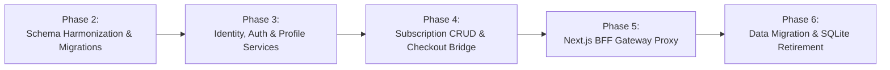

# PrepFord Phase 1 — Comprehensive SQLite Dependency and Backend Readiness Audit

**Document Version:** 1.1  
**Audit Date:** 2026-10-29  
**Auditor:** Senior Full-Stack, Application Security & Database Architect  
**Repository:** `C:\Users\gitau\Documents\PREform`  
**Branch:** `feature/dotnet-backend-migration`  
**Audited Baseline Commit:** `a4c8c24c35233df5e0581b759804f3d2f0cfa358`  
**Working Tree Status:** Clean (with untracked local WAL write from prior test execution: `apps/web/.data/prepford.sqlite-wal`)  
**Target Architecture:** Next.js App Router (Frontend/BFF) + ASP.NET Core 8 Web API + PostgreSQL (EF Core 8)

---

## 1. Executive Verdict

### **VERDICT: NOT SAFE TO PROCEED WITH REMOVING SQLITE IMMEDIATELY**

**Summary Justification:**
Removing SQLite from `apps/web` today would immediately break all core application functionality, including candidate authentication, session validation, profile updates, avatar uploads, checkout simulations, and admin subscription management. It would cause **at least 5 test suites (43 tests)** to fail immediately and crash the production build.

While `apps/api` contains an Entity Framework Core schema (`AppDbContext.cs`) and migrations targeting PostgreSQL, the ASP.NET Core API is currently **completely decoupled from the frontend**:
1. **Zero Frontend-to-Backend Network Traffic:** `apps/web` contains **no code** invoking `apps/api`. The environment variable `API_GATEWAY_URL` exists only in documentation (`docs/data-ownership-architecture.md`) and is not referenced in any TypeScript file in `apps/web/src`.
2. **Missing Backend Authentication:** `apps/api` has **no authentication middleware** configured in `Program.cs`. There is no `AuthController`, no registration endpoint, no login endpoint, and no session persistence in PostgreSQL.
3. **Missing Backend Profile and Checkout Services:** `apps/api` has no `ProfileController`, no `UsersController`, no checkout endpoint, and no order/transaction tracking.
4. **Subscription Catalog Schema Divergence:** The PostgreSQL `SubscriptionPlans` table is missing 14 essential attributes present in the frontend catalog (e.g. `pathway`, `badge_text`, `bg_colour`, `display_order`, `entitlements_json`, and uses integer cents vs dollar pricing). Furthermore, `apps/api` lacks admin CRUD endpoints for subscriptions.
5. **Security Vulnerability in ProfileImageController:** `apps/api/Controllers/ProfileImageController.cs` relies on unverified headers (`X-Authenticated-User-Id`, `X-Authenticated-User-Email`) without HMAC signatures or shared-secret validation, which would allow arbitrary identity spoofing if exposed.
6. **In-Memory Backend Tests Only:** All 15 unit/integration tests in `apps/api/Tests/AppTests.cs` run exclusively against `Microsoft.EntityFrameworkCore.InMemory`. Zero tests run against PostgreSQL.

SQLite must remain in place as a functioning persistence layer until the ASP.NET Core backend is augmented, secured, and wired into the Next.js BFF according to the remediation backlog in Section 12.

---

## 2. Audited Baseline and Repository State

### 2.1 Git Metadata
- **Branch:** `feature/dotnet-backend-migration`
- **HEAD Commit:** `a4c8c24c35233df5e0581b759804f3d2f0cfa358` (`docs: add session integrity and staging gate audit report`)
- **Parent Commits:**
  - `966072d` update the sessions web lib file
  - `1ab73b6` update the session integrity web test file
  - `acb1163` update the google callback auth web route
  - `500fab5` edit the profile image web api route implementation
  - `664ade2` update the web profile api route
  - `b59be30` audit: commit pre-release and data ownership reports
  - `17fc538` Initial audited baseline
- **Working Tree State:**
  ```text
  On branch feature/dotnet-backend-migration
  Your branch is ahead of 'preform/feature/dotnet-backend-migration' by 1 commit.
  Changes not staged for commit:
      modified: apps/web/.data/prepford.sqlite-wal
  ```
  *(Note: `apps/web/.data/prepford.sqlite-wal` was modified by read/write locks during unit test runs; no source code or configuration files were modified during this audit).*

### 2.2 Prior Documentation Claims vs Actual Repository Code

| Document | Claim | Actual Repository Verification | Discrepancy / Reality |
| :--- | :--- | :--- | :--- |
| `docs/data-ownership-architecture.md` (Line 39) | *"The Next.js API routes (`/api/subscriptions`, `/api/checkout`) are designed to forward transactions to `apps/api` when `DATABASE_URL` and `API_GATEWAY_URL` are configured in production."* | Grepped `apps/web/src` for `API_GATEWAY_URL`, `DATABASE_URL`, `localhost:5000`. Found 0 matches. | **Claim is aspirational.** Next.js API routes call SQLite functions directly in all environments. No forwarding logic exists. |
| `docs/data-ownership-architecture.md` (Line 62) | *"The standard 12 products are seeded automatically into PostgreSQL via `Program.cs` and EF Core migrations if the `SubscriptionPlans` table is empty."* | Inspected `apps/api/Program.cs` (lines 80-127). Only `Programmes` (`RN` and `PN`) are seeded. `SubscriptionPlans` has 0 seed logic. | **Claim is false.** If PostgreSQL starts up with applied migrations, `SubscriptionPlans` table remains completely empty. |
| `docs/session-integrity-staging-gate.md` (Line 45) | *"Server-side session persistence in `user_sessions` table with cryptographic HMAC-SHA256 signing."* | Inspected `apps/web/src/lib/session.ts` and `apps/web/src/lib/profile-image-db.ts`. Verified HMAC-SHA256 and `user_sessions` table in SQLite. | **Claim verified.** Implementation is robust and tested in Vitest. |
| `docs/staging-deployment-readiness-report.md` (Line 18) | *"Staging can deploy using single-container SQLite with persistent volume mounted at `PREPFORD_SQLITE_PATH`."* | Verified `PREPFORD_SQLITE_PATH` environment variable handling in `profile-image-db.ts` and `subscription-store.ts`. | **Claim verified.** SQLite runs safely in single-container mode. |

---

## 3. Actual Current Architecture Diagram

The repository currently operates in a **dual-runtime, decoupled topology** where the frontend exclusively relies on embedded SQLite, while the ASP.NET Core backend exists as an isolated service.

```mermaid
flowchart TD
    subgraph Client ["Browser / Candidate Client"]
        BrowserUI["Next.js React 19 Frontend<br/>(Tailwind CSS, Radix UI)"]
        LocalStorage["Browser LocalStorage<br/>(prepford_assessment_attempts)"]
    end

    subgraph WebRuntime ["apps/web — Next.js 16.4.3 App Router (Node.js v24)"]
        direction TB
        AuthRoutes["Auth Routes<br/>/api/auth/login<br/>/api/auth/register<br/>/api/auth/google/callback<br/>/api/auth/logout<br/>/api/auth/session"]
        ProfileRoutes["Profile Routes<br/>/api/profile<br/>/api/profile/image<br/>/api/profile/change-password"]
        SubRoutes["Subscription Routes<br/>/api/subscriptions<br/>/api/checkout<br/>/api/admin/subscriptions"]
        
        SessionLib["apps/web/src/lib/session.ts<br/>(HMAC-SHA256 Signing & RBAC Guard)"]
        ProfileDbLib["apps/web/src/lib/profile-image-db.ts<br/>(node:sqlite DatabaseSync)"]
        SubStoreLib["apps/web/src/lib/subscription-store.ts<br/>(node:sqlite DatabaseSync)"]
        
        AuthRoutes --> SessionLib
        ProfileRoutes --> SessionLib
        SubRoutes --> SessionLib
        
        SessionLib --> ProfileDbLib
        ProfileRoutes --> ProfileDbLib
        SubRoutes --> SubStoreLib
    end

    subgraph LocalSqliteStore ["Embedded Storage (apps/web/.data/prepford.sqlite)"]
        T_Users["user_profiles (4 rows)"]
        T_Sessions["user_sessions (12 rows)"]
        T_Images["user_profile_images (1 row - BLOB)"]
        T_Plans["subscription_plans (23 rows)"]
    end

    ProfileDbLib --> T_Users
    ProfileDbLib --> T_Sessions
    ProfileDbLib --> T_Images
    SubStoreLib --> T_Plans
    BrowserUI --> LocalStorage

    subgraph ApiRuntime ["apps/api — ASP.NET Core 8 Web API (.NET 8.0)"]
        direction TB
        HealthCtrl["HealthController<br/>/api/v1/health/live<br/>/api/v1/health/ready"]
        ProgCtrl["ProgrammesController<br/>/api/v1/programmes"]
        SubCtrl["SubscriptionsController<br/>/api/v1/subscriptions (GET only)"]
        ImgCtrl["ProfileImageController<br/>/api/v1/profile/image (Header-trust)"]
        
        AppDbContext["AppDbContext (EF Core 8.0.10)"]
        ProgCtrl --> AppDbContext
        SubCtrl --> AppDbContext
        ImgCtrl --> AppDbContext
    end

    subgraph PostgresStore ["PostgreSQL Database (Target Authority)"]
        PG_Prog["Programme (2 rows seeded)"]
        PG_Users["Users (Empty)"]
        PG_Images["UserProfileImages (Empty)"]
        PG_Plans["SubscriptionPlans (Empty)"]
        PG_Subs["UserSubscriptions (Empty)"]
        PG_Questions["Questions / Exams (Empty)"]
    end

    AppDbContext -.->|Npgsql Migrations| PostgresStore

    %% Missing Link Annotation
    WebRuntime x-.-x|NO CONNECTION<br/>(API_GATEWAY_URL not implemented)| ApiRuntime

    classDef web fill:#e0f2fe,stroke:#0284c7,stroke-width:2px;
    classDef api fill:#fef3c7,stroke:#d97706,stroke-width:2px;
    classDef db fill:#f1f5f9,stroke:#475569,stroke-width:2px;
    classDef missing fill:#fee2e2,stroke:#dc2626,stroke-width:2px,stroke-dasharray: 5 5;

    class WebRuntime,AuthRoutes,ProfileRoutes,SubRoutes,SessionLib,ProfileDbLib,SubStoreLib web;
    class ApiRuntime,HealthCtrl,ProgCtrl,SubCtrl,ImgCtrl,AppDbContext api;
    class LocalSqliteStore,T_Users,T_Sessions,T_Images,T_Plans,PostgresStore,PG_Prog,PG_Users,PG_Images,PG_Plans,PG_Subs,PG_Questions db;
```

---

## 4. Complete SQLite Dependency Inventory

SQLite is utilized in `apps/web` via Node.js v22+ built-in synchronous module `node:sqlite` (`DatabaseSync`), dynamically loaded via `["node", "sqlite"].join(":")`.

### 4.1 Database Engine Constructors & Storage Files
- **Database Engine:** `node:sqlite` (`DatabaseSync`) with `PRAGMA journal_mode = WAL;`.
- **Database File:** `apps/web/.data/prepford.sqlite` (147,456 bytes / 144 KB).
- **WAL Files:** `apps/web/.data/prepford.sqlite-wal`, `apps/web/.data/prepford.sqlite-shm`.
- **Path Resolution:** `process.env.PREPFORD_SQLITE_PATH || path.join(process.cwd(), ".data", "prepford.sqlite")`. Supports `:memory:` in tests.

### 4.2 SQLite Modules & Function Exports

#### 1. `apps/web/src/lib/profile-image-db.ts` (571 lines)
- **Tables Initialized:**
  - `user_profiles` (`user_id`, `email`, `display_name`, `pathway`, `target_exam_date`, `active_plan`, `email_notifications`, `study_reminders`, `has_profile_image`, `profile_image_updated_at`, `updated_at`).
  - `user_profile_images` (`id`, `user_id`, `user_email`, `image_data` [BLOB], `content_type`, `size_bytes`, `sha256_hash`, `created_at`, `updated_at`).
  - `user_sessions` (`id`, `user_id`, `email`, `role`, `display_name`, `csrf_token`, `created_at`, `expires_at`, `last_active_at`, `revoked`).
- **Indexes:** `idx_user_sessions_user(user_id, revoked)`, `idx_user_sessions_email(email, revoked)`.
- **Exports:**
  - `getProfileDatabase()`: Returns cached `SqliteDatabaseSync` instance.
  - `getUserProfileMeta(userId, email)`: Projection query excluding image BLOBs.
  - `upsertUserProfileMeta(input)`: Upsert query with `ON CONFLICT(email) DO UPDATE`.
  - `saveProfileImageBinary(input)`: Validates raster magic bytes (PNG, JPEG, WebP, GIF), deletes old image, inserts BLOB.
  - `getProfileImageBinary(userId, email)`: Fetches binary BLOB and MIME metadata.
  - `deleteProfileImageBinary(userId, email)`: Deletes BLOB and updates `user_profiles.has_profile_image = 0`.
  - `resetProfileDatabaseForTesting()`: Closes connection for test isolation.

#### 2. `apps/web/src/lib/subscription-store.ts` (411 lines)
- **Tables Initialized:**
  - `subscription_plans` (`id`, `slug`, `name`, `description`, `audience`, `pathway`, `plan_type`, `price`, `original_price`, `currency`, `billing_interval`, `duration_label`, `features_json`, `popular`, `bg_colour`, `accent_colour`, `text_colour`, `badge_text`, `display_order`, `is_active`, `entitlements_json`, `created_at`, `updated_at`).
- **Indexes:** `idx_plans_pathway_active(pathway, is_active)`, `idx_plans_display_order(display_order)`.
- **Auto-Seeding:** On startup, if table count is 0, auto-seeds from `PRODUCTS` constant in `@/lib/products.ts`.
- **Exports:**
  - `getAllSubscriptionPlans(includeInactive)`: Returns mapped `Product[]`. Falls back to static `PRODUCTS` if SQLite query throws.
  - `getSubscriptionPlanById(id)`: Returns single `Product`. Falls back to static `PRODUCTS` if SQLite query throws.
  - `createSubscriptionPlan(input)`: Inserts new plan into SQLite.
  - `updateSubscriptionPlan(id, input)`: Updates existing plan in SQLite.
  - `archiveSubscriptionPlan(id)`: Soft-deletes plan (`is_active = 0`).

#### 3. `apps/web/src/lib/session.ts` (502 lines)
- **Dependencies:** Imports `getProfileDatabase()`, `getUserProfileMeta()`, `deriveCandidateIdFromEmail()` from `profile-image-db.ts`.
- **Exports:**
  - `createServerSession(...)`: Inserts opaque session record into `user_sessions` SQLite table; returns HMAC-signed token.
  - `revokeSession(sessionId)`: Executes `UPDATE user_sessions SET revoked = 1 WHERE id = ?`.
  - `revokeAllUserSessions(userId)`: Executes `UPDATE user_sessions SET revoked = 1 WHERE user_id = ?`.
  - `resolveSession(request)`: Verifies HMAC signature, queries `user_sessions` for revocation/expiry, and merges authoritative state from `user_profiles`.
  - `verifyAdminAuth(request)`: Server-side RBAC guard requiring valid signature and admin role.

---

## 5. Frontend-to-Backend Endpoint Mapping

The following matrix maps every frontend API route and SQLite-backed operation to its corresponding ASP.NET Core endpoint, evaluating current reachability, persistence backing, and migration gaps:

| Frontend Route & Method | Operation & SQLite Target | Corresponding .NET Endpoint | .NET Persistence | Reachable from Web? | Migration Gap / Status |
| :--- | :--- | :--- | :--- | :--- | :--- |
| `POST /api/auth/register` | Writes to `user_profiles` & `user_sessions` | **None** (`AuthController` does not exist) | None | **No** | Missing .NET registration controller, password hashing, and user persistence. |
| `POST /api/auth/login` | Reads `user_profiles`, writes `user_sessions` | **None** (`AuthController` does not exist) | None | **No** | Missing .NET login controller, credentials verification, and session token generation. |
| `GET /api/auth/google/callback` | Writes `user_profiles` & `user_sessions` | **None** (Google OAuth handler missing) | None | **No** | Missing Google OAuth token validation in ASP.NET Core. |
| `POST /api/auth/logout` | Revokes session in `user_sessions` (`revoked = 1`) | **None** | None | **No** | Missing session revocation endpoint in ASP.NET Core. |
| `GET /api/auth/session` | Resolves session from `user_sessions` & `user_profiles` | **None** | None | **No** | Missing session resolution endpoint in ASP.NET Core. |
| `GET /api/profile` | Reads metadata from `user_profiles` | **None** (`ProfileController` does not exist) | None | **No** | Missing profile read endpoint in ASP.NET Core. |
| `PUT /api/profile` | Updates metadata in `user_profiles` | **None** (`ProfileController` does not exist) | None | **No** | Missing profile update endpoint and field allowlist in ASP.NET Core. |
| `POST /api/profile/change-password` | Revokes all sessions in `user_sessions` | **None** | None | **No** | Missing password update and session invalidation endpoint in ASP.NET Core. |
| `GET /api/profile/image` | Reads BLOB from `user_profile_images` | `GET /api/v1/profile/image` | PostgreSQL (`UserProfileImages`) | **No** (Uncalled) | Implemented in .NET but Next.js does not call it. Relies on spoofable `X-Authenticated-*` headers. |
| `PUT /api/profile/image` | Writes BLOB to `user_profile_images` | `PUT /api/v1/profile/image` | PostgreSQL (`UserProfileImages`) | **No** (Uncalled) | Implemented in .NET but Next.js does not call it. Relies on spoofable `X-Authenticated-*` headers. |
| `DELETE /api/profile/image` | Deletes BLOB from `user_profile_images` | `DELETE /api/v1/profile/image` | PostgreSQL (`UserProfileImages`) | **No** (Uncalled) | Implemented in .NET but Next.js does not call it. Relies on spoofable `X-Authenticated-*` headers. |
| `GET /api/subscriptions` | Reads from `subscription_plans` | `GET /api/v1/subscriptions` | PostgreSQL (`SubscriptionPlans`) | **No** (Uncalled) | Read-only in .NET. Schema diverges (missing 14 fields). Unseeded in PostgreSQL. |
| `POST /api/checkout` | Reads `subscription_plans`, writes `user_profiles` | **None** (`CheckoutController` does not exist) | None | **No** | Missing checkout/order initiation, entitlement grant, and payment webhook handlers in .NET. |
| `GET /api/admin/subscriptions` | Reads all plans from `subscription_plans` | **None** (`GET /api/v1/subscriptions` only returns active) | PostgreSQL | **No** (Uncalled) | .NET endpoint cannot return inactive plans or manage display ordering. |
| `POST /api/admin/subscriptions` | Inserts plan into `subscription_plans` | **None** (`POST` not implemented on `SubscriptionsController`) | None | **No** | Missing plan creation endpoint and validation in ASP.NET Core. |
| `PUT /api/admin/subscriptions/[id]` | Updates plan in `subscription_plans` | **None** (`PUT` not implemented on `SubscriptionsController`) | None | **No** | Missing plan update endpoint in ASP.NET Core. |
| `DELETE /api/admin/subscriptions/[id]`| Soft-deletes plan (`is_active = 0`) | **None** (`DELETE` not implemented on `SubscriptionsController`) | None | **No** | Missing plan archiving endpoint in ASP.NET Core. |

---

## 6. Data-Domain Readiness Matrix

Evaluation of each of the 10 data domains against the target ASP.NET Core and PostgreSQL architecture:

| Domain | Current Web Implementation | Current .NET / PostgreSQL Implementation | Readiness Classification | Critical Gaps & Migration Blockers |
| :--- | :--- | :--- | :--- | :--- |
| **1. Registration, Login, OAuth, Logout, Sessions** | `apps/web/src/lib/session.ts` backed by SQLite `user_sessions`. HMAC-SHA256 tokens. | `Users` table in EF Core has `Email, PasswordHash, DisplayName`. **No sessions table.** No auth middleware. | **Missing** | No authentication handlers in `Program.cs`. No endpoints to register, login, or track active sessions. |
| **2. User Profiles & Account Settings** | `user_profiles` table in SQLite (`display_name`, `pathway`, `target_exam_date`, `active_plan`, notification flags). | `Users` table in EF Core only has `DisplayName`, `Pathway`, `IsActive`. | **Partially implemented** | Missing `TargetExamDate`, `ActivePlan`, `EmailNotifications`, `StudyReminders` columns on `Users`. Missing Profile controller. |
| **3. Roles, Permissions & RBAC** | `verifyAdminAuth` guard in `session.ts`. Hardcoded admin accounts for dev/staging. | EF Core entities `Role`, `Permission`, `RolePermission`, `UserRole` exist in PostgreSQL. | **Implemented but not wired** | Role tables exist in PostgreSQL, but no authorization policies or role assignment endpoints are wired into `Program.cs`. |
| **4. Subscription Plans & Pricing** | `subscription_plans` in SQLite. 23 columns. Static fallback to `PRODUCTS`. | `SubscriptionPlans` table in EF Core (`Id, Name, Code, PriceCents, Interval, FeaturesJson, IsActive`). | **Present but inconsistent** | Severe schema divergence: price in cents vs dollars, missing `pathway`, `slug`, `display_order`, `badge_text`, colors, and `entitlements_json`. |
| **5. Checkout, Orders & Transactions** | `POST /api/checkout` with server plan verification and fail-closed staging sandbox. | **None.** No order or payment tables in EF Core. | **Missing** | No checkout endpoints, no payment provider integration, and no transaction/order ledger in PostgreSQL. |
| **6. Paid Entitlements & Renewals** | Evaluated via `activePlan` on `user_profiles` and plan's `entitlements_json`. | `UserSubscriptions` table in EF Core (`Id, UserId, PlanId, Status, StartsAt, ExpiresAt, CancelledAt`). | **Implemented but not wired** | `UserSubscriptions` table exists in PostgreSQL, but there are no endpoints to create, verify, or query candidate entitlements. |
| **7. Profile Images & Image Metadata** | SQLite `user_profile_images` BLOB storage. Full magic-byte validation and caching. | `ProfileImageController` & `ProfileImageService` storing binary BLOB in PostgreSQL `UserProfileImages.ImageData` (`bytea`). | **Present but unsafe** | Fully implemented in .NET, but authentication relies on unauthenticated `X-Authenticated-*` headers. Uncalled by Next.js. |
| **8. Admin Subscription CRUD** | Full CRUD and soft-delete in `admin/subscriptions` routes with WCAG contrast validation. | Read-only `GET` endpoints on `SubscriptionsController`. | **Missing** | No `POST`, `PUT`, or `DELETE` endpoints in `apps/api`. Admin operations cannot function against .NET. |
| **9. Study Content, Progress & Quiz History** | Stored client-side in browser `localStorage` (`prepford_assessment_attempts`). | EF Core has tables for `Questions`, `QuestionOptions`, `Exams`, `ExamAttempts`, `AttemptResponses`. | **Implemented but not wired** | Rich schema migrated in PostgreSQL, but zero controllers or endpoints exist to serve questions or record student attempts. |
| **10. Audit Logs & Metadata** | Logged via structured console output. | `AuditLogs` table in PostgreSQL. Populated by `ProfileImageService`. | **Partially implemented** | Schema exists and is written to during image uploads. No general audit logging middleware or query endpoints. |

---

## 7. PostgreSQL Schema and Migration Readiness

### 7.1 Existing EF Core Migrations
Three migrations exist in `apps/api/Migrations`:
1. `20261026120000_CreateProgrammes.cs`: Creates `Programme` table (`RN`, `PN`).
2. `20261027150000_AddMasterDomainModels.cs`: Creates 20 tables covering Identity, RBAC, Curriculum, Question Bank, Assessments, and Subscriptions.
3. `20261028090000_AddUserProfileImages.cs`: Creates `UserProfileImages` table with `bytea` binary column and adds profile image metadata columns to `Users`.

### 7.2 Critical Schema Incompatibilities: SQLite vs PostgreSQL

#### Incompatibility 1: `SubscriptionPlans` Schema Drift
| Attribute | SQLite (`subscription_plans`) | PostgreSQL (`SubscriptionPlans`) | Impact |
| :--- | :--- | :--- | :--- |
| **Identifier** | `id` (e.g. `nclex-rn-pro`) | `Id` (GUID string) | Conflicting ID strategy |
| **Slug** | `slug` (`nclex-rn-pro`, UNIQUE) | **Missing** | Frontend routes rely on slugs |
| **Pathway** | `pathway` (`RN`, `PN`, `Both`) | **Missing** | Cannot filter plans by nursing pathway |
| **Pricing** | `price INTEGER` (Dollars, e.g. `59`) | `PriceCents INTEGER` (Cents, e.g. `5900`) | 100x unit discrepancy |
| **Original Price**| `original_price INTEGER` | **Missing** | Cannot display discount strike-throughs |
| **Billing Interval**| `billing_interval TEXT` (`month`, `quarter`, `one-time`) | `Interval INTEGER` (Enum: Monthly=1, Quarterly=2, Annual=3) | Mismatched types, missing `one-time` support |
| **Display Order** | `display_order INTEGER` | **Missing** | Cannot order catalog on homepage / pricing page |
| **Styling Colors** | `bg_colour`, `accent_colour`, `text_colour` | **Missing** | Admin theme customization lost |
| **Badge Text** | `badge_text TEXT` (e.g. "Most Popular") | **Missing** | UI badge presentation lost |
| **Entitlements** | `entitlements_json TEXT` (e.g. `["rn"]`) | **Missing** | Cannot determine granular pathway access |

#### Incompatibility 2: User Profile Attributes
| Attribute | SQLite (`user_profiles`) | PostgreSQL (`Users`) | Impact |
| :--- | :--- | :--- | :--- |
| `target_exam_date` | `TEXT` (`2026-11-30`) | **Missing** | Candidate study countdown resets |
| `active_plan` | `TEXT` (`NCLEX-RN Complete...`) | **Missing** | Candidate active plan display lost |
| `email_notifications` | `INTEGER` (`1` / `0`) | **Missing** | Communication preferences lost |
| `study_reminders` | `INTEGER` (`1` / `0`) | **Missing** | Reminder preferences lost |

#### Incompatibility 3: Session Persistence
- **SQLite:** Contains `user_sessions` table with revocation tracking and indexes on `user_id` and `email`.
- **PostgreSQL:** Contains **no session table**. EF Core has no entity for sessions or tokens.

---

## 8. Authentication, Authorization, and Security Boundaries

### 8.1 Next.js Authentication Architecture
- Candidate identity is validated via cryptographic HMAC-SHA256 signed cookie `preform_session`.
- In non-production, unverified JSON is accepted only for candidate unit tests; unsigned admin cookies are **strictly rejected with 401**.
- Session revocation is verified against the database on every sensitive operation.
- Server-side RBAC is enforced via `verifyAdminAuth()`.
- Server-side ownership is strictly enforced on `GET /api/profile/image` and `PUT /api/profile` (`auth.userId === requestedUserId`).

### 8.2 ASP.NET Core Security Deficiencies
1. **Unregistered Authentication Scheme:**
   In `apps/api/Program.cs`, line 72 executes `app.UseAuthorization();` without preceding `builder.Services.AddAuthentication(...)` or `app.UseAuthentication();`. ASP.NET Core will throw an exception or bypass checks for any endpoint decorated with `[Authorize]`.
2. **Identity Spoofing on ProfileImageController:**
   In `apps/api/Controllers/ProfileImageController.cs`:
   ```csharp
   var userId = Request.Headers["X-Authenticated-User-Id"].FirstOrDefault();
   var email = Request.Headers["X-Authenticated-User-Email"].FirstOrDefault();
   ```
   These headers are accepted directly without validating an HMAC signature, JWT, or shared gateway secret. An attacker sending direct HTTP requests to `http://localhost:5000/api/v1/profile/image` can arbitrarily view, overwrite, or delete any candidate's profile image.

---

## 9. Architectural and Operational Risk Assessment

This section addresses the 8 specific operational questions and delivers a prioritized Risk Register:

### 9.1 Operational Risk Evaluations
1. **Conflicting Runtimes:**
   *Can multiple runtimes write conflicting versions of the same entity?*
   **Currently No, but imminent risk upon partial migration.** Currently, `apps/web` writes only to SQLite, while `apps/api` writes to PostgreSQL. If an external client or migration begins updating PostgreSQL while Next.js continues writing to SQLite, identity and subscription records will diverge irrecoverably.
2. **Resilience to API Downtime:**
   *Does the frontend remain functional when the .NET API is unavailable?*
   **Yes, completely.** Because `apps/web` does not yet call `apps/api`, Next.js operates without any dependency on whether `apps/api` is running, degraded, or stopped.
3. **SQLite Startup Auto-Creation:**
   *Is SQLite recreated automatically at startup?*
   **Yes.** In both `profile-image-db.ts` (lines 147-151) and `subscription-store.ts` (lines 43-47), `fs.mkdirSync(".data", { recursive: true })` and `CREATE TABLE IF NOT EXISTS` execute synchronously on first database access. In addition, subscription plans are automatically re-seeded if empty.
4. **Hosting Volumes in Deployment:**
   *Do deployment instructions still require a SQLite volume?*
   **Yes.** For single-container staging deployments, `PREPFORD_SQLITE_PATH` must point to a persistent container volume (e.g. `/var/data/prepford.sqlite`) to prevent data wipeout on container redeploy.
5. **PostgreSQL Operational Documentation:**
   *Are PostgreSQL migrations, backups, restores, and test databases documented?*
   **Partially.** Migration update scripts (`dotnet ef database update`) are documented in `README.md` and root `package.json`, but automated backup/point-in-time recovery (PITR) procedures and dedicated CI test databases are not yet formalized.
6. **Multi-Instance Inconsistency:**
   *Would multiple frontend instances create inconsistent local state?*
   **Yes, severe risk with SQLite.** If `apps/web` is scaled to multiple container instances behind a load balancer with local disk storage, each instance maintains a separate SQLite file, leading to split-brain user sessions, out-of-sync profile images, and broken revocation.
7. **Cross-Origin & Header Forwarding:**
   *Do API calls require authentication forwarding or cross-origin configuration?*
   **Yes.** ASP.NET Core has a CORS policy (`AllowFrontend` for `http://localhost:3000`), but does not have a secure mutual authentication mechanism to validate requests forwarded from the Next.js BFF.
8. **Test & Onboarding Breakage on SQLite Removal:**
   *Would removing SQLite break tests, seed scripts, or developer onboarding?*
   **Yes, catastrophic failure.** 29 test suites rely on SQLite or in-memory SQLite fixtures (`:memory:`). Removing SQLite today causes 5 core test suites (43 tests) and all auth/profile flows to fail immediately.

### 9.2 Prioritized Risk Register

| Risk ID | Severity | Category | Risk Description & Evidence | Affected Components | Likely Impact | Recommended Remediation |
| :--- | :--- | :--- | :--- | :--- | :--- | :--- |
| **R-01** | **CRITICAL** | Security | Identity spoofing via trusted headers on .NET API (`X-Authenticated-User-Id`). | `apps/api/Controllers/ProfileImageController.cs#L19-L29` | Attacker can access or delete any candidate's profile image if port 5000 is exposed. | Implement shared HMAC gateway token or validate verified JWT in `ProfileImageController`. |
| **R-02** | **CRITICAL** | Availability | Removing SQLite immediately crashes candidate journeys and tests. | `apps/web/src/lib/session.ts`, `profile-image-db.ts`, `tests/` | Total application failure; 43 unit tests fail; login and checkout unavailable. | Retain SQLite until ASP.NET Core auth and BFF proxy are fully implemented. |
| **R-03** | **HIGH** | Data Integrity| Price unit mismatch between SQLite (dollars) and PostgreSQL (cents). | `apps/api/Models/Subscriptions.cs#L35`, `subscription-store.ts#L75` | 100x pricing discrepancy if raw numbers are migrated directly without $\times 100$ factor. | Harmonize EF Core model to explicitly store `PriceCents` and validate converter. |
| **R-04** | **HIGH** | Architecture | Unimplemented `API_GATEWAY_URL` causes silent fallback to local SQLite. | `apps/web/src/app/api/*`, `docs/data-ownership-architecture.md` | Dual-store drift; PostgreSQL remains empty while production writes to container disk. | Author Next.js BFF HTTP client (`src/lib/api-client.ts`) with strict production gating. |
| **R-05** | **HIGH** | Security | Missing authentication scheme in `apps/api/Program.cs`. | `apps/api/Program.cs#L72` | `[Authorize]` attributes in ASP.NET Core do not function; API endpoints unprotected. | Configure `AddAuthentication().AddJwtBearer()` or cookie scheme in `Program.cs`. |
| **R-06** | **MEDIUM** | Scalability | SQLite multi-instance split-brain under load balancing. | `apps/web/.data/prepford.sqlite` | Learners logged out or unable to find updated profile images across different pods. | Complete PostgreSQL migration prior to multi-replica scaling. |
| **R-07** | **MEDIUM** | Quality | In-memory EF Core testing masks PostgreSQL-specific constraints. | `apps/api/Tests/AppTests.cs#L29-L371` | Production migration failures on `bytea` or foreign key constraints not caught in CI. | Introduce Testcontainers or dedicated PostgreSQL integration test suite. |

---

## 10. Data Migration Inventory and Risks

### 10.1 Existing Local SQLite Datastore
- **Location:** `apps/web/.data/prepford.sqlite`
- **File Size:** 147,456 bytes
- **Current Row Counts:**
  - `user_profiles`: 4 rows
  - `user_profile_images`: 1 row (contains binary raster image)
  - `subscription_plans`: 23 rows (standard catalogue plus test variations)
  - `user_sessions`: 12 rows (active and revoked sessions)

### 10.2 Migration Risk Analysis
1. **Conflicting Identifiers:**
   SQLite `subscription_plans` uses slug-based IDs (e.g. `nclex-rn-pro`), whereas PostgreSQL expects GUID string IDs (`Guid.NewGuid().ToString()`). Migration must normalize `Code = slug` and generate consistent GUIDs.
2. **Password Hashes:**
   In SQLite `user_profiles`, passwords are not stored (Next.js relies on session cookies and Google OAuth). In PostgreSQL `Users`, `PasswordHash` is non-nullable (`[Required]`). Migrating profiles requires setting a placeholder hash (e.g. `session-managed` or `oauth-managed`) or requiring a password set on initial login.
3. **Price Unit Discrepancy:**
   SQLite stores integer dollars (`59`), PostgreSQL stores integer cents (`5900`). Migration scripts must multiply prices by 100 to prevent a 100x undercharging error.
4. **BLOB Migration:**
   SQLite stores images directly in `user_profile_images.image_data` (BLOB). PostgreSQL `UserProfileImages.ImageData` is `bytea`. Direct binary migration is supported, but database dump tools must preserve byte arrays without UTF-8 corruption.

---

## 11. Missing Endpoints, Services, Constraints, and Tests

### 11.1 Missing ASP.NET Core Controllers & Endpoints
- **Authentication & Sessions:**
  - `POST /api/v1/auth/register` (Missing)
  - `POST /api/v1/auth/login` (Missing)
  - `POST /api/v1/auth/logout` (Missing)
  - `GET /api/v1/auth/session` (Missing)
- **User Profile Management:**
  - `GET /api/v1/profile` (Missing)
  - `PUT /api/v1/profile` (Missing)
  - `POST /api/v1/profile/change-password` (Missing)
- **Subscription Management:**
  - `POST /api/v1/admin/subscriptions` (Missing)
  - `PUT /api/v1/admin/subscriptions/{id}` (Missing)
  - `DELETE /api/v1/admin/subscriptions/{id}` (Missing)
- **Checkout & Entitlements:**
  - `POST /api/v1/checkout` (Missing)
  - `GET /api/v1/entitlements` (Missing)
  - `POST /api/v1/webhooks/payments` (Missing)
- **Learning & Assessment:**
  - `GET /api/v1/questions` (Missing)
  - `POST /api/v1/exams/attempts` (Missing)
  - `GET /api/v1/exams/attempts/{id}` (Missing)

### 11.2 Missing Frontend Integration Infrastructure
- **Gateway Client:** No HTTP client utility in Next.js configured with base URL, timeout, retry policy, and authorization forwarding.
- **Mutual Gateway Authentication:** No shared secret header (e.g. `X-Gateway-Secret`) or JWT forwarding between Next.js BFF and ASP.NET Core.

### 11.3 Testing Gaps
- `apps/api/Tests` contains **0 tests executed against PostgreSQL**. All 15 tests use `UseInMemoryDatabase()`, which ignores PostgreSQL-specific constraints, triggers, and data types (such as `bytea`).
- No end-to-end integration test exists that traverses from a Next.js route handler to ASP.NET Core and asserts on a PostgreSQL database.

---

## 12. Prioritized Remediation Backlog (Phases 2–6)



### **Phase 2 — Schema Harmonization & EF Core Migrations (P0)**
1. **Extend `SubscriptionPlan` Model:** Add `Slug`, `Pathway`, `Audience`, `PlanType`, `OriginalPriceCents`, `Currency`, `DurationLabel`, `Popular`, `BgColour`, `AccentColour`, `TextColour`, `BadgeText`, `DisplayOrder`, and `EntitlementsJson`.
2. **Extend `User` Model:** Add `TargetExamDate`, `ActivePlan`, `EmailNotifications`, and `StudyReminders`.
3. **Add `UserSession` Entity:** Create EF Core model and migration for server-side sessions in PostgreSQL (`Id, UserId, Email, Role, DisplayName, CsrfToken, CreatedAt, ExpiresAt, LastActiveAt, Revoked`).
4. **Add `Order` / `PaymentTransaction` Entity:** Create models to track checkout transactions, provider event IDs, and status.
5. **Generate Migration 0004:** Execute `dotnet ef migrations add HarmonizeFrontendSchema`.

### **Phase 3 — Identity, Authentication & Profile Services in ASP.NET Core (P0)**
1. **Configure Authentication Middleware:** Register JWT or signed session authentication in `Program.cs`.
2. **Implement `AuthController`:** Add registration, login, logout, and session verification endpoints.
3. **Implement `ProfileController`:** Add profile fetch and update endpoints with strict field allowlists.
4. **Secure `ProfileImageController`:** Replace raw header reading with authenticated user context from token or verified gateway signature.

### **Phase 4 — Subscriptions, Admin CRUD & Checkout Bridge in ASP.NET Core (P1)**
1. **Augment `SubscriptionsController`:** Implement `POST`, `PUT`, `DELETE` (soft-delete) with admin authorization policies.
2. **Implement Catalog Seeder:** Update `Program.cs` to auto-seed the standard 12 PrepFord plans into PostgreSQL if `SubscriptionPlans` is empty.
3. **Implement Checkout Service:** Create `CheckoutController` supporting sandbox checkout in staging and fail-closed live provider integration.

### **Phase 5 — Next.js BFF Gateway Proxy (P1)**
1. **Implement `src/lib/api-client.ts`:** Create a robust backend client using `API_GATEWAY_URL` with HMAC request signing.
2. **Bridge Route Handlers:** Update Next.js routes (`/api/auth/*`, `/api/profile/*`, `/api/subscriptions/*`, `/api/checkout`) to proxy requests to `apps/api`.
3. **Implement Fallback & Circuit Breaker:** Maintain non-breaking error handling if the API gateway is temporarily unreachable.

### **Phase 6 — Data Migration, SQLite Retirement & Verification (P2)**
1. **Execute Data Migration Script:** Migrate existing records from `prepford.sqlite` to PostgreSQL using an idempotent script.
2. **Retire SQLite Bindings:** Remove `profile-image-db.ts` and `subscription-store.ts` SQLite instances.
3. **Update Test Suites:** Update Vitest and xUnit test suites to run against test PostgreSQL instances or mocked gateway responses.
4. **Staging Verification:** Run full test suite and confirm that no `.sqlite` files are created or read at runtime.

---

## 13. Explicit Go/No-Go Criteria for Removing SQLite

The removal of SQLite from `apps/web` must **NOT** occur until all of the following criteria are demonstrably met:

| Criterion | Requirement | Verification Method | Status |
| :--- | :--- | :--- | :--- |
| **G1: Schema Parity** | PostgreSQL schema includes all subscription styling, ordering, pathway, and user profile preferences. | EF Core migration applied; columns verified via `psql`. | **NO-GO** |
| **G2: Auth & Session API** | ASP.NET Core exposes authenticated endpoints for login, session resolution, and profile updates. | Automated integration tests against ASP.NET Core return `200` for valid auth. | **NO-GO** |
| **G3: Secure Service Bridge**| Next.js communicates with ASP.NET Core via `API_GATEWAY_URL` with verified signatures (no unauthenticated header trust). | Request headers signed and validated; direct unauthenticated requests return `401`. | **NO-GO** |
| **G4: Catalog CRUD Parity** | Admin subscription creation, editing, and soft-deletion function authoritatively in PostgreSQL. | Admin test suite (`subscription-consistency-admin.test.tsx`) passes through the API gateway. | **NO-GO** |
| **G5: Checkout & Entitlements**| Checkout dispatches to .NET API; mock checkout is permitted in staging and strictly blocked in production. | Checkout test suite passes without local SQLite updates. | **NO-GO** |
| **G6: Zero SQLite File Creation**| Application boots, passes all 29 test suites, and runs candidate journeys with `PREPFORD_SQLITE_PATH` unset and `.data/` deleted. | Vitest and Next.js production build pass with 0 SQLite accesses. | **NO-GO** |
| **G7: Real PostgreSQL Tests** | ASP.NET Core test suite includes integration tests executing against a real PostgreSQL instance (e.g. Testcontainers or CI database). | `dotnet test` executes against PostgreSQL with 100% pass rate. | **NO-GO** |

---
*Report generated and verified by Antigravity Engineering.*
